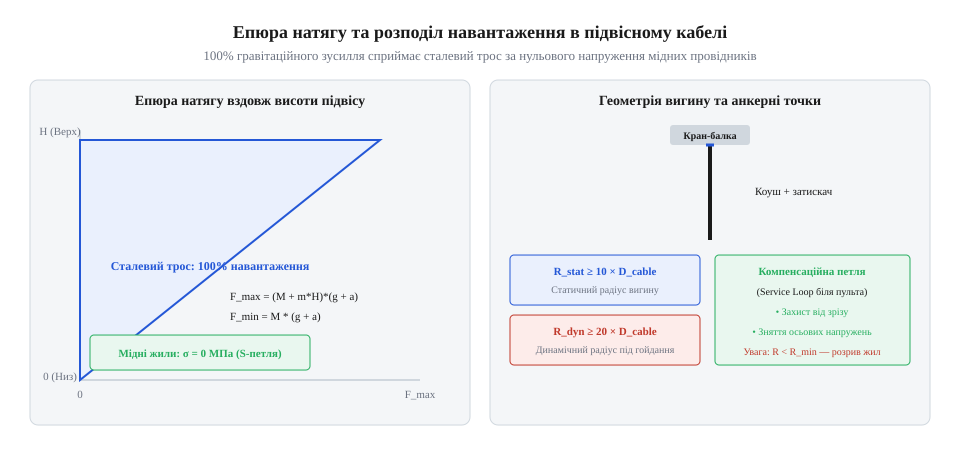

# Розрахунок механічних навантажень, радіуса вигину та міцності розвантажувального троса

<preknowlist>
- [Тросові та еластомірні віброізолятори: Wire Rope, силіконові демпфери та поглинання ударів](root:cat-hw-parts/wire-rope-isolators) — поглинання динамічних ударів і механічна поведінка сталевого троса під розтягом.
- [Монтажний провід 18 і 20 AWG](root:cat-hw-parts/hookup-wire) — механічна міцність мідних жил та їхня деформація при розтягуванні.
- [Класи міцності та матеріали кріплення: сталі 8.8–12.9, нержавійка A2/A4, титан Gr5 та задирання різьби](root:cat-hw-parts/fastener-strength-classes-and-materials) — границя плинності матеріалів та вибір коефіцієнта запасу міцності.
</preknowlist>

## Обрив провідників підвісного пульта

Підвісні кнопочні пульти (@@de|Hängetaster@@, підвісний кнопочний пульт) та виносні панелі керування верстатами (@@en|pendant station@@) працюють у жорстких умовах промислових цехів. Оператори постійно переміщують їх у робочій зоні, залишають висіти в повітрі або випадково випускають із рук. Кабель, що з'єднує такий пульт із шафою автоматики, піддається постійному впливу власної ваги, вигинів та динамічних ударів.

Головна проблема полягає в тому, що електричний кабель розробляють для передачі сигналів і живлення, а не для виконання функцій силового елемента (@@en|structural element@@). Внутрішні жили кабелю виготовляють із м'якої відпаленої міді (@@en|annealed copper@@, від англійського *anneal* — відпалювати для розм'якшення). Мідь має порівняно низьку межу текучості (@@en|yield strength@@, від англійського *yield* — поступатися, межа текучості відпаленої міді становить близько 60–100 МПа). Коли пульт масою від 2 до 5 кг підвішують безпосередньо за електричний кабель, власна вага створює постійне поздовжнє напруження розтягу в мідних жилах.

Якщо пульт падає з рук оператора, інерційне зусилля зупинки створює короткочасний сплеск сили, що багаторазово перевищує межу текучості міді. У результаті виникає пластична деформація: мідний провідник зазнає локального звуження (@@en|necking@@, від англійського *neck* — шийка, утворення шийки при розтягу), що зменшує його площу поперечного перерізу. Згідно із законом Ома та формулою питомого опору, зменшення перерізу провідника призводить до локального зростання електричного опору. У цій зоні виникає підвищений нагрів (@@en|joule heating@@), прискорена втома металу при вигинах та подальший повний механічний обрив провідника — виникає обрив кола (@@en|open circuit@@).

Найбільш критичною точкою виникнення руйнівних напружень є місце вводу кабелю (@@en|cable entry@@) у корпус пульта чи шафи. У цій зоні поздовжній розтяг поєднується з вигинальним моментом. Якщо жили кабелю затиснуті безпосередньо у клемник або припаяні до плати, як це буває, коли розглядають [механічну міцність мідних жил](root:cat-hw-parts/hookup-wire), розтягувальне зусилля діє прямо на контактне з'єднання. Це спричиняє виривання жил із клем чи зріз пайки по межі галтелі.

Щоб запобігти руйнуванню провідників, механічну функцію сприйняття ваги необхідно повністю відокремити від електричної функції передачі струму. Для цього застосовують розвантаження від натягу (@@en|strain relief@@) за допомогою спеціального силового елемента — сталевого розвантажувального троса (@@en|wire rope@@), вивчити [поведінку сталевих тросів](root:cat-hw-parts/wire-rope-isolators) під навантаженням можна на прикладі віброізоляторів. Трос фіксують за анкерні кронштейни на корпусах обладнання, беручи на себе всі поздовжні сили.

## Обчислення допустимого радіуса вигину кабелю

Навіть за наявності силового розвантажувального троса кабель підвісного пульта піддається циклічним вигинам під час переміщення оператором. Вигин кабелю з занадто малим радіусом призводить до незворотних деформацій зовнішньої оболонки, зміщення внутрішніх жил та прискореного втомного руйнування міді.

При зігнанні циліндричного кабелю зовнішнім діаметром `D` по дузі радіуса `R` (виміряного по нейтральній осі кабелю), зовнішній шар оболонки та провідників зазнає максимальної деформації розтягу, а внутрішній шар — стиску. Відносна деформація зовнішнього шару описується співвідношенням:

```
ε_max = D / (2 · R + D) ≈ D / (2 · R)
```

Якщо радіус вигину `R` занадто малий, деформація `ε_max` перевищує гранично припустиму деформацію ізоляційного полімеру та викликає мікропластичні зсуви у зовнішніх пошарових повивах мідних жил. При багаторазовому вигинанні й розгинанні в металі накопичуються мікротріщини, що знижує втомну міцність (@@en|fatigue strength@@, від латинського *fatigatio* — втомлюваність) і призводить до перелому жил.

Для обчислення мінімально допустимого радіуса вигину `R_min` використовують нормований безрозмірний коефіцієнт гнучкості `k`:

```
R_min = k · D
```

де:
- `R_min` — мінімальний радіус вигину кабелю по центральній осі (мм);
- `D` — зовнішній діаметр кабелю (мм);
- `k` — коефіцієнт гнучкості, який визначають за типом кабелю та умовами експлуатації.

Значення коефіцієнта `k` становлять:
- Фіксований стаціонарний монтаж (@@en|static installation@@): `k = 4 … 6`;
- Гнучкий підвіс у стані спокою (@@en|flexible suspension@@): `k = 8 … 10`;
- Динамічний рух під час роботи пульта (@@en|dynamic motion@@): `k = 12 … 15`;
- Високодинамічне застосування у кабелеукладачах та підвісних гірляндах: `k = 15 … 20`.

Розрахуємо мінімальний радіус вигину для підвісного кабелю діаметром `D = 16.0 мм` у статичному та динамічному режимах:

```
R_min_static = k_static · D
             = 8 · 16.0 mm          [обчислення радіуса для статичного підвісу]
             = 128.0 mm             [мінімальний радіус вигину у спокої]

R_min_dynamic = k_dynamic · D
              = 12 · 16.0 mm        [обчислення радіуса для динамічного руху]
              = 192.0 mm            [мінімальний радіус вигину при роботі]
```

Для підвищення гнучкості підвісних кабелів застосовують тонкожильні мідні провідники класу 5 або 6 (згідно з IEC 60228). Якщо використати одножильний [монтажний провід 18 AWG](root:cat-hw-parts/hookup-wire), радіус вигину доведеться збільшити у кілька разів через високі напруження вигину в товстій жилі.

Матеріал зовнішньої оболонки також визначає довговічність кабелю. Поліуретан (PUR, @@en|polyurethane@@) володіє значно вищою стійкістю до циклічного перегину та стирання порівняно з полівінілхлоридом (PVC, @@en|polyvinyl chloride@@). При трасуванні кабелю його вигини за потреби додатково фіксують [пластиковими хомутами для кабелю](root:cat-hw-parts/cable-ties) до несучих елементів із дотриманням розрахованого радіуса.

## Розподіл поздовжнього зусилля розвантажувальним тросом

Щоб мідні жили кабелю не зазнавали деформації від ваги пульта, у кабель вбудовують сталевий розвантажувальний трос (@@en|strain relief rope@@). Під дією зовнішнього розтягувального зусилля загальне навантаження розподіляється між сталевим силовим елементом та мідними жилами відповідно до їхньої осьової жорсткості (@@en|axial stiffness@@).


*Схема розподілу сил розтягу між силовим сталевим тросом і мідними жилами підвісного кабелю з позначенням радіуса вигину та точки анкерного кріплення.*

Складемо математичну модель розподілу сил. Припустимо, що сталевий трос та мідні жили жорстко затиснуті в кінцевих анкерах на довжині `L`. При видовженні кабелю на величину `ΔL` обома компонентами сприймається однакова відносна деформація `ε`:

```
ε = ΔL / L
```

Згідно із законом Гука (@@en|Hooke's law@@), поздовжня сила `F` у елементі з площею перерізу `A` та модулем Юнга (@@en|Young's modulus@@, модуль пружності, від імені англійського фізика Thomas Young) `E` дорівнює:

```
F = E · A · ε
```

Осьова жорсткість (@@en|axial rigidity@@) сталевого троса та сукупності мідних жил визначається як добуток модуля пружності на площу:

```
EA_St = E_St_eff · A_St
EA_Cu = E_Cu · A_Cu
```

де:
- `E_St_eff` — ефективний модуль пружності сталевого троса (~120 ГПа, з урахуванням кута завивки пасом);
- `A_St` — площа металевого перерізу троса (мм²);
- `E_Cu` — модуль пружності відпаленої міді (~110 ГПа);
- `A_Cu` — сумарна площа перерізу всіх мідних жил кабелю (мм²).

Загальне розтягувальне зусилля `F_total` дорівнює сумі сил у сталі та міді:

```
F_total = F_St + F_Cu
        = ε · (EA_St + EA_Cu)
```

Частка навантаження `alpha_St`, яку сприймає сталевий трос, дорівнює відношенню його жорсткості до сумарної жорсткості конструкції:

```
alpha_St = EA_St / (EA_St + EA_Cu)
```

Проведемо розрахунок для 12-жильного кабелю з жилами перерізом 0.75 мм² (`A_Cu = 9.0 мм²`) та вбудованим сталевим тросом діаметром 2.0 мм (`A_St = 1.8 мм²`):

```
EA_St = E_St_eff · A_St
      = 120000 N/mm² · 1.8 mm²       [обчислення осьової жорсткості троса]
      = 216000 N                     [жорсткість сталевого елемента]

EA_Cu = E_Cu · A_Cu
      = 110000 N/mm² · 9.0 mm²       [обчислення осьової жорсткості міді]
      = 990000 N                     [жорсткість мідної групи]

alpha_St = EA_St / (EA_St + EA_Cu)
         = 216000 N / 1206000 N      [розподіл без технологічного запасу]
         = 0.179                     [частка навантаження троса 17.9%]
```

Цей розрахунок викриває небезпечну інженерну пастку: якщо сталевий трос і мідні жили затиснуті абсолютно однаково за довжиною, трос бере на себе лише 17.9% навантаження, а 82.1% зусилля припадає на мідь через її велику сумарну площу!

Конструктивне розв'язання цієї проблеми полягає в створенні технологічного запасу довжини мідних жил (@@en|mechanical slack@@). Всередині кінцевих затискачів мідні жили укладають із невеликою слабиною (S-подібним вигином), а сталевий трос натягують першим. У результаті деформація міді дорівнює нулю (`ε_Cu = 0`), і сталевий трос приймає на себе 100% поздовжнього зусилля (`alpha_St = 1.0`), що повністю захищає мідь від розтягу. При конструюванні анкерних вузлів слід враховувати [класи міцності металів](root:cat-hw-parts/fastener-strength-classes-and-materials) для вибору гвинтів кріплення троса.

## Оцінка динамічних ударів та запасу міцності

Статичний розрахунок ваги пульта дає лише нижню межу навантаження. Основним джерелом руйнівних сил є динамічний удар (@@en|impact load@@), який виникає при падінні пульта з рук оператора до моменту повного натягу розвантажувального троса.

При вільному падінні пульта масою `m` з висоти `h_drop` потенційна енергія переходить у кінетичну, а після вибрання слабини троса — у потенційну енергію пружної деформації троса. Трос довжиною `L_rope` працює як поздовжня пружина з жорсткістю:

```
k_rope = EA_St / L_rope
```

Зрівнюючи роботу сили тяжіння та енергію пружної деформації `0.5 · k_rope · ΔL²`, отримуємо динамічний коефіцієнт навантаження (@@en|dynamic load factor@@) `K_d`:

```
K_d = 1 + √(1 + (2 · h_drop · k_rope) / (m · g))
```

Пікове динамічне зусилля `F_dynamic` обчислюється як:

```
F_dynamic = K_d · F_static
```

Розрахуємо динамічний удар для пульта масою `m = 2.5 кг`, що падає з висоти `h_drop = 0.5 м` на тросі довжиною `L_rope = 3.0 м` із жорсткістю `EA_St = 216000 Н`:

```
F_static = m · g
         = 2.5 kg · 9.81 m/s²        [обчислення статичної ваги пульта]
         = 24.525 N                  [статичне навантаження]

k_rope = EA_St / L_rope
       = 216000 N / 3.0 m            [обчислення жорсткості троса довжиною 3 м]
       = 72000 N/m                   [пружна жорсткість розвантажувального троса]

K_d = 1 + √(1 + (2 · h_drop · k_rope) / F_static)
    = 1 + √(1 + (2 · 0.5 m · 72000 N/m) / 24.525 N)   [підстановка параметрів падіння з 0.5 м]
    = 1 + √(1 + 2935.78)             [обчислення підкореневого виразу]
    = 1 + 54.19                      [динамічний коефіцієнт розтягу]
    = 55.19                          [пікове кратне зростання зусилля]

F_dynamic = K_d · F_static
          = 55.19 · 24.525 N         [обчислення пікової ударної сили]
          = 1353.5 N                 [динамічна сила при падінні]
```

Коефіцієнт запасу міцності (@@en|safety factor@@) `S_f` відносно розривного зусилля троса `F_break` обчислюється за формулою:

```
S_f = F_break / F_dynamic
```

Стандартний сталевий трос діаметром 2.0 мм із нержавіючої сталі A4 (конструкція 7x7) має розривне зусилля `F_break ≈ 2300 Н`. Для отриманої динамічної сили `F_dynamic = 1353.5 Н` запас міцності становить:

```
S_f = 2300 N / 1353.5 N
    = 1.70                           [фактичний запас міцності при падінні]
```

Значення `S_f = 1.70` є недостатнім для промислової експлуатації, оскільки інженерні стандарти безпеки вимагають мінімальний запас міцності `S_f ≥ 5 … 10` відносно статичної ваги та `S_f ≥ 2.0 … 3.0` відносно пікових динамічних ударів.

Щоб зменшити жорсткість підвісу `k_rope` та знизити динамічний коефіцієнт `K_d` в кілька разів, в анкерне кріплення троса вбудовують пружинні демпфери або [тросові віброізолятори та демпфери](root:cat-hw-parts/wire-rope-isolators). Це розсіює кінетичну енергію падіння, запобігає пластичній деформації троса та забезпечує високу втомну довговічність (@@en|fatigue life@@) усього підвісного вузла.