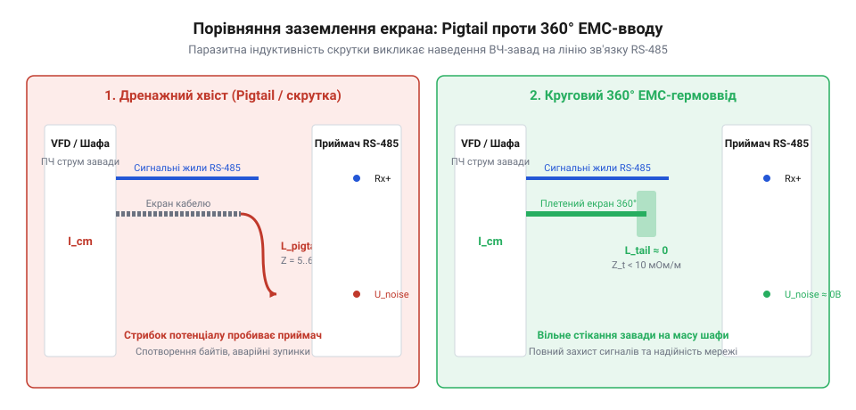
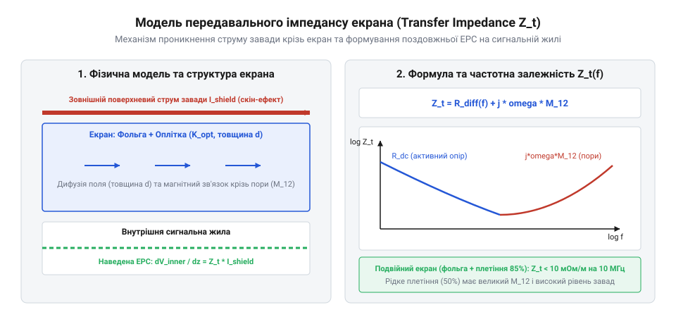

# Розрахунок передавального імпедансу екрана та паразитних струмів у земляних петлях

<preknowlist>
- [Ethernet-кабель RJ45](root:cat-hw-parts/ethernet-cable) — принципи побудови екранів кабелів та особливості заземлення витої пари
- [Монтажний провід 18 і 20 AWG](root:cat-hw-parts/hookup-wire) — омічний опір провідників та залежність падіння напруги від довжини й перерізу жил
</preknowlist>

## Помилки сигналів у підвісному кабелі

Під час експлуатації технологічного обладнання — наприклад, мостових кранів, підвісних кран-балок чи верстатів із рухомими пультами керування — сигнальний кабель перебуває у постійному русі. Інженери з автоматизації нерідко стикаються зі спотворенням даних від цифрових @@en|encoder@@ (від англ. encode — кодувати) та аналогових датчиків. Типовою реакцією на появу збоїв є жорстке заземлення екрана кабелю з обох боків: біля пульта та в шафі керування. Однак на практиці таке рішення часто не усуває завади, а навпаки погіршує роботу системи.

Причина полягає у виникненні різниці потенціалів заземлення `ΔV_g` між металевим корпусом рухомого пульта та головним заземлювальним шинопроводом шафи керування. Через велику протяжність цеху, роботу потужних частотних перетворювачів та омічний опір металоконструкцій струми витоку створюють між цими точками змінну напругу. Коли кабельний екран приєднано до заземлення з обох кінців, утворюється замкнений контур — земляна петля (@@en|ground loop@@, від англ. ground — земля та loop — петля). На відміну від стаціонарного з'єднання через [гнучкий монтажний провід](root:cat-hw-parts/hookup-wire) всередині захищеної шафи, підвісний кабель протягнутий у просторі, де присутні змінні магнітні поля від силових ліній.


*Еквівалентна електрична схема земляної петлі підвісного кабелю: виникнення паразитного струму через різницю потенціалів та вплив способу заземлення екрана на завадозахищеність.*

Різниця потенціалів `ΔV_g` змушує паразитний поверхневий струм `I_g` протікати безпосередньо по зовнішньому провіднику екранованого кабелю. Якщо для підключення екрана використано тонкий дренажний провідник (@@en|pigtail@@, від англ. pig tail — поросячий хвіст), на границі кабельного вводу виникає зосереджена паразитна індуктивність `L_pigtail`. На високих частотах ця індуктивність створює високий опір для струмів завади, через що струм перерозподіляється і створює високу напругу на сигнальних жилах. Натомість суцільний 360-градусний монтаж (@@en|360-degree shield clamp@@) забезпечує рівномірне охоплення кабелю й мінімальну індуктивність з'єднання, проте не зупиняє протікання самого струму `I_g` по екрану.

Струм земляної петлі `I_g`, протікаючи вздовж екрана, наводить поздовжнє електричне поле на внутрішній поверхні захисної оболонки. Оскільки сигнальні провідники розташовані всередині цього провідного циліндра, наведена напруга `V_ind` підсумовується з корисним сигналом сенсора. Для математичного розрахунку рівня цієї завади необхідно зв'язати величину поверхневого струму `I_g` з напругою, яка виникає на сигнальних жилах. Ключовою ланкою цього зв'язку виступає передавальний імпеданс екрана.

## Математична модель передавального імпедансу екрана

Передавальний імпеданс (@@en|transfer impedance@@, від англ. transfer — передача та lat. impedio — перешкоджати) описує ефективність екранування кабелю і кількісно визначає зв'язок між поверхневим струмом завади на зовнішній оболонці та наведеним поздовжнім електричним полем на внутрішніх сигнальних жилах. Математично передавальний імпеданс `Z_t` на одиницю довжини кабелю задається як відношення спаду напруги `dV_int` на внутрішній стороні екрана до повного зовнішнього струму `I_ext`, що протікає по екрану:

```
Z_t = (1 / I_ext) · (dV_int / dz)
= V_ind / (I_ext · L)                 [для однорідного кабелю довжиною L]
```

Одиницею вимірювання `Z_t` є Ом на метр (Ом/м). Чим менше значення передавального імпедансу має кабель на робочій частоті завади, тим кращий захист він забезпечує для сигнальних провідників.


*Фізична модель передавального імпедансу: поверхневий струм завади на зовнішній поверхні екрана наводить поздовжнє електричне поле на внутрішній жилі через дифузію та індуктивність отворів.*

Проникнення електромагнітної енергії крізь екран відбувається за двома основними фізичними механізмами, які визначаються конструкцією кабелю:

1. Дифузія електромагнітного поля крізь суцільний метал. Якщо кабель має суцільну фольгу (@@en|foil shield@@) або суцільну металеву оболонку товщиною `d`, на постійному струмі (`f = 0`) струм розподіляється по товщині рівномірно. При цьому `Z_t` дорівнює активному опору екрана на постійному струмі `R_dc`. Зі зростанням частоти проявляється поверхневий ефект (@@en|skin effect@@, від англ. skin — шкіра), який витісняє струм на зовнішню поверхню провідника. Глибина проникнення скин-шару `δ` обчислюється за формулою:

```
δ = √(1 / (π · f · μ · σ))
```

де `f` — частота завади, `μ` — абсолютна магнітна проникність металу екрана, `σ` — питома електропровідність. Передавальний імпеданс суцільного екрана зменшується з ростом частоти за експоненційним законом:

```
Z_t(f) = R_dc · ((1 + j) · d / δ) / sinh((1 + j) · d / δ)
```

На високих частотах, коли товщина фольги перевищує глибину скин-шару (`d >> δ`), значення `Z_t` прямує до нуля. Це означає, що суцільна фольга забезпечує ідеальне екранування високочастотних завад.

2. Проникання поля крізь отвори сітки. На відміну від суцільної фольги, плетене екранування (@@en|braid shield@@) складається з переплетених мідних пасом, між якими утворюються ромбоподібні отвори — апертури. Хоча поверхневий ефект витісняє струм на зовнішній бік пасом, лінії струму вимушені огинати апертури. Це створює магнітне поле проникання, яке описується взаємною індуктивністю отворів `M_h`. Тоді повний передавальний імпеданс плетеного екрана має активну та індуктивну складові:

```
Z_t(f) = Z_d(f) + j · 2 · π · f · M_h
```

де `Z_d(f)` — дифузійний імпеданс монолітного провідника, а `j` — уявна одиниця. На частотах понад 1 МГц індуктивний доданок `2 · π · f · M_h` починає домінувати, через що передавальний імпеданс плетеного екрана зростає пропорційно частоті. Для захисту від широкого спектра завад у промислових мережах, таких як [промисловому Ethernet-кабелі RJ45](root:cat-hw-parts/ethernet-cable), застосовують комбіноване екранування (фольга разом із плетеною сіткою). Таке поєднання використовується і в гнучких системах, де працює [капсульне ковзне кільце](root:cat-hw-parts/capsule-slip-ring) для передачі даних на рухомі вузли.

Для практичного оцінювання завадостійкості розглянемо розрахунок наведеної напруги завади для підвісного кабелю довжиною `L = 20 м`.

**Обчислення наведеної напруги завади на сигнальній жилі**
Кабель підвісного пульта має плетнений екран з омічним опором `R_dc = 0.015 Ом/м` та взаємною індуктивністю отворів `M_h = 1.2 нГн/м`. По екрану протікає струм земляної петлі `I_g = 100 мА` на частоті гармоніки частотного перетворювача `f = 5 МГц`.

```
Z_t = R_dc + j · 2 · π · f · M_h
|Z_t| = √((R_dc)² + (2 · π · f · M_h)²)
= √((0.015)² + (2 · π · 5 × 10⁶ · 1.2 × 10⁻⁹)²)    [підстановка частоти 5 МГц та індуктивності]
= √((0.015)² + (0.0377)²)                         [модуль реактивного опору отворів]
= √(0.000225 + 0.001421)                           [сумування квадратів складових]
= √0.001646 ≈ 0.0406 Ом/м                         [модуль передавального імпедансу]

V_ind = I_g · |Z_t| · L
= 0.1 · 0.0406 · 20                                [підстановка струму завади та довжини кабелю]
= 0.0812 В = 81.2 мВ                               [підсумкова наведена напруга завади]
```

Розрахунок показує, що при струмі земляної петлі 100 мА на сигнальній жилі виникає поздовжня завада амплітудою 81.2 мВ. Якщо інтерфейс датчика використовує дискретні рівні з низьким запасом завадостійкості або несиметричну передачу сигналів, така напруга призведе до хибних спрацьовувань та втрати пакетів даних.

## Розрахунок струмів у контурі заземлення

Коли підвісний пульт керування з'єднується з центральною шафою довгим кабелем, між двома точками заземлення виникає фізичний розрив потенціалів. У промисловому середовищі заземлювач шафи керування та металевий каркас верстата або балочної естакади рідко мають ідентичний потенціал. Несиметрія трифазної мережі, струми витоку потужних частотних перетворювачів та спрацьовування пускачів створюють різницю потенціалів `U_g` між землями. Одночасно з цим екран підвісного кабелю разом із металевими конструкціями будівлі утворює замкнену просторову петлю площею `A_loop`. Якщо крізь цю петлю проходить змінний магнітний потік від силових кабелів, згідно із законом електромагнітної індукції утворюється наведена електрорушійна сила `e_ind = -d\Phi/dt`. Обидва чинники змушують паразитний струм `I_g` протікати безпосередньо по зовнішньому екрану кабелю, перетворюючи його з засобу захисту на джерело завад.

Щоб обчислити амплітуду цього струму, необхідно розглянути еквівалентний імпеданс контуру заземлення `Z_loop`. Цей контур складається з омічного опору екрана `R_shield`, опору захисних провідників `R_PE` та розподіленої індуктивності петлі `L_loop`, яка визначається геометрією прокладання кабелю відносно заземлених металоконструкцій. Загальний імпеданс контуру як функція колової частоти `\omega = 2 \cdot \pi \cdot f` описується комплексним виразом:

```
Z_loop(\omega) = R_loop + j \cdot \omega \cdot L_loop
               = (R_shield + R_PE) + j \cdot \omega \cdot L_loop
```

Поведінка контуру кардинально змінюється на межі частоти спряження `f_c = R_loop / (2 \cdot \pi \cdot L_loop)`.

У низькочастотній області (наприклад, на частоті мережі `50` Гц), реактивний опір індуктивності `\omega \cdot L_loop` є мізерно малим порівняно з активним опором `R_loop`. Струм у земляній петлі @@en|ground loop@@ визначається виключно різницею потенціалів заземлювачів:

```
I_g(LF) = U_g / R_loop      [для f << f_c]
```

На високих частотах (від десятків кілогерц до мегагерц), де діють завади шим-модуляції інверторів, індуктивний опір `\omega \cdot L_loop` починає повністю домінувати над омічним опором. Струм у контурі визначається індуктивністю петлі та сумарною ЕРС:

```
I_g(HF) = (U_g + e_ind) / (j \cdot \omega \cdot L_loop)      [для f >> f_c]
```

Якщо основным джерелом є наведена магнітна ЕРС `e_ind = j \cdot \omega \cdot B \cdot A_loop`, де `B` — магнітна індукція завади, вираз для високочастотного струму спрощується:

```
I_g(HF) = (j \cdot \omega \cdot B \cdot A_loop) / (j \cdot \omega \cdot L_loop)
        = (B \cdot A_loop) / L_loop                          [насичення струму за частотою]
```

Це демонструє важливий фізичний ефект: амплітуда високочастотного струму завади в екрані при індуктивному наведенні перестає зростати з частотою і виходить на насичення, оскільки зростання наведеної ЕРС повністю компенсується зростанням індуктивного опору петлі.

Паразитний струм `I_g`, що протікає екраном кабелю довжиною `L`, наводить заваду на внутрішні сигнальні жили. Напруга завади `U_noise` спільного режиму (@@en|common mode noise@@) прямо пропорційна струму екрана та передавальному імпедансу кабелю `Z_t`:

```
U_noise(\omega) = I_g(\omega) \cdot Z_t(\omega) \cdot L
```

Згадаємо, що якщо використовується якісний [екранований Ethernet-кабель](root:cat-hw-parts/ethernet-cable), його передавальний імпеданс на низьких частотах дорівнює активному опору екрана на постійному струмі `R_dc`, а на високих частотах зростає через індуктивність зв'язку отворів оплітки `M_12`.


*Схема заміщення земляної петлі підвісного кабелю, де різниця потенціалів заземлення U_g та наведена ЕРС e_ind викликають струм I_g крізь передавальний імпеданс Z_t.*

**Обчислення струмів та напруги завади для 30-метрового підвісного кабелю**

Розглянемо практичний приклад. Підвісний пульт з'єднаний із шафою керування кабелем довжиною `L = 30` м. Опір екрана кабелю на постійному струмі `R_shield = 0.4` Ом (`13.3` мОм/м). Індуктивність земляного контуру `L_loop = 45` мкГн (`1.5` мкГн/м). Передавальний імпеданс кабелю на частоті `1` МГц становить `Z_t(1 MHz) = 15` мОм/м (загальний імпеданс `Z_t \cdot L = 0.45` Ом). Між шафою та пультом діє низькочастотна різниця потенціалів `U_g(50 Hz) = 1.5` В, а також високочастотна завада від частотного перетворювача `U_g(1 MHz) = 6` В.

Обчислимо опір контуру та струми для двох частот:

```
\omega_50 = 2 \cdot \pi \cdot 50 = 314.16 rad/s
X_L(50 Hz) = 314.16 \cdot 45 \cdot 10⁻⁶ = 0.0141 Ohm
Z_loop(50 Hz) = \sqrt{0.4² + 0.0141²} \approx 0.4002 Ohm
I_g(50 Hz) = 1.5 / 0.4002 = 3.748 A      [низькочастотний струм земляної петлі]

\omega_1M = 2 \cdot \pi \cdot 10⁶ = 6.283 \times 10⁶ rad/s
X_L(1 MHz) = 6.283 \times 10⁶ \cdot 45 \cdot 10⁻⁶ = 282.74 Ohm
Z_loop(1 MHz) = \sqrt{0.4² + 282.74²} \approx 282.74 Ohm
I_g(1 MHz) = 6 / 282.74 = 0.0212 A = 21.2 mA      [високочастотний струм земляної петлі]
```

Тепер визначимо наведену напругу завади на сигнальних жилах на частоті `1` МГц:

```
U_noise(1 MHz) = I_g(1 MHz) \cdot Z_t(1 MHz) \cdot L
               = 0.0212 \cdot 0.015 \cdot 30
               = 0.0212 \cdot 0.45 = 0.00954 V = 9.54 mV
```

Як бачимо, низькочастотна різниця потенціалів створює масивний струм `3.75` А, який може викликати перегрів екрана та завади промислової частоти. Високочастотна ж завада через великий реактивний опір петлі створює струм всього `21.2` мА, проте через зростання `Z_t` наводить на сигнальній жилі заваду амплітудою `9.54` мВ, що є критичним для чутливих аналогових датчиків.

## Вплив способу заземлення екрана

Навіть якщо вибрано кабель із найнижчим власним передавальним імпедансом, захист від завад може бути повністю знівельований помилковим способом монтажу. У промисловій практиці монтажники часто знімають зовнішню оболонку кабелю, скручують оплітку екрана у тонку косичку — так званий «хвіст» або @@en|pigtail@@ — і підключають його до клемника заземлення. З погляду електродинаміки, таке скручування руйнує коаксіальну симетрію струмів і додає в контур заземлення зосереджену паразитну індуктивність `L_pigtail`. На високих частотах ця індуктивність діє як високий імпедансний бар'єр безпосередньо в точці з'єднання екрана з корпусом шафи керування.

Індуктивність прямолінійного провідника круглого перерізу довжиною `l_pig` та радіусом `r_pig` обчислюється за наближеною формулою:

```
L_pigtail \approx (\mu_0 \cdot l_pig / (2 \cdot \pi)) \cdot [ \ln( (2 \cdot l_pig) / r_pig ) - 0.75 ]
```

Практичне правило свідчить: кожен міліметр довжини «хвоста» додає приблизно `1` нГн індуктивності (`10` нГн на сантиметр). Сумарний ефективний передавальний імпеданс лінії з урахуванням з'єднання становить:

```
Z_eff(\omega) = Z_t(\omega) \cdot L + j \cdot \omega \cdot L_pigtail
```

Оскільки реактивний опір `\omega \cdot L_pigtail` зростає лінійно з частотою `f`, вже на частотах понад `1` МГц імпеданс короткого «хвоста» довжиною всього кілька сантиметрів перевищує власний передавальний імпеданс цілого 20-метрового кабелю. Падіння напруги завади на індуктивності хвоста `U_pigtail = I_g \cdot \omega \cdot L_pigtail` прикладається безпосередньо між екраном та корпусом шафи, проникаючи всередину кабелю.

На противагу цьому, суцільний 360-градусний монтаж екрана в спеціальному ЕМС-кабельному вводі (@@en|EMC cable gland@@) охоплює екран по всьому периметру. Це зберігає коаксіальний розподіл струму та знижує індуктивність контакту до величини `L_360 \approx 0.05 ... 0.1` нГн, що є зневажливо малим значенням.


*Залежність сумарного імпедансу заземлення екрана від частоти: реактивний опір pigtail стрімко зростає, руйнуючи ефективність екранування на ВЧ.*

Погіршення коефіцієнта екранування (@@en|shielding effectiveness loss@@) при використанні «хвоста» замість 360-градусного вводу обчислюється у децибелах як відношення модулів імпедансів:

```
SE_loss = 20 \cdot lg( |Z_eff(pigtail)| / |Z_eff(360)| )
        = 20 \cdot lg( |Z_t \cdot L + j \cdot \omega \cdot L_pigtail| / |Z_t \cdot L + j \cdot \omega \cdot L_360| )
```

**Порівняльний розрахунок коефіцієнта згасання завад**

Проведемо розрахунок для кабелю довжиною `L = 20` м з власним передавальним імпедансом `Z_t = 10` мОм/м на частоті `f = 10` МГц (`\omega = 6.283 \times 10⁷` рад/с). Власний опір екрана становить `Z_cable = Z_t \cdot L = 0.010 \cdot 20 = 0.2` Ом.

Розглянемо два варіанти монтажу:
1. Варіант А: екран підключено через «хвіст» довжиною `l_pig = 8` см (`L_pigtail \approx 80` нГн). Для монтажу використано звичайні [ізольовані наконечники Faston](root:cat-hw-parts/faston-crimp-terminals), які обтиснуто на кінці дренажної косички. 2. Варіант Б: екран затиснуто по колу в ЕМС-вводі з індуктивністю `L_360 = 0.1` нГн.

Обчислимо реактивні опори та сумарні імпеданси:

```
X_pigtail = \omega \cdot L_pigtail = 6.283 \times 10⁷ \cdot 80 \cdot 10⁻⁹ = 5.026 Ohm
Z_eff(pigtail) = \sqrt{0.2² + 5.026²} \approx 5.030 Ohm

X_360 = \omega \cdot L_360 = 6.283 \times 10⁷ \cdot 0.1 \cdot 10⁻⁹ = 0.00628 Ohm
Z_eff(360) = \sqrt{0.2² + 0.00628²} \approx 0.2001 Ohm
```

Визначимо втрату ефективності екранування в децибелах:

```
SE_loss = 20 \cdot lg( 5.030 / 0.2001 )
        = 20 \cdot lg( 25.137 )
        \approx 28.01 dB
```

Результат розрахунку показує, що звичайний монтажний «хвіст» довжиною 8 см на частоті 10 МГц збільшує імпеданс з'єднання у `25` разів і погіршує захист від завад на `28` дБ. Це означає, що понад `96%` амплітуди високочастотної завади проникає на сигнальні жили виключно через незахищену точку заземлення, зводячи нанівець якість самого екранованого кабелю.

## Оптимізація схеми екранування та заземлення

Вибір схеми заземлення екрана підвісного кабелю завжди є компромісом між усуненням низькочастотних струмів земляної петлі та забезпеченням захисту від високочастотних електромагнітних завад.

При односторонньому заземленні (зазвичай на боці шафи керування) земляний контур `I_g = 0` повністю розривається. Це повністю усуває завади 50 Гц. Проте незаземлений кінець кабелю на пульті керування перетворюється на чвертьхвильову антену. На частотах, де довжина кабелю дорівнює `\lambda / 4`, виникає резонанс, а ємнісний зв'язок легко наводить високочастотні завади від силових джгутів.

Двостороннє пряме заземлення забезпечує ідеальний коаксіальний захист на високих частотах, але створює описану в розділі 3 земляну петлю. Якщо різниця потенціалів `U_g` значна, це призводить до перегріву екрана та спотворення сигналів.

Для вирішення цієї проблеми застосовують паралельний провідник вирівнювання потенціалів (@@en|parallel earth conductor@@, PEC). Поруч із підвісним кабелем прокладають мідний [монтажний провід](root:cat-hw-parts/hookup-wire) великого перерізу (наприклад, `16`–`25` мм²). Оскільки активний опис `R_PEC` значно менший за опір тонкого екрана `R_shield`, паразитний струм розподіляється обернено пропорційно опорам:

```
I_shield = I_g \cdot ( R_PEC / (R_shield + R_PEC) )
```

Це дозволяє скинути понад `90%` низькочастотного струму земляної петлі на силовий провідник PEC, захистивши екран кабелю.

Якщо прокладання додаткового товстого провідника вирівнювання потенціалів механічно неможливе у підвісному джгуті, оптимальним рішенням є гібридне заземлення (@@en|hybrid grounding@@). За цієї топології екран кабелю з'єднується з корпусом шафи керування напряму через 360-градусний ввід, а на боці підвісного пульта — через декомпресійний керамічний або плівковий конденсатор `C_h` з низькою власною індуктивністю (@@en|equivalent series inductance@@, ESL).

Еквівалентний імпеданс гібридного закінчення описується виразом:

```
Z_hybrid(\omega) = R_ESR + j \cdot \omega \cdot L_ESL + 1 / (j \cdot \omega \cdot C_h)
```

Схема працює як частотно-вибірковий фільтр:
1. На низьких частотах (`50` Гц) реактивний опір конденсатора `X_C = 1 / (2 \cdot \pi \cdot f \cdot C_h)` є дуже високим. Конденсатор розриває гальванічний ланцюг для постійного струму та частоти 50 Гц, блокуючи струми земляної петлі. 2. На високих частотах (`> 1` МГц) реактивний опір `X_C` прямує до нуля. Конденсатор закорочує екран на корпус пульта за змінним струмом, забезпечуючи повноцінне 360-градусне високочастотне екранування.

Для запобігання накопиченню статичного заряду паралельно конденсатору підключають високоомний розрядний резистор `R_h \approx 1` МОм.


*Топологія гібридного заземлення: прямо заземлений екран у шафі керування та послідовний RC-ланцюг у пульті керування для блокування низькочастотних петльових струмів.*

**Розрахунок параметрів керамічного конденсатора гібридного заземлення**

Обчислимо опір гібридного заземлення з конденсатором ємністю `C_h = 100` нФ (`10⁻⁷` Ф) та власним опором `R_ESR = 0.05` Ом для двох частотних режимів: `50` Гц та `1` МГц.

```
\omega_50 = 2 \cdot \pi \cdot 50 = 314.16 rad/s
X_C(50 Hz) = 1 / (314.16 \cdot 10⁻⁷) = 31831 Ohm = 31.83 kOhm
Z_hybrid(50 Hz) \approx 31.83 kOhm      [розрив низькочастотної петлі]

\omega_1M = 2 \cdot \pi \cdot 10⁶ = 6.283 \times 10⁶ rad/s
X_C(1 MHz) = 1 / (6.283 \times 10⁶ \cdot 10⁻⁷) = 1.591 Ohm
Z_hybrid(1 MHz) = \sqrt{0.05² + 1.591²} \approx 1.592 Ohm      [низький опір для ВЧ завад]
```

При виборі компонента слід обирати керамічні конденсатори типу X7R з робочою напругою `V_c \ge 500` В, стійкі до імпульсних перенапруг. Якщо підвісний пульт має обертову секцію і використовує [капсульне ковзне кільце](root:cat-hw-parts/capsule-slip-ring), гібридне заземлення встановлюють безпосередньо перед обертовим контактом, а виводи вирівнювання потенціалів фіксують через [пластикові хомути](root:cat-hw-parts/cable-ties) для запобігання механічному стиранню.

**Алгоритм вибору топології заземлення підвісного кабелю**

Щоб вибрати оптимальну схему заземлення у реальному промисловому проекті, слід дотримуватись такого послідовного алгоритму:

1. **Оцінка частотного спектра завад**:
   - Якщо в системі відсутні джерела потужних високочастотних завад (відсутні частотні перетворювачі, сервоприводи), а довжина кабелю `< 10` м — використовують **одностороннє заземлення** на боці шафи. 2. **Вимірювання різниці потенціалів `U_g`**:
   - Вимірюють змінну напругу між корпусом шафи та заземленням пульта при відключеному екрані. - Якщо `U_g < 0.2` В — застосовують **двостороннє пряме 360-градусне заземлення** в ЕМС-кабельних вводах з обох боків. 3. **Захист від високочастотних завад при наявності `U_g > 0.5` В**:
   - Якщо в джгуті є вільне місце — монтують **паралельний провідник вирівнювання потенціалів (PEC)** перерізом не менше `16` мм² та виконують двостороннє пряме заземлення екрана. - Якщо прокладання PEC неможливе — монтують **гібридне заземлення**: пряме 360-градусне з'єднання в шафі керування та з'єднання через RC-ланцюг (`C_h = 10 ... 100` нФ, `R_h = 1` МОм) у підвісному пульті.

Дотримання цього математично обґрунтованого підходу дозволяє мінімізувати наведення завад на сигнальні жили до рівнів, що не перевищують одиниць мілівольт, гарантуючи надійну та безперебійну роботу промислового обладнання.