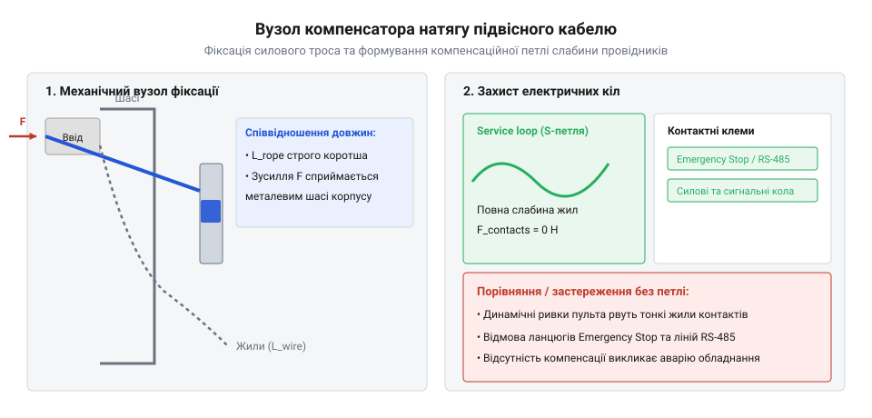
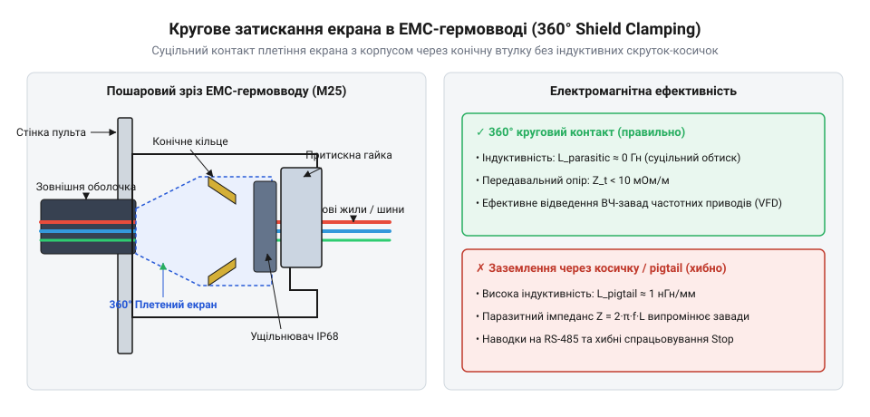

# Практичний монтаж та випробування екранованого підвісного кабельного шлейфу пульта

<preknowlist>
- [Монтажний провід 18 і 20 AWG](root:cat-hw-parts/hookup-wire) — зачистка суцільних та багатожильних провідників і допустимі радіуси вигину
- [Хомути пластикові](root:cat-hw-parts/cable-ties) — фіксація внутрішніх кабельних джгутів усередині корпусів та запобігання перетисканню ізоляції
- [Ізольовані наконечники Faston та технологія обтискання](root:cat-hw-parts/faston-crimp-terminals) — техніка опресування наконечників для комутації силових кіл і заземлення
- [Класи міцності та матеріали кріплення: сталі 8.8–12.9, нержавійка A2/A4, титан Gr5 та задирання різьби](root:cat-hw-parts/fastener-strength-classes-and-materials) — вибір металевого кріплення для затискачів сталевих несучих тросів
</preknowlist>

## Руйнування контактів у підвісних пультах

Промислові підвісні пульти керування мостовими кранами, талями та важким підйомним обладнанням працюють у надзвичайно жорстких умовах постійних механічних навантажень, вібрацій та динамічних ривків. Під час експлуатації кабельний джгут зазнає багаторазових вигинів і розтягувань під впливом власної маси, яка на великих висотах підйому може досягати значних величин. Зокрема, для типового 16-жильного підвісного кабелю довжиною L = 15 м із погонною масою m_lin = 0.45 кг/м статична вага становить F_stat = m_lin * L * g = 0.45 * 15 * 9.81 ≈ 66.2 Н, а під час екстреного гальмування чи різкого підйому з прискоренням a_dyn = 2.5 м/с² динамічне навантаження зростає за формулою F_total = m_lin * L * (g + a_dyn) = 0.45 * 15 * (9.81 + 2.5) ≈ 83.1 Н, доповнюючись імпульсними ривками оператора з піковими зусиллями до 250–300 Н. Якщо виконати прямоточне підключення багатожильного підвісного кабелю безпосередньо до клемних колодок плати керування чи роз'ємів усередині корпусу пульта, вся механічна енергія натягу й коливань передаватиметься безпосередньо на тонкі мідні провідники. Це неминуче призводить до втомного руйнування металу, появи мікротріщин у зоні пайки та обриву жил під дією багаторазових циклів вигину і деформації.

Для запобігання подібним аваріям у конструкції передбачається спеціальний несучий сталевий трос, який сприймає на себе всю поздовжню напругу від розтягування. Механіка передачі навантаження побудована на чіткому розділенні функцій: сталевий трос жорстко затискається в корпусних елементах корпусу та підвісу, повністю розвантажуючи електричні провідники від поздовжнього розтягуючого зусилля. Поняття @@en|strain relief@@ (компенсація натягу) визначає комплекс конструктивних заходів і механічних затискачів, які гарантують, що зовнішнє тягнуче зусилля передається на конструктивні елементи каркаса, а не на мідні жили кабелю. Сам підвісний кабель із групою сигнальних та силових провідників, що забезпечують передачу команд від кнопок, утворює так званий @@en|pendant cable@@, який має бути ретельно збалансований за довжиною та механічною гнучкістю.

Під час монтажу критично важливо забезпечити правильний запас слабини провідників відносно зафіксованої точки сталевого троса. Якщо залишити жили занадто натягнутими, будь-які температурні коливання або динамічні ривки спричинять передачу поздовжнього напруження на паяні з'єднання. З іншого боку, надмірна слабина створює ризик защемлення провідників рухомими елементами або внутрішніми стінками корпусу пульта. Тому жили внутрішнього розводіння укладаються з контрольованим запасом у вигляді невеликої компенсаційної петлі. Для забезпечення надійного електричного зв'язку та комутації окремих кіл використовують попередньо підготовлені жили з використанням [монтажних проводів 18 і 20 AWG](root:cat-hw-parts/hookup-wire), які зачищаються з дотриманням допустимих радіусів вигину. Для опресування кінців провідників та підключення силових кіл застосовують [ізольовані наконечники Faston](root:cat-hw-parts/faston-crimp-terminals), що гарантують якісний контакт і стійкість до вібрацій. Крім того, фіксація внутрішніх джгутів та формування акуратних трас усередині пульта виконується за допомогою [пластикових кабельних хомутів](root:cat-hw-parts/cable-ties), які виключають перетискання ізоляції. Механічні затискачі троса збираються із застосуванням якісного металевого кріплення, причому вибір класу міцності регламентується вимогами стандартів для [класів міцності кріплення](root:cat-hw-parts/fastener-strength-classes-and-materials), що виключає зрив різьби чи самовідгвинчування під дією вібрацій.

## Зачистка кабелю та фіксація троса

Технологія монтажу підвісного кабельного шлейфу починається з акуратного зняття зовнішньої захисної оболонки кабелю без найменшого пошкодження внутрішнього екрана та ізоляції сигнальних жил. Зовнішня оболонка з поліуретану або спеціального зносостійкого ПВХ зрізається на довжину, визначену конструктивною документацією корпусу пульта, зазвичай на ділянці 150–200 мм від кінця кабелю. Під час зачистки використовують спеціалізований інструмент для зняття ізоляції, контролюючи глибину різу, щоб не надрізати плетлений металевий екран, який слугує для захисту від електромагнітних завад. Після оголення екрана та внутрішніх провідників проводиться розділення силових і сигнальних ліній, а несучий сталевий трос звільняється від захисних шарів для безпосереднього затискання в механічному вузлі.

Фіксація сталевого троса в механічному затискачі компенсатора натягу є відповідальною операцією, від якої залежить безпека експлуатації всього виробу. Трос заводиться в клиновий або губчастий затискач компенсатора натягу, де створюється необхідне зусилля тертя для запобігання прослизанню під максимальним робочим навантаженням. Залежно від номінального діаметра несучого троса застосовують регламентовані зусилля фіксації: для троса діаметром d = 2.0 мм використовують різьбові затискачі М4 із крутним моментом затягування T = 2.8–3.2 Н·м, тоді як для посиленого троса діаметром d = 3.0 мм застосовують шпильки або болти М5 із нормованим моментом T = 5.5–6.0 Н·м (для класу міцності сталі 8.8). Затискання клинової колодки виконують рівномірно у два проходи динамометричним ключем, щоб уникнути одностороннього перекосу сухарів і пластичної деформації зовнішніх сталевих пасом троса. На цьому етапі обов'язково формується спеціальна компенсаційна петля провідників зі слабиною 20–30 мм, яка забезпечує повну механічну розв'язку контактної групи від будь-яких відривних зусиль.

*Вузол кріплення несучого сталевого троса в механічному затискачі компенсатора натягу зі сформованою петлею та запасом слабини провідників.*

Сформована петля розвантаження натягу, відома як @@en|service loop@@, дозволяє нівелювати мікрозміщення кабелю та захищає комутаційні клеми від механічних руйнувань. Одночасно під час проектування та укладання джгута суворо контролюється мінімальний радіус вигину провідників, або @@en|bend radius@@, значення якого не повинно перевищувати допустимі виробником кабелю норми, щоб уникнути виникнення внутрішніх механічних напружень у мідних жилах.

## Монтаж 360-градусного екранованого кабельного вводу

Під час експлуатації промислових підвісних пультів у зонах підвищених електромагнітних завад від частотних перетворювачів, потужних двигунів та силових кабелів виникає серйозна проблема наводок на сигнальні кола. Традиційний метод підключення екрана за допомогою тонкого одиночного провідника, відомого як @@en|pigtail@@ (кісичка), є неефективним на високих частотах через значну індуктивність такого виводу, яка перешкоджає ефективному відведенню високочастотних струмів перешкод на корпус. Для усунення цього недоліку застосовують технологію кругового 360-градусного затискання екрана в спеціальному металевому гермовводі @@en|EMC cable gland@@.

Процес монтажу такого вводу вимагає акуратного відгинання та розпушування плетеного мідного або лудженого екрана кабелю на довжину, що відповідає посадочній зоні гермовводу. Зовнішня оболонка кабелю знімається на ділянці, яка точно збігається з місцем розташування пружинного або конічного контактного кільця всередині кабельного вводу. Під час закручування гайки вводу конічні кільця створюють рівномірний тиск по всій окружності плетеного екрана, забезпечуючи низькоопірний металевий контакт між екраном кабелю та заземленим корпусом пульта.

*Пошаровий розріз електромагнітного кабельного вводу з круговим 360-градусним контактом плетеного екрана.*

Таке технічне рішення гарантує мінімальний імпеданс перехідного контакту та ефективне шунтування високочастотних завад безпосередньо на шасі обладнання, забезпечуючи високу надійність передачі сигналів та стабільну роботу комунікаційних інтерфейсів.

## Трасування жил та розділення кіл

Маючи захищений та заземлений кабель на вході в корпус пульта, необхідно організувати внутрішнє трасування провідників із суворим дотриманням електромагнітної сумісності (@@en|EMC@@). Усередині компактного простору пульта суміщаються високовольтні або силові кола комутації привода, ланцюги аварійної зупинки та чутливі диференціальні лінії зв'язку, такі як інтерфейси @@en|RS-485@@ чи @@en|CAN bus@@. Неправильне укладання джгутів неминуче призводить до виникнення перехресних перешкод @@en|cross-talk@@ та знижує надійність передачі команд.

Для запобігання електромагнітним наводкам застосовується просторове розділення кіл. Силові лінії та лінії керування двигунами розводяться в одному боці корпусу, тоді як сигнальні інтерфейси прокладаються якомога далі від них. Якщо перетин силових та сигнальних трас неминучий, він має виконуватися виключно під прямим кутом (90 градусів), що мінімізує ємнісні та індуктивні зв'язки між провідниками. Для комутації живильних кіл та підключення елементів керування використовуються гнучкі [монтажних проводів 18 і 20 AWG](root:cat-hw-parts/hookup-wire), які забезпечують необхідний переріз та допустимий радіус вигину без деградації мідної жили.

Особливу увагу приділяють ланцюгу аварійної зупинки (Emergency Stop), який за стандартом виконується як замкнений нормально-замкнений контур @@en|Normally Closed (NC)@@. Цей ланцюг повинен мати фізично відокремлений шлях трасування та безпосередньо комутуватися з апаратними реле безпеки без проходження через чутливі цифрові буфери мікроконтролерів. Для фіксації внутрішніх джгутів у проєктному положенні використовуються [пластикових кабельних хомутів](root:cat-hw-parts/cable-ties), які надійно утримують пучки дротів, запобігаючи їх перетисканню кришкою корпусу та механічному натягуванню термінальних точок.

Усі сигнальні лінії інтерфейсу @@en|RS-485@@ трасуються у вигляді скрученої пари в загальному екрані, причому екран обов'язково заземлюється на шасі в одній точці або через круговий затискач гермоввода, уникаючи утворення земляних петель @@en|ground loops@@. Для стабільної комутації сигналів та живлення на платах управління задіюються [ізольованих наконечників Faston](root:cat-hw-parts/faston-crimp-terminals), які забезпечують надійний нероз'ємний механічний і електричний контакт, стійкий до вібрацій та ударних навантажень під час щоденної експлуатації підвісного пульта.

Для реалізації апаратної обробки сигналів та комунікації використовується спеціалізоване програмне забезпечення. Програма опитування стану кнопок підвісного пульта, перевірки лінії Emergency Stop та обробки помилок передачі даних по шині RS-485 наведена у вставці нижче. :::code proj-industrial-pendant-harnessing-assembly/c/main.c
:::code proj-industrial-pendant-harnessing-assembly/c/pendant_controller.c
:::code proj-industrial-pendant-harnessing-assembly/c/pendant_controller.h
:::code proj-industrial-pendant-harnessing-assembly/cpp/main.cpp
:::code proj-industrial-pendant-harnessing-assembly/cpp/pendant_driver.cpp
:::code proj-industrial-pendant-harnessing-assembly/cpp/pendant_driver.hpp

## Інструментальні випробування та усунення дефектів

Після завершення механічного монтажу, трасування жил та фіксації всіх елементів усередині корпусу підвісного пульта необхідно провести комплекс інструментальних випробувань для підтвердження електричної безпеки та механічної міцності виробу. Первинним етапом є перевірка цілісності та якості заземлення екрана кабелю. За допомогою міліометра Кельвіна (чотирипровідна схема вимірювання) визначається перехідний опір між металевим корпусом пульта, зовнішнім 360-градусним гермовводом та точкою підключення захисного провідника на шасі. Отримане значення опору не повинно перевищувати 10 міліом, що гарантує ефективне відведення високочастотних завад і відповідність вимогам @@en|galvanic isolation@@ та електромагнітної сумісності.

Наступним кроком є тестування електричних кіл на відсутність коротких замикань та обривів. Вимірюється опір ізоляції між силові провідниками і заземленим екраном за допомогою мегаомметра при випробувальній напрузі 500 В постійного струму. Особлива увага приділяється перевірці ланцюга аварійної зупинки: розмикання контакту кнопки E-Stop повинно миттєво фіксуватися апаратною системою безпеки без жодних затримок.

Механічна перевірка підвісного вузла включає статичне випробування на розривне зусилля. Оскільки підвісний кабель разом із несучим тросом сприймає всю вагу пульта та динамічні ривки під час експлуатації, зібраний вузол компенсатора натягу випробовується пробним статичним зусиллям 1.5 кН протягом 3 хвилин. Під час випробування не допускається прослизання троса в затискачах, деформація корпусу кабельного вводу чи пошкодження зовнішньої оболонки кабелю.

У процесі випробувань можуть виявлятися типові дефекти монтажу. До них належать пошкодження ізоляції провідників об гострі крайки металевого корпусу, ослаблення гвинтових затискачів через вібраційне розкручування або порушення цілісності паяних і обтискних з'єднань. Усі виявлені дефекти підлягають негайному усуненню шляхом переобтискання клем, встановлення додаткових захисних кембриків та перевірки моменту затяжки різьбових з'єднань за допомогою динамометричного інструменту.