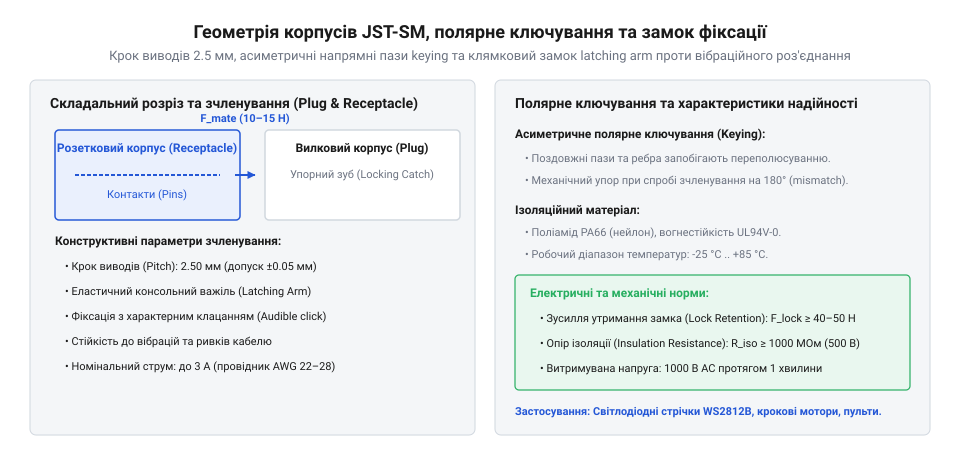
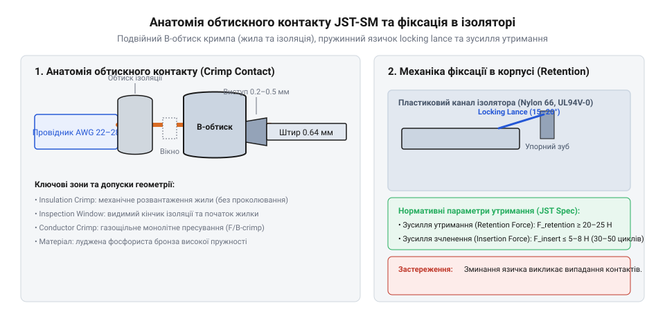

# Залізний інтерфейс роз'ємів JST-SM: розпиновка, геометрія та електричні параметри

<preknowlist>
- [Dupont дроти (M-M/M-F/F-F)](root:cat-hw-parts/dupont-wires) — обмеження відкритих штирових з'єднувачів при вібраціях та ризики самовільного розмикання незахищених контактних груп
- [Монтажний провід 18 і 20 AWG](root:cat-hw-parts/hookup-wire) — систему калібрів провідників AWG, геометричні характеристики струмоведучих жил та правила підбору ізоляції під електричний струм
- [Ізольовані наконечники Faston та технологія обтискання](root:cat-hw-parts/faston-crimp-terminals) — технологію пластичної деформації металевих хвостовиків клем кримпером та фізику створення газощільного обтискного контакту
- [Тросові та еластомірні віброізолятори: Wire Rope, силіконові демпфери та поглинання ударів](root:cat-hw-parts/wire-rope-isolators) — вплив циклічних вібраційних навантажень на механічну втомлюваність пластикових корпусів і металевих елементів фіксації роз'ємів
</preknowlist>

## Чому роз'єднання сигнальних джгутів руйнує обладнання

В умовах експлуатації робототехнічних комплексів, безпілотних літальних апаратів та промислових верстатів кабельні джгути зазнають постійного впливу циклічних вібрацій, різких прискорень і теплового розширення. Прагнучи швидко з'єднати міжблочні кола живлення чи керування, розробники часто застосовують нефіксовані з'єднувачі на основі [відкритих штирових з'єднувачів](root:cat-hw-parts/dupont-wires). Проте в умовах змінних механічних навантажень сила тертя між гладкими контактами не здатна втримати з'єднання. Контакти поступово висуваються з каналів, створюючи нестабільний електричний контакт, мікродугові розряди та спадки напруги. У колах живлення мікроконтролерів це викликає спонтанні перезавантаження, а в сигнальних шинах — спотворення даних та хибні спрацьовування датчиків.

Аварійне розмикання кола під навантаженням супроводжується іскрінням, яке окислює поверхню металу та випалює захисне луджене покриття. Ще небезпечнішою є ситуація, коли під час обслуговування або через зсув незахищеного джгута відбувається зміщення роз'єму на один крок або його дзеркальне сочленення. Випадкова переполюсовка подає високий потенціал живлення на чутливі виводи системних контролерів, що призводить до миттєвого пробою напівпровідникових структур та виходу з ладу силових ключових транзисторів.

Для усунення цих ризиків конструкція міжпровідного з'єднувача мусить мати два обов'язкові балістичні захисти. Перший — це механізм @@en|keying@@ (англ. *key* — ключ, напрямна), який асиметричними геометричними виступами фізично унеможливлює неправильне вставлення вилки в розетку. Другий — жорсткий корпусний замок @@en|latching lock@@ (англ. *latch* — засувка, фіксатор), який механічно блокує роз'єднання корпусів доти, доки оператор свідомо не натисне на вивільняльний важіль. Саме ці принципи покладено в основу геометрії міжпровідних роз'ємів серії JST-SM.

## Геометрія корпусів, кроку та полярного ключування

Роз'єми серії JST-SM спроєктовані як компактні міжпровідні з'єднувачі типу «провід–провід» із міжконтактною відстанню (кроком) 2,5 мм (0,098 дюйма). Вони випускаються у дворядних та однорядних конфігураціях із кількістю виводів від 2 до 8, що робить їх універсальним стандартом для малогабаритної електроніки. З'єднання складається з двох сопряганих деталей: вилкового корпусу (англ. @@en|plug housing@@), у якому монтуються штирові контакти, та розеткового корпусу (англ. @@en|receptacle housing@@), призначеного для гніздових контактів. Обидва корпуси виготовляються з високоміцного поліаміду PA66, який зберігає формостійкість і діелектричну міцність у широкому діапазоні температур.

Механічна надійність з'єднання базується на суворій геометрії полярного ключування @@en|keying@@. На зовнішній поверхні вилкового корпусу відлито поздовжні виступаючі ребра, яким відповідають точно калібровані пази на внутрішній стінці розеткового корпусу. Завдяки цій симетрії фізично неможливо з'єднати корпуси з поворотом на 180 градусів або із зсувом на один контакт: при спробі помилкового орієнтування пластикові направляючі впираються в глухі торці корпусу, блокуючи просування задовго до того, як металеві контакти торкнуться один одного.

Фіксація з'єднаних корпусів забезпечується консольним пружинним замком @@en|latching lock@@. Під час сочленення вилочна клямка плавно піднімається по похилому рампі розеткового корпусу і з чітким клацанням падає у фіксувальне вікно. Отриманий замок утримує корпуси від поздовжнього розмикання навіть при прямому розтягувальному зусиллі кабельного джгута. При проєктуванні монтажних відсіків необхідно враховувати габаритні допуски: висота замкового вузла додає 1,8–2,2 мм до базового профілю корпусу, що вимагає передбачення вільного простору для ходу пальця оператора під час розстикування.


*Конструктивна геометрія вилкового та розеткового корпусів JST-SM з елементами полярного ключування й фіксувальним замком.*

## Електричні граничні параметри та вибір провідників

Електрична система JST-SM розрахована на роботу в колах постійного та змінного струму з граничною напругою 250 В (AC/DC) і номінальним струмовим навантаженням до 3 А на один контакт. Високі ізоляційні властивості поліаміду PA66 забезпечують опір ізоляції не менше 500 МОм при випробувальний напрузі 500 В постійного струму, а діелектрична міцність матеріалу витримує пробивну напругу 1500 В змінного струму протягом 60 секунд без пробою чи витоку. Робочий температурний діапазон з'єднувача становить від -25 °C до +85 °C, включаючи власне самонагрівання контактної групи під струмовим навантаженням.

Допустимий струм крізь роз'єм обмежений джоулевим теплом, яке виділяється на перехідному опорі металевих контактів. За стандартами JST, максимальне підвищення температури контактів під навантаженням не повинно перевищувати 30 K. При використанні багатоконтактних корпусів (від 4 до 8 виводів) погіршуються умови тепловідведення від внутрішніх контактів, через що необхідно застосовувати коефіцієнт струмового зниження @@en|derating@@ (англ. *rate* — пропорційно оцінювати, обмежувати). Розрахунок гранично допустимого струму виконується за формулою:

```
I_max = I_nom × k_derating
= 3.0 × 0.70      [коефіцієнт зниження для 8-контактного корпусу]
= 2.1 А           [допустимий струм на один контакт]
```

Для забезпечення вказаних електричних характеристик роз'єми JST-SM сумісні з монтажними провідниками калібрів від AWG 22 до AWG 28 (площа перерізу струмоведучої жили від 0,33 мм² до 0,08 мм² відповідно). При підборі кабельного матеріалу критично важливо враховувати зовнішній діаметр ізоляції, який повинен лежати у межах 1,2–1,9 мм. Занадто товста ізоляція не увійде у хвостову частину контакту і деформує пластиковий канал, а занадто тонка — не забезпечить механічного затискання в зоні розвантаження натягу. Точний вибір відповідних калібрів та типів ізольованого проводу описано в матеріалі [монтажні провідники AWG](root:cat-hw-parts/hookup-wire).

## Специфікація обтискних контактів та механічні зусилля

Електричний зв'язок у роз'ємах JST-SM реалізують штирові (male) та гніздові (female) обтискні контакти @@en|crimp contact@@ (англ. *crimp* — обтискати, деформувати), штамповані з високопружної фосфористої бронзи або напівтвердої латуні з поверхневим лудженням товщиною 1,0–2,5 мкм. Контакт складається з робочої зони сочленення, фіксувального вусика та двох обтискних хвостовиків. Перший хвостовик охоплює зачищену мідну жилу, створюючи газощільне обтискне з'єднання без застосування пайки, а другий обтискає зовнішню ізоляцію провідника, сприймаючи механічні згинні зусилля.

Утримування контакту всередині пластикового каналу ізолятора забезпечує зовнішній пружинний вусик-фіксатор (англ. *locking lance*). Під час проштовхування контакту в корпус вусик стискається, а при досягненні робочого положення розпрямляється та впирається в пластиковий уступ канала. Це створює нормоване зусилля утримання @@en|retention force@@ (англ. *retain* — утримувати), яке для серії JST-SM становить не менше 15 Н (1,53 кгс) на один контакт. Якщо під час монтажу вусик загнутий або деформований, контакт під дією змикального зусилля висунеться назад з корпусу, викликавши розрив кола.

Механіка сочленення роз'єму характеризується двома показниками: зусиллям вставляння @@en|insertion force@@ (англ. *insert* — вставляти) та зусиллям витягування @@en|withdrawal force@@ (англ. *withdraw* — витягувати). Зусилля сочленення одного контакту не перевищує 3,9 Н, що дає змогу легко з'єднувати 8-полюсні корпуси вручну (загальне зусилля до 31 Н). Початкове зусилля витягування незафіксованого контакту становить не менше 0,5 Н, що гарантує фрикційний притиск контактних поверхонь. Для створення надійного газощільного стику обтискання жили та ізоляції слід виконувати спеціалізованим інструментом, застосовуючи [технологію обтискання Faston](root:cat-hw-parts/faston-crimp-terminals) для контролю геометричних висот обтиску.


*Зони пластичної деформації обтискного контакту JST-SM та механіка пружинної фіксації в каналі пластикового корпусу.*

## Проєктування міжпровідних джгутів та діагностика відмов

При проєктуванні кабельних джгутів живлення та низькочастотної сигналізації на базі роз'ємів JST-SM необхідно дотримуватися правил геометричного розвантаження натягу. Кабельний джгут не повинен виходити з розеткового чи вилкового корпусу під гострим кутом: радіус вигину провідників має становити не менше п'яти зовнішніх діаметрів джгута, а перша точка фіксації стрічкою чи хомутом повинна розташовуватися на відстані 30–50 мм від торця корпусу. Це запобігає передачі механічних напружень безпосередньо на хвостовики обтискних контактів @@en|crimp contact@@ та виключає втомне викришування мідних жил.

Основним дефектом електричних кіл у процесі тривалої експлуатації є зростання перехідного опору @@en|contact resistance@@ (англ. *resist* — чинити опір) понад початкові 10 мОм. Причиною цього є фретинг-корозія — мікрозсуви контактних поверхонь під дією вібрації, які руйнують оксидну плівку олова та утворюють точковий шар діелектричного сміття. Зростання опору до кількох Ом під струмом 3 А призводит до локального виділення потужності понад 1 Вт, що викликає оплавлення поліамідного корпусу. Другою поширеною несправністю є втомне викришування або пластична деформація язичка @@en|latching lock@@, викликана недотриманням вимог щодо [демпфування вібраційних навантажень](root:cat-hw-parts/wire-rope-isolators).

Діагностика кабельних джгутів охоплює візуальний огляд цілісності корпусу, перевірку надійності спрацьовування механізму @@en|keying@@ та вимірювання спаду напруги під номінальним струмом. При виявленні нестабільного контакту здійснюється витягування пошкодженого елемента за допомогою екстрактора (голки), яка відтискає пружинний вусик крізь сервісне віконце корпусу. Деформований контакт підлягає обов'язковій заміні з повторним обтисканням нового елемента на свіжозачищену ділянку провідника.