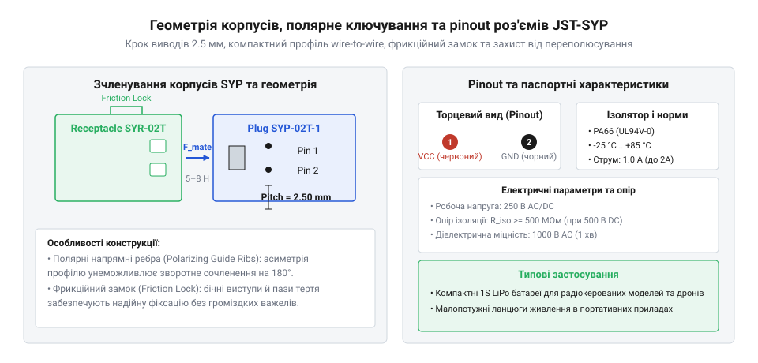
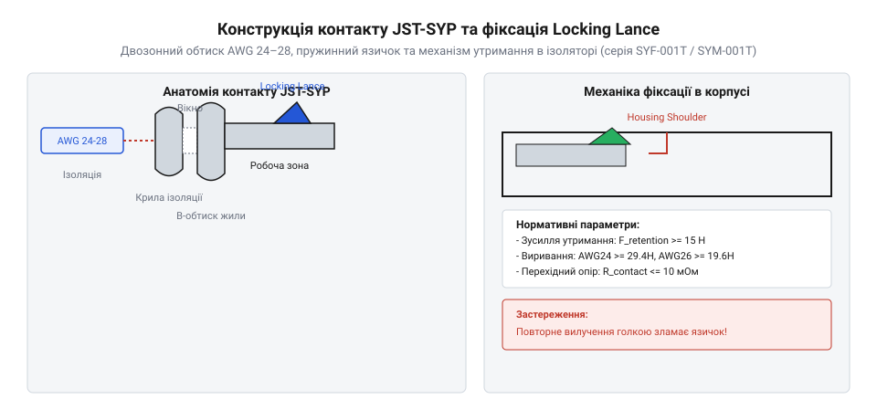

# Залізний інтерфейс компактних роз'ємів JST-SYP: геометрія та електричні межі

<preknowlist>
- [Штирьові зʼєднувачі (male)](root:cat-hw-parts/pin-headers) — Конструкція штирових контактів, крок між виводами та базові принципи роз'ємного з'єднання.
- [Ізольовані наконечники Faston та технологія обтискання](root:cat-hw-parts/faston-crimp-terminals) — Загальні фізичні принципи обтискання металевих клем кримпером.
- [Монтажний провід 18 і 20 AWG](root:cat-hw-parts/hookup-wire) — Класифікація провідників за калібром AWG та залежність діаметра ізоляції від струмового навантаження.
</preknowlist>

## Проблема надійних з'єднань у компактних приладах

Під час розробки компактних приладів інженери стикаються із жорстким дефіцитом внутрішнього об'єму, де провідники проходять вздовж рухомих вузлів або стінок. З'єднання блоків за допомогою відкритих [штирових зʼєднувачів](root:cat-hw-parts/pin-headers) у таких умовах викликає відмови: через відсутність замкових фіксаторів від вібрацій контактні гнізда сповзають зі штирів, а оголений метал спричиняє коротке замикання при дотику до корпусу чи сусідніх виводів.

Спроби замінити роз'єми прямим паянням дротів створюють зону концентрації механічних напружень на межі затоплення мідної жили припаєм. Від вигинів багатожильний провідник швидко ламається від втомного руйнування металу, а прилад втрачає ремонтопридатність. Інша пастка — використання симетричних неключованих колодок, які допускають сочленення зі зсувом чи розворотом на 180 градусів, що подає переполярне живлення на сигнальні лінії.

Для розв'язання цих проблем компанія JST (від англ. @@en|Japan Solderless Terminals@@) створила серію ультракомпактних з'єднувачів «провід–провід» (від англ. @@en|wire-to-wire@@) під назвою @@en|JST-SYP@@ з кроком контактів (від англ. @@en|pitch@@) 2,5 мм. Вони поєднують повністю ізольовані пластикові корпуси, сувору систему полярного ключування та компактний замковий фіксатор. Дотримання специфікаційного інтерфейсу цієї серії гарантує надійний електричний контакт і механічну цілісність кабельних ліній у замкненому об'ємі.

## Електричні межі та граничні параметри JST-SYP

Грамотне проєктування міжпровідних ліній вимагає чіткого розуміння граничних електричних режимів, за межами яких пластиковий ізолятор роз'єму або його металеві ламелі зазнають незворотної деградації. Серія @@en|JST-SYP@@ розроблялася як ультракомпактне рішення для сигнальних кіл та малопотужного живлення, тому її специфікаційні межі суворо нормовані стандартом виробника.

Основними залізними параметрами електричного інтерфейсу @@en|JST-SYP@@ є:

- Номінальний струм (від англ. @@en|rated current@@): 1,0 А змінного або постійного струму (AC/DC). - Максимальна робоча напруга (від англ. @@en|rated voltage@@): 250 В AC/DC. - Випробовувальна електрична міцність діелектрика (від англ. @@en|dielectric strength@@): 500 В AC протягом 1 хвилини без пробою та виникнення дугового розряду. - Початковий контактний опір (від англ. @@en|contact resistance@@): не більше 10 мОм (0,010 Ом). - Опір ізоляції (від англ. @@en|insulation resistance@@): не менше 1000 МОм при випробувальному потенціалі 500 В DC. - Робочий температурний діапазон: від -25 °C до +85 °C (включаючи самонагрівання контактів під навантаженням).

Обмеження за струмом у 1 А зумовлене невеликим перерізом тонкостінних металевих клем із фосфористої бронзи або латуні та обмеженою площею відведення тепла крізь компактний нейлоновий корпус. Електрична міцність ізолятора при напрузі 250 В забезпечується величиною шляху витоку та повітряним зазором між сусідніми герметичними камерами колодки.

Фізична природа контактного опору у 10 мОм визначається опором звуження (від англ. @@en|constriction resistance@@, опір звуження струмових ліній на мікроскопічних плямах фактичного торкання металів) та наявністю тонких плівок поверхневих оксидів. У процесі тривалої експлуатації в умовах вібрацій відбувається фретинг-корозія: мікрозміщення штиря відносно гнізда стирають захисне олов'яне покриття, викликаючи окислення мідної основи. Якщо контактний опір зростає, на з'єднанні починає виділятися додаткова теплова потужність.

Для розрахунку теплових втрат та падіння напруги скористаємося базовими електричними співвідношеннями. Розрахуємо падіння напруги `U_drop` та втрату потужності `P_loss` на одній контактній парі роз'єму @@en|JST-SYP@@ при проходженні максимального допустимого струму 1,0 А та початковому опорі 0,010 Ом:

```
U_drop = I · R_contact
= 1.0 A · 0.010 Ω        [підстановка номінального струму та початкового опору]
= 0.010 V                [падіння напруги 10 мВ на контакті]
```

```
P_loss = I² · R_contact
= (1.0 A)² · 0.010 Ω      [підстановка номінального струму та початкового опору]
= 0.010 W                [теплова потужність 10 мВт на один контакт]
```

Якщо внаслідок окислення або окиснювального перегріву контактний опір зросте вдесятеро — до 100 мОм (0,100 Ом), то падіння напруги зросте до 0,100 В, а локальне виділення тепла сягне 0,100 Вт на контактну пару. У замкненій двоконтактній колодці це виділить 0,200 Вт локального тепла, що спричинить розм'якшення термопластикового корпусу. З цієї причини роз'єми @@en|JST-SYP@@ категорично заборонено застосовувати у високострумових силових колах живлення двигунів чи акумуляторів, де слід використовувати спеціалізовані рішення на зразок [силових роз'ємів серії XT](root:cat-hw-parts/xt-connectors). Сфера @@en|JST-SYP@@ — це інтерфейсні лінії сенсорів, вентилятори, світлодіодні індикатори та кола живлення логічних плашок струмом до 1 А.

## Геометрія корпусів, ключування та зачеплення

Механічний інтерфейс серії @@en|JST-SYP@@ розроблений із розрахунком на високу щільність компоновки та безпомилковість збірки вручну без використання спеціального візуального обладнання. З'єднання складається з двох парних пластикових ізоляторів, виготовлених із міцного та гнучкого нейлону PA66 (поліамід-66).

Перший елемент парного комплекту — штировий корпус (від англ. @@en|plug housing@@, корпус-штекер із зовнішніми габаритами сочленення). Усередині нього монтуються металеві контакти штирового типу (male pins). Другий елемент — гніздовий корпус (від англ. @@en|receptacle housing@@, корпус-розетка, що охоплює штекер при з'єднанні). У ньому розташовуються розтрубні гніздові контакти (female sockets). Схема розташування виводів (від англ. @@en|pinout@@, розпиновка) у стандартній серії @@en|JST-SYP@@ є однорядною і найчастіше виконується у двоконтактному виконанні (позначення серії SYP-02T-1).


*Геометричні особливості та елементи орієнтації корпусів штирового та гніздового типів серії JST-SYP.*

Надійна захищеність від помилкового сочленення забезпечується системою асиметричного полярного ключування (від англ. @@en|polar keying@@). На зовнішній поверхні штирового корпусу @@en|plug housing@@ виконано поздовжні виступаючі направляючі ребра, тоді як внутрішня порожнина гніздового корпусу @@en|receptacle housing@@ має відповідні покрокові пази. Геометрія перерізу корпусів несиметрична відносно центральної осі. Спроба вставити штекер під кутом 180° призводить до механічного впирання пластикових ключів у торці стінок, унеможливлюючи фізичний дотик металевих контактів.

Для утримання сочленованої пари від самовільного роз'єднання під дією вібрацій застосовується механізм фрикційного зачеплення (від англ. @@en|friction lock@@, замок тертя). На відміну від великих роз'ємів із виступаючими пружними важелями-кліпсами, фрикційний замок @@en|JST-SYP@@ має гладкий низький профіль. Він складається з напівсферичного або клиноподібного фіксувального виступу на стінці штирового корпусу та відповідного заглиблення-вікна на гніздовому корпусі.

При сочлененні стінки гніздового корпусу злегка пружно деформуються, розширюючись при насуванні на виступ, після чого виступ із виразним клацанням заходить у фіксувальне вікно. Сила тримання роз'єму базується на пружності пластику та силі тертя спокою. Таке рішення запобігає зачіплянню корпусу за сусідні дроти у вузьких кабельних каналах та гарантує утримання колодок при прискореннях і вібраціях.

Процес правильного сочленення вимагає візуального суміщення орієнтирів полярних ключів та плавного осьового натискання на пластикові корпуси до моменту повного заходу виступу фрикційного замка. Для розчленування з'єднання необхідно охопити пальцями обома руками саме пластикові корпуси і прикласти розтягувальне зусилля вздовж осі. Спроби тягнути за вихідні дроти категорично неприпустимі, оскільки це призводить до виривання клем із пластикових ізоляторів.

## Обтискні контакти, калібри AWG та фіксація

Серцевиною електричного з'єднання серії @@en|JST-SYP@@ є обтискні контакти (від англ. @@en|crimp contact@@, металевий контакт, що закріплюється на провіднику методом холодної деформації). Вони виготовляються штампуванням із високопровідної фосфористої бронзи з гальванічним оловуванням поверхні.

Кожен контакт має дві послідовні зони обтискання:
1. Крила обтискання жили (від англ. @@en|conductor crimp@@): при обтисканні вони згинаються у формі профілю «B», щільно стискаючи оголені мідні жилки у монолітну структуру без повітряних проміжків. 2. Крила обтискання ізоляції (від англ. @@en|insulation crimp@@): вони охоплюють зовнішню силіконову або ПВХ-ізоляцію провідника у вигляді профілю «O» або перекривного охоплення. Це забезпечує розвантаження від механічного натягу (strain relief), захищаючи мідну жилу від зламу при згинанні кабелю.

Обтискні контакти @@en|JST-SYP@@ розраховані на роботу з тонкими [монтажних провідників AWG](root:cat-hw-parts/hookup-wire) діапазону калібрів від @@en|AWG@@ 28 (площа перерізу жили ~0,08 мм²) до @@en|AWG@@ 24 (площа перерізу жили ~0,22 мм²). Зовнішній діаметр ізоляції провідника повинен перебувати в межах від 1,1 мм до 1,9 мм. Використання дротів із занадто товстою ізоляцією (понад 1,9 мм) унеможливить встановлення контакту всередину вузької камери пластикового корпусу, а використання дротів із тонкою ізоляцією (менше 1,1 мм) позбавить контакт механічної підтримки в зоні обтискання ізоляції.


*Будова металевого обтискного контакту JST-SYP із фіксувальним язичком і зонними крилами обтискання.*

Фіксація обтиснутого контакту всередині нейлонового ізолятора здійснюється за допомогою пружного металевого язичка (від англ. @@en|locking lance@@, фіксувальний язичок контакту). На тильній спинці металевого контакту виштампувано під кутом пружну пелюстку.

При заштовхуванні обтиснутого контакту в заднє вікно пластикової камери фіксувальний язичок @@en|locking lance@@ притискається до тіла контакту, проходячи повз внутрішнє пластикове звуження. Як тільки контакт досягає крайнього переднього положення і спирається у внутрішній упор камери, металевий язичок пружинно розпрямляється і впирається у прямокутний виступ пластикового утримувача.

Це забезпечує зусилля фіксації (від англ. @@en|retention force@@, зусилля утримання контакту в корпусі) не менше 15–20 Н на один контакт. Механічний язичок надійно запобігає явищу виштовхування або висмикування клем (від англ. @@en|pin push-out@@) під час сочленення з'єднувача чи при зворотному натягу кабелю. Якісне обтискання [технології обтискання Faston](root:cat-hw-parts/faston-crimp-terminals) або клем JST вимагає збереження правильного кута відгину фіксувального язичка: якщо при кримпінгу язичок випадково притиснути або зігнути, контакт не зафіксується в корпусі і вискочить при першому ж спробі сочленення.

## Контроль збірки, діагностика та обслуговування

Завершальним етапом створення надійного міжпровідного джгута є вихідний контроль збірки колодок та регулярне технічне обслуговування роз'ємних вузлів. Навіть найякісніші компоненти серії @@en|JST-SYP@@ втрачають свої специфікаційні властивості при порушенні правила монтажу або недбалій експлуатації.

Процедура первинного контролю збірки колодки включає два обов'язкові кроки:
1. Тактильний тест на виривання (Pull-test): після клацання клем у пластиковому корпусі необхідно з легким зусиллям (~3–5 Н) потягнути за кожен провідник у зворотному напрямку. Якщо контакт зібраний правильно, фіксувальний язичок @@en|locking lance@@ впирається в упор камери і не дозволяє провіднику вийти з корпусу. Якщо провідник вислизає — язичок був деформований або контакт не дійшов до переднього упору. 2. Візуальний огляд переднього торця: через передні вікна сочленення контролюється правильність розташування штирів і розтрубів гнізд. Усі металеві елементи повинні знаходитися на однаковій глибині без перекосів.

Під час експлуатації приладів можуть виникати несправності кабельних ліній, які вимагають швидкої діагностики:

- Підвищене падіння напруги або періодичне зникнення сигналу: головною причиною є деформація притискних ламелей гніздового контакту. Це трапляється, коли для перевірки напруги вимірювальні щупи мультиметра з силою вставляють безпосередньо у гніздові отвори роз'єму, розширюючи металеві ламелі. Інша причина — окислення чи поганий кримпінг жили. - Самовільне розчленування колодок при вібраціях: спричиняється механічним зносом або відламуванням пластикового виступу фрикційного замка @@en|friction lock@@ внаслідок частих або некоректних роз'єднань під кутом. - Витискання клем назад з корпусу (pin push-out): виникає при спробі сочленення колодок із затиснутими або пошкодженими язичками фіксації.

При обслуговуванні щільно закомпонованих приладів дроти часто впорядковують [пластиковими хомутами](root:cat-hw-parts/cable-ties) або за допомогою [кабельних органайзерів](root:cat-hw-parts/cable-organizer). При цьому важливо залишати невеличку компенсаційну петлю біля корпусу @@en|JST-SYP@@, щоб хомути не створювали постійного натягу на вихідні дроти.

Для безпечного демонтажу пошкодженого контакту з нейлонового корпусу використовують спеціальну тонку демонтажну голку або викрутку з шириною леза 0,8 мм. Інструмент вводиться з боку сочленення у спеціальний верхній слот камери прямо над металевим контактом. Голка притискає відігнутий язичок @@en|locking lance@@ до тіла контакта, звільняючи його від пластикового упору, після чого провідник разом із клемою вільно витягується через тильне вікно корпусу. Після витягання язичок підправляють пінцетом до початкового кута, відновивши можливість його повторної фіксації.