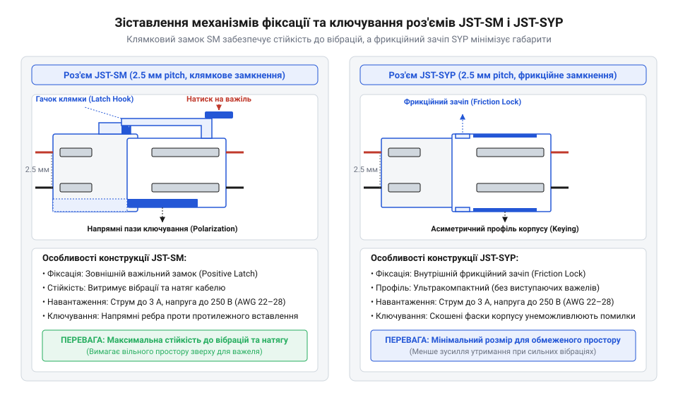
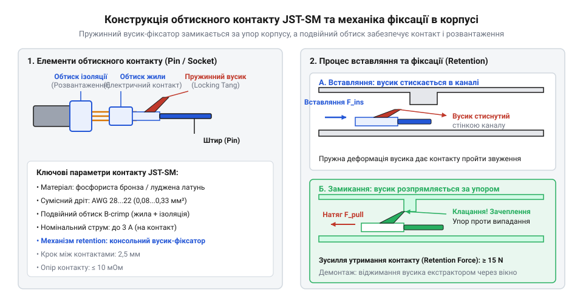
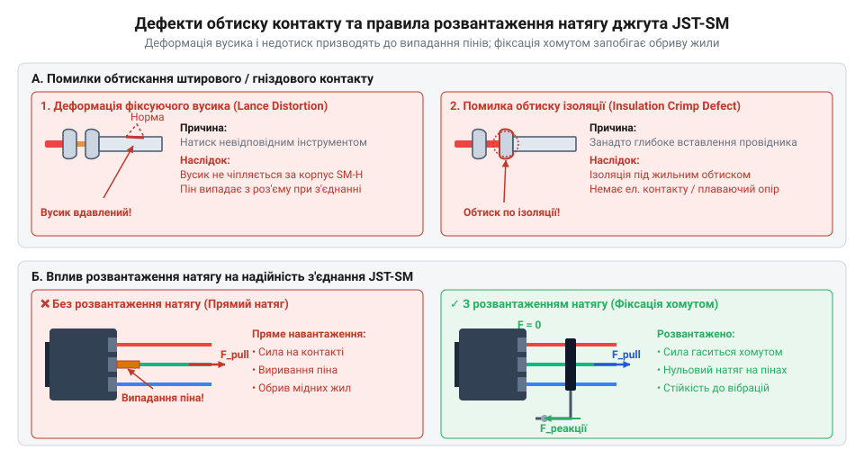
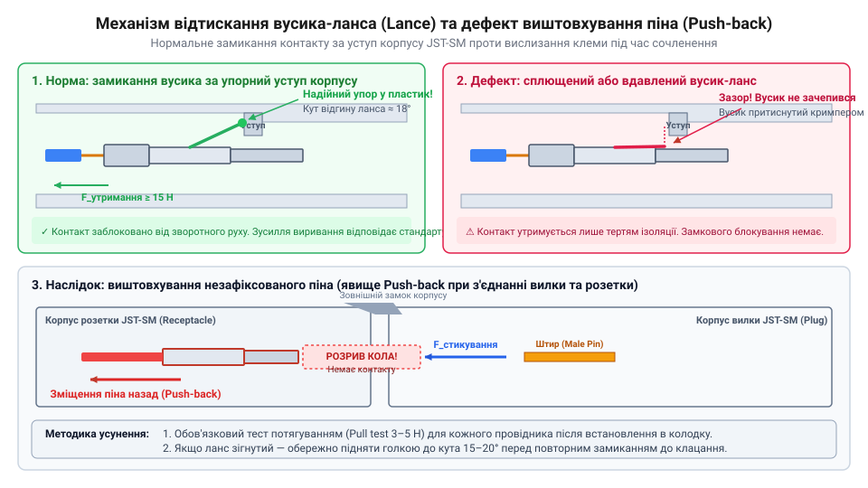

# Розʼєми JST-SM і JST-SYP (сигнальні)

<preknowlist>
- [Dupont дроти (M-M/M-F/F-F)](root:cat-hw-parts/dupont-wires) — принципи використання відкритих штирових з'єднувачів та їхні обмеження при вібрації
- [Ізольовані наконечники Faston та технологія обтискання](root:cat-hw-parts/faston-crimp-terminals) — принципи пластичної деформації металу під час обтискання клем
- [Монтажний провід 18 і 20 AWG](root:cat-hw-parts/hookup-wire) — геометрія багатожильних провідників та система вимірювання калібрів AWG
</preknowlist>

## Загроза самовільного розмикання сигнальних джгутів

Уявіть мобільний робототехнічний комплекс, безпілотний літальний апарат або 3D-принтер під час багатогодинного друку, де рухома каретка постійно здійснює інтенсивні зворотно-поступальні переміщення. Всередині таких систем вузли керування, давачі кінцевих положень, світлодіодні стрічки та виконавчі механізми з'єднані між собою гнучкими міжкабельними джгутами. Початківці в електроніці нерідко використовують для таких з'єднань стандартні [дупонт-дроти з відкритими контактами](root:cat-hw-parts/dupont-wires) або поодинокі [відкриті штирьові з'єднувачі](root:cat-hw-parts/pin-headers) без єдиного фіксувального пластикового корпусу.

Під час роботи обладнання міжкабельний джгут зазнає постійних вібрацій та механічних шарпань. Поодинокий контакт у звичайній розетці утримується виключно за рахунок пружності тонкого внутрішнього пелюстка. Під дією постійних мікрозсувів та вібраційного розгойдування сила тертя між металевими поверхнями падає, і контакт поступово вислизає зі штиря. Самовільне розмикання сигнального провідника у працюючій схемі призводить до миттєвої втрати зв'язку з давачем або аварійної зупинки контролера.

Ще більшою загрозою є відсутність закритих ізольованих корпусів та напрямних елементів поляризації. Якщо роз'єднаний під час обслуговування джгут повторно підключається вручну, поодинокі контакти легко переплутати місцями або змістити на один крок. При випадковій зміні поляризації (переполюсовці) напруга живлення 5 В або 12 В потрапляє на чутливі сигнальні лінії мікроконтролера, що викликає електричний пробій вихідних транзисторів і незворотну деградацію кристала. Окрім того, оголені металеві штирі при випаданні з гнізд можуть торкнутися металевої рами пристрою чи сусідніх провідників, спричиняючи коротке замикання.

Японська корпорація @@ja|JST@@ (від яп. *Nihon Atsuchaku Tanshi* / англ. *Japan Solderless Terminals* — японські безпайкові термінали) пройшла тривалий еволюційний шлях від розробки найпростіших обтискних кільцевих клем до створення спеціалізованих серій роз'ємів для внутрішнього міжблочного з'єднання типу @@en|wire-to-wire@@ (від англ. *wire-to-wire* — провід–провід). Стрімкий розвиток побутової електроніки, світлотехніки та промислової автоматики вимагав створення компактних з'єднувачів із кроком 2.5 мм, які б поєднували високу щільність монтажу, абсолютний механічний захист від помилкового вставлення та стійкість до вібраційних навантажень. В результаті цієї еволюції виникли роз'єми серій @@en|JST-SM@@ та @@en|JST-SYP@@. Конструкторська думка розвивалася від найпростішого фрикційного зачеплення у компактних корпусах до створення повноцінного засувного механічного замка у серії @@en|JST-SM@@, що повністю виключило ризик самовільного розмикання сигнальних кіл у мобільних і вібраційно навантажених системах.

Аналіз відмов у сигнальних джгутах дозволяє сформулювати чотири обов'язкові вимоги до безпечного міжблочного з'єднувача:
1. Повний суцільний ізолювальний корпус, що повністю закриває металеві контакти від зовнішнього замкнення. 2. Конструктивне ключування (@@en|keying@@, від англ. *keying* — створення профільного ключа), яке унеможливлює з'єднання вилки та розетки у перевернутому чи зміщеному положенні. 3. Механічний замок фіксації двох половинок корпусу, здатний протистояти осьовому натягу кабелю та вібраціям. 4. Надійна внутрішня фіксація самих металевих контактів всередині пластикових каналів, яка запобігає випиханню пінів під час з'єднання.

## Механічна фіксація та ключування корпусів

Для забезпечення надійного з'єднання сигнальних джгутів у сучасній електроніці найширше застосовуються дві серії роз'ємів типу @@en|wire-to-wire@@ з однаковим кроком між контактами: @@en|JST-SM@@ та @@en|JST-SYP@@. Поняття @@en|pitch@@ (від англ. *pitch* — крок/відстань між центрами сусідніх контактів) для обох серій становить 2.5 мм, проте їхня геометрична архітектура та механізми утримання корпусів суттєво відрізняються.

Серія @@en|JST-SM@@ розроблена спеціально для з'єднання міжкабельних джгутів у звисаючому або рухомому стані, де виникають осьові зусилля на розтяг. Корпус складається з двох сумісних частин: вилки (корпус для гніздових контактів) та розетки (корпус для штирових контактів). Фіксація між ними здійснюється за допомогою зовнішнього механічного замка типу @@en|latch@@ (від англ. *latch* — клямка/засувка). На розетковій частині корпуса відформовано гнучкий пластиковий важіль з зачіпним зубом, а на корпусі вилки — відповідний виступ. Під час з'єднання важіль відхиляється і зі щигликом (виразним клацанням) замикається за виступом. Щоб роз'єднати джгут, необхідно свідомо натиснути на важіль клямки пальцем. Завдяки такому засувному замку роз'єм утримує осьове розривне зусилля до 30–50 Н (залежно від кількості контактів), що робить самовільне розмикання під дією вібрації фізично неможливим.

На відміну від @@en|JST-SM@@, серія @@en|JST-SYP@@ орієнтована на ультракомпактні пристрої — акумуляторні джгути радіокерованих моделей, компактні безпілотники та світлодіодні модулі, де кожен міліметр об'єму є критичним. З'єднання @@en|JST-SYP@@ використовує внутрішній фрикційний зачеп (@@en|friction lock@@, від англ. *friction lock* — замок тертя). На внутрішніх стінках розеткової частини виформовано спеціальні виступи, які при з'єднанні з силою вклинюються у відповідні заглиблення вилки, утворюючи щільну посадку за рахунок сили пружної деформації пластику. Серія @@en|JST-SYP@@ має відчутно менші зовнішні габарити, проте поступається серії @@en|JST-SM@@ у стійкості до сильних шарпань кабелю.


*Порівняльна будова корпусів JST-SM та JST-SYP: бічний клямковий замок серії SM запобігає розмиканню під дією вібрації, а внутрішні фрикційні зачепи SYP забезпечують мінімальні габарити з'єднання.*

Окрім фіксації від розмикання, обидві серії мають асиметричне конструктивне @@en|keying@@. На зовнішній поверхні корпуса вилки виконано виступаючі поздовжні напрямні ребра, а всередині корпуса розетки — відповідні напрямні пази. Якщо оператор спробує розвернути роз'єм на 180°, виступи впруться у суцільну пластикову стінку розетки. Фізичний контакт між металевими штирями та гніздами стає неможливим до тих пір, поки роз'єм не буде орієнтовано правильно. Точна геометрія корпусу та розміри для проектування міжблочного монтажу наведені в матеріалах [специфікації корпусів JST-SM](root:cat-hw-parts/jst-sm-connectors/api-jst-sm-specifications.md) та в [технічних параметрах роз'ємів JST-SYP](root:cat-hw-parts/jst-sm-connectors/api-jst-syp-specifications.md).

Важливо зазначити, що серії @@en|JST-SM@@ та @@en|JST-SYP@@ призначені виключно для вільного міжкабельного монтажу @@en|wire-to-wire@@. Якщо у проекті необхідно підключити сигнальний джгут безпосередньо до друкованої плати, застосовують інші класи роз'ємів, такі як [міжплатні роз'єми JST-XH та JST-PH](root:cat-hw-parts/jst-xh-ph-connectors), які розглядаються в загальному [оглядовому матеріалі про роз'єми JST](root:cat-hw-parts/jst-connector-overview).

## Електричні параметри та обтискання контактів

Електрична надійність з'єднання визначається не лише пластиковим корпусом, але й характеристиками металевих контактів. Роз'єми серій @@en|JST-SM@@ та @@en|JST-SYP@@ розраховані на максимальну робочу напругу до 250 В (змінної або постійної напруги) та граничний довготривалий струм до 3 А на один контакт. Для забезпечення вказаного струму використовується [багатожильний монтажний провід](root:cat-hw-parts/hookup-wire) калібру від 22 до 28 за американською системою маркування провідників @@en|AWG@@ (від англ. *American Wire Gauge* — американський калібр провідників). Провідники більшого перерізу (наприклад, 18 або 20 @@en|AWG@@) не вміщаються в хвостову частину обтискного контакту, а тонші за 28 @@en|AWG@@ не забезпечують достатньої механічної міцності обтиску.

Початковий контактний опір замкненої пари «штир–гніздо» складає не більше 10 мОм (0.010 Ом). Падіння напруги `V_drop` на контактній парі розраховується за законом Ома:

```
V_drop = I · R_contact
       = 3 · 0.010               [підстановка струму 3 А та опору 0.010 Ом]
       = 0.030 В                 [обчислення падіння напруги]
       = 30 мВ                   [переведення у мілівольти]
```

При цьому потужність теплових втрат `P_loss` у зоні контакту дорівнює:

```
P_loss = I² · R_contact
       = 3² · 0.010              [підстановка струму 3 А та опору 0.010 Ом]
       = 9 · 0.010               [піднесення струму до квадрата]
       = 0.090 Вт                [обчислення втрати потужності]
       = 90 мВт                  [переведення у мілівати]
```

Отримане значення 90 мВт на один контакт є безпечним для поодиноких ліній при кімнатній температурі. Проте у багатопінових щільно зібраних джгутах при підвищеній температурі навколишнього середовища необхідно застосовувати коефіцієнт зниження навантаження (@@en|derating@@, від англ. *derating* — зниження номінальних параметрів). Повний математичний аналіз теплового нагріву та формула обчислення обмежень струму представлені у матеріалі про [розрахунок падіння напруги та контактного опору](root:cat-hw-parts/jst-sm-connectors/math-jst-contact-derating-and-resistance.md).

Металевий контакт роз'єму штампується з фосфористої бронзи з лудженим покриттям і виготовляється у двох виконаннях: штир (@@en|pin@@, від англ. *pin* — штир/палець) та гніздо (@@en|socket@@, від англ. *socket* — гніздо/розетка). Ключовим елементом утримання контакту в корпусі є пружинний вусик-фіксатор — металевий пружний язичок або пружинна лапка (@@en|lance@@, від англ. *lance* — спис/язичок-фіксатор). Під час просування контакту всередину пластикового каналу вусик стискається, а при досягненні робочої позиції відскакує вбік і впирається у внутрішнє вікно корпуса. Це блокує зворотний хід контакту при стикуванні роз'єму.

З’єднання контакту з дротом виконується методом обтискання (@@en|crimp@@, від англ. *crimp* — обтискати/опресовувати). Контакт має дві послідовні зони обтиску:
1. Зона обтиску жили: вузькі металеві крила охоплюють очищені мідні жили, пластично деформуючи металевий дріт і утворюючи газощільне холодне зварювання. 2. Зона обтиску ізоляції: ширші крила охоплюють зовнішню силіконову або ПВХ-ізоляцію проводу, сприймаючи механічні згинальні навантаження і захищаючи тонку мідну жилу від зламу.


*Геометрія обтискних контактів JST: зона обтиску жили утворює газощільний електричний контакт, зона обтиску ізоляції сприймає механічне навантаження, а пружинний вусик фіксує контакт у пластиковому каналі.*

Неякісне обтискання або порушення технології монтажу є головною причиною відмов сигнальних джгутів:
- Зігнутий пружинний вусик: якщо контакт вставлявся невідомою стороною або з надмірним зусиллям, вусик зминається і втрачає пружність. В результаті при з'єднанні штир випихається з корпуса назад, перериваючи коло. - Перетиснута або недотиснута ізоляція: надмірне обтискання підрізає захисну оболонку, а недостатнє — призводить до вислизання проводу з контакту при розтягуванні. - Відсутність розвантаження від натягу (@@en|strain relief@@, від англ. *strain relief* — розвантаження від натягу/деформації): якщо міжкабельний джгут вільно висить і піддається постійним вигинам, мідні жили зазнають втомного руйнування біля краю обтискної манжети.


*Причини відмов і розвантаження натягу: деформація пружинного вусика призводить до випадання контакта з корпусу, а фіксація джгута хомутом захищає обтискне з'єднання від втоми металу.*

Для уникнення дефектів слід використовувати спеціалізовані кліщі-кримпери з двоконтурними матрицями та рачетовим механізмом, що гарантує повне завершення циклу пресування, за правилами з матеріалу про [технології обтискання контактів](root:cat-hw-instruments/crimp-tool). Також для запобігання зламам провідників джгут має жорстко кріпитися до нерухомих елементів конструкції, для чого застосовуються [пластикові кабельні хомути](root:cat-hw-parts/cable-ties) відповідно до загальних [правил розвантаження кабельних джгутів](root:hw-pcb/cable-harness-strain-relief). Практична послідовність виготовлення кабелю детально описана у [покроковому проєкті збирання джгута](root:cat-hw-parts/jst-sm-connectors/proj-jst-sm-harness-assembly.md).

## Типові дефекти та захист від натягу

Зібрана електрична схема з роз'ємами @@en|JST-SM@@ чи @@en|JST-SYP@@ може бездоганно проходити первинне перевірочне прозвонювання мультиметром на робочому столі, але раптово виходити з ладу під час реальної експлуатації у складі рухомого робота, 3D-принтера чи світлодіодної інсталяції. Причиною більшості плаваючих відмов є не дефекти монокристалів напівпровідників чи пайки на платі, а приховані механічні пошкодження у точках крімпування (від англ. @@en|crimp@@, що означає обтискати металеву гільзу навколо провідника) та відсутність фіксації кабельного джгута. Без глибокого аналізу фізики деформації контактів та розподілу механічних зусиль будь-яка міжкабельна лінія перетворюється на джерело ненадійного електричного контакту.

Найпоширенішим дефектом при ручному складанні пластикових корпусів є відхід металевого контакту в глибину гнізда (так званий ефект @@en|push-back@@). Кожен штировий контакт (англ. @@en|pin@@) та гніздовий контакт (англ. @@en|socket@@) серій @@en|JST-SM@@ і @@en|JST-SYP@@ має штампований пружинний вусик-фіксатор (англ. @@en|lance@@, від латинського *lancea* — спис, завдяки виступаючій формі металевого язичка). Під час вставляння обтисненого провідника в пластикову касету вусик пластично й пружно згинається усередину, пропускаючи контакт крізь вузький канал, а після проходження фіксуючого виступу розпрямляється і впирається в прямокутне вікно корпусу. Якщо під час зберігання клем у пакеті, неакуратного обтискання кримпером або затискання ручним інструментом пружинний язичок був надмірно відігнутий чи заплесканий до тіла контакту, він втрачає пружність і не здатний зачепитися за внутрішній упор. При стикуванні роз'єму зустрічний контакт притискається до гнізда з зусиллям сочленення і виштовхує незафіксовану клему назад з корпусу. Зовні роз'єм виглядає повністю зібраним і замкненим, проте всередині контактна пара розімкнена або ледь торкається крайками, утворюючи нестабільний електричний ланцюг. Для безпечного відгинання пружинного язичка та заміни пошкодженого піна скористайтеся [інструментами та методикою вилучення контактів](root:cat-hw-instruments/jst-sm-pin-extraction-and-repair).


*Пружинний вусик-фіксатор при належній висоті зачіпляється за вікно корпусу, а при зминанні не утримує контакт, спричиняючи його відхід углиб при стикуванні.*

Для виявлення дефекту @@en|push-back@@ перед остаточним монтажем джгута обов'язково виконують ручний тест на потягування (англ. @@en|pull test@@): кожен провід злегка потягують у зворотному напрямку з зусиллям близько 3–5 Н. Якщо клема зафіксована правильно, вусик-фіксатор @@en|lance@@ надійно утримує її у пластиковому каналі. Проте самі зони обтиску провідника містять іншу приховану загрозу. Якісне крімпування роз'єднується на дві ізольовані задачі: створення газонепроникного електричного контакту у зоні жил та механічне захоплення ізоляції задніми вусиками. Якщо вусики ізоляції затиснені недостатньо або провід позбавлений зовнішнього покриття в цій зоні, усі механічні згинальні навантаження та натяг припадають безпосередньо на мідні жили у зоні електричного контакту. При періодичних вібраціях мідь швидко піддається втомному руйнуванню біля зрізу металевої гільзи, що призводить до повного обриву провідника під неушкодженою зовнішньою ізоляцією. Вивчити нормативні вимоги до геометрії обтискних клем можна через [технологію обтискання контактів](root:cat-hw-instruments/crimp-tool).

Недостатній або надмірний обтиск зони жил змінює мікрогеометрію мідного пучка. При недотисканні між жилами лишаються мікроскопічні повітряні зазори, що призводить до окиснення міді під дією кисню повітря та різкого зростання перехідного опору контакту (англ. @@en|contact resistance@@). При перетисканні мідні жили стоншуються чи підрізаються губками кримпера, зменшуючи ефективний переріз провідника калібру @@en|AWG@@ (англ. @@en|American Wire Gauge@@). В обох випадках опір контактного вузла `R_contact` зростає від нормативних 10 мОм до 40–100 мОм і більше. При проходженні струму `I` це спричиняє падіння напруги `V_drop` та локальний нагрів згідно із законом Ома та законом Джоуля-Ленца.

Розрахуємо падіння напруги та виділення теплової потужності на пошкодженому контакті роз'єму @@en|JST-SM@@ під навантаженням:

```
V_drop = I × R_contact
= 2.5 A × 0.040 Ohm      [підстановка струму навантаження та опору дефектного контакту]
= 0.100 V               [падіння напруги на одному контакті]
```

```
P_loss = I² × R_contact
= (2.5 A)² × 0.040 Ohm   [обчислення втрат теплової потужності]
= 6.25 A² × 0.040 Ohm   [квадрат сили струму на збільшений перехідний опір]
= 0.250 W               [теплова потужність, що виділяється у точці обтиску]
```

Падіння напруги на 0.100 В на кожній з двох ліній живлення (плюс і мікро-земля) сумарно зменшує напругу живлення чутливого давача або мікроконтролера на 0.200 В, що може спричиняти спонтанні перезавантаження цифрової логіки. Водночас виділення 0.250 Вт тепла у замкненому пластиковому корпусі об'ємом менше кубічного сантиметра спричиняє розм'якшення та термічну деформацію термопласту корпусу, що призводить до втрати фіксації клем та подальшого розплавлення роз'єму. Докладний [електричний розрахунок нагріву](root:cat-hw-parts/jst-sm-connectors/math-jst-contact-derating-and-resistance.md) пояснює фізичні межі струмового навантаження та необхідність зниження допустимого струму (англ. @@en|derating@@) при підвищеній температурі навколишнього середовища.

Щоб повністю нівелювати втомне руйнування жил та виривання клем з корпусів @@en|JST-SM@@ та @@en|JST-SYP@@, у конструкцію джгута впроваджують розвантаження від натягу (англ. @@en|strain relief@@, від латинського *stringere* — стискати, та старофранцузького *reliever* — полегшувати). Головний принцип розвантаження полягає у жорсткій фіксації кабельного пучка до несучої конструкції або корпусу пристрою на відстані 20–40 мм від точки входу провідників у роз'єм. При цьому між точкою фіксації та роз'ємом залишають компенсаційну петлю (слабину), завдяки якій будь-які динамічні ривки кабелю чи вібраційні коливання гасяться на зовнішньому кріпленні й не передаються на внутрішні клеми. Фіксацію джгута реалізують за допомогою клейових термоусаджувальних трубок, нейлонових [пластикових хомутів](root:cat-hw-parts/cable-ties) або спеціальних 3D-друкованих кронштейнів. Загальні інженерні підходи до проектування джгутів описані у матеріалі про [розвантаження кабельних джгутів](root:hw-pcb/cable-harness-strain-relief), а практичний [проєкт зі складання джгутів](root:cat-hw-parts/jst-sm-connectors/proj-jst-sm-harness-assembly.md) демонструє покрокову техніку виготовлення надійного міжкабельного з'єднання для світлодіодних стрічок та давачів.

## Вибір серії під умови експлуатації

При проектуванні внутрішньої компоновки електронного пристрою інженер постійно перебуває у стані компромісу між щільністю компонування та механічною надійністю з'єднань. Сигнальні роз'єми серій @@en|JST-SM@@ та @@en|JST-SYP@@ мають одинаковий крок контактів (англ. @@en|pitch@@) 2.5 мм і схожі електричні межі — номінальний струм до 3 А та напругу до 250 В при використанні монтажних провідників калібру @@en|AWG@@ 22–28. Проте за принципами механічної фіксації корпусу, габаритним об'ємом і вібростійкістю ці дві серії є принципово різними інструментами, помилка у виборі яких може призвести або до неможливості закрити корпус пристрою, або до розмикання кола під час роботи.

Ключова відмінність серії @@en|JST-SM@@ полягає у наявності зовнішнього активного механічного замка клямкового типу (англ. @@en|latch@@). При з'єднанні вилки та розетки пружинний важіль розетки зачіпляється за прямокутний зуб вилки із чітким акустичним клацанням. Для розмикання ланцюга необхідно свідомо натиснути на фіксуючий важіль пальцем. Така конструкція повністю унеможливлює самовільне розмикання контакту при сильній вібрації або випадковому потягуванні за кабель. Проте ціною надійності є збільшені габарити корпусу. Для отримання детальних геометричних креслень та габаритів корпусу скористайтеся [специфікацією корпусів JST-SM](root:cat-hw-parts/jst-sm-connectors/api-jst-sm-specifications.md).

Натомість роз'єм @@en|JST-SYP@@ розроблявся як ультракомпактне рішення для міжблочного монтажу в умовах жорсткого дефіциту вільного простору. У ньому повністю відсутній виступаючий зовнішній важіль, а утримання вилки в розетці забезпечується внутрішнім пасивним фрикційним зачепом (англ. @@en|friction lock@@) за рахунок пружного тертя пластикових виступів. Внутрішній об'єм, який займає з'єднання @@en|JST-SYP@@, майже вдвічі менший порівняно з @@en|JST-SM@@. Ознайомитися з граничними геометричними параметрами цієї серії можна у [геометричних межах JST-SYP](root:cat-hw-parts/jst-sm-connectors/api-jst-syp-specifications.md).

Вибір оптимальної серії між @@en|JST-SM@@ та @@en|JST-SYP@@ здійснюють на основі аналізу чотирьох експлуатаційних факторів:

1. **Рівень вібраційного та ударного навантаження.** У рухомих вузлах робототехніки, коптерах, колісних платформах та обладнанні з кроковими двигунами роз'єми піддаються постійній вібрації. Пасивне тертя @@en|JST-SYP@@ під дією циклічних мікрозміщень може послаблюватися, викликаючи сповзання корпусу та переривальний контакт (фретинг-корозію). Для вібраційних умов єдиним надійним вибором є @@en|JST-SM@@ з механічним замком @@en|latch@@. 2. **Доступний геометричний об'єм.** У компактних пультах управління, ліхтарях чи мікропристроях виступаючі елементи клямки @@en|JST-SM@@ не дозволяють розмістити роз'єм у корпусі. У таких застосуваннях застосовують @@en|JST-SYP@@, передбачаючи додаткову фіксацію кабелю. 3. **Число комутаційних циклів.** Замок @@en|JST-SM@@ витримує багаторазове сочленення і розмикання без зносу фіксуючих поверхонь. Фрикційний зачеп @@en|JST-SYP@@ після 20–30 циклів перепідключення втрачає первинне зусилля утримання через стирання пластикових пукликів. 4. **Кількість провідників у джгуті.** Серія @@en|JST-SM@@ випускається у модифікаціях від 2 до 8 контактів, що дозволяє комутувати багатожильні сигнальні шлейфи. Серія @@en|JST-SYP@@ представлена переважно 2-контактними роз'ємами (рідше 3-контактними), розрахованими на підключення акумуляторів або поодиноких давачів.

Якщо конструктивні вимоги вимагають монтувати з'єднання безпосередньо на друковану плату (board-to-wire), а не у підвішеному міжкабельному стані (wire-to-wire), серії SM та SYP поступаються місцем альтернативним [сигнальним роз'ємам JST-XH](root:cat-hw-parts/jst-xh-ph-connectors) з кроком 2.5 мм або JST-PH з кроком 2.0 мм. Для підключення силових акумуляторних кіл зі струмами понад 3 А слід переходити на [силові роз'єми XT](root:cat-hw-parts/xt-connectors), де контактні групи розраховані на струми від 30 А до 90 А. Грамотне зіставлення умов експлуатації з механічними властивостями роз'ємів гарантує безвідмовну роботу електронного пристрою протягом усього терміну служби.