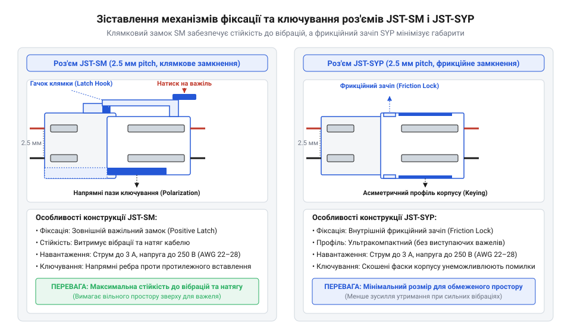
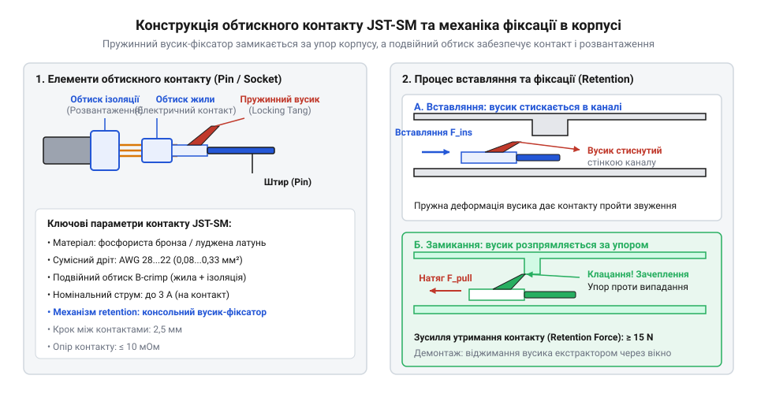
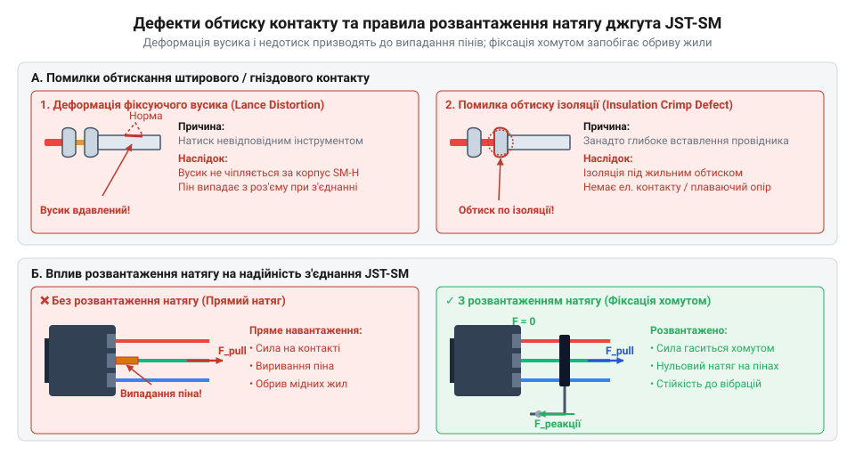

# Міжпровідні роз'єми серій JST-SM та JST-SYP

<preknowlist>
- [Dupont дроти (M-M/M-F/F-F)](root:cat-hw-parts/dupont-wires) — принципи використання відкритих штирових з'єднувачів та їхні обмеження при вібрації
- [Ізольовані наконечники Faston та технологія обтискання](root:cat-hw-parts/faston-crimp-terminals) — принципи пластичної деформації металу під час обтискання клем
- [Монтажний провід 18 і 20 AWG](root:cat-hw-parts/hookup-wire) — геометрія багатожильних провідників та система вимірювання калібрів AWG
</preknowlist>

## Ненадійність відкритих штирових з'єднань у рухомих джгутах

У мобільній робототехніці, безпілотниках та світлодіодних інсталяціях кабельні джгути піддаються постійним вібраціям, розхидуванням та механічним шарпанням. Використання поодиноких [дупонт-дротів](root:cat-hw-parts/dupont-wires) або відкритих [штирових з'єднувачів](root:cat-hw-parts/pin-headers) у таких умовах призводить до спонтанного розмикання кіл. Внутрішні пелюстки відкритих розеток утримуються лише за рахунок слабкої сили тертя, яка під дією вібрації швидко падає.

Окрім ризику випадання контакту, відсутність ізольованих пластикових корпусів створює загрозу коротного замикання та помилкового підключення з порушенням поляризації. Випадкова зміна полярності живлення під час обслуговування здатна миттєво вивести з ладу чутливі сигнальні лінії мікроконтролера.

Для створення надійних з'єднань типу «провід–провід» (англ. @@en|wire-to-wire@@) компанія JST розробила спеціалізовані серії роз'ємів @@en|JST-SM@@ та @@en|JST-SYP@@. Вони забезпечують повну ізоляцію контактних груп, механічне ключування від переполюсовки та фіксацію двох половинок корпусу від самовільного розмикання.

## Конструктивна будова корпусів JST-SM та JST-SYP

Обидві серії роз'ємів мають однаковий крок між центрами контактів (англ. @@en|pitch@@) 2.5 мм, проте суттєво відрізняються габаритами та механізмом утримання.

Серія @@en|JST-SM@@ призначена для рухомих і вібраційно навантажених джгутів. Вона оснащена активним механічним замком клямкового типу (англ. @@en|latch@@). На розетковій частині корпусу розміщено пружинний пластиковий важіль із зачіпним зубом, який при стикуванні із клацанням замикається за виступ на вилці. Роз'єднання здійснюється лише при свідомому натисканні на важіль пальцем. Замок утримує осьове розривне зусилля від 30 до 50 Н, що виключає самовільне розмикання. Серія випускається у варіантах від 2 до 8 контактів і розрахована на струм до 3 А на контакт.

Серія @@en|JST-SYP@@ орієнтована на ультракомпактні пристрої, де кожен міліметр об'єму є критичним (акумулятори радіомоделей, дрони, компактні світлодіодні модулі). Утримання корпусу забезпечується пасивним фрикційним зачепом (англ. @@en|friction lock@@) за рахунок тертя пластикових виступів усередині касети. Вона має значно менші габарити, розрахована на струм до 1 А на контакт і випускається переважно у 2-контактному виконанні.

*Порівняльна будова корпусів JST-SM та JST-SYP: бічний клямковий замок серії SM запобігає розмиканню під дією вібрації, а внутрішні фрикційні зачепи SYP забезпечують мінімальні габарити з'єднання.*

Конструктивне ключування (англ. @@en|keying@@) в обох серіях реалізовано за допомогою асиметричних поздовжніх ребер і пазів на корпусах. При спробі розвернути роз'єм на 180° виступи впираються у глуху пластикову стінку, запобігаючи невірному підключенню. Точні розміри корпусів деталізовано у [специфікаціях корпусів JST-SM](root:cat-hw-parts/jst-sm-connectors/api-jst-sm-specifications.md).

## Металеві контакти та технологія обтискання

Електричне з'єднання забезпечується штампованими контактами з фосфористої бронзи з лудженим покриттям — штирями (англ. @@en|pin@@) та гніздами (англ. @@en|socket@@). 

Фіксація контакту в пластиковому каналі корпусу здійснюється за допомогою пружинного вусика-фіксатора (англ. @@en|lance@@). Під час просування провідника всередину корпусу вусик стискається, а в робочій позиції відскакує у прямокутне вікно, блокуючи зворотний хід.

Монтаж контактів на [багатожильний монтажний провід](root:cat-hw-parts/hookup-wire) калібру AWG 22–28 виконується методом обтискання (англ. @@en|crimp@@). Контакт має дві зони опресування:
1. Зона обтиску жили: деформує мідні жили, утворюючи газощільне холодне зварювання з низьким перехідним опором (~10 мОм).
2. Зона обтиску ізоляції: охоплює зовнішній силіконовий або ПВХ-шар, сприймаючи механічні згинальні навантаження.

*Геометрія обтискних контактів JST: зона обтиску жили утворює газощільний електричний контакт, зона обтиску ізоляції сприймає механічне навантаження, а пружинний вусик фіксує контакт у пластиковому каналі.*

## Дефекти монтажу та захист від натягу

Неякісне складання або порушення технології обтискання призводить до типових несправностей:

- **Відхід контакту (англ. @@en|push-back@@):** якщо пружинний вусик @@en|lance@@ був зігнутий при обтисканні або неправильному вставлянні, він не зачіпляється за вікно корпусу. При стикуванні роз'єму зустрічний пін виштовхує контакт назад. Для виявлення дефекту застосовують ручний pull-тест (потягування провідника із зусиллям 3–5 Н).
- **Перехідний опір та нагрів:** недотискання жил викликає окиснення міді й зростання опору контакту від 10 мОм до 100 мОм і більше. За законом Джоуля-Ленца ($P = I^2 \cdot R$) це спричиняє падіння напруги та термічне розм'якшення корпусу. Розрахунки теплових втрат та коефіцієнти дерейтингу наведено в матеріалі про [математику контактного опору](root:cat-hw-parts/jst-sm-connectors/math-jst-contact-derating-and-resistance.md).
- **Втомне руйнування жил:** відсутність розвантаження від натягу (англ. @@en|strain relief@@) викликає швидкий злам мідних жил біля обтискної манжети під дією вигинів.

*Причини відмов і розвантаження натягу: деформація пружинного вусика призводить до випадання контакта з корпусу, а фіксація джгута хомутом захищає обтискне з'єднання від втоми металу.*

Щоб захистити з'єднання від механічної втоми, джгут жорстко кріпиться [пластиковими хомутами](root:cat-hw-parts/cable-ties) до рами пристрою на відстані 20–40 мм від роз'єму із забезпеченням слабини (компенсаційної петлі).

## Інженерні критерії вибору серії

При виборі між роз'ємами керуються такими правилами:

1. **JST-SM:** обирають для рухомих джгутів, робототехніки, адресних світлодіодних стрічок WS2812B/SK6812 та умов високої вібрації, де необхідний активний механічний замок.
2. **JST-SYP:** застосовують у жорстких обмеженнях за габаритами (внутрішні акумуляторні з'єднання в R/C моделях, коптерах), де достатньо фрикційного зачепу.
3. **Плата-провід (board-to-wire):** для монтування на друковану плату замість міжпровідних серій використовують роз'єми [JST-XH або JST-PH](root:cat-hw-parts/jst-xh-ph-connectors).
4. **Силові кола (>3 А):** для високих струмів переходять на спеціалізовані [силові роз'єми XT](root:cat-hw-parts/xt-connectors).
