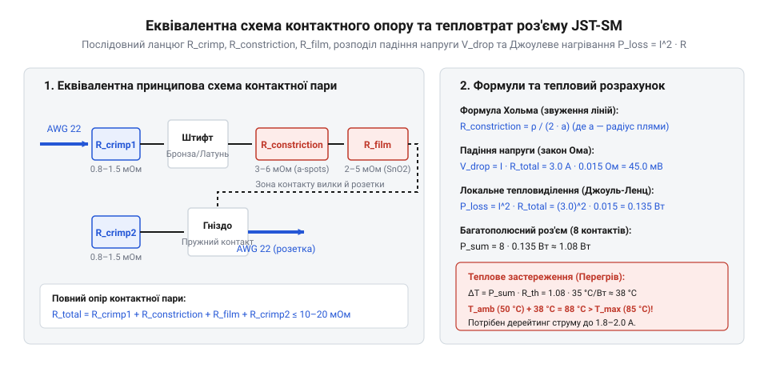
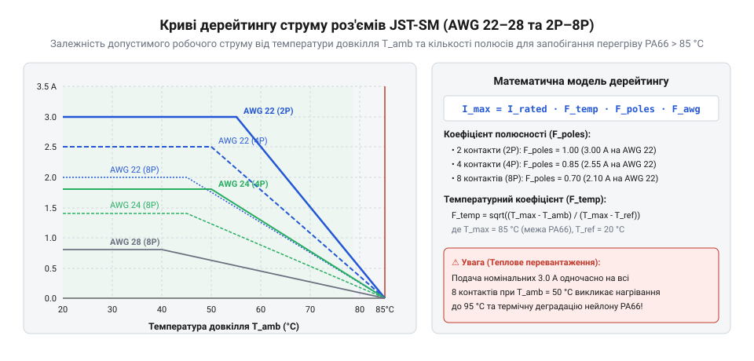

# Електричні розрахунки перехідного опору, нагріву та дерейтингу роз'ємів JST-SM/SYP

<preknowlist>
- [Монтажний провід 18 і 20 AWG](root:cat-hw-parts/hookup-wire) — Залежність електроопору провідника від його перерізу AWG та принципи вибору провідників для передачі струму.
- [Ізольовані наконечники Faston та технологія обтискання](root:cat-hw-parts/faston-crimp-terminals) — Фізика пластичної деформації обтискної гільзи при кримпуванні та формування газонепроникного контакту між жилою й наконечником.
</preknowlist>

## Локальний перегрів та розплавлення колодки JST-SM

розділ цілком, уже стиснутий

Під час проєктування систем живлення розробники часто припускаються критичної помилки, спираючись на номінальне паспортне значення струму 3 А для роз'ємів серії JST-SM і транслюючи його на всі контактні лінії багатополюсної колодки. Якщо підключити роз'єм із тонкими монтажними провідниками калібру AWG 28 і навантажити кожен контакт граничним струмом, у замкненому об'ємі поліамідного корпусу PA66 починається лавиноподібне накопичення тепла. Високий питомий опір тонких жил, деформаційний опір обтискного кримпу та перехідний опір пружних пелюсток генерують значні теплові втрати за законом Джоуля-Ленца. Оскільки теплопровідність термопласту обмежена, а сусідні контакти розташовані з кроком лише 2.5 мм, лінії взаємно підігрівають одна одну, через що внутрішня температура колодки швидко перевищує допустимі 85 °C. Це спричиняє термічну деформацію поліаміду, ослаблення пружного притиску контактних ламелей та катастрофічне оплавлення вузла. Щоб уникнути аварій, інженер має виконувати математичний розрахунок розсіюваної потужності та застосовувати системний дерейтинг струму залежно від перерізу провідника, числа полюсів і температури довкілля.

## Еквівалентна математична модель контактного опору

Електричний зв'язок між вилкою та розеткою у роз'ємах JST-SM і JST-SYP забезпечують штамповано-обтискні клеми з фосфористої бронзи або латуні. Повний еквівалентний контактний опір `R_contact` роз'ємної пари є послідовною сумою трьох компонентів:

```
R_contact = R_crimp + R_constriction + R_film
```

Опір пластичної деформації жил у кримпі (англ. @@en|crimping@@, від англ. @@en|crimp@@ — спресовувати) `R_crimp` виникає під час обтискання, коли гільза зтискає пучок жил із зусиллям, вищим за межу плинності. Жили утворюють газонепроникане з'єднання (англ. @@en|gas-tight joint@@). За дотримання [технології обтискання Faston](root:cat-hw-parts/faston-crimp-terminals) значення `R_crimp` не перевищує 1.0–1.5 мОм.

Опір стягування струмових ліній `R_constriction` виникає через мікроскопічну шорсткість деталей, де контакт відбувається лише на виступаючих а-плямах. Згідно з формулою Гольма, опір стягування поодинокої а-плями радіусом `a` дорівнює:

```
R_constriction = ρ / (2 · a)
```

де `ρ` — питомий опір металу (Ом·м), `a` — ефективний радіус плями (м). Площа дотику `A_real = π · a²` залежить від нормального притиску пружної пелюстки `F_contact` та твердості покриття `H`:

```
A_real = F_contact / H
```

Чим вищий притиск пружного елемента, тим більша площа плям і нижчий `R_constriction`. На відміну від [пружних контактів Pogo Pins](root:cat-hw-parts/pogo-pins) зі спіральною пружиною, у JST-SM притиск створюється відгином бронзового фіксатора.

Плівковий опір `R_film` створюють оксиди SnO₂ на олов'яному покритті. Механічне ковзання здирає оксид, але у мікропорах лишається `R_film ≈ 2.0–5.0 мОм`. Повний `R_contact` нової пари JST-SM становить 10.0–20.0 мОм, а після температурного циклювання зростає до 25.0–30.0 мОм.


*Еквівалентна електрична схема обтискного з'єднання та пружного контакту JST-SM, що демонструє послідовне додавання опорів кримпування, стягування струмових ліній і поверхневої оксидної плівки.*

Падіння напруги `V_drop` на контактному з'єднанні обчислюють за законом Ома:

```
V_drop = I · R_contact
= 3.0 A × 0.020 Ω         [підстановка струму I та опору R_contact]
= 0.060 V                 [падіння напруги на одному контакті]
```

Локальну потужність виділення тепла `P_loss` розраховують за законом Джоуля-Ленца (англ. @@en|Joule heating@@):

```
P_loss = I² · R_contact
= (3.0 A)² × 0.020 Ω      [підстановка струму у квадраті та контактного опору]
= 9.0 A² × 0.020 Ω        [піднесення струму до квадрата]
= 0.180 W                 [потужність тепловиділення на одному контакті]
```

Повний шлях струму крізь колодку містить дві обтискні клеми та одну пружну пару, тому опір лінії досягає 0.025–0.030 Ом, що збільшує втрати до 0.225–0.270 Вт при струмі 3.0 А.

## Фізика теплопередачі та підвищення температури

Для оцінки теплового стану роз'єму розглянемо колодку як замкнену термодинамічну систему з еквівалентним тепловим опором (англ. @@en|thermal resistance@@, від грец. @@el|therme@@ — тепло) `R_th` відносно довкілля. Загальна потужність тепловиділення `P_total` у колодці є сумою втрат на всіх `N` навантажених контактних парах та ділянках провідників:

```
P_total = N · P_loss + P_wire_cavity
```

Теплова енергія передається від гарячих клем до корпуса з поліаміду PA66 шляхом теплопровідності, а далі в довкілля — конвекцією й випромінюванням. У усталеному режимі підвищення температури (англ. @@en|temperature rise@@, від лат. @@la|temperatura@@ — належне змішування) корпуса `Delta T` прямо пропорційне потужності втрат:

```
Delta T = T_housing - T_amb
= P_total · R_th          [зв'язок підвищення температури корпуса з втратами та тепловим опором]
```

Тепловий опір корпуса `R_th` залежить від площі його поверхні `A_housing` та коефіцієнта тепловіддачі `h_eff`: `R_th = 1 / (h_eff · A_housing)`. При збільшенні кількості полюсів `N` площа корпуса зростає повільніше за кількість джерел тепла, що погіршує відведення тепла на один контакт і вимагає зниження допустимого струму — проведення дерейтингу.

Гранична температура корпуса для поліаміду PA66 становить `T_max = 85 °C`. Максимально припустиме підвищення температури дорівнює `Delta T_max = T_max - T_amb`, а граничне тепловиділення — `P_total_max = Delta T_max / R_th`. Підставивши `P_loss = I² · R_contact`, отримуємо формулу граничного струму одного контакту `I_max`:

```
I_max(T_amb, N) = √[ (T_max - T_amb) / (N · R_contact · R_th) ]
```

**Розрахунок допустимого струму 8-полюсного роз'єму JST-SM (8P)** при `T_amb = 40 °C`, `R_th = 45 °C/W`, `R_contact = 0.025 Ом` з провідниками AWG 28:

```
Delta T_max = 85 °C - 40 °C
= 45 °C                   [гранично припустимий перегрів корпуса]

P_total_max = 45 °C / (45 °C/W)
= 1.00 W                  [максимальна сумарна потужність втрат 8 полюсів]

P_loss_max = 1.00 W / 8
= 0.125 W                 [гранична потужність втрат на один контакт]

I_max = √(0.125 W / 0.025 Ω)
= √(5.00 A²)              [квадрат допустимого струму]
= 2.24 A                  [граничний струм на один контакт 8P роз'єму при 40 °C]
```

Урахування додаткового нагріву жил AWG 28 знижує реальний допустимий струм до 1.80–1.90 А. Подача паспортних 3.0 А на всі 8 полюсів при 40 °C створить втрати `P_total = 8 × (3.0 A)² × 0.025 Ом = 1.80 Вт`, що спричинить перегрів `Delta T = 1.80 Вт × 45 °C/Вт = 81 °C` і розігріє корпус до `T_housing = 121 °C`, викликавши термічне руйнування поліаміду.


*Залежність гранично припустимого струму контакту роз'єму JST-SM від температури довкілля для різної кількості задіяних полюсів і калібрів провідників.*

Коефіцієнт дерейтингу (англ. @@en|derating factor@@) `K_d` визначає відношення допустимого струму `I_max` до номінального `I_rated = 3.0 A`:

```
K_d = I_max / I_rated
= 2.24 A / 3.0 A          [відношення розрахованого струму до паспортного]
= 0.747                   [коефіцієнт зниження струмового навантаження 74.7%]
```

Для запобігання перегріву дотримуються правил [збирання кабельних джгутів](root:cat-hw-parts/jst-sm-connectors/proj-jst-sm-harness-assembly) та специфікацій із документації [характеристики роз'ємів JST-SM](root:cat-hw-parts/jst-sm-connectors/api-jst-sm-specifications). Збільшення перерізу жил до AWG 22 покращує відведення тепла вздовж мідного провідника, підвищуючи допустимий струм.

## Методика розрахунку коефіцієнта зниження навантаження

У практичному проектуванні кабельних з'єднань електронних пристроїв вихідними даними для інженера є робочий струм кола I_load, температура всередині приборного корпусу T_amb та кількість силових або сигнальних провідників у джгуті. Паспортний номінальний струм I_rated = 3.0 А, вказаний у документації на [характеристики роз'ємів JST-SM](root:cat-hw-parts/jst-sm-connectors/api-jst-sm-specifications), виміряно виробником для поодинокого контакту при кімнатній температурі T_ref = 25 °C і використанні провідника максимального перерізу AWG 22. Реальні умови експлуатації суттєво відрізняються від ідеальних: контакти згруповані в багатополюсну колодку (від 2P до 8P), температура довкілля (англ. @@en|ambient temperature@@) у закритому шафі або біля силових ключів контролера сягає 40–60 °C, а підключення виконується провідниками AWG 24–28. Для уникнення перевищення гранично припустимої температури поліамідного корпуса T_max = 85 °C та запобігання термічній деградації (англ. @@en|thermal degradation@@) клем застосовують математичний розрахунок коефіцієнта зниження струмового навантаження (англ. @@en|derating factor@@) F_derating.

Підсумковий коефіцієнт дерейтингу F_derating є добутком трьох безрозмірних поправочних множників, кожен із яких враховує окремий фізичний фактор впливу на тепловий баланс колодки:

```
F_derating = F_temp · F_poles · F_awg
```

Перший множник F_temp враховує зменшення допустимого температурного перегріву Delta T_max при підвищенні температури довкілля T_amb. Оскільки потужність джоулевих втрат P_loss пропорційна квадрату струму I², а підвищення температури Delta T прямо пропорційне потужності, температурний коефіцієнт виражається квадратним коренем із відношення залишкового температурного інтервалу до базового:

```
F_temp = √[ (T_max - T_amb) / (T_max - T_ref) ]
```

де T_max = 85 °C — максимальна робоча температура поліаміду PA66, T_ref = 25 °C — базова температура випробувань. При T_amb = 25 °C множник F_temp = 1.00; при T_amb = 50 °C значення знижується до F_temp = √[ (85 - 50) / (85 - 25) ] = √[35 / 60] ≈ 0.764.

Другий множник F_poles враховує взаємну теплову взаємодію суміжних контактів у згрупованому пластиковому корпусі. Чим більше полюсів N задіяно під струмове навантаження, тим гіршим є відведення тепла від внутрішніх клем, оскільки серединні контакти омиваються теплом від сусідів і мають вищий тепловий опір відносно довкілля. Для серії JST-SM із кроком контактів 2.5 мм емпірична залежність полюсного коефіцієнта F_poles від кількості навантажених ліній N становить:
- для 2-полюсних колодок (2P): F_poles = 1.00;
- для 3P–4P: F_poles = 0.85;
- для 5P–6P: F_poles = 0.75;
- для 8-полюсних колодок (8P): F_poles = 0.65.

Третій множник F_awg враховує теплопровідну та електроопірну роль підключеного монтажного провідника. Переріз мідної жили провідника працює як подвійний чинник: з одного боку, тонкі жили мають високий власний опір і генерують додаткове тепло; з іншого боку, товста мідна жила виступає ефективним пасивним радіатором, який відводить тепло від обтискного кримпа назовні корпуса. Відповідно до стандартів [калібрів провідників AWG](root:cat-hw-parts/wire-gauge-awg-standards), коефіцієнт F_awg становить:
- AWG 22 (площа перерізу S = 0.326 мм²): F_awg = 1.00 (базовий переріз із максимальним тепловідводом);
- AWG 24 (S = 0.205 мм²): F_awg = 0.85;
- AWG 26 (S = 0.128 мм²): F_awg = 0.72;
- AWG 28 (S = 0.080 мм²): F_awg = 0.60 (мінімальний переріз із високим погонним опором R_wire ≈ 0.213 Ом/м).

Після обчислення сумарного коефіцієнта F_derating гранично допустимий струм одного контакту I_max(N, AWG, T_amb) визначається за базовою формулою:

```
I_max = I_rated · F_derating
= I_rated · F_temp · F_poles · F_awg
```

Розглянемо практичний покроковий приклад електричного розрахунку для 6-полюсної колодки JST-SM (6P), у якій усі 6 ліній живлять крокові двигуни струмом по провідниках калібру AWG 26, а роз'єм розміщено всередині захисного блоку робота при температурі довкілля T_amb = 45 °C.

**Умова:** Визначити граничний допустимий струм I_max та перевірити безпечність експлуатації при навантаженні I_load = 1.50 А.

```
F_temp = √[ (85 °C - 45 °C) / (85 °C - 25 °C) ]
= √[ 40 °C / 60 °C ]        [обчислення відношення температурних інтервалів]
= √0.6667                    [ділення значень]
= 0.816                      [температурний коефіцієнт дерейтингу]

F_poles = 0.75               [коефіцієнт для 6-полюсної колодки 6P]
F_awg = 0.72                 [коефіцієнт для провідника калібру AWG 26]

F_derating = F_temp · F_poles · F_awg
= 0.816 × 0.75 × 0.72        [перемножування поправочних множників]
= 0.441                      [підсумковий коефіцієнт зниження струму 44.1%]

I_max = I_rated · F_derating
= 3.00 A × 0.441             [множення номінального струму на коефіцієнт]
= 1.32 A                     [гранично допустимий струм одного контакту]
```

**Висновок:** Отримане граничне значення I_max = 1.32 А є нижчим за робочий струм кола I_load = 1.50 А. Спроба подати струм 1.50 А призведе до того, що тепловиділення зросте в (1.50 / 1.32)² = 1.29 раза вище допустимого нормативу, викликавши підвищення температури корпуса до T_housing = 45 °C + 1.29 × (85 °C - 45 °C) = 96.6 °C, що перевищує граничні 85 °C і призведе до термічної деформації колодки. Для забезпечення надійності необхідно або замінити провідник на AWG 22 (що підніме F_awg до 1.00 і I_max до 1.83 А), або розподілити струмове навантаження між кількома паралельними контактами.

## Побудова кривих дерейтингу та розрахунок джгута

Для наочного аналізу безпечних робочих режимів роз'ємів JST-SM та JST-SYP інженери будують графічні криві дерейтингу (англ. @@en|derating curves@@). На графіку по осі абсцис відкладається температура довкілля T_amb (від 0 °C до T_max = 85 °C), а по осі ординат — гранично допустимий струм I_max. Область під кривою визначає зону безпечної експлуатації (англ. @@en|safe operating area@@, SOA), у межах якої температура пластикового корпуса не перевищує 85 °C при тривалій роботі. Будь-яка робоча точка (англ. @@en|operating point@@) вище кривої відповідає критичному перегріву й термічному руйнуванню ізоляції.

Характерною рисою кривих дерейтингу для JST-SM є наявність горизонтального плато у діапазоні температур від 0 °C до 25 °C, де допустимий струм обмежений не лише температурою, а й вихідним значенням I_rated · F_poles · F_awg. При перевищенні T_amb = 25 °C крива плавно знижується за параболічною залежністю, прямуючи до нульового струму при T_amb = 85 °C. Порівняння кривих для різних калібрів наочно показує, що перехід від [монтажний провід 20 AWG](root:cat-hw-parts/hookup-wire) чи AWG 22 до тонких жил AWG 28 звужує зону безпечної експлуатації майже вдвічі, що робить застосування AWG 28 небажаним для силових ліній живлення.

Під час розробки реальних систем збирання кабельних джгутів (англ. @@en|wire harness assembly@@) інженер часто стикається з необхідністю передачі струмів, що перевищують розрахований допустимий струм поодинокого контакту I_max. Застосування правил [збирання кабельних джгутів](root:cat-hw-parts/jst-sm-connectors/proj-jst-sm-harness-assembly) передбачає два основних інженерних рішення: розгрупування комбінованих ліній та паралельне резервування контактів (англ. @@en|parallel pin allocation@@).

Якщо в одній колодці JST-SM поєднуються високострумові силові лінії (живлення приводів, нагрівачів) та слабострумові сигнальні кола (опитування датчиків), потужність втрат розподіляється нерівномірно. Сигнальні контакти генерують мікроскопічний джоулевий нагрів, тому сумарний тепловий опір колодки визначається лише кількістю силових полюсів N_power. У такому разі коефіцієнт F_poles розраховується строго за числом силових клем N_power, а не загальною кількістю заповнених гнізд N_total. Крім того, силові контакти слід розміщувати по крайніх позиціях колодки (позиції 1 та N), залишаючи внутрішні гнізда під сигнальні лінії. Це забезпечує ефективніший відвід тепла крізь зовнішні бічні стінки поліамідного корпуса в довкілля.

Коли необхідно передати силовий струм I_total = 4.0 А крізь роз'єм JST-SM, де для 8-полюсної колодки 8P з провідником AWG 24 допустимий струм одного контакту становить лише I_max = 1.45 А, застосовують дублювання силових шин крізь N_par паралельно з'єднаних клем. Однак розробник повинен враховувати ефект струмового небалансу: через технологічний розкид контактного опору R_contact (±20–30%) та опору кримпування струм між паралельними гілками розподіляється нерівномірно. Для запобігання перевантаженню гілки з найнижчим опором вводиться коефіцієнт нерівномірності K_imb = 1.20–1.25. Розрахунковий струм на один паралельний контакт визначається за формулою:

```
I_pin = (I_total / N_par) · K_imb
```

Для передачі I_total = 4.0 А при N_par = 3 гілках та K_imb = 1.20 маємо I_pin = (4.0 / 3) × 1.20 = 1.60 А, що порівнюється з граничним I_max. Якщо I_pin перевищує I_max, кількість паралельних контактів збільшують до N_par = 4 або замінюють тип роз'єму.

Якщо розраховані струмові навантаження перевищують можливості колодки JST-SM навіть з урахуванням паралельного дублювання, необхідно здійснювати схемотехнічний перехід на інші серії компонентів. Для силових кіл високої потужності (понад 5–10 А) застосовують [силові роз'єми XT60](root:cat-hw-parts/xt-connectors) або XT30, що мають суцільні точені контакти з низьким опором R_contact < 0.5 мОм. Для слабких міжплатних сигналів та датчиків доцільно використовувати компактний [сигнальний кабель JST-GH](root:cat-hw-parts/jst-gh-cable) із кроком 1.25 мм або [GPIO шлейф 40-pin](root:cat-hw-parts/gpio-ribbon-cable). При лабораторному прототипуванні тимчасові зв'язки виконують гнучкими [проводами з роз'ємами Dupont](root:cat-hw-parts/dupont-wires), пам'ятаючи про їхній обмежений контактний тиск.

На остаточні теплові характеристики джгута суттєво впливає спосіб механічного в'язання проводів. Щільне стягування провідників [пластиковими хомутами](root:cat-hw-parts/cable-ties) або укладання у замкнений [органайзер кабелів](root:cat-hw-parts/cable-organizer) погіршує природну конвекцію повітря навколо жил, що підвищує локальну температуру довкілля T_amb безпосередньо біля входу в колодку на 10–15 °C. Для промислових рухомих джгутів, таких як [кабельні шлейфи пультів](root:cat-hw-parts/industrial-pendant-cable-harnessing-and-shielding), слід враховувати додаткову фретинг-корозію клем від вібрацій, що з часом підвищує R_contact. Узгодження теплових та електричних розрахунків з вимогами документації на [характеристики роз'ємів JST-SM](root:cat-hw-parts/jst-sm-connectors/api-jst-sm-specifications) дозволяє проектувати кабельні джгути з високим коефіцієнтом надійності та довговічності.