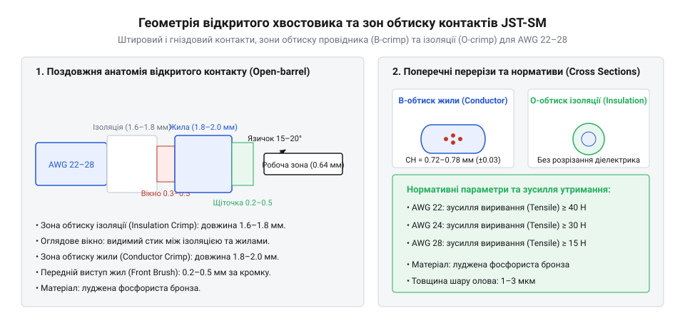
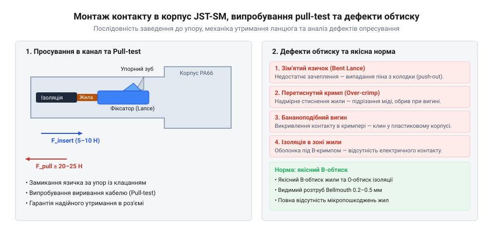

## Відмова сигнальних з'єднань і невизначеність контакту

Коли електронні пристрої, як-от світлодіодні стрічки, контролери або сенсорні модулі, працюють у реальних умовах експлуатації, вони постійно зазнають вібрацій, механічних поштовхів і температурних коливань. Під час монтажу таких пристроїв часто використовують прості роз'єми без механічних фіксаторів, подібні до нефіксованих Dupont дротів (root:cat-hw-parts/dupont-wires), які утримуються в гніздах лише за рахунок сили пружного тертя плоских або штирових контактів. Під дією навіть незначних коливань корпусу або натягу кабелю такі з'єднання поступово зміщуються. Це призводить до того, що контактна площа зменшується, електричний опір у місці з'єднання зростає, а в ланцюзі виникає неконтрольоване падіння напруги. Наслідком стають спорадичні збої живлення, миготіння підсвічування або втрата пакетів даних у сигнальних лініях.

Фізична сутність цієї проблеми полягає у відсутності жорсткої механічної фіксації, яка могла б протистояти мікрозміщенням. Коли кабель злегка натягується, пружний елемент нещільного з'єднання не може компенсувати вектор сили, спрямований уздовж осі вставки. В результаті виникає явище мікророзмикання, яке супроводжується іскрінням на мікрорівні та окисненням оголених металевих поверхонь. Усунути цю вразливість дозволяє перехід до міжкабельних роз'ємів JST-SM (root:cat-hw-parts/jst-gh-cable), які мають вбудований замковий фіксатор (@@en|latch lock@@). Цей пластиковий замок надійно блокує обидві частини корпусу разом, перетворюючи розтягувальне зусилля на безпечне механічне навантаження всього корпусу, а не окремого контакту, що повністю запобігає самочинному розмиканню (@@en|loose connection@@) і гарантує безперервність міжкабельного з'єднання (@@en|wire-to-wire connector@@).

## Конструкція та геометрія контактів JST-SM

Для забезпечення стабільного електричного та механічного зв'язку в роз'ємах використовують штирові та гніздові клеми, які виготовляються методом штампування з лудженої латуні або фосфористої бронзи. Конструкція цих елементів базується на концепції відкритого обтискного хвостовика (від англ. @@en|open barrel@@), де кожен контакт має чітко розмежовані функціональні зони. З одного боку міститься контактна частина — штировий контакт (@@en|male pin@@) у вигляді прямого стрижня або гніздовий контакт (@@en|female socket@@) у вигляді пружної гільзи з внутрішніми пелюстками, які забезпечують щільне обхватне з'єднання. З іншого боку розташовані два ряди крил різної довжини: ближчі призначені для обтискання оголеної мідної жили, а дальні — для надійного захоплення ізоляції провідника.

*Геометрія відкритого хвостовика контакту JST-SM: подвійні крила обтискання жили та ізоляції з фіксувальним язичком.*

Окрім обтискних крил, кожен металевий контакт має спеціальний виступ — пружний фіксувальний язичок. Під час введення контакту в пластиковий корпус цей язичок відгинається, а після досягнення кінцевого положення заскакує за внутрішній уступ корпусу, блокуючи зворотне витягування. Відкритий хвостовик дозволяє візуально контролювати глибину заведення жилок перед обтисканням, що виключає потрапляння ізоляції в зону електричного контакту. Поєднання пружних властивостей матеріалу контакту та двозонного механічного захвату гарантує, що струмопровідна жила не зазнаватиме надмірних згинальних навантажень під час експлуатації джгута.

## Підготовка провідників та інструменту обтискання

Якість виготовлення кабельного з'єднання безпосередньо залежить від точної підготовки джгута та дотримання технологічних допусків. Як основний провідник для таких монтажних робіт використовують багатожильний мідний кабель стандартного калібру проводу (@@en|AWG@@), зокрема монтажний провід AWG 24 (root:cat-hw-parts/hookup-wire), який забезпечує оптимальний баланс між гнучкістю джгута та допустимим струмовим навантаженням. Першим етапом є видалення зовнішньої ізоляції за допомогою спеціального інструменту — знімача ізоляції або стрипера (від англ. @@en|wire stripper@@). Довжина зняття ізоляції має бути строго дозованою: якщо оголити занадто велику ділянку жили, мідні волокна виступатимуть за межі контактного хвостовика і перешкоджатимуть замиканню корпусу; якщо ж зняти замало ізоляції, дальші крила захлипнуть захисну оболонку замість того, щоб надійно обійняти її для захисту від згинів.

*Монтаж контакту в корпус JST-SM: правильне орієнтування замкового виступу та фіксація пластиковим упором.*

Після зачищення жили її пасма акуратно скручуються у щільний джгут без втрати окремих волокон, після чого провід поміщають у матрицю ручного обтискача або кримпера (від англ. @@en|crimp tool@@). Кримпер має профільовані гнізда, які під час стискання рукояток послідовно загортають передні крила контакту навколо мідної жили у формі трапеції чи B-подібного замка, а задні крила — навколо ізоляції. Для перевірки якості виконаного з'єднання проводять випробування на зусилля на виривання (@@en|pull-out force@@), яке має відповідати нормативним показникам для даного перерізу провідника. Правильно обтиснутий контакт не повинен мати тріщин на металі, розривів жилок чи перекосів, що забезпечує довговічність і стабільність усієї електросистеми.

## Технологія дворежимного обтискання та монтажу

Щоб електричний контакт у міжкабельному з'єднанні не втратив провідність під час багаторазових згинань чи вібрацій, зусилля від натягу кабелю не повинно припадати на тендітну зону з'єднання мідних жил із металом клеми. Для цього під час монтажу застосовують двозональне дворежимне обтискання (від англ. @@en|two-stage crimping@@), під час якого матриця кримпера (від англ. @@en|crimp tool@@ — обтискач) одночасно формує два незалежних затиски на відкритому хвостовику (від англ. @@en|open barrel@@): електричний та механічний. На першій робочій ділянці матриці внутрішні вушка щільно загортаються навколо зачищених багатожильних жил, утворюючи герметичний B-подібний обтиск (від англ. @@en|B-crimp@@), де кожна мідна жила деформується за рахунок пластичного течіння металу, витісняючи повітря та створюючи газонепроникне з'єднання. На другій ділянці зовні ізоляції другі, ширші вушка обтискають захисну оболонку дроту, забезпечуючи надійне розвантаження від натягу і запобігаючи перегину та втомному руйнуванню мідних жилок біля межі переходу в метал.

Перед початком процесу обтискання за допомогою інструменту для зняття ізоляції стрипера (від англ. @@en|wire stripper@@ — знімач ізоляції) оголюють кінець багатожильного провідника калібру (@@en|AWG@@) на строго визначену довжину, уникаючи надрізання чи скручування тонких мідних дротів, які формують струмопровідну жилу. Підготовлений кінець вкладають у гніздо ручного обтискача так, щоб межа ізоляції опинилася чітко між двома парами вушок контакту. Під час стискання ручок матриця послідовно загинає крила в єдиний монолітний профіль, чим досягається низький перехідний опір і висока механібілість з'єднання. Такий підхід має спільні риси з [технологією обтискання наконечників](root:cat-hw-parts/faston-crimp-terminals), де також критично важливо дотримуватися балансу між глибиною деформації та збереженням структури металу.

Після завершення обтискання отриманий металевий вивод необхідно правильно зорієнтувати та зафіксувати всередині пластикового корпусу @@en|JST-SM@@. Контакт утримується за допомогою пружного замкового фіксатора (від англ. @@en|latch lock@@), який при введенні клеми в гніздо корпусу відгинається, а потім із характерним клацанням повертається у вихідне положення, блокуючись об внутрішній уступ. Якщо під час монтажу спрямувати контакт перевернутим або докласти надмірне зусилля без перевірки орієнтації, фіксуючий язичок деформується і не зможе утримати клему під час стикування роз'ємів. Для додаткового захисту місць виходу джгутів із корпусів або для об'єднання кількох дільниць у єдину акуратну магістраль доцільно використовувати [органайзери розвантаження натягу](root:cat-hw-parts/cable-organizer), які мінімізують локальні перегини та підвищують стійкість виробу до механічних навантажень.

## Контроль якості та усунення дефектів

Навіть за умови використання якісного інструменту візуальний огляд обтиснутого з'єднання не гарантує його електричної та механічної довговічності під час експлуатації в умовах постійних вібрацій. Головним інструментом перевірки надійності є руйнівне або неруйнівне випробування на виривання (від англ. @@en|pull-test@@), під час якого зразок закріплюють у динамометрі та плавно прикладають тягнуче зусилля до розриву або досягнення нормованого порогу. Якщо зусилля на виривання (від англ. @@en|pull-out force@@) виявляється нижчим за мінімально допустиме значення для даного перерізу дроту, це свідчить або про недостатній ступінь змикання матриці кримпера, або про часткове випадіння кількох жилок під час закладання в хвостовик.

Серед найпоширеніших дефектів виділяють асиметрію крил обтиску, коли одне вушко загинається навколо жил раніше за інше, утворюючи гострий край, який згодом перерізає мідні волокна під навантаженням. Іншою критичною помилкою є надмірне перетискання міді, за якого матриця сплющує жилу настільки сильно, що руйнує значну частину елементарних дротів, різко знижуючи загальний поперечний переріз та викликаючи локальний перегрів провідника під час проходження робочого струму. Також під час масового монтажу трапляється переполюсовка джгутів через неуважність під час заведення контактів у пластикові корпуси, що вимагає ретельної перевірки відповідності кольорів маркування або використання контрольних шаблонів перед остаточним замиканням фіксаторів. Для захисту з'єднань від вологи, пилу та абразивного впливу на ділянках переходу до роз'ємів часто монтують термозбіжну трубку (від англ. @@en|heat shrink tubing@@), яка після нагрівання щільно охоплює кабельну оболонку й задню частину пластикового корпусу, створюючи додатковий демпферний шар проти вібраційного зламу, подібний до вимог, які ставляться до [промислових кабельних шлейфів](root:cat-hw-parts/industrial-pendant-cable-harnessing-and-shielding).
