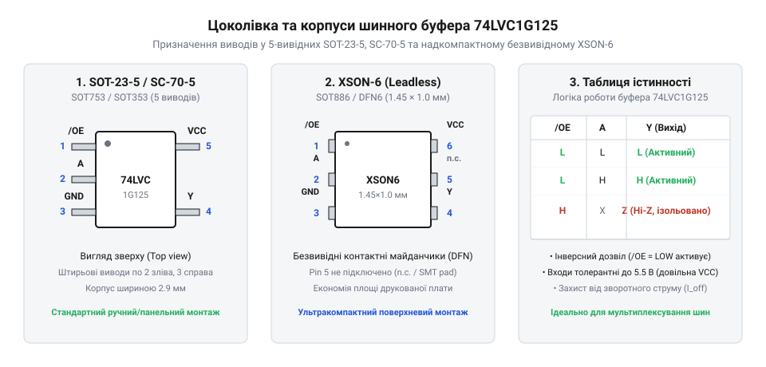
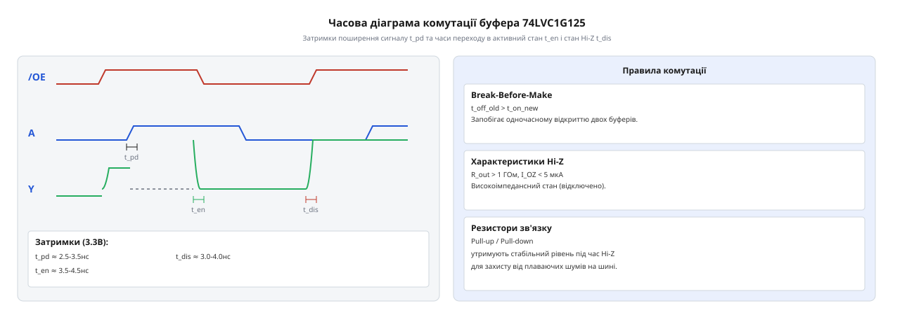

# Апаратні характеристики, розводка виводів та часові діаграми 74LVC1G125

<preknowlist>
- [Перетворювач логічних рівнів](root:cat-hw-parts/logic-level-converter) — базова теорія узгодження логічних сигналів між родинами з різними напругами живлення.
- [Логіка серії 74AHCT у системній схемотехніці](root:cat-hw-parts/74ahct-logic-family) — принципи CMOS і TTL сумісності логічних рівнів та стандартні параметри серій 74-ї логіки.
</preknowlist>

## Робота кількох джерел на спільній лінії

При паралельному підключенні кількох пристроїв до спільної сигнальної лінії безпосереднє з'єднання двотактних виходів (@@en|push-pull@@) створює ризик аварійних режимів. Якщо один передавач встановлює логічну одиницю (відкритий PMOS до `V_CC`), а інший — логічний нуль (відкритий NMOS до `GND`), виникає колізія на шині (@@en|bus contention@@).

У момент колізії утворюється прямоточне коло з низьким опором між `V_CC` та `GND`. Наскрізний струм `I_shoot` обмежується лише опорами відкритих каналів `R_DS(on)` і сягає сотень міліампер. Це викликає:
1. Перегрів та незворотне термічне руйнування кристалів мікросхем. 2. Просідання напруги живлення `V_CC` та збої в роботі сусідніх логічних елементів. 3. Невизначений рівень напруги на шині (`V_CC / 2`), що спричиняє помилкові спрацьовування приймачів.

При підключенні пристроїв із різною напругою живлення (наприклад, 5 В та 3.3 В) виникає струм через паразитний діод (@@en|body diode@@) PMOS-транзистора або ESD-захист. Це призводить до паразитного заживлення (@@en|back-feeding@@) та ризику ефекту засувки (@@en|latch-up@@).

Щоб запобігти цим аварійним режимам, неактивні передавачі повинні відключати свої виходи, переводячи їх у високоімпедансний стан @@en|Hi-Z@@.

## Принцип роботи та керування станом Hi-Z

Одноканальний шинний буфер 74LVC1G125 призначений для ізоляції сигналів та керування доступом до спільних ліній передачі даних. Це неінвертуючий буфер із трьома станами виходу (@@en|tri-state@@), який містить сигнальний вхід `A`, інверсний керуючий вхід дозволу `OE` (від @@en|output enable@@, active-low) та вихід `Y`.

Коли на вхід `OE` подано логічний нуль (0 В), двотактний вихідний каскад активовано: вихід `Y` повністю повторює стан входу `A` (при `A = 0` вихід `Y = 0`, при `A = 1` вихід `Y = 1`).

При подачі на `OE` логічної одиниці (`V_CC`) PMOS- та NMOS-транзистори вихідного каскаду закриваються. Вихід `Y` переходить у високоімпедансний стан @@en|Hi-Z@@ (від @@en|high impedance@@), у якому має опір у десятки Мегаом і поводиться як розімкнений вимикач. Струм витоку `I_OZ` через вихідний вивід при цьому не перевищує 5 мкА.

Логіку роботи описує таблиця істинності:

| OE | A | Y |
|:---:|:---:|:---:|
| L | L | L |
| L | H | H |
| H | X | Z |

де `L` — низький рівень, `H` — високий рівень, `X` — байдужий стан (Don't care), `Z` — стан @@en|Hi-Z@@.

Коли всі передавачі на шині переходять у стан @@en|Hi-Z@@, сигнальна лінія залишається у висячому стані (@@en|floating bus@@). Ємність лінії `C_bus` та електромагнітні наводки можуть створювати випадковий потенціал, що призводить до помилкового зчитування даних і наскрізних струмів у CMOS-входах. Для фіксації логічного рівня під час паузи передачі застосовують підтягувальні резистори — до живлення (@@en|pull-up@@) або до землі (@@en|pull-down@@).

Опір підтягувального резистора `R_pullup` розраховують у межах нижнього та верхнього обмежень:

1. Нижнє обмеження (`R_min`):
Коли активний передавач виставляє логічний нуль, його NMOS-транзистор вбирає струм від `V_CC` через `R_pullup`. Цей струм не повинен перевищувати граничний вихідний струм низького рівня `I_OL` (для 74LVC1G125 при `V_CC = 3.3 В` значення `I_OL = 24 мА`):

```
R_min = V_CC / I_OL
= 3.3 / 0.024
= 137.5 Ω                      [мінімальний опір підтяжки]
```

2. Верхнє обмеження (`R_max`):
Резистор `R_pullup` із паразитною ємністю шини `C_bus` утворює RC-ланцюг, який визначає час наростання фронту `t_r` при переході з низького рівня у високий у режимі @@en|Hi-Z@@:

```
t_r = 2.2 · R_pullup · C_bus   [час наростання фронту від 10% до 90%]
```

Розрахунок `R_max` для заданого максимально допустимого часу наростання `t_r = 50 нс` та ємності `C_bus = 30 пФ`:

```
R_max = t_r / (2.2 · C_bus)
= (50 · 10⁻⁹) / (2.2 · 30 · 10⁻¹²)
= 50 · 10⁻⁹ / 66 · 10⁻¹²
≈ 757.5 Ω                      [максимальний опір підтяжки]
```

Вибір опору між `R_min` та `R_max` (на практиці від 1 кОм до 4.7 кОм) забезпечує як захист активних ключів, так і збереження швидкодії лінії під час пауз передачі.

## Призначення виводів у компактних корпусах


*Розводка п'яти виводів мікросхеми 74LVC1G125 у корпусах SOT-23, SC-70 та XSON.*

Мікросхема 74LVC1G125 випускається у компактних 5-вивідних корпусах поверхневого монтажу SOT-23 (SOT-23-5 або DBV), SC-70 (SOT-353 або DCK) та безвивідному XSON (DSF). Вони мають стандартизоване призначення та нумерацію виводів:

- Вивід 1 (`OE`): інверсний вхід дозволу виходу (@@en|active-low enable@@). - Вивід 2 (`A`): сигнальний вхід даних. - Вивід 3 (`GND`): спільний вивід живлення (земля). - Вивід 4 (`Y`): сигнальний вихід даних. - Вивід 5 (`V_CC`): вивід напруги живлення.

Габаритні особливості корпусів визначають сферу їх застосування:
1. SOT-23 (2.9 мм × 1.6 мм, крок 0.95 мм) — зручний для ручного монтажу та макетування. 2. SC-70 (2.0 мм × 1.25 мм, крок 0.65 мм) — заощаджує до 60% площі плати порівняно із SOT-23. 3. XSON (1.0 мм × 1.0 мм або 1.45 мм × 1.0 мм) — безвивідний корпус із низьким профілем для компактної та мобільної електроніки.

Швидке перемикання CMOS-транзисторів супроводжується кидками струму споживання `ΔI / Δt`. Паразитна індуктивність провідників `L_trace` викликає індуктивні стрибки напруги `ΔV` на виводах живлення:

```
ΔV = L_trace · (ΔI / Δt)       [індуктивний кидок напруги живлення]
```

Для пригнічення завад і стабілізації живлення дотримуються правил трасування:
- Блокувальний керамічний конденсатор `C_dec` ємністю 0.1 мкФ (X7R/X5R) розміщують якомога ближче між виводом 5 (`V_CC`) та виводом 3 (`GND`). - Довжину провідників від виводів мікросхеми до обкладок конденсатора мінімізують для зменшення `L_trace`. - Вивід 3 (`GND`) підключають безпосередньо до суцільного шару землі (@@en|ground plane@@) через перехідний отвір із низьким опором.

## Граничні електричні параметри та режим Ioff

Робочий діапазон живлення `V_CC` мікросхеми 74LVC1G125 становить від 1.65 В до 5.5 В (гранично допустимий — від -0.5 В до +6.5 В).

Входи `A` та `OE` толерантні до напруги до 5.5 В (@@en|5.5 V tolerant inputs@@) незалежно від `V_CC`. Відсутність верхніх ESD-діодів до шини `V_CC` запобігає струмам витоку при високій вхідній напрузі. Це дозволяє 74LVC1G125 виконувати [зсув логічних рівнів](root:cat-hw-parts/logic-level-converter) з 5 В до 3.3 В або 1.8 В без додаткових компонентів. Для зворотного узгодження слід враховувати вимоги [сумісності CMOS та TTL](root:cat-hw-parts/74ahct-logic-family) щодо порогів `V_IH`.

Схема захисту `I_off` (@@en|partial power-down@@) ізолює вихід `Y` та входи при `V_CC = 0 В`. Струм витоку `I_off` не перевищує ±10 мкА при напрузі до 5.5 В, що запобігає паразитному заживленню знеструмленої шини живлення через ESD-діоди.

Вихідний каскад забезпечує високу струмову віддачу: при `V_CC = 3.3 В` струми `I_OH` та `I_OL` становлять ±24 мА, а при `V_CC = 5.0 В` досягають ±32 мА (граничний струм виходу — ±50 мА). У високоімпедансному стані @@en|Hi-Z@@ (`OE = HIGH`) струм витоку `I_OZ` не перевищує ±5 мкА.

## Динамічні характеристики та часові діаграми


*Часова діаграма затримок поширення сигналу t_pd та перемикання станів t_en і t_dis.*

Динамічні параметри 74LVC1G125 визначають її швидкодію залежно від напруги живлення `V_CC` та ємності навантаження `C_L`:

1. Затримка поширення `t_pd` (@@en|propagation delay@@): час між зміною рівня на вході `A` та виході `Y` (на рівні 50%) при `OE = LOW`. При `C_L = 50 пФ` становить 0.8...3.6 нс для `V_CC = 5.0 В`, 1.0...4.5 нс для `V_CC = 3.3 В` та 1.5...7.0 нс для `V_CC = 1.8 В` (`C_L = 30 пФ`). 2. Час активації `t_en` (@@en|enable time@@, `t_PZH`/`t_PZL`): інтервал переходу виходу зі стану @@en|Hi-Z@@ в активний стан при `OE = LOW`. 3. Час деактивації `t_dis` (@@en|disable time@@, `t_PHZ`/`t_PLZ`): інтервал повернення виходу з активного стану в @@en|Hi-Z@@ при `OE = HIGH`.

Запобігання колізіям під час арбітражу шини:
При перемиканні кількох передавачів на спільну шину через [дешифратори адреси](root:cat-hw-parts/74hc138) важливо запобігти коротким замиканням через накладання активних станів. Захисний інтервал (@@en|dead time@@) `t_pause` між зняттям `OE_1 = HIGH` та подачею `OE_2 = LOW` має перевищувати максимальний час деактивації:

```
t_pause > t_dis(max)           [пауза більша за час вимкнення]
```

Якщо `t_pause < t_dis(max)`, вихід першого буфера ще не перейде в @@en|Hi-Z@@ під час відкриття другого, викликаючи імпульсну колізію на шині.

Розрахунок максимальної робочої частоти (`f_max`):
У високошвидкісних колах, як-от лінії тактування [каскадів зсувних регістрів](root:cat-hw-parts/74hc595) чи схем [паралельного зчитування даних](root:cat-hw-parts/74hc165), робоча частота `f_max` обмежується затримкою `t_pd` та тривалістю фронтів `t_r`:

```
f_max = 1 / (2 · (t_pd + t_r)) [максимальна робоча частота]
```

При `V_CC = 3.3 В` і `C_L = 15 пФ` (`t_pd ≈ 2.5 нс`, `t_r ≈ 1.5 нс`) гранична частота становить:

```
f_max = 1 / (2 · (2.5 · 10⁻⁹ + 1.5 · 10⁻⁹))
= 1 / (8.0 · 10⁻⁹)
= 125 · 10⁶ Гц                 [гранична частота перемикання 125 МГц]
```

Це дозволяє 74LVC1G125 стабільно працювати на частотах понад 100 МГц.