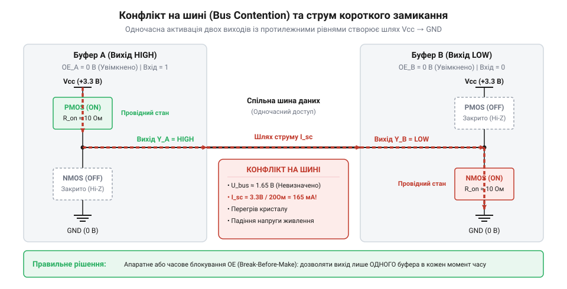
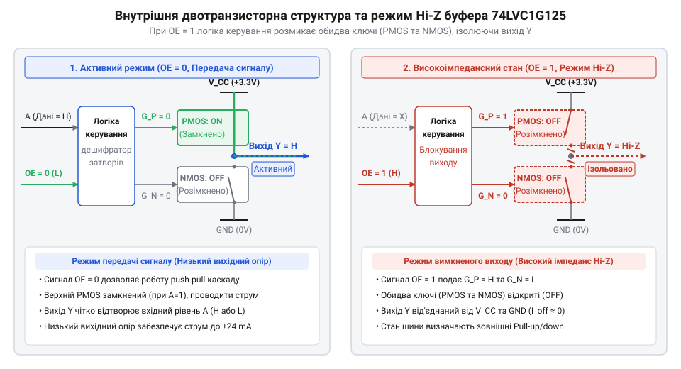
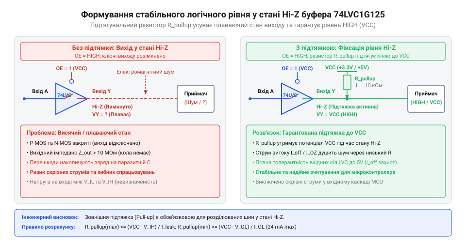
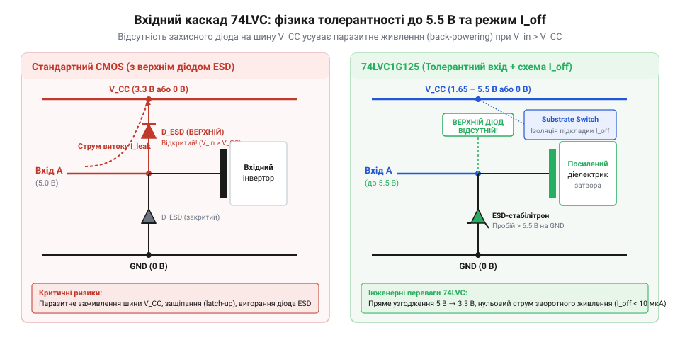
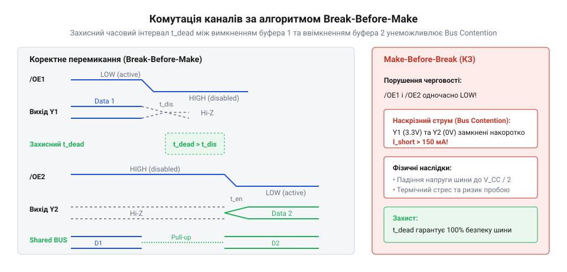
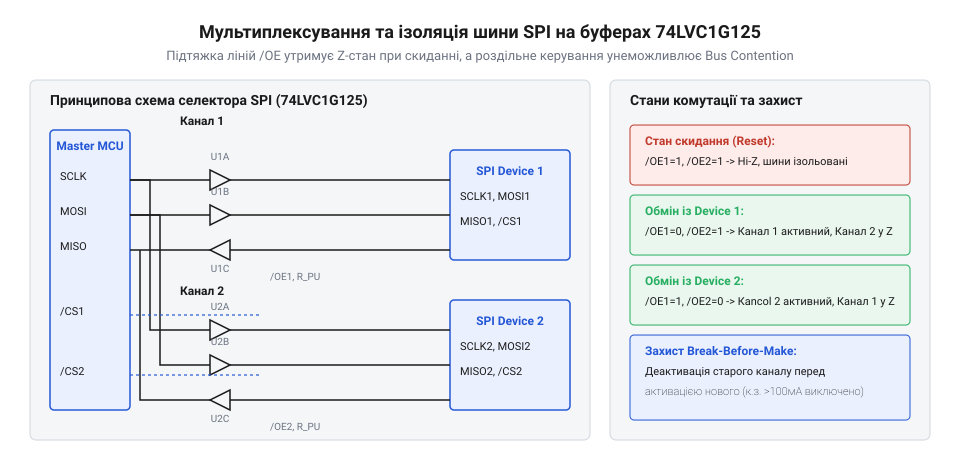

# Буфер із трьома станами виходу 74LVC1G125

<preknowlist>
- [Перетворювач логічних рівнів](root:cat-hw-parts/logic-level-converter) — концепція трансляції логічних сигналів між родинами з різними напругами живлення
- [Логіка серії 74AHCT у системній схемотехніці](root:cat-hw-parts/74ahct-logic-family) — принципи сумісності TTL/CMOS логічних рівнів та пороги спрацьовування вхідних каскадів
</preknowlist>

## Конфлікти паралельних джерел на спільній шині

Коли кілька цифрових пристроїв мають передавати дані до єдиного приймача через @@en|спільну шину даних@@ (від англ. @@en|data bus@@ — «загальна лінія передачі даних»), їхні виходи фізично з'єднують в одну електричну точку. У стандартній цифровій схемотехніці вихід будь-якої логічної мікросхеми улаштований як @@en|двотактний вихідний каскад@@ (від англ. @@en|push-pull output stage@@ — «двотактний вихідний каскад»). Цей каскад складається з двох послідовно увімкнених силових @@en|транзисторів@@ (від англ. @@en|transistor@@): верхнього плеча, підключеного до лінії живлення `V_CC`, та нижнього плеча, підключеного до спільного проводу `GND`. У будь-який момент часу один із цих ключових елементів повністю відкритий, а інший — закритий.

Проблема виникає тоді, коли два джерела даних одночасно намагаються передати власні сигнали в один і той самий дріт. Якщо перший пристрій виставляє на своєму виході логічну одиницю, відкриваючи верхній ключ і з'єднуючи лінію з `V_CC`, а другий пристрій у цей же момент виставляє логічний нуль, відкриваючи нижній ключ до `GND`, між шиною живлення та землею утворюється пряме гальванічне з'єднання через два відкриті напівпровідникові канали. Оскільки внутрішній опір відкритих силових ключів становить від кількох одиниць до десятків ом, у колі виникає струм короткого замикання, який може досягати сотень міліампер або кількох ампер.

Наслідки такого підключення негайно руйнують роботу системи на двох рівнях. По-перше, електрична напруга на лінії перестає відповідати будь-якому допустимому логічному рівню. Лінія опиняється в проміжному стані, який визначається дільником опорів відкритих каналів двох змагальних виходів, через що приймач даних бачить хаотичний або спотворений сигнал. По-друге, колосальний струм короткого замикання створює інтенсивне тепловиділення на крихітній площі кремнієвого кристала. Температура напівпровідникового переходу миттєво перевищує критичну межу 150 °C, що призводить до термічного пробою вихідних каскадів і незворотного пошкодження портів мікросхем.


*Шлях проходження струму короткого замикання через відкриті транзистори верхнього та нижнього плечей двох конкуруючих виходів.*

Описане явище в цифровій схемотехніці називають @@en|шинним конфліктом@@ (від англ. @@en|bus contention@@ — «суперництво на шині»). Докладний аналіз причин і фізичних наслідків цієї проблеми наведено в матеріалі про [шинні конфлікти цифрових ліній](root:hw-digital/digital-bus-contention-and-isolation). Щоб побудувати надійну систему з розділюваним каналом зв'язку, необхідно мати спосіб фізично відключати вихід неактивного передавача від спільного дроту, переводячи його у стан, у якому він не проводитиме струм і не впливатиме на електричний потенціал лінії.

## Фізична природа тристабільного виходу та OE

Для фізичного відключення джерела даних від спільної лінії ззвичайного @@en|двотактного каскаду@@ недостатньо: потрібен елемент, здатний формувати третій стан виходу, у якому обидва силові ключі одночасно розімкнені. Саме цю функцію виконує одноканальний буфер @@en|74LVC1G125@@. Його вихідний каскад побудовано на двох комплементарних польових транзисторах — верхньому P-канальному та нижньому N-канальному @@en|MOSFET@@ (від англ. @@en|Metal-Oxide-Semiconductor Field-Effect Transistor@@ — «польовий транзистор метал-оксид-напівпровідник»). Керування цими @@en|транзисторами@@ здійснюється внутрішньою логічною схемою, яка зважує стан сигнального входу `A` та входу дозволу виходу `OE` (від англ. @@en|Output Enable@@ — «дозвіл виходу»).

Вхід `OE` у мікросхемі @@en|74LVC1G125@@ є активним низьким рівнем. Коли на вхід `OE` подано логічний нуль (`GND`), внутрішня логіка дозволяє проходження сигналу зі входу `A` на затвори вихідних ключів. Якщо `A = 0`, відкривається нижній N-канальний @@en|транзистор@@ і замикає вихід `Y` на `GND`. Якщо `A = 1`, відкривається верхній P-канальний @@en|транзистор@@ і замикає вихід `Y` на `V_CC`. У цьому режимі мікросхема працює як звичайний повторювач напруги з низьким вихідним опором.

Ситуація принципово змінюється, коли на вхід `OE` подають логічну одиницю (`V_CC`). Внутрішня логіка керування негайно формує такі напруги на затворах силових @@en|транзисторів@@, що різниця потенціалів між затвором і витоком кожного з них падає нижче порогового значення. У результаті P-канальний і N-канальний @@en|транзистори@@ закриваються одночасно. Оскільки обидва електронні ключі розімкнені, електричний опір між виходом `Y` та іншими колами мікросхеми зростає до сотень мегаом або гігаом, а струм витоку не перевищує кількох пікоампер. Цей стан називають @@en|високоімпедансним станом@@ (від англ. @@en|high-impedance state@@, або @@en|Hi-Z@@ — «стан високого опору»).

З електричного погляду вихід у режимі @@en|Hi-Z@@ еквівалентний повністю розірваному колу або відпаяному дроту. Він не подає напругу на шину і не замикає її на землю, що повністю усуває загрозу @@en|шинного конфлікту@@. Глибоке фізичне обґрунтування та еквівалентні схеми заміщення цього режиму викладено у статті про [фізику високоімпедансного стану](root:hw-digital/hi-z-state).


*Внутрішня двотранзисторна структура буфера з внутрішньою логікою керування, де високий рівень на вході OE вимикає обидва силові ключі.*

Поява ключових елементів із @@en|тристабільним виходом@@ (від англ. @@en|three-state output@@ — «вихід із трьома станами») стала вирішальним етапом розвитку цифрової техніки. У 1970-х роках масовий перехід до паралельних шин процесорів вимагав заміни повільних схем із @@en|відкритим колектором@@ (від англ. @@en|open-collector@@ — «відкритий колекторний вихід»), у яких наростання сигналу гальмувалося пасивними резисторами. Винайдення активних @@en|тристабільних каскадів@@ у класичній 14-вивідній мікросхемі @@en|74125@@ на основі @@en|TTL@@ (від англ. @@en|Transistor-Transistor Logic@@ — «транзисторно-транзисторна логіка») дало змогу поєднати високу швидкість @@en|двотактного виходу@@ з можливістю повної ізоляції неактивних пристроїв. Із розвитком напівпровідникових технологій громіздкі багатоканальні корпуси поступилися місцем дискретним елементам серії @@en|TinyLogic@@ у корпусах @@en|SOT-23@@ та @@en|SC-70@@. Перехід від 5-вольтової біполярної логіки до низьковольтної @@en|CMOS@@ (від англ. @@en|Complementary Metal-Oxide-Semiconductor@@ — «комплементарна структура метал-оксид-напівпровідник») серії @@en|74LVC@@ забезпечив роботу при напругах живлення від 1.65 В до 5.5 В із збереженням толерантності входів до вищої напруги та захистом вимкненого живлення `I_off`.

Хоча режим @@en|Hi-Z@@ розв'язує проблему коротких замикань, він створює іншу схемотехнічну небезпеку — плаваючий стан лінії. Коли всі джерела на шині перебувають у @@en|високоімпедансному стані@@, провідник залишається електрично ізольованим. Власна паразитна ємність лінії зберігає залишковий заряд, а високий імпеданс робить лінію чутливою до зовнішніх електромагнітних наводок. Якщо напруга на такій плаваючій лінії опиниться між порогами спрацьовування `V_IL` та `V_IH` вхідного каскаду приймача, у приймальній мікросхемі одночасно частково відкриються обидва вхідні @@en|транзистори@@. Це спричинить наскрізний струм пробою через вхідний каскад, зростання статичного енергоспоживання та спотворення логічних даних.

Для фіксації визначеного електричного потенціалу на шині під час @@en|Hi-Z@@ застосовують зовнішній @@en|підтягувальний резистор@@ (від англ. @@en|pull-up resistor@@ — «підтягувальний резистор») або зтягувальний резистор. Коли вихід буфера @@en|74LVC1G125@@ відключено, резистор з відносно високим опором (зазвичай від 4.7 кОм до 100 кОм) м'яко утримує напругу на шині на рівні `V_CC` або `GND`. Як тільки буфер активується низьким рівнем на вході `OE`, його низькоомний @@en|двотактний вихід@@ легко пересилює струм @@en|підтяжки@@ та впевнено керує шиною.


*Формування фіксованого логічного рівня на спільній шині за допомогою підтягувального резистора під час високого імпедансу виходу.*

Точний розрахунок опору @@en|підтяжки@@ з урахуванням ємності лінії та частотних затримок виконують за допомогою [розрахунку підтягувальних резисторів](root:cat-hw-parts/logic-buffer-74lvc1g125/math-pullup-resistor-and-hiz-timing.md). У практичних системах буфер @@en|74LVC1G125@@ використовують для [побудови мультиплексорів шин](root:cat-hw-parts/logic-buffer-74lvc1g125/proj-bus-multiplexer-isolation.md) і систем керування периферією. Окрім ізоляції, толерантність вхідних каскадів серії @@en|74LVC@@ дозволяє застосовувати елемент для [узгодження логічних рівнів](root:cat-hw-parts/logic-buffer-74lvc1g125/proj-level-shifter-and-port-protector.md) між 5-вольтними джерелами та 3.3-вольтними мікроконтролерами. Вичерпні довідкові дані щодо граничних струмів та швидкодії компонента наведено у розділі з [електричними параметрами буфера](root:cat-hw-parts/logic-buffer-74lvc1g125/api-74lvc1g125-hardware-spec.md), а загальну концепцію та відмінності серії @@en|74LVC@@ розкрито у матеріалі про системні риси [родини мікросхем LVC](root:cat-hw-parts/74lvc-logic-family-overview).

## Особливості серії LVC і захист Ioff

Коли пристрій проектують на базі сучасного 3.3-вольтового чи 2.5-вольтового мікроконтролера, постає завдання прийому цифрових сигналів від застарілих 5-вольтних датчиків, енкодерів або логічних мікросхем. У класичних мікросхемах комплементарної логіки на входах встановлено захисні діоди електростатичного розряду (від англ. @@en|ESD@@ — «електростатичний розряд»), один із яких підключено між вхідною ніжкою та шиною живлення `V_CC`. Якщо на вхід такої мікросхеми подати напругу 5 В за живлення `V_CC = 3.3 В`, захисний діод відкривається, оскільки пряме зміщення перевищує порогове значення 0.6 В. Через діод починає протікати необмежений струм із джерела 5 В безпосередньо в шину 3.3 В. Це спричиняє паразитне живлення всієї плати (від англ. @@en|phantom powering@@ — «примарне живлення»), аварійне підвищення напруги живлення, збої в роботі мікроконтролера та вихід з ладу напівпровідникових переходів через перегрів.

Логічна родина @@en|74LVC@@ (від англ. @@en|Low-Voltage CMOS@@ — «низьковольтна комплементарна логіка») позбавлена цього недоліку завдяки спеціально спроектованій топології вхідного каскаду. У мікросхемі @@en|74LVC1G125@@ верхній захисний діод між входами `A`, `OE` та шиною `V_CC` повністю відсутній. Захист від електростатичних розрядів реалізовано за допомогою спеціальних лавинних дифузійних структур або заземлених ланцюгів із зворотним зміщенням, підключених виключно до спільного проводу `GND`. Завдяки цьому вхідні канали витримують напругу до 5.5 В незалежно від поточного значення напруги живлення `V_CC`, навіть якщо воно становить 1.65 В або 0 В. Цю властивість називають толерантністю входів до підвищеної напруги (від англ. @@en|5V tolerance@@ — «стійкість вхідних каскадів до напруги 5 В»). Вона дозволяє використовувати буфер @@en|74LVC1G125@@ як прямий знижувальний [перетворювач логічних рівнів](root:cat-hw-parts/logic-level-converter) без застосування зовнішніх дільників або додаткових захисних діодів.

Ще більш критична проблема виникає в системах із кількома джерелами живлення або при використанні режимів глибокого енергозбереження, коли окремі блоки схеми знеструмлюють (`V_CC = 0 В`), залишаючи зовнішні лінії зв'язку під напругою. Якщо звичайна мікросхема втрачає живлення, її вихідні транзистори та паразитичні діоди підкладки створюють низькоомний шлях витоку струму з активної шини даних у знеструмлену лінію `V_CC`. Це призводить до розряджання акумуляторів, виникнення невизначених потенціалів на шинах та фатального заклинювання напівпровідникової структури (від англ. @@en|latch-up@@ — «засувка»).

Для усунення цього ризику в буфері @@en|74LVC1G125@@ реалізовано схему захисту вимкненого живлення (від англ. @@en|Partial Power-Down mode@@ — «режим часткового вимкнення живлення»), яку в документації позначають параметром @@en|I_off@@. Коли напруга живлення мікросхеми падає до нуля (`V_CC = 0 В`), внутрішнє коло моніторингу автоматично ізолює затвори та підкладки вихідних P-канальних і N-канальних транзисторів. Спеціальний перемикач підкладки (від англ. @@en|substrate switch@@ — «перемикач підкладки») від'єднує внутрішню кишеню P-канального транзистора від шини `V_CC`, унеможливлюючи пряме протікання струму через паразитний p-n перехід. У такому стані вихід `Y` та входи `A`, `OE` переходять у високоімпедансний стан із наднизьким струмом витоку, який не перевищує 10 мкА.


*Спрощена структура вхідного каскаду 74LVC без захисного діода на V_CC, яка забезпечує толерантність входів до 5 В та відсутність витоків у режимі I_off.*

Завдяки захисту @@en|I_off@@ буфер @@en|74LVC1G125@@ можна безпечно залишати підключеним до працюючої шини даних у той час, коли сам буфер позбавлений живлення. Це робить його ідеальним вибором для пристроїв із гарячим підключенням модулів (від англ. @@en|hot-swapping@@ — «гаряча заміна») та складних багаторазових систем із вибірковим вимкненням живлення. Практичні схемотехнічні розрахунки побудови [трансляторів рівнів із захистом I_off](root:cat-hw-parts/logic-buffer-74lvc1g125/proj-level-shifter-and-port-protector.md) демонструють високу надійність таких бар'єрів. Більш детальний аналіз специфіки всієї серії наведено в матеріалі про системні властивості [родини логіки LVC](root:cat-hw-parts/74lvc-logic-family-overview).

## Запобігання плаваючим станам та шинним конфліктам

Ви перевели вихід буфера @@en|74LVC1G125@@ у режим @@en|Hi-Z@@, розімкнувши обидва силові ключі, і припустили, що шина даних перебуває в безпеці. Однак ізольований провідник без електричного зв'язку з джерелом живлення або землею перетворюється на плаваючу лінію. Паразитна ємність монтажу та входів мікросхем накопичує випадкові заряди, а зовнішні електромагнітні наводки здатні зміщувати потенціал провідника у проміжну область між логічним нулем `V_IL` та логічною одиницею `V_IH`.

Коли напруга на вхідних затворах приймальної логічної мікросхеми зависає на рівні близько `V_CC / 2`, в її вхідному двотактному каскаді одночасно частково відкриваються P-канальний і N-канальний транзистори. Замість чіткого переключення виникає прямий канал між `V_CC` та `GND`, через який протікає наскрізний струм пробою (від англ. @@en|shoot-through current@@ — «наскрізний струм пробою»). Це викликає додатковий розігрів кристала, шум на шинах живлення та хаотичні генерації вихідних сигналів. Для усунення плаваючих станів лінію обов'язково підтягують до визначеного потенціалу за допомогою зовнішнього резистора.

Вибір опору підтягувального резистора `R_pull` визначається компромісом між швидкістю відновлення сигналу та енергоспоживанням. Верхня межа опору `R_pull_max` обмежена максимально допустимим часом наростання сигналу `t_r` та сумарною паразитною ємністю шини `C_bus`, яка складається з ємності друкованих провідників і вхідних ємностей підключених мікросхем:

```
R_pull_max = t_r / (2.2 * C_bus)       [граничний опір за часом наростання]
```

Якщо сумарна ємність шини `C_bus` становить 30 пФ, а необхідний час наростання сигналу `t_r` для забезпечення заданої частоти становить 100 нс, максимальний опір підтяжки обчислюють так:

```
R_pull_max = 100 * 10^-9 / (2.2 * 30 * 10^-12)       [підстановка параметрів]
= 100 * 10^-9 / (6.6 * 10^-11)                       [роззрахунок знаменника]
= 1515 Ohm                                          [граничне значення опору]
```

Нижня межа опору `R_pull_min` обмежена максимально допустимим вхідним струмом нижнього транзистора буфера `I_OL_max`, при якому вихідна напруга не перевищує поріг логічного нуля `V_OL_max`:

```
R_pull_min = (V_CC - V_OL_max) / I_OL_max       [граничний опір за навантажувальною здатністю]
```

Для мікросхеми @@en|74LVC1G125@@ при живленні `V_CC = 3.3 В` допустимий вихідний струм досягає `I_OL = 24 мА` при `V_OL = 0.4 В`. Отже, абсолютний мінімум опору становить `(3.3 - 0.4) / 0.024 = 120.8 Ом`. На практиці для досягнення оптимуму між швидкодією та енергоспоживанням обирають номінали в діапазоні від 1 кОм до 10 кОм. Детальний математичний апарат із урахуванням струмів витоку викладено у розділі про [розрахунок підтягувальних резисторів](root:cat-hw-parts/logic-buffer-74lvc1g125/math-pullup-resistor-and-hiz-timing.md).

Другою критичною пасткою є часове перекриття сигналів під час перемикання декількох буферів на спільну шину. Перехід виходу з активного стану у високоімпедансний займає час затримки вимкнення `t_PHZ` або `t_PLZ`, а ввімкнення — час `t_PZH` або `t_PZL`. Якщо керовані сигнали дозволу `OE` для двох джерел перемикаються одночасно, другий буфер може увімкнутися раніше, ніж перший встигне повністю закритися.


*Часові діаграми сигналів керування OE, що показують виникнення короткочасного шинного конфлікту при одночасному перемиканні та його усунення за допомогою затримки break-before-make.*

Протягом інтервалу перекриття тривалістю від 1 до 4 нс виникає короткочасний [шинний конфлікт](root:hw-digital/digital-bus-contention-and-isolation), що супроводжується імпульсним струмом і завадами на шині. Щоб гарантовано виключити суперництво виходів, застосовують алгоритм затримки увімкнення (від англ. @@en|break-before-make timing@@ — «часова затримка розмикання перед замиканням»). Схема керування спочатку знімає сигнал дозволу з першого буфера (`OE1 = 1`), витримує паузу, більшу за `t_PHZ_max`, і лише після цього активує другий буфер (`OE2 = 0`).

Завдяки високій швидкодії серії @@en|74LVC@@ фронти перемикання сигналів є надзвичайно крутими (`t_r, t_f < 2.5 нс`), що при струмах до 32 мА створює високе значення похідної струму по часу (`di/dt`). Через паразитну індуктивність провідників живлення це викликає імпульсні підйоми потенціалу землі (від англ. @@en|ground bounce@@ — «підйоми потенціалу спільної шини») та просідання напруги `V_CC`. Для нейтралізації цих завад безпосередньо біля виводів живлення мікросхеми встановлюють керамічний розв'язувальний конденсатор (від англ. @@en|decoupling capacitor@@ — «розв'язувальний конденсатор») ємністю 0.1 мкФ з низьким еквівалентним послідовним опором (ESR). Трасування друкованої плати має забезпечувати мінімальну довжину провідників від конденсатора до виводів `V_CC` і `GND`. З повним переліком часових затримок та електричних обмежень можна ознайомитися у [довіднику апаратних характеристик 74LVC1G125](root:cat-hw-parts/logic-buffer-74lvc1g125/api-74lvc1g125-hardware-spec.md).

## Застосування буфера в узгодженні та ізоляції

Завдяки поєднанню високої швидкодії, толерантності до напруги 5 В та наявності керуючого входу `OE`, мікросхема @@en|74LVC1G125@@ є універсальним інструментом для вирішення системних завдань схемотехніки. Найпростішим сценарієм є використання буфера для безпечного зниження логічних рівнів. Якщо мікроконтролер із живленням 3.3 В має приймати високочастотний сигнал від 5-вольтового датчика, буфер живлять від шини 3.3 В, а вхід `OE` підключають до `GND`. Сигнал 5 В подається на вхід `A`, а з виходу `Y` знімається чистий 3.3-вольтний сигнал без ризику пошкодження чутливого порту введення-виведення. При цьому буфер додатково працює як захисний бар'єр (від англ. @@en|buffer barrier@@ — «захисний буферний бар'єр»), приймаючи на себе можливі сплески напруги та статичні розряди із зовнішнього кабелю.

У складних мікроконтролерних системах часто виникає потреба ізоляції периферійних пристроїв на спільних шинах даних. Наприклад, на послідовній шині @@en|SPI@@ (від англ. @@en|Serial Peripheral Interface@@ — «послідовний інтерфейс периферії») кілька ведених пристроїв підключені до єдиної лінії MISO (Master In Slave Out). Деякі бюджетні мікросхеми не переходять у стан @@en|Hi-Z@@ після зняття сигналу вибору мікросхеми CS (Chip Select), продовжуючи шунтувати лінію. Встановлення буфера @@en|74LVC1G125@@ між виходом MISO такого пристрою та спільною шиною повністю усуває проблему. Вхід `OE` буфера з'єднують із лінією `CS`: коли пристрій не активний (`CS = 1`), вихід буфера повністю ізолює його від шини.

На базі двох буферів @@en|74LVC1G125@@ легко побудувати двоканальний цифровий мультиплексор, який дозволяє мікроконтролеру обирати одне з двох джерел даних для прийому через єдиний апаратний порт. Виходи двох буферів об'єднують на спільній лінії з підтягувальним резистором, а керуючі входи `OE` підключають до протилежних значень вибіркового сигналу:

:::tabs
:::code logic-buffer-74lvc1g125-d/c/esp-idf/select-channel.c
:::code logic-buffer-74lvc1g125-d/cpp/arduino/selectchannel.cpp
:::


*Принципова схема застосування буферів 74LVC1G125 для ізоляції лінії MISO в шині SPI та побудови двоканального мультиплексора сигналів.*

Практична реалізація таких вузлів детально описана в проєктах [двоканального мультиплексора та ізолятора шини SPI](root:cat-hw-parts/logic-buffer-74lvc1g125/proj-bus-multiplexer-isolation.md), а також [модуля захисту портів](root:cat-hw-parts/logic-buffer-74lvc1g125/proj-level-shifter-and-port-protector.md). Подібні схеми часто працюють у зв'язці зі [зсувними регістрами 74HC595](root:cat-hw-parts/74hc595), вхідними [регістрами 74HC165](root:cat-hw-parts/74hc165) та дешифраторами [74HC138](root:cat-hw-parts/74hc138) для побудови масштабних систем введення-виведення. Якщо ж вимагається двоспрямований транзит даних складних шин, використовують спеціалізовані [перетворювачі логічних рівнів](root:cat-hw-parts/logic-level-converter).

Вибір корпусного виконання мікросхеми @@en|74LVC1G125@@ визначається вимогами щільності монтажу та умовами експлуатації. Для стандартних двошарових плат та ручного розпаювання зручним є корпус @@en|SOT-23-5@@ (позначення DBV) з кроком виводів 0.95 мм. Для компактних пристроїв застосовують корпус @@en|SC-70-5@@ (позначення DCK, також відомий як @@en|SOT-353@@), який займає вдвічі меншу площу. У надмініатюрній електроніці використовують безкорпусні виконання @@en|DSBGA@@ (від англ. @@en|Die-Size Ball Grid Array@@ — «кулькова матриця розміром із кристал»), такі як @@en|NanoStar@@ (позначення YZP), де розміри елемента становлять лише 1.4 × 0.9 мм. Малі розміри не лише економлять місце на друкованій платі, але й мінімізують паразитичну індуктивність виводів, покращуючи цілісність високочастотних сигналів.