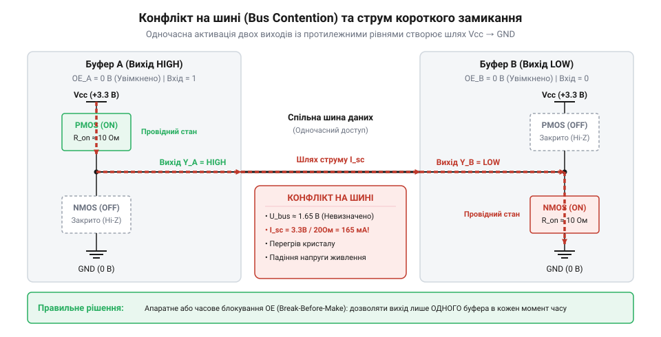
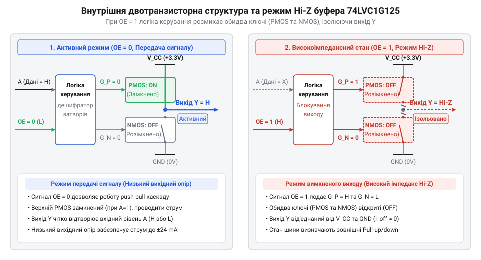
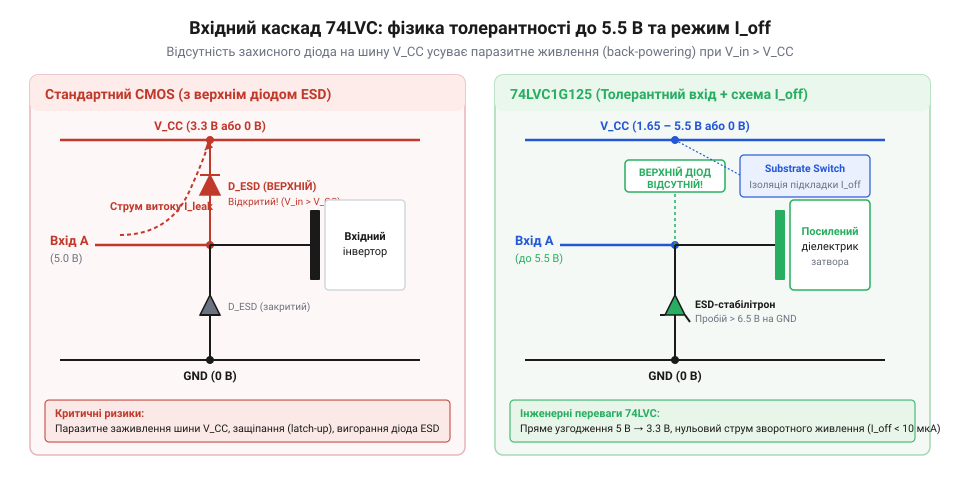
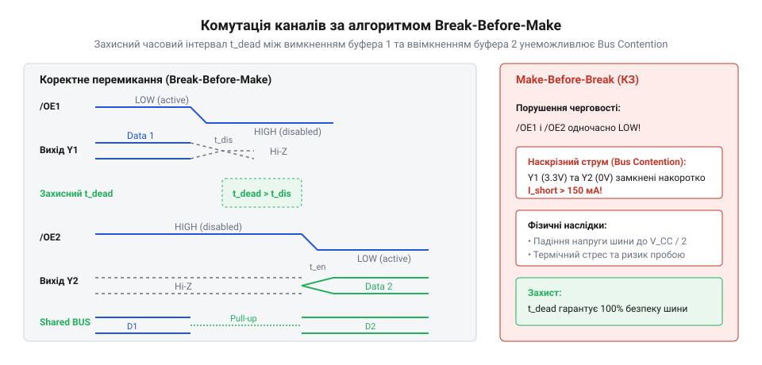
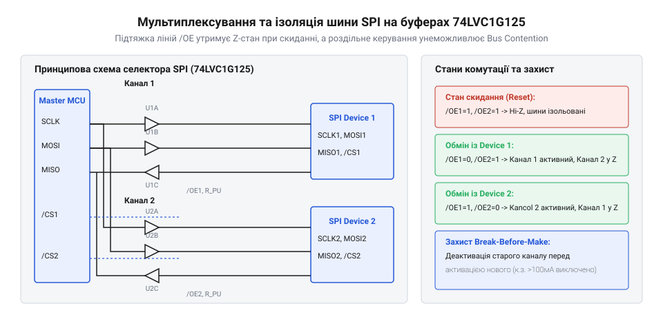

# Буфер із трьома станами виходу 74LVC1G125

<preknowlist>
- [Перетворювач логічних рівнів](root:cat-hw-parts/logic-level-converter) — концепція трансляції логічних сигналів між родинами з різними напругами живлення
- [Логіка серії 74AHCT у системній схемотехніці](root:cat-hw-parts/74ahct-logic-family) — принципи сумісності TTL/CMOS логічних рівнів та пороги спрацьовування вхідних каскадів
</preknowlist>

## Конфлікти паралельних джерел на шині

*Наскрізний струм короткого замикання при одночасній активності двох протилежних виходів на спільній шині.*

## Фізика тристабільного виходу та OE

Одноканальний цифровий буфер @@en|74LVC1G125@@ додає до двотактної логіки [високоімпедансний стан](root:hw-digital/hi-z-state) (від англ. @@en|high impedance@@, @@en|Hi-Z@@) для безпечного підключення пристроїв до спільної лінії.

Вихідний каскад побудовано на комплементарній парі MOSFET-транзисторів. Інверсний вхід дозволу виходу (від англ. @@en|output enable@@, `OE`) за логічного нуля (0 В) дозволяє передачу сигналу з `A` на `Y`: високий рівень на вході відкриває PMOS-транзистор, низький — NMOS-транзистор, забезпечуючи низький вихідний опір.

*Функціональна схема тристабільного вихідного каскаду, де високий рівень на вході OE вимикає обидва силові транзистори.*

Високий рівень (`V_CC`) на `OE` замикає обидва транзистори, від'єднуючи вихід `Y` від живлення та землі. Його опір зростає до гігаомів із мінімальним струмом витоку `I_OZ`. У стані @@en|Hi-Z@@ вихід еквівалентний розірваному колу та не заважає іншим пристроям на шині.

## Толерантність входів та захист Ioff

*Конструкція вхідного каскаду буфера 74LVC1G125 без верхнього паразитного діода забезпечує толерантність до 5.5 В.*

## Запобігання плаваючим станам і завадам

*Часова діаграма комутації виходів показує небезпеку короткочасного шинного конфлікту через затримки перемикання.*

## Практичні схеми узгодження та ізоляції

*Схема підключення буфера 74LVC1G125 для надійної ізоляції виходу MISO пристрою шини SPI за сигналом CS.*