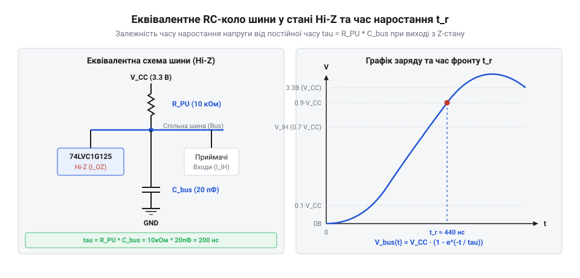

# Розрахунок підтягувальних резисторів та часових затримок для Hi-Z шин

<preknowlist>
- [Логіка серії 74AHCT у системній схемотехніці](root:cat-hw-parts/74ahct-logic-family) — значення порогових напруг V_IH, V_IL та електричні характеристики виходів із трьома станами
- [Перетворювач логічних рівнів](root:cat-hw-parts/logic-level-converter) — особливості роботи підтягувальних резисторів у колах з відкритим стоком та розв'язкою рівнів
</preknowlist>

## Плаваюча шина та ризики Hi-Z

Цифрові мікросхеми з трьома станами виходу можуть переходити у стан високого імпедансу (третій стан, з англ. @@en|high impedance@@, або @@en|Hi-Z@@). У цьому режимі вихідний каскад драйвера вимикає обоє силових ключів — верхній PMOS-транзистор до живлення `V_CC` та нижній NMOS-транзистор до землі `GND`. З боку зовнішнього кола вихід перетворюється на опір у десятки мегаом, і лінія стає повністю ізольованою.

Вхідні каскади КМОН-логіки побудовані на польових транзисторах (з англ. @@en|MOSFET@@) із високим вхідним опором затвора. Оскільки струм через затвор практично не тече, електричний заряд на відключеній шині не має шляху для витоку чи поповнення. Така лінія стає плаваючою (з англ. @@en|floating bus@@), а її потенціал — невизначеним. Напругу на ній починають задавати статика, накопичені заряди та ємнісна наводка (з англ. @@en|crosstalk@@) від сусідніх провідників. Плаваюча шина працює як антена, де напруга довільно коливається між 0 В та `V_CC`.

Це створює дві небезпеки для цифрової системи. Перша — хибні спрацьовування приймачів. Якщо плаваючий потенціал перетинає порогові значення, логічні входи таких компонентів, як [зсувний регістр 74HC595](root:cat-hw-parts/74hc595) або [дешифратор серії 74HC138](root:cat-hw-parts/74hc138), починають довільно змінювати стан, сприймаючи хаотичні шуми за реальні імпульси.

Друга небезпека — фізичне деградування кристала. Вхідний КМОН-інвертор складається з послідовних PMOS та NMOS транзисторів. При чіткій логічній 1 (`V > V_IH`) або 0 (`V < V_IL`) відкритий лише один із них. Проте коли потенціал плаваючої шини зависає в невизначеному діапазоні довкола `V_CC / 2`, обоє транзисторів вхідного каскаду частково відкриваються.

У результаті між `V_CC` та `GND` утворюється прямоточний канал, яким починає протікати наскрізний струм (з англ. @@en|shoot-through current@@). Споживання зростає від мікроамперів до сотень міліамперів, що викликає локальний перегрів кристала, просідання живлення та може призвести до виходу мікросхеми з ладу.

Щоб усунути стан плаваючого потенціалу у режимі @@en|Hi-Z@@, шину прив'язують до фіксованого логічного рівня зовнішнім резистором: до живлення `V_CC` — підтягувальним резистором (з англ. @@en|pull-up@@), або до землі `GND` — підтягувальним резистором (з англ. @@en|pull-down@@).

## Верхня межа опору та струми витоку

Підтягувальний резистор до живлення (з англ. @@en|pull-up@@) має надійно фіксувати високий логічний рівень на шині у стані @@en|Hi-Z@@, що обмежує його максимальний опір `R_max`.

Через закриті КМОН-виходи у стані @@en|Hi-Z@@ та входи приймачів протікають струми витоку (з англ. @@en|leakage current@@) `I_OZ` та `I_IH` до землі `GND`. Єдиним джерелом струму для їхньої компенсації є підтягувальний резистор `R_PU`. Сумарний струм витоку `I_leak_total` дорівнює:

```
I_leak_total = N_out * I_OZ + N_in * I_IH
```

де `N_out` — кількість виходів у режимі @@en|Hi-Z@@, `N_in` — кількість підключених входів приймачів.

Спад напруги `I_leak_total * R_PU` знижує потенціал шини `V_bus = V_CC - I_leak_total * R_PU`. Щоб забезпечити логічний високий рівень з урахуванням запасу завадостійкості `V_noise` (для [логіки 74AHCT](root:cat-hw-parts/74ahct-logic-family) граничні рівні напруг строго стандартизовані), напруга `V_bus` повинна задовольняти нерівності:

```
V_CC - I_leak_total * R_PU >= V_IH_min + V_noise
```

Звідси граничний опір `R_max` обчислюється як:

```
V_CC - I_leak_total * R_max = V_IH_min + V_noise
I_leak_total * R_max = V_CC - (V_IH_min + V_noise)        [перенесення доданків]
R_max = (V_CC - V_IH_min - V_noise) / I_leak_total        [ділення на сумарний струм витоку]
```

**Умова розрахунку**:
Живлення `V_CC = 5.0 В`, вхідний рівень `V_IH_min = 3.5 В`, запас завадостійкості `V_noise = 0.2 В`. До шини підключено `N_out = 4` виходи з `I_OZ = 5 мкА` та `N_in = 2` входи з `I_IH = 1 мкА`.

```
I_leak_total = 4 * 5 uA + 2 * 1 uA
= 20 uA + 2 uA                [додавання витоків виходів та входів]
= 22 uA = 0.000022 A          [переведення в ампери]

R_max = (5.0 V - 3.5 V - 0.2 V) / 0.000022 A
= 1.3 V / 0.000022 A          [обчислення допустимого спаду напруги]
≈ 59090.9 Ohm                 [ділення спаду напруги на струм]
≈ 59.09 kOhm                  [переведення в кілооми]
```

Опір, більший за `59.09 кОм`, знизить напругу шини нижче допустимих `3.3 В` (`V_IH_min + V_noise`), викликаючи втрату завадостійкості.

## Нижня межа опору та струми навантаження

Стан логічного 0 накладає протилежне обмеження на підтяжку. Коли один із драйверів виходить із стану @@en|Hi-Z@@ і притискає шину до землі, опір підтягувального резистора не повинен бути надто малим, що визначає нижню межу опору `R_min`.

При активації низького рівня відкритий NMOS-транзистор драйвера створює провідний канал між шиною та `GND`. Через резистор `R_PU` від джерела `V_CC` у вивід драйвера тече струм вбирання (з англ. @@en|sink current@@, або `I_OL`). Через опір каналу `R_DS(on)` цей струм формує падіння напруги низького рівня `V_OL`. У документації вказують граничний струм `I_OL_max`, при якому напруга `V_OL` не перевищує допустимий поріг `V_OL_max` (зазвичай 0.4 В).

Сумарний струм вбирання драйвера `I_sink` складається зі струму підтяжки `I_PU` та струмів приймачів `I_IL`:

```
I_sink = I_PU + N_in * I_IL
```

Враховуючи `I_PU = (V_CC - V_OL_max) / R_PU`, умова `I_sink <= I_OL_max` набуває вигляду:

```
(V_CC - V_OL_max) / R_PU + N_in * I_IL <= I_OL_max
```

Звідси обчислюється мінімально припустимий опір `R_min`:

```
(V_CC - V_OL_max) / R_PU <= I_OL_max - N_in * I_IL
R_min = (V_CC - V_OL_max) / (I_OL_max - N_in * I_IL)      [вираження R_min з нерівності]
```

Для КМОН-входів струми `I_IL` мізерні (близько 1 мкА), тому ними зазвичай нехтують. Проте при підключенні таких пристроїв, як [перетворювач логічних рівнів](root:cat-hw-parts/logic-level-converter) або [паралельний регістр 74HC165](root:cat-hw-parts/74hc165), вхідні струми слід враховувати.

**Умова розрахунку**:
Живлення `V_CC = 5.0 В`, напруга `V_OL_max = 0.4 В`, допустимий струм `I_OL_max = 4 мА = 0.004 А`, сумарний вхідний струм `N_in * I_IL = 20 мкА = 0.00002 А`.

```
R_min = (5.0 V - 0.4 V) / (0.004 A - 0.00002 A)
= 4.6 V / 0.00398 A           [обчислення чисельника та знаменника]
≈ 1155.78 Ohm                 [ділення на допустимий струм]
≈ 1.16 kOhm                   [округлення до найближчого значення]
```

Опір, менший за `1.16 кОм`, не дозволить драйверу притиснути напругу шини до `0.4 В`. Напруга `V_OL` перевищить поріг `V_IL_max`, спричинивши помилки зчитування та перегрів вихідного транзистора.

## Паразитна ємність шини та постійна часу

Статичний аналіз визначає допустимий діапазон опорів `R_min <= R_PU <= R_max`, але не враховує динаміку перемикання сигналів у часі. Реальна друкована плата, крім опору, має паразитно ємнісні характеристики.

Сумарна паразитна ємність (з англ. @@en|parasitic capacitance@@, `C_bus`) складається з ємності траси друкованої плати `C_trace`, вихідних ємностей виходів у режимі @@en|Hi-Z@@ (`C_out`) та вхідних ємностей приймачів (`C_in`):

```
C_bus = C_trace + Sum(C_out) + Sum(C_in)
```

Типове значення `C_bus` для коротких дорожніх трас становить 10–20 пФ, але для розгалужених шин із багатьма компонентами воно може досягати 100 пФ і більше.

Коли відкритий ключ драйвера розмикається і шина переходить із стану логічного 0 у режим @@en|Hi-Z@@ (або при відпусканні шини з відкритим стоком), джерело живлення `V_CC` починає заряджати еквівалентну ємність `C_bus` виключно через підтягувальний резистор `R_PU`.


*Еквівалентна схема заряджання паразитної ємності шини через підтягувальний резистор та часовий графік наростання напруги.*

Зростання напруги на шині у часі `t` описується класичним законом заряджання RC-ланцюга:

```
V_bus(t) = V_CC * (1 - e^(-t / tau))
```

де `tau = R_PU * C_bus` — постійна часу (з англ. @@en|time constant@@) експоненціального процесу.

Для оцінки швидкодії цифрових шин використовують параметр тривалості фронту наростання (з англ. @@en|rise time@@, `t_r`), який визначається як час переходу напруги від 10% до 90% від рівня `V_CC`.

Знайдемо математичний вираз для `t_r`. Спочатку виразимо час `t` через напругу `V(t)`:

```
V(t) = V_CC * (1 - e^(-t / tau))
1 - V(t) / V_CC = e^(-t / tau)                        [виділення експоненціального члена]
-t / tau = ln(1 - V(t) / V_CC)                        [логарифмування обох частин]
t = -tau * ln(1 - V(t) / V_CC)                        [вираження t]
```

Для моменту досягнення 10% від `V_CC` (`V = 0.1 * V_CC`):

```
t_10% = -tau * ln(1 - 0.1)
= -tau * ln(0.9)              [обчислення логарифма]
≈ 0.1054 * tau
```

Для моменту досягнення 90% від `V_CC` (`V = 0.9 * V_CC`):

```
t_90% = -tau * ln(1 - 0.9)
= -tau * ln(0.1)              [обчислення логарифма]
≈ 2.3026 * tau
```

Різниця цих моментів часу дає тривалість фронту `t_r`:

```
t_r = t_90% - t_10%
= 2.3026 * tau - 0.1054 * tau      [обчислення різниці]
≈ 2.197 * tau                      [знаходження коефіцієнта для t_r]
≈ 2.2 * R_PU * C_bus               [підстановка значення постійної часу tau]
```

**Умова розрахунку**:
Паразитна ємність шини `C_bus = 50 пФ = 50 * 10^-12 Ф`, опір підтягувального резистора `R_PU = 10 кОм = 10000 Ом`.

```
tau = 10000 Ohm * 50 * 10^-12 F
= 0.0000005 s = 500 ns             [обчислення постійної часу tau]

t_r = 2.197 * 500 ns
= 1098.5 ns                        [множення на коефіцієнт фронту]
≈ 1.1 us                           [переведення в мікросекунди]
```

Тривалість наростання фронту `1.1 мкс` означає, що якщо шина повинна працювати на частоті 2 МГц (де період становить 500 нс), напруга просто не встигне піднятися до рівня `V_IH`, і фронт сигналу виявиться заваленим.

## Компроміс між швидкодією та енергоспоживанням

Підсумковий вибір опору підтягувального резистора завжди є інженерним компромісом між швидкодією шини та її статичним енергоспоживанням (з англ. @@en|static power consumption@@).

Зменшення опору `R_PU` до значення, близького до `R_min` (так звана сильна підтяжка, з англ. @@en|strong pull-up@@), зменшує постійну часу `tau`. Це забезпечує круті фронти сигналів та дозволяє шині працювати на високих частотах. Проте щоразу, коли один із пристроїв притискає шину до логічного 0, через резистор протікає значний статичний струм `I_static ≈ V_CC / R_PU`. Це викликає даремне розсіювання потужності `P_static = V_CC^2 / R_PU` у вигляді тепла, що є критичним недоліком для пристроїв із акумуляторним живленням.

Навпаки, збільшення опору до меж `R_max` (слабка підтяжка, з англ. @@en|weak pull-up@@) зводить статичне споживання струму до мікроамперних значень. Однак за це доводиться платити суттєвим збільшенням тривалості фронту `t_r`, що різко обмежує максимально припустиму частоту передачі даних `f_max`.

Алгоритм вибору оптимального опору `R_opt` складається з трьох кроків:

1. Визначити максимальну робочу частоту шини `f_bus` та розрахувати тривалість періоду `T_clk = 1 / f_bus`. Для стабільного зчитування даних тривалість фронту наростання `t_r` не повинна перевищувати 30% від тривалості тактового імпульсу (або періоду):

```
t_r <= 0.3 / f_bus
```

2. Використати динамічну формулу `t_r ≈ 2.2 * R_PU * C_bus` для знаходження максимального опору `R_speed_max`, який ще забезпечує необхідну швидкодію:

```
2.2 * R_PU * C_bus <= 0.3 / f_bus
R_speed_max = 0.3 / (2.2 * f_bus * C_bus)
≈ 0.136 / (f_bus * C_bus)          [спрощення коефіцієнта для швидкодії]
```

3. Обрати оптимальний опір `R_opt` у допустимому інтервалі, який задовольняє всі три умови:

```
R_min <= R_opt <= min(R_max, R_speed_max)
```

**Умова розрахунку**:
Шина працює на частоті `f_bus = 400 кГц = 400000 Гц`, сумарна ємність траси та пінів `C_bus = 100 пФ = 100 * 10^-12 Ф`. Раніше знайдені статичні межі: `R_min = 1.16 кОм`, `R_max = 59 кОм`.

```
R_speed_max = 0.136 / (400000 Hz * 100 * 10^-12 F)
= 0.136 / 0.00004                  [обчислення добутку частоти та ємності]
= 3400 Ohm = 3.4 kOhm              [ділення та переведення в кілооми]
```

Отже, допустимий діапазон опорів звужується до `1.16 кОм <= R_opt <= 3.4 кОм`. З огляду на стандартний ряд номіналів E24, оптимальним вибором буде резистор `2.2 кОм` або `2.7 кОм`. Таке значення гарантує круті фронти для 400 кГц без завалів напруги й водночас обмежує статичний струм на рівні 1.8–2.2 мА при притисканні шини до землі, досягаючи ідеального компромісу між швидкістю та енергоефективністю.