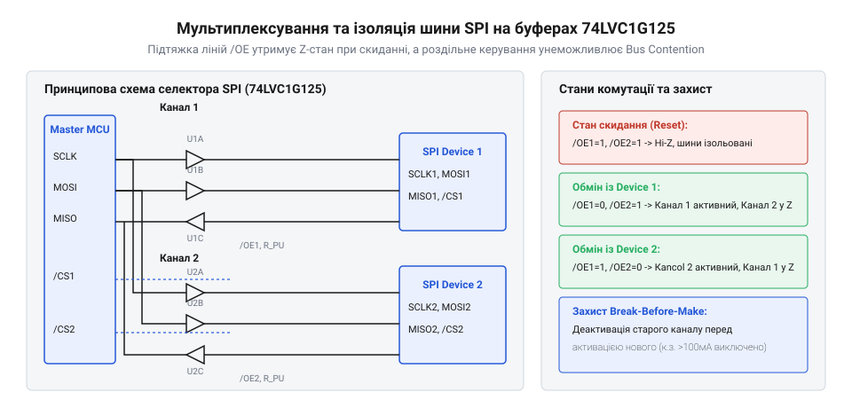
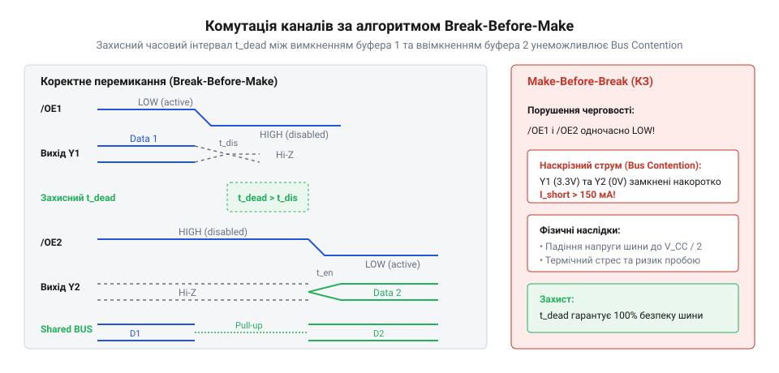

# Мультиплексування та ізоляція шини SPI на буферах 74LVC1G125

<preknowlist>
- [Перетворювач логічних рівнів](root:cat-hw-parts/logic-level-converter) — Принципи узгодження сигналів між пристроями з різними напругами живлення та концепцію тристанового виходу.
- [Логіка серії 74AHCT у системній схемотехніці](root:cat-hw-parts/74ahct-logic-family) — Поняття порогових напруг входів і виходів логічних елементів та їх вплив на цілісність сигналів.
</preknowlist>

## Конфлікти та протікання струмів SPI

Під час підключення кількох периферійних пристроїв до спільної апаратної шини @@en|SPI bus@@ виникає класична схемотехнічна проблема, пов'язана з паралельним об'єднанням виходів активних цифрових мікросхем. У класичній архітектурі SPI лінії даних та синхронізації — такі як тактовий сигнал @@en|SCLK@@, вихід мікроконтролера @@en|MOSI@@ та лінія вибору кристала @@en|SS@@ — формуються єдиним майстром @@en|SPI master@@ і розпаралелюються на всі ведені пристрої @@en|SPI slave@@. Проте зворотна лінія передачі даних від периферії до мікроконтролера, відома як @@en|MISO@@, вимагає об'єднання кількох виходів різних ведених пристроїв на одному вхідному піні магістрального приймача. Коли активізується лише один ведений пристрій через його персональну лінію вибору, решта пристроїв на шині повинні переходити у пасивний стан, повністю відключаючи свої виходні каскади від фізичної лінії зв'язку. Якщо ж розробник забуває про цю вимогу або використовує мікросхеми, виходи яких не здатні переходити у високоімпедансний стан, виникає небезпечна ситуація, коли два або більше активні виходи намагаються одночасно керувати однією лінією з різними логічними рівнями.

Коли один вихідний каскад намагається утримувати на лінії логічну одиницю, видаючи напругу живлення через відкритий верхній транзистор кремнієвого ключа, а сусідній пристрій примусово заземлює цю ж лінію через відкритий нижній транзистор, виникає пряме коротке замикання між шиною живлення та загальним провідником. Таке явище в електронній схемотехніці називається шинним конфліктом або @@en|bus contention@@. У стані шинного конфлікту через вихідні транзистори мікросхем починають текти величезні наскрізні струми, які багаторазово перевищують номінальні значення робочих струмів напівпровідникових кристалів. Оскільки внутрішній опір насичених полевих або біполярних транзисторів вихідних буферів є надзвичайно малим і становить лише частки ома, струм короткого замикання обмежується виключно цим малим опором та оконом паразитних доріжок друкованої плати. Це призводить до миттєвого локального перегріву напівпровідникового кристала, деградації кремнієвої структури, а в критичних випадках — до повного теплового пробою виходів мікроконтролера або периферійних мікросхем.

Окрім прямих коротких замикань на шині, паралельне підключення несумісних виходів спричиняє приховані процеси протікання струмів через внутрішні захисні діоди вимкнених мікросхем. Навіть якщо вихідний каскад мікросхеми переведено умовний пасивний режим, наявність захисних діодів від електростатичного розряду @@en|ESD protection diode@@, з'єднаних між виводами введення-виведення та шинами живлення і землі, створює неявні шляхи для протікання струму. Якщо напруга на спільній лінії перевищує напругу живлення пасивного пристрою через різницю потенціалів або несинхронність увімкнення стабілізаторів, верхній захисний діод зміщується у прямому напрямку, починаючи закачувати струм з лінії безпосередньо в шину живлення периферійного пристрою. Це явище здатне самовільно піднімати напругу на шині живлення вимкненого вузла, викликаючи ефект паразитного живлення @@en|parasitic powering@@ або защіпку @@en|latch-up@@ структури напівпровідника. Для запобігання подібним руйнівним ефектам надійне проектування вимагає фізичної ізоляції сигнальних ліній за допомогою спеціалізованих буферів, а також узгодження напруг із використанням перетворювача логічних рівнів, описаного в розділі про перетворювач логічних рівнів @@en|logic level converter@@.

## Буфер 74LVC1G125 у тристановому режимі

Для запобігання описаним шинним конфліктам та забезпечення надійного електричного розмежування сигналів на магістралі необхідні активні комутаційні елементи здатні повністю відокремлювати вихід від навантаження. Ідеальним рішенням для таких завдань є одноканальний буферний елемент @@en|74LVC1G125@@, який належить до сучасного сімейства низьковольтної КМОП-логіки з підвищеною стійкістю та толерантністю до 5-вольтових сигналів. Ключовою особливістю цієї мікросхеми є наявність спеціального керувального входу дозволу виходу, який у технічній документації позначається як сигнал дозволу виходу або @@en|output enable@@ (OE). На відміну від звичайних логічних вентилів, що завжди утримують на виході або логічний нуль, або логічну одиницю, вихідний каскад 74LVC1G125 здатний переходити у третій стан, який називається високоімпедансним станом або @@en|high-impedance state@@ (Z-стан). У цьому стані вихідний каскад мікросхеми повністю відключається від зовнішнього виводу, перетворюючись на розрив кола з надзвичайно високим опором та мінімальними ємнісними витоками, що дозволяє кільком таким буферам підключатися до однієї лінії без ризику виникнення короткого замикання.

Логіка роботи буфера побудована таким чином, що стан виходу визначається комбінацією інформаційного входу та керувального сигналу OE. Оскільки керувальний вхід є активним низьким сигналом або @@en|active-low@@, подача на нього низького потенціалу землі відкриває внутрішні ключі і дозволяє сигналу з інформаційного входу безперешкодно проходити на вихід із мінімальною затримкою поширення сигналу або @@en|propagation delay@@. Коли ж на вхід OE подається високий логічний рівень, керуюча логіка примусово закриває як верхній, так і нижній польові транзистори вихідного каскаду, переводячи вихід у Z-стан. Важливою перевагою серії 74LVC є сумісність по входах із довкіллям, де напруга живлення може становити від 1.65 до 3.6 вольт, тоді як входи стійко сприймають сигнали до 5 вольт, що забезпечує безшовну інтеграцію з різними мікроконтролерами без потреби в додаткових погоджувальних резисторах чи сумісність із компонентами, подібними до логіки серії 74AHCT у системній схемотехніці @@en|74AHCT logic family@@.

Незважаючи на високу швидкість та ефективність тристанового буфера, під час проектування схем на його основі необхідно враховувати перехідні процеси у моменти зміни стану керувального входу OE. Коли мікроконтролер перемикає лінії дозволу виходу, існує невеликий часовий інтервал, протягом якого один буфер ще не повністю закрився і перебуває у процесі переходу в Z-стан, а сусідній буфер уже починає відкриватися. Якщо обидва буфери на короткий мікросекундний момент виявляться активними одночасно, на шині виникне короткочасний наскрізний струм, здатний викликати просідання напруги живлення або електромагнітні перешкоди. Для усунення цього ефекту схемотехніки застосовують жорсткі часові інтервали перемикання та апаратні затримки, а також обов'язкову зовнішню підтяжку керувальних ліній, що унеможливлює появу невизначених плаваючих станів під час ініціалізації системи.

## Схемотехніка двоканального мультиплексора та ізолятора

Коли виникає потреба підключити до єдиного контролера два периферійні пристрої SPI з окремими лініями вибору та розділеними каналами даних, стандартних засобів мікроконтролера стає недостатньо через обмеженість виводів або специфіку розводки плати. Для розв'язання цієї проблеми розробляється принципова схема двоканального мультиплексора та ізолятора ліній SCLK, MOSI, MISO і SS на базі чотирьох мікросхем 74LVC1G125, які забезпечують незалежне спрямування потоків даних від майстра до обраного периферійного пристрою. У цій архітектурі інформаційні входи буферів об'єднуються відповідно до сигналів шини, а їхні виходи комутуються попарно за допомогою роздільних ліній керування OE1 та OE2, що дозволяє активувати або перший, або другий пристрій, повністю ізолюючи неактивну гілку від магістралі.


*Принципова електрична схема двоканального мультиплексора та ізолятора шини SPI на буферах 74LVC1G125.*

На розробленій принциповій схемі чітко видно, що керувальні входи OE1 та OE2 кожного буфера за замовчуванням підтягнуті до шини живлення через високоомні резистори підтяжки або @@en|pull-up resistor@@. Таке схемотехнічне рішення є критично важливим, оскільки в момент подачі живлення або під час перезавантаження мікроконтролера його виводи введення-виведення перебувають у високоімпедансному стані з високим опором і можуть непередбачувано коливатися під дією наведених перешкод. Завдяки резисторам підтяжки на входах OE, усі буфери гарантовано переводяться у вимкнений Z-стан одразу після подачі живлення, запобігаючи будь-яким випадковим конфліктам на шині до моменту ініціалізації програмного забезпечення. Подібні підходи до управління станами часто поєднуються з іншими мікросхемними компонентами, такими як регістром 74HC595 @@en|74HC595@@ для розширення портів виводу або дешифратором 74HC138 @@en|74HC138@@ для детермінованого декодування адрес та сигналів вибору кристала.

Для забезпечення безпомилкової комутації без виникнення перехідних колізій програмне забезпечення мікроконтролера повинно реалізувати часову стратегію перемикання з захисним інтервалом. Цей метод передбачає, що перед активацією нового каналу попередній канал повинен бути повністю вимкнений переведенням його лінії OE у високий рівень, після чого витримується гарантована пауза перед зниженням сигналу OE на новому каналі.


*Часова діаграма перемикання каналів із захисним інтервалом break-before-make.*

Наведені часові діаграми ілюструють співвідношення керувальних сигналів OE1 і OE2 із захисним інтервалом перемикання без замикання або @@en|break-before-make@@, який гарантує, що жодної миті часу два вихідні каскади не працюють одночасно на спільну лінію. Розрахунок номіналу підтягувальних резисторів виконується виходячи з мінімального допустимого струму витоку входу буфера та необхідного часу зарядки паразитної ємності друкованої плати. Завдяки такому проєктуванню схема забезпечує гальванічне та логічне розмежування периферії, повністю захищаючи порт мікроконтролера від аварійних струмів та гарантуючи стабільну роботу високошвидкісних інтерфейсів.

## Часова затримка break-before-make та керування

Під час комутації сигналів високошвидкісних шин між різними периферійними пристроями виникає небезпека короткочасного перекриття станів, коли обидва буферні елементи одночасно виводять дані на спільну лінію. Якщо один вихід перебуває у стані логічної одиниці, а інший намагається притягнути шину до нуля, виникає небезпечний наскрізний струм через вихідні транзистори мікросхем, що призводить до просадки напруги живлення, теплового перевантаження або виходу з ладу портів введення-виведення. Для запобігання цьому явищам застосовують схемотехнічні та програмні методи гарантування інтервалу розриву з'єднання перед створенням нового, відомого як @@en|break-before-make@@. Цей підхід передбачає, що попередній активний канал спочатку переводиться у високоімпедансний стан @@en|high-impedance state@@ за допомогою деактивації входу дозволу виходу @@en|output enable@@ (OE), і лише після завершення часу вимкнення @@en|disable time@@ відбувається активація нового каналу.

Для реалізації такого алгоритму необхідно враховувати часові параметри мікросхем буферів, зокрема максимальний час переходу виходу з високого або низького рівня у Z-стан, який у технічній документації позначається як @@en|disable time@@ (`t_PHZ` та `t_PLZ`), а також час переходу з високого чи низького імпедансу у робочий логічний стан (`t_PZL` та `t_PZH`). Якщо змінити рівень на керуючих ніжках OE обидвох буферів одночасно без програмної паузи, затримка поширення сигналу @@en|propagation delay@@ та різниця фронтів у реальному часі призведуть до короткочасного конфлікту. Тому програмний драйвер керування мусить витримувати мікросекундні паузи, які перевищують паспортні часові інтервали переходів для конкретної напруги живлення. Для інтеграції надійної комутації в пристроях із розширеною периферією часто використовують додаткові мікросхеми розширення портів, наприклад, [регістром 74HC595](root:cat-hw-parts/74hc595) або спеціалізовані схеми з узгодженням через [перетворювача логічних рівнів](root:cat-hw-parts/logic-level-converter).

Нижче наведено кросплатформний програмний драйвер для безпечного перемикання каналів шини SPI з гарантованим часовим інтервалом затримки `t_bbm` для мов C та C++ у вигляді окремих вкладок:

:::tabs
@tab c
```c
#include <stdint.h>
#include <stdbool.h>

// Конфігурація пінів керування OE для двох каналів SPI
typedef struct {
    void (*set_oe1)(bool state);
    void (*set_oe2)(bool state);
    uint32_t bbm_delay_us;
} spi_mux_driver_t;

// Ініціалізація драйвера мультиплексора
void spi_mux_init(spi_mux_driver_t *drv, void (*oe1_fn)(bool), void (*oe2_fn)(bool), uint32_t delay_us) {
    drv->set_oe1 = oe1_fn;
    drv->set_oe2 = oe2_fn;
    drv->bbm_delay_us = delay_us;
    
    // Початковий стан: обидва канали вимкнені (Z-стан, OE високий)
    drv->set_oe1(true);
    drv->set_oe2(true);
}

// Безпечне перемикання активного каналу SPI з паузою break-before-make
void spi_mux_switch_channel(spi_mux_driver_t *drv, uint8_t target_channel, void (*delay_us_fn)(uint32_t)) {
    if (target_channel == 1) {
        // Вимикаємо другий канал
        drv->set_oe2(true);
        delay_us_fn(drv->bbm_delay_us);
        // Вмикаємо перший канал ( active-low OE )
        drv->set_oe1(false);
    } else if (target_channel == 2) {
        // Вимикаємо перший канал
        drv->set_oe1(true);
        delay_us_fn(drv->bbm_delay_us);
        // Вмикаємо другий канал
        drv->set_oe2(false);
    }
}
```
@tab cpp|arduino
```cpp
#include <Arduino.h>

class SpiBusMultiplexer {
private:
    uint8_t pin_oe1;
    uint8_t pin_oe2;
    uint32_t bbmDelayUs;
    uint8_t activeChannel;

public:
    SpiBusMultiplexer(uint8_t oe1, uint8_t oe2, uint32_t delayUs) 
        : pin_oe1(oe1), pin_oe2(oe2), bbmDelayUs(delayUs), activeChannel(0) {
        pinMode(pin_oe1, OUTPUT);
        pinMode(pin_oe2, OUTPUT);
        // За замовчуванням обидва буфери вимкнені (HIGH для active-low OE)
        digitalWrite(pin_oe1, HIGH);
        digitalWrite(pin_oe2, HIGH);
    }

    // Метод перемикання каналів із реалізацією break-before-make
    void selectChannel(uint8_t channel) {
        if (channel == 1 && activeChannel != 1) {
            digitalWrite(pin_oe1, HIGH); // Вимкнути канал 1
            delayMicroseconds(bbmDelayUs);
            digitalWrite(pin_oe2, HIGH); // Переконатися, що канал 2 вимкнений
            digitalWrite(pin_oe1, LOW);  // Увімкнути канал 1 (active-low)
            activeChannel = 1;
        } else if (channel == 2 && activeChannel != 2) {
            digitalWrite(pin_oe2, HIGH); // Вимкнути канал 2
            delayMicroseconds(bbmDelayUs);
            digitalWrite(pin_oe1, HIGH); // Переконатися, що канал 1 вимкнений
            digitalWrite(pin_oe2, LOW);  // Увімкнути канал 2 (active-low)
            activeChannel = 2;
        }
    }

    // Безпечне вимкнення всіх каналів (RAII-подібний деструктор або захисний метод)
    void disableAll() {
        digitalWrite(pin_oe1, HIGH);
        digitalWrite(pin_oe2, HIGH);
        activeChannel = 0;
    }
};
```
:::

## Топологія друкованої плати та завадозахищеність

Фізичне трасування ліній високошвидкісної шини SPI вимагає суворого дотримання правил проектування друкованих плат, оскільки частоти тактування `SCLK` та швидкі фронти сигналів `MOSI` створюють значні електромагнітні перешкоди. Буфери 74LVC1G125 завдяки своїм швидким вихідним характеристикам здатні формувати круті фронти, що призводить до виникнення паразитної ємності @@en|parasitic capacitance@@ між сусідніми провідниками та утворення перехресних наводок @@en|crosstalk@@. Для мінімізації цих ефектів провідники тактового сигналу та даних мають бути максимально короткими, виконаними на одному шарі без зайвих пере переходів через віаси, а довжини ліній від буфера до кожного веденого пристрою слід узгоджувати за геометричною довжиною.

Особливу увагу приділяють організації опорних площин землі та контуру повернення струму. Суцільний полігон землі під лініями SPI зменшує індуктивність зворотного шляху, запобігаючи виникненню контурних струмів та падінню напруги на загальній шині живлення. Живлення мікросхем буферів повинно супроводжуватися встановленням керамічних блокувальних конденсаторів ємністю 0.1 мкФ безпосередньо біля виводів живлення `VCC` та `GND` кожної мікросхеми 74LVC1G125, що забезпечує низький імпеданс джерела живлення під час високих імпульсних навантажень на виходах. Крім того, керуючі лінії `OE` потрібно захищати від випадкового наведення перешкод під час перехідних процесів шляхом розміщення резисторів підтяжки до живлення або землі безпосередньо біля виводів мікроконтролера.
