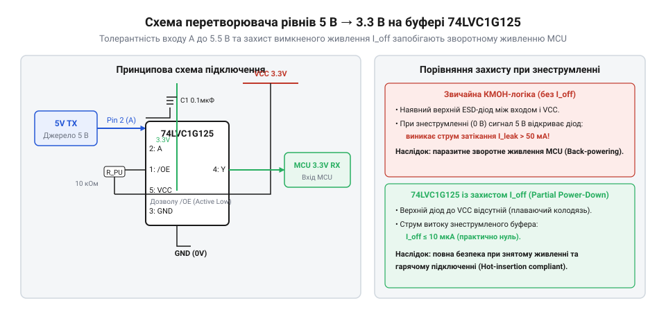

# Схема транслятора рівнів 5 В в 3.3 В із захистом вимкненого живлення ($I_I_off)

<preknowlist>
- [Перетворювач логічних рівнів](root:cat-hw-parts/logic-level-converter) — Загальні концепції узгодження напруг між логічними доменами.
- [Логіка серії 74AHCT у системній схемотехніці](root:cat-hw-parts/74ahct-logic-family) — Пороги перемикання TTL-входів та робота логічних елементів при суміщенні живильних напруг.
</preknowlist>

## Небезпека зворотного живлення вимкненої мікросхеми

Коли в електронному пристрої взаємодіють кілька мікроконтролерів або логічних блоків, що працюють на різних напругах живлення — наприклад, потужний сенсор чи інтерфейсний модуль із живленням 5 В та чутливий центральний мікроконтролер із живленням 3.3 В, — виникає критична проблема сумісності логічних рівнів. Якщо подати сигнал високого рівня 5 В з активного виходу джерела на вхід приймача, чиє живлення у цей момент вимкнено або ще не запущене, внутрішня структура мікросхеми зазнає руйнівного впливу.

Будь-який стандартний інтегрований порт введення-виведення напівпровідникового кристала захищений від електростатичного розряду (@@en|electrostatic discharge@@) спеціальними захисними діодами, що з'єднують кожну сигнальну лінію з шиною живлення `VCC` та загальним проводом `GND`. Коли напруга на вхідному піні стає суттєво вищою за напругу на шині `VCC` знеструмленого мікроконтролера, верхній захисний діод, увімкнений між сигнальним виводом і шиною `VCC`, виявляється зміщеним у прямому напрямку. Через цей паразитний діод починає неконтрольовано текти струм з активної лінії 5 В безпосередньо в шину живлення `VCC` вимкненого пристрою.

Цей процес призводить до явища, відомого як зворотне живлення (@@en|back-powering@@). Оскільки вхідний струм через паразитний діод (@@en|parasitic diode@@) живить усю внутрішню схемотехніку знеструмленого мікроконтролера через його шину `VCC`, напруга на цій шині частково підіймається — зазвичай до рівня близько 4.3 В або 4.5 В (з урахуванням падіння на кремнієвому діоді). Такий стан є вкрай небезпечним з кількох причин. По-перше, напівпровідникові компоненти, розраховані на номінальну напругу 3.3 В, опиняються під ненормованою підвищеною напругою, що спричиняє прискорену деградацію оксиду затворів транзисторів і скорочує термін служби кристала. По-друге, оскільки напруга на шині `VCC` знеструмленого пристрою є нестійкою і залежить від струму навантаження зовнішніх кіл, логічні блоки всередині кристала переходять у невизначений проміжний стан. У цьому стані внутрішні КМОП-структури (@@en|CMOS structures@@) можуть увімкнутися одночасно, викликаючи катастрофічне зростання наскрізного струму споживання, перегрів кристала та повне вихід з ладу мікроконтролера або інших компонентів системи.

Для запобігання цьому небезпечному явищу в сучасній схемотехніці використовують спеціалізовані рішення узгодження напруг, детально описані в матеріалі про [перетворювача логічних рівнів](root:cat-hw-parts/logic-level-converter), а також застосовують дискретні буферні елементи зі спеціальною архітектурою вхідних і вихідних каскадів, які повністю розривають шлях паразитних витоків.

## Буфер 74LVC1G125 та захист I_off

Щоб уникнути ефекту зворотного живлення та забезпечити надійне узгодження логічних рівнів між 5 В та 3.3 В системами, застосовують високошвидкісні буферні мікросхеми серії `LVC` (Low-Voltage CMOS), яскравим представником яких є одиночний буфер з трьома станами 74LVC1G125. Головною архітектурною перевагою напівпровідників цієї родини є наявність вбудованої апаратної підтримки режиму часткового вимкнення живлення (@@en|partial power-down mode@@), яка реалізується за допомогою спеціальної схемотехніки витоків `I_off` (@@en|I_off circuitry@@).

У звичайних мікросхемах стандартної логіки (наприклад, поширених серій `HC` або старих `TTL`-сумісних сімейств, що розглядаються в матеріалі про [логіку серії 74AHCT](root:cat-hw-parts/74ahct-logic-family)) вхідні та вихідні каскади містять обов'язкові захисні діоди, що ведуть від пінів до шини живлення `VCC`. У мікросхемах із підтримкою `I_off` схемотехнічний дизайн вихідного та вхідного каскадів модифіковано: верхній захисний діод до шини `VCC` фізично усунуто або заведено через схемні ключі, які автоматично замикають його за відсутності напруги живлення на виводі `VCC`.

Коли мікросхема 74LVC1G125 знеструмлена (V_CC = 0 В), а на її вхідні чи вихідні виводи подається напруга високого рівня (наприклад, 5 В від сусіднього активного пристрою), відсутність традиційного діода до `VCC` повністю блокує будь-яке протікання струму на знеструмлену шину живлення. Параметр `I_off` гарантує, що струм витоку через виводи мікросхеми у знеструмленому стані залишається мізерно малим (у межах кількох мікроампер або навіть наноампер). Це повністю усуває явище @@en|back-powering@@, захищає чутливі приймачі від деградації та дозволяє безпечно об'єднувати пристрої, що живляться від різних джерел або вмикаються в різний час, гарантуючи нульовий струм витоку (@@en|zero leakage current@@) при вимкненому живленні.

## Схема транслятора та керування входом OE

Для побудови надійного односпрямованого транслятора логічних рівнів із 5 В у 3.3 В використовують одиночний буфер 74LVC1G125, який живиться від стабілізованої напруги 3.3 В. Сигнал із джерела 5 В подається на вхід даних `A` буфера. Оскільки мікросхеми серії `LVC` мають входи, толерантні до напруги 5 В (@@en|5V-tolerant inputs@@), напруга високого рівня 5 В на вході `A` безпечно сприймається мікросхемою як логічна одиниця, незважаючи на те, що сама мікросхема живиться від 3.3 В. На виході `Y` формується чистий сигнал з амплітудою 3.3 В, який надходить безпосередньо на вхід приймача мікроконтролера.

Ключовим елементом керування потоком даних є інверсний вхід дозволу виходу `OE` (Output Enable, або частіше позначається як `/OE`), який реалізує функцію з активним низьким рівнем (@@en|active-low enable@@). Коли на вхід `/OE` подано низький логічний рівень (0 В), буфер переходить в активний стан, і сигнал із входу `A` транслирується на вихід `Y`. Якщо ж на вхід `/OE` подати високий логічний рівень або залишити його у підвішеному стані, вихід `Y` мікросхеми переходить у високоімпедансний стан (@@en|high-impedance state@@, або @@en|Hi-Z state@@), повністю відключаючи буфер від лінії зв'язку.

*Принципова електрична схема транслятора рівнів 5 В у 3.3 В на базі 74LVC1G125 із захистом вимкненого живлення.*

Для гарантування безпеки під час завантаження мікроконтролера, коли піни GPIO перебувають у високоімпедансному вхідному стані, вхід `/OE` обов'язково підтягується до шини живлення 3.3 В через резистор номіналом від 10 кОм до 47 кОм. Це запобігає випадковому хитанню рівня та гарантує, що одразу після подачі живлення вихід буфера перебуватиме в ізольованому стані Hi-Z, доки мікроконтролер програмно не налаштує пін керування та не активує передачу.

Програмне керування станом буфера через лінії GPIO мікроконтролера реалізується за допомогою спеціалізованих драйверів. Нижче наведено кросплатформні реалізації такого драйвера мовами C та C++, які забезпечують безпечну комутацію та керування станом `/OE`.

:::code proj-level-shifter-and-port-protector/c/lvc_buffer.c
:::code proj-level-shifter-and-port-protector/c/lvc_buffer.h
:::code proj-level-shifter-and-port-protector/c/main.c

Для об'єктно-орієнтованих систем на базі C++ розроблено надійну ідіоматичну обгортку з використанням ідіоми RAII (@@en|Resource Acquisition Is Initialization@@), яка гарантує автоматичне переведення буфера у безпечний стан Hi-Z при знищенні об'єкта або виході з області видимості.

:::code proj-level-shifter-and-port-protector/cpp/LvcBuffer.cpp
:::code proj-level-shifter-and-port-protector/cpp/LvcBuffer.hpp
:::code proj-level-shifter-and-port-protector/cpp/main.cpp

## Блокувальні конденсатори та динамічні кидки струму

Під час високовольтного та високошвидкісного перемикання цифрових сигналів КМОП-буфера 74LVC1G125 виникають короткочасні імпульсні наскрізні струми (@@en|shoot-through currents@@), коли верхній і нижній транзистори вихідного каскаду одночасно перебувають у напіввідчиненому стані протягом кількох наносекунд. Крім того, швидка перезарядка ємності навантаження на виході `Y` вимагає миттєвого відбору порції заряду з джерела живлення. Якщо лінія живлення мікросхеми має навіть невелику паразитів індуктивність (наприклад, через довгі доріжки на друкованій платі), ці імпульсні кидки струму викликають падіння напруги на живленні, що призводить до високочастотних коливань та ефекту підняття потенціалу землі (@@en|ground bounce@@).

Для придушення високочастотних завад і локального забезпечення імпульсного струму безпосередньо біля виводу живлення `VCC` мікросхеми встановлюють керамічний блокувальний конденсатор (@@en|decoupling capacitor@@). Розрахунок номіналу такого конденсатора базується на необхідності компенсувати падіння напруги під час максимального динамічного навантаження. 

Необхідну ємність блокувального конденсатора `C` визначають з урахуванням сумарного заряду, що споживається буфером за один цикл перемикання, та допустимого рівня пульсацій напруги живлення:

C
= (I_{\text{dyn}} · t_{\text{sw}}) / (ΔV)
= (15\text{ мА} · 2\text{ нс}) / (0.1\text{ В})
= 0.3\text{ нФ}          [розрахунок динамічного зарядного балансу буфера]

де `I_dyn` — імпульсний струм перемикання буфера (орієнтовно 15 мА), `t_sw` — час перемикання вихідного каскаду (близько 2 нс), а `ΔV` — допустиме пульсування напруги живлення (прийнято 0.1 В). 

З урахуванням практичного запасу на старіння кераміки та високочастотні гармоніки, стандартним і оптимальним вибором для мікросхем серії `LVC` є керамічний конденсатор ємністю 0.1 мкФ (або 100 нФ) з діелектриком типу X5R або X7R. Цей конденсатор необхідно розміщувати фізично максимально близько до виводів `VCC` та `GND` корпусу SOT-23-5 мікросхеми, мінімізуючи площу контуру високочастотного струму та гарантуючи безперебійну і стабільну роботу транслятора рівнів.