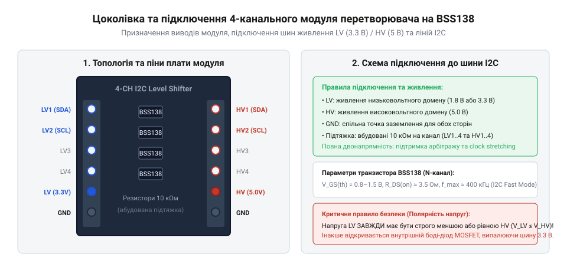
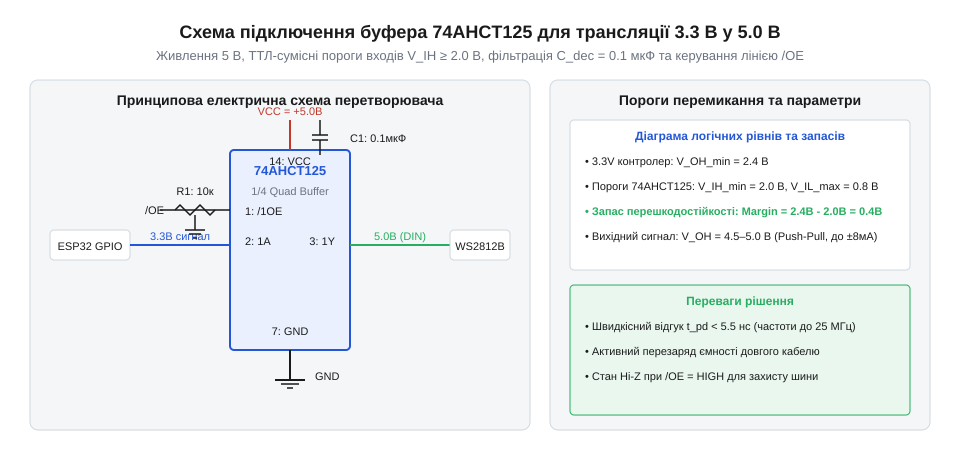

# Залізний інтерфейс та схемотехнічне підключення перетворювачів рівнів

<preknowlist>
- [Буфер із трьома станами виходу 74LVC1G125](root:cat-hw-parts/logic-buffer-74lvc1g125) — принцип дії входу дозволу OE та високоімпедансного стану Hi-Z
- [Логіка серії 74AHCT у системній схемотехніці](root:cat-hw-parts/74ahct-logic-family) — порогові напруги ТТЛ-сумісних входів при живленні 5 В
</preknowlist>

## Несумісність шин живлення та ризики

Коли доводиться об'єднувати цифрові мікросхеми, що працюють на різних напругах живлення — наприклад, сучасний мікроконтролер із напругою 3.3 В та периферійний давач із живленням 5 В, — пряме з'єднання їхніх ліній сигналів створює приховану загрозу для всієї системи. Вихідний порт 5-вольтового пристрою під час видачі високого рівня подає на лінію напругу, яка значно перевищує допустимий максимум живлення низьковольтного елемента. Усередині мікросхем на входах і виходах обов'язково присутні захисні діоди, призначені для відведення імпульсів статичної електрики до шин живлення та землі; ці компоненти утворюють систему @@en|ESD-protection@@. Коли на вхід 3.3-вольтового контролера надходить сигнал амплітудою 5 В, захисний діод, підключений до шини живлення 3.3 В, відкривається, оскільки потенціал лінії стає вищим за напругу живлення. У результаті виникає паразитний струм, який тече з 5-вольтового виходу через захисний діод прямо в шину живлення 3.3 В низьковольтної плати, викликаючи її несанкціоноване підняття. Такий аномальний перетік енергії призводить до явища @@en|back-powering@@, коли вимкнений або менш навантажений пристрій починає живитися через сигнальні лінії від сусіднього вузла, що спричиняє збої в ініціалізації, зависання або вихід із ладу стабілізаторів напруги. Навіть якщо загальне живлення витримує навантаження, тривале протікання струму через обмежені за площею напівпровідникові переходи захисних кіл викликає локальний перегрів портів вводу-виводу, деградацію кристала та поступове руйнування порту. Щоб уникнути подібних катастрофічних наслідків, між різновольтними вузлами необхідно встановлювати апаратні розв'язувальні елементи, які забезпечують двосторонню передачу сигналів без гальванічного перетікання струмів живлення та з повним узгодженням логічних рівнів.

## Пасивні MOSFET-транслятори та розпиновка модулів

Для безпечного узгодження двонапрямних сигналів без втрати швидкодії на коротких лініях застосовують прості та надійні схемотехнічні рішення на польових транзисторах з індукованим каналом n-типу. Типовий 4-канальний модуль базується на чотирьох транзисторах, затвори яких об'єднані та підключені до низьковольтної шини живлення, тоді як джерела та стоки з'єднують лінії низьковольтної та високовольтної сторін.

*Призначення виводів низьковольтної та високовольтної сторін 4-канального модуля перетворювача рівнів на польових транзисторах.*

На платі модуля розведено кілька ключових контактів: вивід `LV` слугує для підключення низьковольтного живлення (наприклад, 3.3 В), вивід `HV` приймає високовольтне живлення (5 В), а контакти `GND` об'єднують землю обох пристроїв. Сигнальні лінії з низьковольтної сторони позначаються як `LV1`, `LV2`, `LV3`, `LV4`, а відповідні їм високовольтні лінії на протилежному боці — як `HV1`, `HV2`, `HV3`, `HV4`. Кожен канал оснащений вбудованими або зовнішніми підтягувальними резисторами, які утримують лінії у високому стані за відсутності активного керування. Розрахунок номіналів цих компонентів критично важливий для роботи протоколів із відкритим стоком, таких як `I2C` або `SMBus`, де лінії постійно перемикаються між низьким рівнем та станом високого опору. Фізика перехідного процесу визначається зміною напруг на витоку (лінія `LV`) та стоці (лінія `HV`) транзистора `BSS138`: коли низьковольтний вихід відпускає шину, напруга витоку починає наростати від 0 В, а транзистор залишається відкритим, поки різниця напруг між затвором і витоком перевищує порогову напругу відкриття каналу (близько 1.2 В). У цій першій фазі потенціал стоку повторює витік, підіймаючись синхронно приблизно до 2.1 В, після чого транзистор закривається, і в другій фазі лінії заряджаються ізольовано: витік дотягується своїм резистором до 3.3 В, а стік — до 5.0 В. Якщо опір резистора надто малий, зростатиме енергоспоживання та навантаження на вихідні каскади, а якщо надто великий — паразитна ємність монтажу сповільнюватиме фронти сигналів, обмежуючи максимальну швидкість обміну даними. Для коректного функціонування таких кіл із транзисторами типу `BSS138` використовують підтягувальні резистори номіналом від 2.2 кОм до 10 кОм залежно від довжини лінії та ємності навантаження. Оскільки схема працює за принципом комутації з відкритим стоком, архітектура якої належить до категорії @@en|open-drain@@, вибір правильного номіналу резистора підтяжки, відомого як @@en|pull-up resistor@@, гарантує чіткі перепади напруги та відсутність збоїв під час синхронізації тактових імпульсів на шині.

## Активні односпрямовані буфери 74AHCT125 і 74HCT245

Коли навантаження на лінії зв'язку зростає, а лінії вимагають високої швидкодії та чітких фронтів без використання повільних резистивних підтяжок, пасивні транзистори стають неефективними через обмеження швидкої перезарядки ємностей. У таких випадках застосовують активні односпрямовані буфери, здатні примусово перемикати стан лінії як угору, так і вниз із високою потужністю вихідного струму. Класичним прикладом таких мікросхем є чіпи з високим швидкодіанням, чиї входи адаптовані під специфічні напруги спрацьовування. Попередньо вивчений [Буфер із трьома станами виходу 74LVC1G125](root:cat-hw-parts/logic-buffer-74lvc1g125) демонструє базові принципи керування потоком за допомогою дозволу виходу, проте для узгодження рівнів 3.3 В та 5 В найкраще підходять мікросхеми серії `AHCT`. Детально особливості таких компонентів описані в матеріалі [Логіка серії 74AHCT у системній схемотехніці](root:cat-hw-parts/74ahct-logic-family), де розкрито переваги їхніх порогових напруг. Головною особливістю таких мікросхем є те, що вони живляться від напруги 5 В, але їхні входи розраховані на сприйняття сигналів 3.3 В як повноцінного логічного одиничного рівня, оскільки внутрішні пороги перемикання сумісні зі стандартами транзисторно-транзисторної логіки, тобто мають @@en|TTL-compatible inputs@@.

*Схема електрична принципова підключення буфера 74AHCT125 для узгодження сигналів 3.3 В у 5.0 В.*

Для забезпечення стабільної роботи схеми живлення мікросхеми 5 В обов'язково шунтується керамічним конденсатором ємністю 0.1 мкФ, розташованим якомога ближче до виводів живлення для фільтрації високочастотних перешкод. Відсутність такого блокувального конденсатора призводить до того, що паразитна індуктивність провідників живлення плати (зазвичай 5–15 нГн) під час швидкого перемикання потужних двотактних вихідних каскадів генерує різкі індуктивні викиди напруги, величина яких пропорційна швидкості зміни струму. Ці імпульсні просідання та підкидання напруги живлення викликають брязкіт логічних фронтів, хибні спрацьовування сусідніх каналів та ризик тиристорного замикання напівпровідникової структури. Керування потоком даних у таких буферах здійснюється через спеціальні управляючі входи, зокрема інверсійний вивід дозволу виходу, який у технічній документації позначається як @@en|output enable@@. Коли на цей вхід подається високий рівень, виходи мікросхеми переходять у високоімпедансний стан, який у схемотехніці називається @@en|Hi-Z@@, повністю відключаючи буфер від лінії та запобігаючи конфліктам на шині. У багатоканальних буферах типу `74HCT245` додатково використовується вивід вибору напрямку передачі `DIR`, який визначає, чи передаються дані від виводів `A` до `B`, чи у зворотному напрямку. Застосування таких активних елементів гарантує надійну передачу сигналів для інтерфейсів `SPI`, `UART` та швидкісних адресних шин світлодіодних стрічок без спотворення імпульсів.

## Автоматичні трансивери серій TXS0108E та TXB0108

Коли проєктується складний пристрій, де лінії зв'язку є двонапрямними і змінюють напрямок передачі динамічно без виділеної лінії керування напрямком, використання односпрямованих буферів стає неможливим. Для таких випадків розроблені інтегровані двонапрямні трансивери з функцією автоматичного визначення напрямку передачі даних, серед яких найпопулярнішими є мікросхеми `TXS0108E` та `TXB0108`. Обидві мікросхеми підтримують двосторонню трансляцію рівнів між низьковольтними та високовольтними шинами без необхідності подачі сигналів `DIR`, але їхня внутрішня архітектура суттєво відрізняється. Трансивер `TXS0108E` розроблений спеціально для роботи з протоколами, що використовують архітектуру з відкритим стоком, такими як `I2C`, оскільки він містить вбудовані слабкі підтягувальні резистори на кожному каналі. Натомість мікросхема `TXB0108` оптимізована для високошвидкісних двонапрямних шин із двотактними виходами, таких як `SPI` або інтерфейси пам'яті, і не призначена для роботи з лініями відкритий сток через особливості внутрішніх драйверів. Автоматичне визначення напрямку сигналу, відоме як @@en|auto-direction sensing@@, реалізується за допомогою спеціальних внутрішніх схем відстеження фронтів, які реагують на зміну рівня на будь-якому з боків і тимчасово активують потужний внутрішній прискорювач перемикання, який у документації називається @@en|one-shot accelerator@@. Після завершення перепаду сигналу управління переходить до слабкого буферного елемента підтримки рівня, який у технічній літературі має назву @@en|weak buffer@@, утримуючи лінію у стабільному стані до наступного перемикання. Під час розведення друкованої плати з цими мікросхемами необхідно суворо дотримуватися важливого схемотехнічного правила: напруга низьковольтної сторони ніколи не повинна перевищувати напругу високовольтної сторони, тобто завжди має виконуватися умова напруг живлення за виразом:

VCCA
<= VCCB      [вимога до відношення напруг живлення трансивера]
<= 5.5 В     [абсолютний максимальний допущений ліміт мікросхеми]

порушення цієї послідовності призводить до непередбачуваної поведінки внутрішніх транзисторних ключів та виходу мікросхеми з ладу. Живлення обох сторін `VCCA` та `VCCB` повинно обов'язково фільтруватися індивідуальними керамічними конденсаторами ємністю 0.1 мкФ, встановленими безпосередньо біля виводів живлення для запобігання проникненню імпульсних завад між різними частинами схеми.