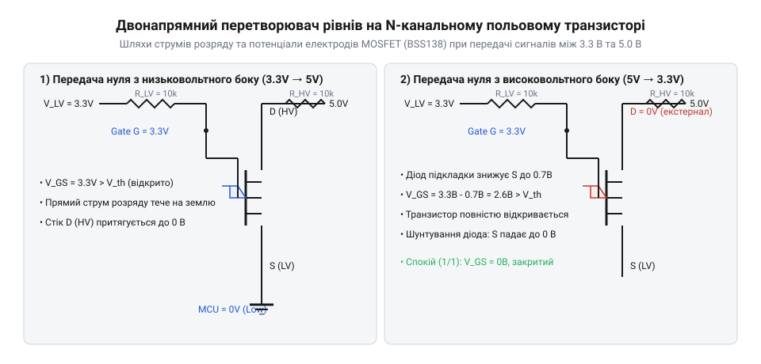
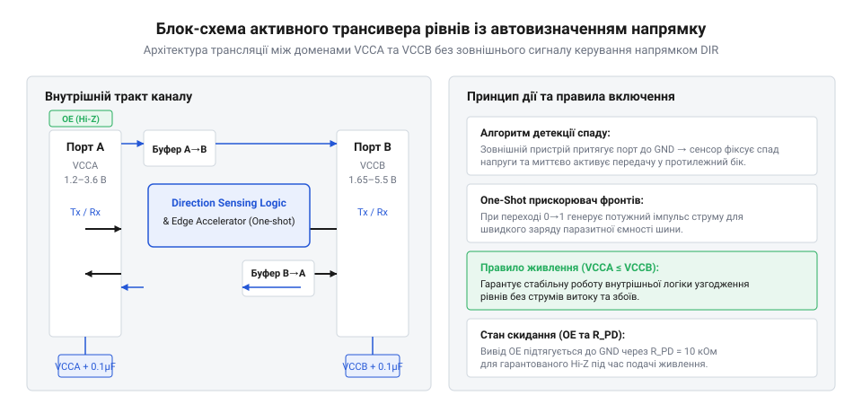

# Еволюція логічних рівнів напруги та схемотехніка перетворювачів

<preknowlist>
- [Логіка серії 74AHCT у системній схемотехніці](root:cat-hw-parts/74ahct-logic-family) — Використання TTL-сумісних входів CMOS-мікросхем для безпечного прийому сигналів 3.3 В.
- [Буфер із трьома станами виходу 74LVC1G125](root:cat-hw-parts/logic-buffer-74lvc1g125) — Властивість 5V-tolerant входів низьковольтних мікросхем серії LVC.
</preknowlist>

## Обмеження стандарту живлення 5 В TTL

У 1960–1970-х роках компанія Texas Instruments разом із розвитком біполярної транзисторно-транзисторної логіки (@@en|TTL@@ серії SN7400) фактично закріпила номінальну напругу 5 В як абсолютний промисловий стандарт цифрової електроніки. Вибір саме 5 В базувався на фізичних характеристиках біполярних кремнієвих n-p-n транзисторів: пряме падіння на двох p-n переходах базово-емітерного кола та діода насичення вимагало щонайменше 1.4–2.0 В для гарантованого відмикання каскаду, а напруга живлення 5 В забезпечувала достатній запас надійності, прийнятну завадостійкість і простоту побудови параметричних лінійних стабілізаторів. Перші комплементарні метал-оксид-напівпровідникові мікросхеми (@@en|CMOS@@ серії 4000 та пізніше 74HC) також проєктувалися з підтримкою 5 В, щоб зберегти пряму електричну сумісність із масовою біполярною логікою.

Проте до кінця 1980-х років вибухове зростання тактових частот і щільності інтеграції кристалів зіткнулося з жорсткими фізичними обмеженнями. Динамічна потужність розсіювання будь-якого цифрового КМОН-вентиля визначається енергією, необхідною для циклічного перезаряджання еквівалентної ємності вузлів і паразитних ємностей монтажу:

```
P_dyn = C_load · V_CC² · f
```

де `C_load` — сумарна паразитна ємність навантаження, `V_CC` — напруга живлення схеми, а `f` — робоча тактова частота перемикання. Через квадратичну залежність від напруги навіть помірне підвищення частоти процесорів з 10 МГц до 50–100 МГц на напрузі 5 В викликало експоненційне зростання тепловиділення, яке вже неможливо було розсіяти наявними системами охолодження без перегріву напівпровідникового кристала.

Паралельно з тепловим бар'єром виникла фундаментальна технологічна криза розмікронення. Щоб збільшити кількість транзисторів на кристалі та підняти їхню швидкодію, виробники кремнієвих пластин зменшували геометричні розміри транзистора за законами скейлінгу Деннарда (Dennard scaling). Зменшення довжини каналу вимагало пропорційного зменшення товщини підзатворного діелектрика з діоксиду кремнію (@@en|SiO2@@). На технологічних нормах нижче 0.5 мкм товщина шару оксиду кремнію скоротилася до кількох нанометрів. Напруженість електричного поля в затворі при подачі 5 В перевищила критичну величину пробою діелектрика (близько 10 МВ/см), що призводило до лавинної деградації, появи струмів тунелювання через затвор і незворотного теплового руйнування транзисторів. Залишатися на напрузі 5 В далі було фізично неможливо.

## Зниження напруги живлення до 3.3 В

У 1990-х роках комітет зі стандартизації електронних технологій JEDEC (Joint Electron Device Engineering Council) прийняв революційний стандарт JESD8, який затвердив зниження напруги живлення логічних пристроїв із 5.0 В до 3.3 В. У масовій свідомості початківців закріпився міф, ніби перехід на 3.3 В був зумовлений суто потребою економії акумуляторів у перших портативних комп'ютерах та мобільних телефонах. Насправді ж першопричиною був саме порятунок мікропроцесорів від самознищення через пробій підзатворного оксиду кремнію та тепловий колапс на частотах понад 50 МГц.

Зниження напруги живлення дало потужний стрибок енергоефективності. Розрахунок показує безпосереднє зниження динамічної потужності:

```
(5.0)² / (3.3)² = 25.0 / 10.89 ≈ 2.296
```

Зниження напруги лише з 5.0 В до 3.3 В скоротило динамічні втрати енергії в 2.3 раза при незмінній ємності й тактовій частоті, дозволивши індустрії подолати бар'єр у сотні мегагерц.

Однак цей крок створив найгострішу проблему системної сумісності останніх десятиліть: міжрівневий конфлікт. Інженери опинилися перед фактом, що нові мікропроцесори й мікроконтролери працювали від 3.3 В, тоді як мільйони існуючих периферійних контролерів, драйверів дисплеїв, пам'яті й датчиків залишалися суворо п'ятивольтовими.

Пряме з'єднання таких мікросхем викликало дві симетричні проблеми. Якщо передавач 3.3 В передавав логічну одиницю на вхід мікросхеми 5 В CMOS (наприклад, [регістра 74HC595](root:cat-hw-parts/74hc595) або [селектора 74HC138](root:cat-hw-parts/74hc138)), виникала помилка детектування: поріг високого рівня `V_IH` для класичного КМОН становить `0.7 · V_CC = 3.5 В`. Напруга 3.3 В потрапляла в зону невизначеності, спричиняючи зависання або паразитне наскрізне відкриття обох транзисторів вхідного інвертора.

У зворотному напрямку, коли вихід 5 В подавався на чутливий вхід 3.3 В мікроконтролера, напруга 5 В відкривала вбудований захисний діод електростатичного розряду (@@en|ESD-diode@@) до шини `V_CC`. Виникав небезпечний струм зворотного заживлення (@@en|back-powering@@), напруга на шині 3.3 В неконтрольовано зростала, а в кристалі міг активуватися паразитний тиристор (явище @@en|latch-up@@), що викликало коротке замикання живлення та миттєве вигорання чіпа.

## Глибоке зниження напруг і пасивне узгодження

Подальший поступ літографії за нормами 180 нм, 90 нм, 65 нм і глибше змусив розробників ще радикальніше зменшувати товщину затворного діелектрика. З'явилися нові офіційні рівні живлення ядер процесорів, сигнальних процесорів та матриць @@en|FPGA@@: 2.5 В (JESD8-5), 1.8 В (JESD8-7), 1.5 В, 1.2 В та 0.9 В. Складні цифрові плати перетворилися на гетерогенні системи, де одночасно співіснували компоненти з трьома або чотирма різними рівнями сигналів.

На перших етапах інженери намагалися вирішити проблему узгодження найпростішими пасивними засобами. Найпопулярнішим методом зниження сигналу 5 В до 3.3 В був звичайний резистивний дільник напруги:

```
V_out = V_in · R₂ / (R₁ + R₂)
```

При використанні резисторів R₁ = 1.8 кОм та R₂ = 3.3 кОм вихідний сигнал 5 В перетворювався на акуратні 3.23 В. Для зворотного захисту іноді ставили послідовний резистор (1–10 кОм), розраховуючи обмежити струм через вбудований діод ESD до безпечних 1–2 мА, або застосовували діоди Шотткі для фіксації рівня напруги.

Однак пасивні методи мали фатальні недоліки, через які вони виявилися непридатними для сучасної апаратури:

1. **Завал фронтів через паразитну ємність (RC-деградація).** Резистори дільника утворювали з паразитною ємністю доріжки друкованої плати та входу мікросхеми (зазвичай 15–30 пФ) інтегрувальний фільтр низьких частот. Постійна часу `τ = R_equiv · C_load` розмивала круті прямокутні фронти в похилі експоненти. Якщо на повільних сигналах UART частотою 9600 бод це було непомітно, то на шинах SPI або швидкісних лініях із частотами понад 2 МГц тактовий сигнал перетворювався на спотворену пилкоподібну хвилю з фазовим тремтінням.
2. **Абсолютна односпрямованість.** Резистивний дільник здатний лише ділити напругу в одному напрямку. Він принципово не може передавати сигнал у зворотний бік і не здатний підвищувати рівень напруги з 3.3 В до 5 В.
3. **Непридатність для двонапрямних шин із відкритим колектором.** Інтерфейси на кшталт I2C, SMBus або 1-Wire вимагають, щоб одна й та сама фізична лінія почергово використовувалася обома пристроями як передавач і як приймач. Резистивний дільник порушував логіку роботи шини, фіксуючи зміщення потенціалів.

Електроніка гостро потребувала компактного, симетричного та недорогого схемотехнічного рішення, яке дозволило б автоматично передавати сигнал в обох напрямках без ручного перемикання ліній.

## Винайдення двонапрямного перетворювача на MOSFET

Справжній інженерний прорив відбувся у другій половині 1990-х років, коли інженер компанії Philips Semiconductors (нині NXP) Герман Шутте (Herman Schutte) опублікував легендарне керівництво із застосування Philips Application Note AN97055. Він запропонував елегантну схему двонапрямного транслятора логічних рівнів усього на одному дискретному N-канальному польовому транзисторі (@@en|MOSFET@@) збагаченого типу та двох резисторах підтяжки.

Схема базується на використанні транзистора (найчастіше популярного BSS138 або 2N7002), затвор якого підключено до низьковольтної шини живлення `V_LV` (3.3 В), витік — до низьковольтної лінії `LV`, а стік — до високовольтної лінії `HV` (5.0 В). Обидві лінії підтягнуті до відповідних напруг живлення через зовнішні резистори R_LV та R_HV номіналом 10 кОм (або 4.7 кОм).


*Принципова схема роботи транслятора рівнів на N-канальному MOSFET у трьох характерних фазах передачі цифрових станів.*

Фізичний механізм роботи цієї схеми розгортається у трьох станах:

1. **Стан спокою (на обох лініях високий рівень).** Коли жоден пристрій не притягує шину до землі, лінія `LV` підтягнута резистором до 3.3 В, а лінія `HV` — до 5.0 В. Напруга на затворі становить 3.3 В, на витоку — 3.3 В. Різниця потенціалів затвор-витік `V_GS = 3.3 В - 3.3 В = 0 В`. Оскільки ця напруга суттєво менша за порогову напругу відкриття транзистора `V_th` (для BSS138 `V_th ≈ 1.3–1.5 В`), канал польового транзистора надійно закритий. Обидві напівпровідникові системи повністю ізольовані одна від одної, і кожна шина утримує свою власну стабільну напругу без витоків струму.
2. **Передача нуля від низьковольтного пристрою до високовольтного (3.3 В → 5.0 В).** Коли низьковольтний передавач замикає лінію `LV` на землю (0 В), потенціал витоку падає до нуля. Напруга затвор-витік миттєво зростає: `V_GS = 3.3 В - 0 В = 3.3 В`. Оскільки `3.3 В > V_th`, транзистор відкривається і переходить в активний режим насичення з малим опором відкритого каналу (одиниці Ом). Через відкритий канал заряд із високовольтної лінії стікає на землю, і потенціал лінії `HV` також спадає майже до повного нуля, надійно передаючи логічний 0 п'ятивольтовому приймачу.
3. **Передача нуля від високовольтного пристрою до низьковольтного (5.0 В → 3.3 В).** Коли п'ятивольтний передавач притягує лінію `HV` до нуля, потенціал стоку падає до 0 В. У перший момент витік утримується на рівні 3.3 В. Однак конструктивна особливість будь-якого дискретного MOSFET полягає в наявності внутрішнього паразитного діода підкладки (@@en|body diode@@), анод якого з'єднаний з витоком, а катод — зі стоком. Цей діод відкривається у прямому напрямку і швидко розряджає лінію `LV` до рівня падіння на діоді (близько 0.7 В). Як тільки потенціал витоку падає нижче `3.3 В - V_th` (тобто нижче приблизно 1.8 В), напруга `V_GS` перевищує поріг, і транзистор повністю відкривається, закорочуючи витік на стік і доводячи напругу лінії `LV` до чистих нульових мілівольтів.

Ця схемотехніка стала стандартом де-факто для міжрівневої комутації шин I2C у всьому світі. Модулі з чотирма або вісьмома такими транзисторами випускаються мільйонними тиражами. Проте ця схема є пасивною: швидкість наростання фронту логічної одиниці суворо обмежена швидкістю заряджання паразитної ємності шини через підтягувальні резистори. Тому пасивний MOSFET-транслятор бездоганно працює на частотах до 400 кГц (стандартний режим I2C), але виявляється непридатним для швидкісних шин SPI або пам'яті з тактовими частотами в десятки мегагерц.

## Активні трансивери та автовизначення напрямку

Для подолання обмежень швидкодії та усунення необхідності повільних підтягувальних резисторів напівпровідникова індустрія розробила активні трансивери з розділеним живленням. Першим поколінням активних рішень стали класичні мікросхеми шинних формувачів із виводом керування напрямком (DIR) та дозволу виходу (OE), такі як 74LVC245 або двонапрямні транслятори родини 74ALVC164245. Вони містили потужні активні двотактні push-pull буфери, що живилися окремо: порт A від низької напруги `VCCA`, а порт B — від високої `VCCB`. Такі буфери забезпечували круті фронти й підтримку частот понад 50–100 МГц, проте вимагали окремого апаратного сигналу GPIO від мікроконтролера для перемикання напрямку передачі `DIR`, що ускладнювало розведення плати та робило їх непридатними для ліній із невідомим або динамічним напрямком потоку даних.

Наступним еволюційним кроком стало створення мікросхем трансиверів із вбудованою системою автовизначення напрямку (@@en|auto-direction sensing@@), де лінійні виводи самі розпізнають активне джерело сигналу без зовнішнього піна `DIR`.


*Архітектура активного двонапрямного транслятора із розділеними доменами живлення та вбудованим прискорювачем наростання фронтів.*

Сучасні активні трансивери поділяються на дві фундаментальні архітектурні родини:

1. **Трансивери на базі прохідних ключів із прискорювачами фронтів (серія TXS, наприклад TXS0108E).** Ця архітектура оптимізована для шин із відкритим колектором (Open-Drain), таких як I2C або 1-Wire, але також може працювати з Push-Pull. Всередині мікросхеми встановлено прохідний польовий N-MOS транзистор із внутрішніми підтяжками та спеціальна схема детектування перепадів напруги — одновибраторний прискорювач фронтів (@@en|one-shot edge accelerator@@). Коли лінія починає переходити з низького рівня у високий, схема детектора фіксує перепад і на короткий проміжок часу (близько 10–30 нс) вмикає потужний внутрішній P-канальний транзистор, який різко «закидає» напругу на ємності лінії безпосередньо до шини живлення. Це дозволяє шинам I2C на базі TXS працювати на підвищених частотах до 2 МГц.
2. **Трансивери на базі буферів рециркуляції зі слабким утриманням (серія TXB, наприклад TXB0108).** Ця архітектура розроблена суто для активних двотактних інтерфейсів (Push-Pull), таких як швидкісний SPI, UART або шини керування паралельними РК-індикаторами. Вона містить симетричні слабкі вихідні драйвери з послідовним внутрішнім опором близько 4 кОм. Зовнішній драйвер мікроконтролера з низьким вихідним опором (зазвичай 20–50 Ом) легко «пересилює» внутрішній слабкий буфер, змінюючи логічний стан внутрішньої схеми, яка потім автоматично транслює його на протилежний бік через потужний прискорювач.

При виборі топології міжрівневого перетворювача для практичного проєкту інженер керується трьома чіткими правилами:

- Для повільних двонапрямних шин із відкритим стоком (I2C до 400 кГц, 1-Wire, SMBus) найкращим і найдешевшим вибором залишається класичний пасивний каскад на MOSFET (BSS138).
- Для швидкісних односпрямованих ліній (лінії MOSI, SCLK, CS у шині SPI, передача даних світлодіодів WS2812B) ідеальним рішенням є активні буфери прямої дії, такі як [буфер із трьома станами 74LVC1G125](root:cat-hw-parts/logic-buffer-74lvc1g125) або [мікросхеми серії 74AHCT](root:cat-hw-parts/74ahct-logic-family) з ТТЛ-входами, які не мають завалів на фронтах і здатні працювати на частотах до 50 МГц.
- Для складних багатоканальних двонапрямних шин без окремої лінії керування DIR обирають трансивери автовизначення відповідного типу: серію TXS для змішаних та Open-Drain шин, або серію TXB для суто двотактних високошвидкісних ліній Push-Pull.
