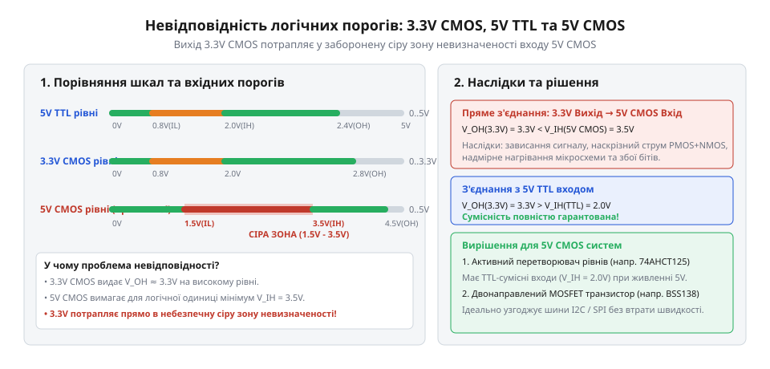
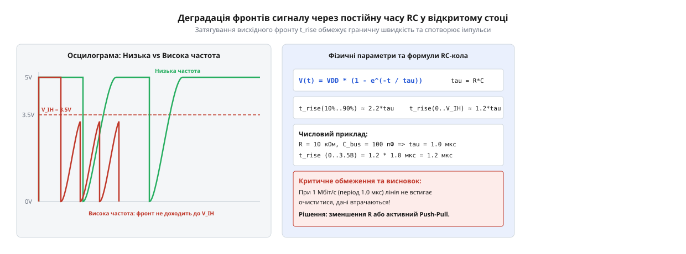
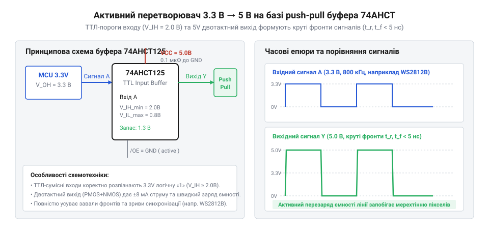
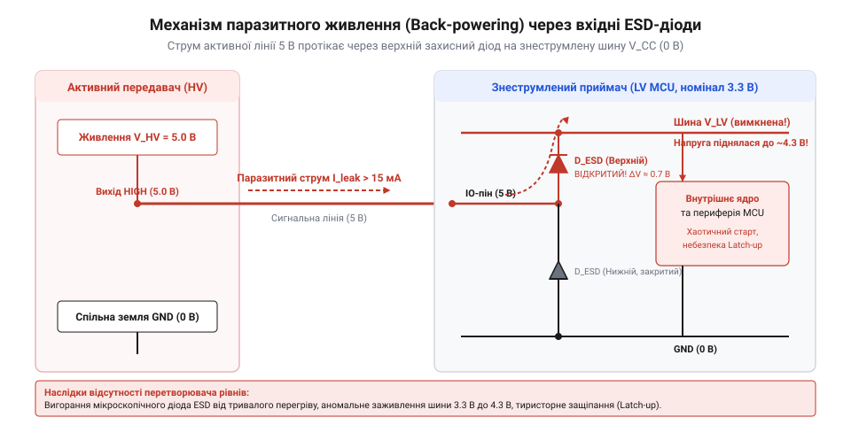

# Перетворювач логічних рівнів

<preknowlist>
- [Буфер із трьома станами виходу 74LVC1G125](root:cat-hw-parts/logic-buffer-74lvc1g125) — принцип дії шинного буфера з виходом високого імпедансу (High-Z) та керувальними входами дозволу виходу OE
- [Логіка серії 74AHCT у системній схемотехніці](root:cat-hw-parts/74ahct-logic-family) — схемотехнічні відмінності вхідних порогових напруг TTL-сумісної логіки 74AHCT при живленні 5 В для узгодження з 3.3 В сигналами
</preknowlist>

## Несумісність напруг та ризики прямого з'єднання

Пряме з'єднання двох цифрових мікросхем із різними напругами живлення здається найпростішим шляхом побудови пристрою. Коли розробник підключає вивід сучасного мікроконтролера з робочою напругою 3.3 В до датчика, периферійного модуля або дисплея з живленням 5 В, сигнальні лінії сприймаються як звичайні провідники для передачі двокових нуля та одиниці. Однак на рівні кремнієвої структури цифровий сигнал не є дискретним абстрактним значенням — це безперервна аналогова напруга, інтерпретація якої повністю залежить від внутрішньосхемних порогових рівнів приймача та наявності захисних структур на його входах.

Головна фізична причина збоїв при прямому з'єднанні полягає у розбіжності порогових напруг розпізнавання логічних рівнів між різними технологічними сімействами. Цифрова логіка визначає чотири ключові електричні параметри: максимальну напругу логічного нуля на виході `V_OL`, мінімальну напругу логічної одиниці на виході `V_OH`, а також вхідні пороги розпізнавання — максимальну напругу нуля `V_IL` та мінімальну напругу одиниці `V_IH`. За проміжок напруги між `V_IL` та `V_IH` відповідає зона невизначеності (або «сіра зона»), у якій приймач не гарантує коректного зчитування стану лінії. Надійність передачі даних визначає запас завадостійкості @@en|noise margin@@ (англ. @@en|noise margin@@ — запас завадостійкості), який для високого рівня обчислюється як різниця між вихідною напругою одиниці передавача та вхідним порогом приймача.

У класичній технології @@en|CMOS@@ (від @@en|Complementary Metal-Oxide-Semiconductor@@, англ. @@en|Complementary Metal-Oxide-Semiconductor@@ — комплементарна структура метал-оксид-напівпровідник) з живленням 5 В (наприклад, мікросхеми серії 74HC або класичні 8-бітні мікроконтролери AVR) порогові рівні прив'язані безпосередньо до напруги живлення `V_DD`:

```
V_IL_max = 0.3 × V_DD
         = 0.3 × 5.0
         = 1.5 V                [максимальний поріг логічного нуля]
V_IH_min = 0.7 × V_DD
         = 0.7 × 5.0
         = 3.5 V                [мінімальний поріг логічної одиниці]
```

Коли мікроконтролер із живленням 3.3 В виставляє на своєму виході логічну одиницю, реальна вихідна напруга `V_OH` з урахуванням внутрішнього опору p-канального транзистора та струму навантаження становить від 3.0 В до 3.1 В. Обчислимо запас завадостійкості високого рівня `N_MH` при спробі прямого керування 5-вольтовим @@en|CMOS@@ входом від 3.3-вольтового виходу:

```
N_MH = V_OH_LV - V_IH_HV
     = 3.1 - 3.5
     = -0.4 V                   [від'ємний запас завадостійкості]
```

Оскільки вихідна напруга 3.1 В є меншою за необхідний вхідний поріг 3.5 В, значення `N_MH` виявляється від'ємним. Це означає, що сигнал постійно перебуває нижче порогу спрацювання 5-вольтового приймача. У результаті приймач @@en|CMOS@@ або взагалі не розпізнає логічну одиницю (продовжує зчитувати 0), або генерує хаотичні спотворення бітів під впливом найменших температурних коливань та шумів шини живлення.

Принципово інша ситуація спостерігається при з'єднанні з логікою сімейства @@en|TTL@@ (від @@en|Transistor-Transistor Logic@@, англ. @@en|Transistor-Transistor Logic@@ — транзисторно-транзисторна логіка) або @@en|TTL@@-сумісними @@en|CMOS@@ серіями (такими як 74HCT та [серія 74AHCT](root:cat-hw-parts/74ahct-logic-family)). У цих мікросхемах вхідний поріг `V_IH_min` зафіксовано на рівні 2.0 В незалежно від того, що напруга живлення становить 5 В. Розрахуємо запас завадостійкості для цього випадку:

```
N_MH = V_OH_LV - V_IH_TTL
     = 3.1 - 2.0
     = +1.1 V                   [позитивний запас завадостійкості]
```

Завдяки позитивному запасу в +1.1 В сигнал із рівнем 3.3 В надійно розпізнається 5-вольтовим @@en|TTL@@ входом як логічна одиниця без застосування додаткових перетворювачів. Історичні причини виникнення таких розбіжностей та зміну стандартів живлення детально висвітлює [еволюція напруг логічних рівнів](root:cat-hw-parts/logic-level-converter/hist-voltage-levels-evolution.md). Загальні електричні характеристики різних стандартів узагальнюють [цифрові логічні сімейства](root:hw-digital/logic-families).


*Порівняння порогових напруг TTL (5V) та CMOS (3.3V/5V) із вказанням зон V_IH, V_IL та небезпечної сірої зони невизначеності.*

Зворотена проблема виникає при передачі сигналу у зворотному напрямку — від 5-вольтового виходу до входу з живленням 3.3 В або 1.8 В. Більшість вхідних каскадів цифрових мікросхем містять внутрішні захисні діоди від електростатичного розряду @@en|ESD@@ (від @@en|Electrostatic Discharge@@, англ. @@en|Electrostatic Discharge@@ — електростатичний розряд). Один діод підключено між вхідним виводом та шиною землі `GND`, а другий — між вхідним виводом та внутрішньою шиною живлення `V_DD` (3.3 В).

Коли на вхід 3.3-вольтової мікросхеми подається напруга 5.0 В від зовнішнього джерела, верхній захисний діод відкривається, оскільки потенціал входу перевищує напругу шини `V_DD` на величину прямого падіння напруги на p-n переході діода `V_D ≈ 0.6 V`:

```
V_in = 5.0 V
V_diode_threshold = V_DD + V_D
                  = 3.3 + 0.6
                  = 3.9 V                [поріг відкривання верхнього ESD-діода]
V_diff = V_in - V_diode_threshold
       = 5.0 - 3.9
       = 1.1 V                  [надлишкова напруга прямого зміщення]
```

Відкритий діод утворює низькоомний шлях для проходження струму від сигнальної лінії 5.0 В прямо у внутрішню шину живлення 3.3 В. Це явище спричиняє [паразитне живлення через ESD-діоди](root:hw-components/parasitic-powering-esd-diode-conduction). У такому стані 3.3-вольтова мікросхема продовжує хаотично функціонувати навіть при повністю вимкненому власному лінійному стабілізаторі @@en|LDO@@ (від @@en|Low Dropout Regulator@@, англ. @@en|Low Dropout Regulator@@ — лінійний стабілізатор із малим падінням напруги), відбираючи енергію із сигнального виводу передавача.

Якщо ж чип не має верхніх підтягувальних діодів на входах (або у разі застосування небезпечних ліній 5 В до стійких виходів), надлишкова напруга створює надвисоку напруженість електричного поля в тонкому затворному діелектрику з оксиду кремнію (SiO₂). Це викликає пробій затвора входів @@en|MOSFET@@ та незворотну руйнацію логічного входу.

Тривалий протік струму через тонкі захисні діоди (які розраховані лише на короткочасні мікросекундні імпульси статики) викликає їхній локальний перегрів, деградацію напівпровідникового переходу та інжекцію носіїв у підкладку. Це індукує паразитний тиристорний ефект @@en|latch-up@@ (англ. @@en|latch-up@@ — защіпання, паразитне відмикання чотиришарової тиристорної структури @@en|SCR@@ від @@en|Silicon Controlled Rectifier@@, англ. @@en|Silicon Controlled Rectifier@@ — кремнієвий керований вентиль). При защіпанні між шинами `V_DD` та `GND` утворюється коротке замикання всередині кристала, що призводить до негайного вигорання мікросхеми. Для запобігання цим ризикам та безпечного узгодження шин використовують спеціалізовані схемотехнічні рішення.

## Пасивне перетворення на MOSFET з підтяжками

Для безпечного узгодження логічних рівнів між низьковольтними (наприклад, 3.3 В) та високовольтними (наприклад, 5 В) пристроями без застосування складних напрямних перемикачів використовують пасивний каскад на одному N-канальному польовому транзисторі @@en|MOSFET@@ (від @@en|Metal-Oxide-Semiconductor Field-Effect Transistor@@, англ. @@en|Metal-Oxide-Semiconductor Field-Effect Transistor@@ — польовий транзистор зі структурою метал-оксид-напівпровідник) та двох підтягувальних резисторах. Ця топологія є класичним розв'язком для двонапрямних шин з відкритим стоком @@en|open-drain@@ (англ. @@en|open-drain@@ — відкритий стік), таких як шина @@en|I2C@@ (від @@en|Inter-Integrated Circuit@@, англ. @@en|Inter-Integrated Circuit@@ — міжмікросхемна шина) або 1-Wire.

Схемотехніка каскаду базується на симетричному підключенні транзистора:
- Затвор (@@en|Gate@@, `G`) підключається до низьковольтної шини живлення `V_LV` (3.3 В). - Витік (@@en|Source@@, `S`) підключається до низьковольтної сигнальної лінії `LV`. - Стік (@@en|Drain@@, `D`) підключається до високовольтної сигнальної лінії `HV`. - Лінію `LV` підтягнуто через резистор `R1` до живлення `V_LV` (3.3 В). - Лінію `HV` підтягнуто через резистор `R2` до живлення `V_HV` (5.0 В). - У структуру транзистора інтегровано паразитний технологічний діод підкладки @@en|body diode@@ (англ. @@en|body diode@@ — діод підкладки), анод якого з'єднано з витоком `S`, а катод — зі стоком `D`.

Функціонування пасивного перетворювача розбивається на три фізичні стани залежно від того, яка сторона керує лінією та який логічний рівень передається.

Перший стан відповідає режиму спокою, коли жоден із пристроїв не притискає лінію до землі (передача логічної одиниці або стан високого імпедансу @@en|High-Z@@ від @@en|High Impedance@@, англ. @@en|High Impedance@@ — стан високого імпедансу). Низьковольтна лінія `LV` підтягується резистором `R1` до напруги `V_LV` (3.3 В). Напруга на затворі `V_G` також дорівнює 3.3 В. Обчислимо різницю потенціалів між затвором та витоком `V_GS`:

```
V_GS = V_G - V_S
     = 3.3 - 3.3
     = 0 V                      [різниця потенціалів затвор-витік у стані спокою]
```

Оскільки напруга `V_GS` (0 В) є меншою за порогову напругу відкривання транзистора `V_GS(th)` (яка для логічних транзисторів типу BSS138 становить 0.8–1.5 В), провідний канал транзистора повністю закритий. Високовольтна лінія `HV` через резистор `R2` підтягується до напруги `V_HV` (5.0 В). Вбудований діод підкладки перебуває під зворотною напругою (`V_S = 3.3 V`, `V_D = 5.0 V`) і не проводитиме струм. Обидві лінії фізично ізольовані одна від одної, утримуючи власні потенціали 3.3 В та 5.0 В.

Другий стан виникає, коли низьковольтний пристрій передає логічний нуль, притягуючи лінію `LV` до потенціалу `GND` (0 В). Потенціал затвора лишається фіксованим на рівні `V_LV` (3.3 В). Розрахуємо нове значення `V_GS`:

```
V_GS = V_G - V_S
     = 3.3 - 0.0
     = 3.3 V                    [напруга затвор-витік при передачі нуля з LV боку]
```

Оскільки `3.3 V > V_GS(th)`, транзистор відкривається, створюючи низькоомний провідний канал між стоком та витоком. Струм із високовольтної шини `V_HV` через резистор `R2` та відкритий канал @@en|MOSFET@@ протікає на землю через вихідний транзистор низьковольтного передавача. Обчислимо напругу логічного нуля на високовольтній лінії `V_OL_HV` з урахуванням опору відкритого каналу транзистора `R_DS(on) ≈ 3.5 Ом` та опору вихідного ключа передавача `R_driver ≈ 10 Ом`:

```
I_sink = (V_HV - 0) ÷ (R2 + R_DS(on) + R_driver)
       = (5.0 - 0) ÷ (10000 + 3.5 + 10)
       ≈ 0.5 mA                 [струм розряду через відкритий ключ]
V_OL_HV = I_sink × (R_DS(on) + R_driver)
        = 0.0005 × 13.5
        ≈ 0.007 V               [напруга логічного нуля на ліній HV]
```

Оскільки падіння напруги `V_OL_HV` (7 мВ) значно менше за поріг `V_IL_max` (1.5 В), високовольтна сторона надійно зчитує логічний нуль.

Третій стан спостерігається при передачі логічного нуля у зворотному напрямку — коли високовольтний пристрій притягує лінію `HV` до землі (0 В). На початку цього процесу лінія `LV` перебуває під потенціалом 3.3 В. Оскільки потенціал стоку `V_D` стає рівним 0 В, а потенціал витоку `V_S` дорівнює 3.3 В, вбудований діод підкладки зміщується у прямому напрямку. Струм з лінії `LV` починає швидко протікати через відкритий діод у лінію `HV`, розряджаючи ємність низьковольтної лінії. Коли потенціал витоку `V_S` знижується до рівня `V_LV - V_GS(th)` (близько 1.8–2.0 В), напруга `V_GS` перевищує поріг відкривання, провідний канал @@en|MOSFET@@ шунтує діод і повністю притягує лінію `LV` до потенціалу `GND` (0 В).


*Схема пасивного перетворювача на N-канальному MOSFET з підтяжками у трьох станах: спокій, передача нуля з низьковольтного боку та передача нуля з високовольтного боку.*

При виборі компонента для пасивного перетворювача критичним параметром є максимальна порогова напруга затвор-витік `V_GS(th)_max`. Для стабільної роботи при живленні `V_LV = 3.3 В` або `1.8 В` транзистор мусить мати `V_GS(th) < V_LV - 0.5 В` (наприклад, польовий транзистор BSS138 з `V_GS(th) ≈ 1.2 В`). Застосування силових транзисторів із високим `V_GS(th) > 2.5 В` призведе до того, що канал не відкриється від низької напруги 1.8 В чи 3.3 В.

Незважаючи на універсальність і двонапрямність, пасивний каскад на @@en|MOSFET@@ має жорсткі фізичні обмеження за частотою передачі даних. При передачі нуля розряд лінії здійснюється активно через відкритий транзистор із малим опором каналу (`R_DS(on) ≈ 1–5 Ом`), що забезпечує дуже короткий час спаду фронту (@@en|fall time@@). Проте повернення лінії до стану логічної одиниці відбувається виключно пасивно — шляхом заряджання паразитної ємності лінії `C_line` (ємність монтажу та входів чипів) через підтягувальні резистори `R1` та `R2`.

Процес відновлення напруги описується рівнянням заряджання @@en|RC@@-ланцюга:

```
V_line(t) = V_DD × (1 - e^(-t ÷ (R × C)))
```

Для обчислення тривалості фронту зростання (@@en|rise time@@, `t_rise`) від 0 до порогового рівня розпізнавання одиниці `V_IH = 0.7 × V_DD` розв'яжемо це рівняння відносно часу `t`:

```
0.7 × V_DD = V_DD × (1 - e^(-t_rise ÷ (R × C)))
0.3 = e^(-t_rise ÷ (R × C))
ln(0.3) = -t_rise ÷ (R × C)
t_rise = -ln(0.3) × R × C
       ≈ 1.204 × R × C          [формула часу зростання фронту до рівня 0.7 V_DD]
```

Проведемо розрахунок `t_rise` для типової шини @@en|I2C@@ з опором підтяжки `R = 10 кОм` (10⁴ Ом) та сумарною паразитною ємністю лінії `C = 100 пФ` (10⁻¹⁰ Ф):

```
t_rise = 1.204 × 10⁴ × 10⁻¹⁰
       = 1.204 × 10⁻⁶ s
       = 1.204 μs               [тривалість фронту зростання напруги]
```

Якщо швидкість передачі даних становить 1 Мбіт/с (період тактового імпульсу `T = 1.0 мкс`), тривалість одного фронту `t_rise` (1.204 мкс) перевищує весь період сигналу. Прямокутний імпульс перетворюється на згладжену пилоподібну криву, яка не встигає досягти рівня `V_IH`, спричиняючи повну втрату синхронізації.

Зменшення опору підтяжки `R` до 1 кОм дозволяє прискорити заряджання лінії та зменшити `t_rise` до 0.12 мкс, проте це різко збільшує статичне енергоспоживання під час передачі нуля:

```
P_static = V_DD² ÷ R
         = 5.0² ÷ 1000
         = 25 mW                [потужність розсіювання на одному резисторі підтяжки при 0V]
```

Таким чином, у пасивних перетворювачах виникає непереборний схемотехнічний компроміс між швидкістю роботи та енергоефективністю. Детальний математичний аналіз вибору опорів та часових затримок розгортає [математичний розрахунок підтягувальних резисторів](root:cat-hw-parts/logic-level-converter/math-level-converter-timing-and-resistors.md). Практичну схему плати та розводку каналів висвітлює [модуль двонапрямного перетворювача рівнів на BSS138](root:cat-hw-parts/logic-level-converter/proj-i2c-mosfet-level-shifter.md). У випадках, коли необхідна високошвидкісна однонапрямна передача сигналів з короткими фронтами (наприклад, для шин @@en|SPI@@ або керування світлодіодами), використовують активні буфери, такі як [буфер із трьома станами 74LVC1G125](root:cat-hw-parts/logic-buffer-74lvc1g125) з двотактним виходом @@en|push-pull@@ (англ. @@en|push-pull@@ — двотактний вихід).

## Активні push-pull буфери для швидкісних ліній

Пасивні перетворювачі на польових транзисторах чудово справляються з повільними шинами, але на високих частотах виявляють критичне обмеження. Коли вихідний транзистор закривається, напруга на лінії зростає не миттєво, а за експоненціальним законом заряду паразитної ємності лінії через підтягувальний резистор. Час наростання фронту `t_rise` (англ. *rise time* — час підйому) визначається добутком опору підтяжки та ємності монтажу. Якщо для шини `@@en|I2C@@` із частотою `400 kHz` закруглення фронтів є допустимим, то в швидкісних протоколах — таких як `@@en|SPI@@` із частотами `10 MHz` і вище, або при керуванні адресними світлодіодами `@@en|WS2812B@@` — фронт сигналу просто не встигає досягти порогу логічної одиниці за відведений проміжок часу.


*Вплив паразитної ємності лінії та підтягувального резистора на тривалість фронту наростання.*

Спроба зменшити опір підтягувального резистора для прискорення заряду ємності впирається у фізичне обмеження: зменшення опору до `330 Ω` викликає надмірний струм розряду через відкритий транзистор, перевищуючи гранично допустимий вихідний струм мікроконтролера та створюючи високе статичне енергоспоживання. Для швидкісних ліній потрібен докорінно інший схемотехнічний підхід — активне керування обома фронтами сигналу.

Розв'язанням цієї проблеми є каскад типу `@@en|push-pull@@` (англ. *push* — штовхати, *pull* — тягнути): двотактний вихідний каскад з двох комплементарних транзисторів. Верхній P-канальний транзистор активно підтягує лінію до шини живлення з низьким опором каналу, а нижній N-канальний транзистор так само активно розряджає її на землю. Оскільки заряд ємності відбувається через відкритий транзистор із опором у одиниці Ом, тривалість фронту наростання скорочується з сотень наносекунд до `2...5 ns`.

Однак підключення активного `@@en|push-pull@@` буфера з живленням `5 V` до мікроконтролера з рівнем `3.3 V` вимагає врахування порогових напруг вхідного каскаду. Стандартні `5 V` мікросхеми класичного `@@en|CMOS@@`-сімейства `74HC` мають поріг розпізнавання високого рівня `V_IH_min = 0.7 × V_CC = 3.5 V`. Вихідний сигнал `3.3 V` контролера (який під навантаженням може просідати до `3.0 V`) виявляється нижчим за цей поріг. У результаті буфер або взагалі не розпізнає логічну одиницю, або потрапляє в лінійну область підсилення, де обидва вихідні транзистори напіввідкриті, що викликає колосальне наскрізне споживання струму та перегрів.

Вихід полягає у використанні логічних серій із `@@en|TTL@@`-сумісними вхідними порогами при `5 V` живленні — перш за все серії `@@en|74AHCT@@` (англ. *Advanced High-Speed CMOS with TTL inputs*) або `@@en|74HCT@@`. Порогові напруги `@@en|TTL@@`-входу зафіксовані схемотехнічно і не залежать пропорційно від напруги живлення `V_CC`:

```
V_IH_min = 2.0 V          [мінімальна вхідна напруга високого рівня]
V_IL_max = 0.8 V          [максимальна вхідна напруга низького рівня]
```

Оскільки вихідна напруга логічної одиниці `3.3 V` мікроконтролера гарантовано перевищує поріг `V_IH_min = 2.0 V`, виникає позитивний запас завадостійкості:

```
V_OH_min = 3.0 V          [гарантований вихідний високий рівень 3.3V контролера]
V_IH_min = 2.0 V          [вхідний поріг 74AHCT при живленні 5V]
ΔV_H = V_OH_min - V_IH_min
     = 3.0 V - 2.0 V
     = 1.0 V              [позитивний запас завадостійкості]
```


*Схемотехніка активного однонапрямного буфера 74AHCT із підключенням до 5 В та TTL-входом.*

Завдяки цьому мікросхема `@@en|74AHCT@@`, живлячись від `5 V`, безпомилково сприймає керувальні сигнали `3.3 V` і формує на своєму виході повноамплітудний `5 V` `@@en|push-pull@@` сигнал із крутими фронтами. Детальний аналіз електричних характеристик [різних логічних сімейств](root:hw-digital/logic-families) показує, що саме `@@en|74AHCT@@` забезпечує оптимальний компроміс між швидкодією та енергоефективністю.

Крім того, більшість активних буферів містять керувальний вхід дозволу виходу `@@en|OE@@` (англ. *output enable* — дозвіл виходу). При подачі пасивного рівня на вхід `@@en|OE@@` обидва ключі вихідного каскаду розмикаються, і вихід переходить у [стан високого імпедансу](root:cat-hw-parts/logic-buffer-74lvc1g125) `@@en|High-Z@@` (англ. *high impedance* — високий опір). Це дозволяє відключати пристрій від шини без вимикання його живлення.

Головне обмеження активних `@@en|push-pull@@` буферів — їхня жорстка однонапрямність. Сигнал може передаватися лише від входу `A` до виходу `Y`. Спроба подати зовнішній сигнал на вихід `Y` під час активного стану призведе до міжшинного конфлікту струмів (англ. *bus contention* — конфлікт на шині) та можливого виходу з ладу драйвера. Тому такі буфери застосовують для однонапрямних ліній: тактового сигналу `SCLK` та даних `MOSI` в шині `@@en|SPI@@`, лінії `TX` в `@@en|UART@@`, а також для керування світлодіодними стрічками. Наприклад, специфікація розробки [адаптера світлодіодів WS2812B](root:cat-hw-parts/logic-level-converter/proj-ws2812b-active-buffer-driver.md) базується саме на буфері `74AHCT125`.

Для зворотного напрямку — зсуву з `5 V` у `3.3 V` — використовувати `74AHCT` неможливо, оскільки її не можна живити від `3.3 V`. Для пониження напруги застосовують активні буфери сімейства `74LVC` (наприклад, `74LVC125`), які живляться від `3.3 V`, але мають входи, стійкі до перенапруги (англ. *5V-tolerant inputs*). У їхній схемотехніці відсутній верхній захисний [ESD-діод до шини V_CC](root:hw-components/parasitic-powering-esd-diode-conduction), що виключає паразитне протікання струму з `5 V` лінії у джерело `3.3 V`.

Загальні правила побудови принципових схем та розведення опорних шин для активних трансляторів наведені у документації на [залізний інтерфейс перетворювачів](root:cat-hw-parts/logic-level-converter/api-logic-level-converter-hardware.md).

## Спеціалізовані мікросхеми з автовизначенням напрямку

У складних цифрових системах часто виникає потреба в двонапрямному обміні даними без використання окремих ліній керування напрямком `DIR`. Якщо для повільної шини `@@en|I2C@@` з відкритим стоком достатньо пасивного перетворювача на транзисторах, то для двонапрямних `@@en|push-pull@@` ліній (наприклад, лінії даних `SWDIO` відлагоджувального інтерфейсу `@@en|SWD@@`, шини `SDIO` для `SD`-карт або швидкодіючих двонапрямних ліній `@@en|GPIO@@`) пасивна схема не підходить через уповільнення фронтів, а звичайний буфер `74AHCT` вимагає ручного перемикання сигналу `OE`/`DIR`.

Для автоматичного узгодження таких шин створено спеціалізовані мікросхеми трансляторів рівнів із функцією автоматичного визначення напрямку (англ. *auto-direction sensing*). Їхня архітектура позбавляє розробника потреби виділяти керувальні виводи мікроконтролера, проте внутрішній механізм суттєво відрізняється залежно від типу шини. Найпоширенішими є дві серії спеціалізованих чипів від Texas Instruments: серія `@@en|TXS@@` та серія `@@en|TXB@@`.


*Архітектурні відмінності двонапрямних трансляторів рівнів серій TXS та TXB.*

Серія `@@en|TXS@@` (наприклад, `TXS0102`, `TXS0104E`, `TXS0108E`) оптимізована для інтерфейсів із відкритим стоком `@@en|open-drain@@` (англ. *open drain* — відкритий стік), хоча може працювати і з `@@en|push-pull@@` сигналами. В основі кожного каналу `@@en|TXS@@` лежить прохідний транзистор `@@en|pass-transistor@@` (англ. *pass* — пропускати), доповнений внутрішніми підтягувальними резисторами з опором `10 kΩ` та схемою динамічного прискорення фронтів.

Головним схемотехнічним вузлом `@@en|TXS@@` є однократний прискорювач фронтів `@@en|one-shot edge accelerator@@` (англ. *one-shot* — однократний імпульс). Коли будь-який із підключених пристроїв починає притягувати лінію до землі, струм вільно тече через відкритий прохідний транзистор, і обидва борти (Port A та Port B) швидко переходять у логічний нуль. Проте під час переходу з низького рівня у високий напруга починає повільно зростати через внутрішній резистор `10 kΩ`. Спеціальна схема детектора фронту фіксує цей початок підйому напруги й миттєво вмикає потужний внутрішній P-канальний транзистор на короткий проміжок часу (близько `30 ns`).

Цей потужний транзистор шунтує резистор `10 kΩ` і прямим низькоомним шляхом форсовано інжектує струм у лінію, заряджаючи її паразитну ємність. Як тільки напруга на лінії досягає рівня логічної одиниці, однократний прискорювач вимикається, і далі рівень утримується високим за рахунок слабкого резистора `10 kΩ`. Завдяки цьому тривалість фронту скорочується з сотень наносекунд до `5...10 ns`, що дозволяє шині `@@en|I2C@@` стабільно працювати на частоті `400 kHz` і навіть `1 MHz` без критичного розмиття імпульсів.

Зовсім інший підхід реалізовано в серії `@@en|TXB@@` (наприклад, `TXB0104`, `TXB0108`), яка призначена виключно для `@@en|push-pull@@` ліній і не сумісна з відкритим стоком. У чипах `@@en|TXB@@` немає прохідних транзисторів і підтягувальних резисторів. Замість них між портом A та портом B включено зустрічно-паралельні слабкі буфери `@@en|weak buffer@@` (англ. *weak buffer* — слабкий буфер) зі слабкою вихідною здатністю.

Вихідний опір слабкого внутрішнього драйвера `@@en|TXB@@` становить близько `4 kΩ` (`@@en|weak driver@@`). Коли зовнішній мікроконтролер змінює стан лінії, його потужний вихідний драйвер із опором менше `100 Ω` без зусиль пересилює слабкий внутрішній утримувач `4 kΩ` чипа `@@en|TXB@@`, примусово змінюючи напругу на його виході. Внутрішній детектор напрямку `@@en|TXB@@` відчуває цю зміну потенціалу та активує однократний прискорювач фронтів, який протягом кількох наносекунд подає потужний імпульс у протилежний порт, швидко дзеркалюючи новий логічний стан. Після завершення імпульсу прискорювач вимикається, а новий стан засувається й утримується слабким буфером `4 kΩ`.

Незважаючи на зручність автовизначення напрямку, серії `@@en|TXS@@` та `@@en|TXB@@` мають суворі схемотехнічні обмеження, невиконання яких призводить до збоїв у роботі:

1. **Заборона зовнішніх підтягувальних резисторів для TXB.** Оскільки вихідний драйвер `@@en|TXB@@` у статичному стані є слабким (`4 kΩ`), підключення зовнішнього резистора підтяжки з опором менше `50 kΩ` призведе до того, що струм зовнішньої підтяжки повністю перекриє внутрішній драйвер. Мікросхема стане нездатною встановити логічний нуль або втратить стійкість станів. 2. **Обмеження ємності навантаження лінії.** Тривалість імпульсу прискорювача `@@en|one-shot edge accelerator@@` суворо обмежена часом близько `30 ns`. Якщо ємність монтажу чи довгого кабелю перевищує `70 pF` (для `@@en|TXB@@`) або `100 pF` (для `@@en|TXS@@`), струму прискорювача за `30 ns` не вистачить для повного заряду лінії. Після вимкнення прискорювача напруга не досягне порогу `V_IH`, і лінія повернеться до слабкого утримувача, що спричинить просідання напруги, фальшиві перезапуски та генерацію високочастотних завад. 3. **Паразитні осциляції та відбиття сигналу.** Дуже круті фронти (`dv/dt`), які створюють прискорювачі, вимагають якісного розведення друкованої плати. При неузгодженості імпедансу лінії в ній виникають хвильові відбиття (зворотні викиди). Детектор `@@en|one-shot edge accelerator@@` сприймає зворотну хвилю відбиття як новий вхідний фронт протилежної полярності та повторно вмикає прискорювач, викликаючи некеровану зворотну генерацію (самовозбудження) на частотах у сотні мегагерц. 4. **Послідовність живлення шин.** Напруга на опорному порту `V_CCA` завжди повинна бути меншою або рівною напрузі `V_CCB` (`V_CCA ≤ V_CCB`), оскільки внутрішня логіка керування напрямком та відліку порогових напруг живиться саме від шини `V_CCA`.

Практичні приклади застосування та особливості розведення плат для [двонапрямних трансляторів TXS0108E](root:cat-hw-parts/txs0108e-auto-direction-level-shifters) розглядаються в окремих матеріалах. При виборі між пасивними, активними та автовизначальними схемотехнічними рішеннями необхідно враховувати тип шини, частоту передачі та ємнісне навантаження, щоб уникнути вигорання вхідних каскадів через [паразитне живлення та ESD-діоди](root:hw-components/parasitic-powering-esd-diode-conduction).

## Обмеження ємності й спотворення часових характеристик

При підключенні цифрових мікросхем із різною напругою живлення недостатньо просто забезпечити відповідність рівнів напруги логічного нуля та логічної одиниці. На реальній друкованій платі будь-яка провідна доріжка, вивід корпусу мікросхеми, з'єднувальний шлейф та вхідний каскад приймача володіють власною @@en|parasitic capacitance@@ (від лат. @@la|capacitas@@ — місткість). Ця ємність утворює паразитне конденсаторне навантаження відносно спільної шини землі `GND`, яке зазвичай становить від 5 до 50 pF для коротких доріжок плати та може досягати 100–400 pF на довгих кабелях чи шинах із десятком підключених пристроїв. Коли вихідний транзистор перетворювача змінює свій стан, ця ємність не може зарядитися чи розрядитися миттєво. Фізична швидкість зміни напруги на лінії визначається виключно тим, який струм протікає через перезаряджуваний провідник.

У пасивному двонапрямному перетворювачі на N-канальному @@en|MOSFET@@ розряд лінії відбувається вкрай швидко. Коли передавач замикає лінію на землю, транзистор відкривається, а опір його відкритого каналу `R_DS(on)` становить усього кілька ом. Величезний розрядний струм майже миттєво скидає заряд з паразитної ємності, забезпечуючи короткий @@en|fall time@@ (від англ. @@en|fall time@@ — час спаду), який зазвичай не перевищує 2–5 ns. Проте при переході з низького рівня у високий транзистор закривається і повністю відключає вихід від землі. Відтепер лінія не має активного джерела струму: заряджання паразитної ємності здійснюється виключно через пасивний резистор підтяжки `R_pullup`, підключений до шини живлення.

Процес заряджання ємності через опір описується експоненційною залежністю напруги від часу. Постійна часу @@en|RC time constant@@ (від англ. @@en|RC time constant@@ — постійна часу RC) визначає швидкість, з якою напруга зростає до логічного рівня одиниці. Час зростання @@en|rise time@@ `t_r` вимірюється як інтервал, за який напруга на лінії піднімається від 30% до 70% від значення шини живлення `V_CC`. Для розрахунку часу зростання фронту сигналів у пасивній лінії використовують співвідношення між постійною часу `τ = R_pullup × C_line` та експоненційним зростанням напруги:

```
t_r = ln(0.7 / 0.3) × R_pullup × C_line
    = 0.847 × R_pullup × C_line             [перехід від логарифма до коефіцієнта]
```

Де `R_pullup` позначено опір резистора підтяжки в омах, а `C_line` — сумарну паразитну ємність лінії в фарадах. Якщо опір підтяжки становить 10 kΩ, а ємність лінії дорівнює 100 pF, час зростання фронту `t_r` досягає 847 ns.


*Залежність часу зростання сигналу від RC-постійної часу та вихід з ладу часових таймінгів швидкісних шин.*

Затягування фронту перетворює прямокутний цифровий сигнал на закруглену пилоподібну хвилю. У протоколах із відкритим стоком, таких як @@en|I2C@@, стандартний режим @@en|Standard-mode@@ (100 kHz, тривалість півперіоду 5000 ns) припускає максимальний час зростання `t_r` до 1000 ns, що дозволяє пасивному перетворювачу працювати без помилок. Проте у режимі @@en|Fast-mode@@ (400 kHz, тривалість півперіоду 1250 ns) специфікація вимагає `t_r` не більше 300 ns. Якщо закруглений фронт не встигає досягти вхідного порогу високого рівня `V_IH` до моменту зчитування даних стробуючим імпульсом годинника, приймач фіксує логічний нуль замість одиниці, викликаючи збій шини.

Для високошвидкісних протоколів із комплементарним виходом @@en|push-pull@@, таких як @@en|SPI@@ (з частотами від 10 до 50 MHz) або інтерфейс налагодження @@en|SWD@@ (Serial Wire Debug, 5–10 MHz), пасивний перетворювач з резисторами підтяжки непридатний у принципі. При тривалості тактового імпульсу в кілька десятків наносекунд фронт затягується на сотні наносекунд, через що сигнал взагалі втрачає амплітуду й розчиняється.

Щоб зменшити `t_r` та підвищити граничну частоту пасивного перетворювача, виникає спокуса зменшити опір резистора підтяжки `R_pullup`. Однак зменшення опору жорстко обмежене вихідною навантажувальною здатністю мікросхеми-передавача по струму `I_OL`. Коли вихідний транзистор відкривається і тягне лінію до землі, через нього протікає статичний струм `I_OL = V_CC / R_pullup`. Якщо обрати занадто малий опір, вихідний каскад не зможе опустити напругу нижче порогу логічного нуля `V_IL_max`. Падіння напруги на відкритому каналі `V_OL` зросте вище норми, створюючи ризик зчитування хибної одиниці та спричиняючи статичне перегрівання транзистора.

Таким чином, розрахунок підтяжки становить класичний інженерний компроміс між швидкістю та струмовим навантаженням. Мінімально припустимий опір визначено граничним струмом входу `I_OL_max` та максимально припустимою напругою низького рівня `V_OL_max`:

```
R_min = (V_CC - V_OL_max) / I_OL_max       [граничний статичний опір]
```

Максимально припустимий опір обмежено лімітом часу зростання `t_r_max` для конкретного протоколу:

```
R_max = t_r_max / (0.847 × C_line)          [граничний опір за швидкодією]
```

Для глибшого аналізу того, як [математично розраховують часові параметри фронтів](root:cat-hw-parts/logic-level-converter/math-level-converter-timing-and-resistors.md) та опори підтяжок, використовують деталізовані співвідношення залежно від напруги живлення та ємності. При розробці конкретного [чотириканального модуля на MOSFET](root:cat-hw-parts/logic-level-converter/proj-i2c-mosfet-level-shifter.md) для шини @@en|I2C@@ зазвичай обирають опір підтяжки у межах від 2.2 kΩ до 4.7 kΩ як оптимальний баланс для ліній ємністю біля 50–100 pF.

Щоб усунути обмеження RC-постійної часової затримки @@en|propagation delay@@ (від лат. @@la|propagatio@@ — поширення), застосовують активні перетворювачі рівнів. В активних push-pull буферах (наприклад, серії 74AHCT) вихідний каскад містить пару комплементарних транзисторів, які активним чином підтягують лінію як до землі, так і до живлення `V_CC` з низьким внутрішнім опором. Завдяки цьому часи `t_r` та `t_f` стають симетричними і становлять лише 2–4 ns, а затримка поширення сигналу зменшується до одиниць наносекунд, відкриваючи можливість роботи на частотах понад 50 MHz.

У спеціалізованих двонапрямних трансляторах з автовизначенням напрямку серії TXS використовується @@en|one-shot edge accelerator@@ (від англ. @@en|one-shot edge accelerator@@ — одноімпульсний прискорювач фронту, від лат. @@la|acceleratio@@ — прискорення). При виявленні наростаючого фронту внутрішня схема короткочасно (на 10–30 ns) вмикає потужний внутрішній PMOS-транзистор з опором близько 30 Ω, що форсовано впорскує струм у лінію та швидко заряджає паразитну ємність. Після цього транзистор вимикається, і стан підтримується слабким підтягувальним резистором. Однак якщо паразитна ємність лінії перевищує 100–150 pF, енергії одноразового імпульсу прискорювача не вистачає для повного заряду, що призводить до подвійного спрацьовування прискорювача, дзвіна на фронтах та спотворення переданих даних.

## Вибір топології та запобігання паразитному живленню

Практичний вибір схемотехніки перетворювача рівнів вимагає комплексного аналізу трьох ключових параметрів шини: напрямку передачі даних, типу вихідного каскаду та робочої частоти сигналів. Помилка у виборі топології призводить або до повного розриву зв'язку через затягнуті фронти, або до апаратних конфліктів на шині та незворотного пошкодження мікросхем.

Для системного вибору використовують наступне узгодження вимог:
1. **Однонапрямні високошвидкісні лінії з push-pull виходом** (сигнали тактування SPI, лінії даних MOSI/MISO, UART, індикатори, світлодіодні стрічки). Найкращим рішенням є активні push-pull буфери (наприклад, серії 74AHCT або 74LVC). Вони забезпечують круті фронти, високу навантажувальну здатність та стабільні затримки поширення. Наприклад, для керування швидкісними адресними стрічками використовують [спеціалізований драйвер на 74AHCT125](root:cat-hw-parts/logic-level-converter/proj-ws2812b-active-buffer-driver.md), який прецизійно перетворює рівні 3.3 В контролера у 5 В із збереженням часових інтервалів у сотні наносекунд. Застосування [тристабільного буфера 74LVC1G125](root:cat-hw-parts/logic-buffer-74lvc1g125) чи логіки серії [74AHCT у системній схемотехніці](root:cat-hw-parts/74ahct-logic-family) дозволяє будувати надійні інтерфейси узгодження. При побудові паралельних шин керування зсувними регістрами на кшталт [зсувного регістра 74HC595](root:cat-hw-parts/74hc595) або [вхідного регістра 74HC165](root:cat-hw-parts/74hc165) чи [дешифратора 74HC138](root:cat-hw-parts/74hc138) активні буфери є єдино можливим вибором для збереження тактової частоти.

2. **Двонапрямні низько- та середньошвидкісні шини з відкритим стоком** (I2C SDA/SCL, 1-Wire, SMBus на частотах до 400 kHz – 1 MHz). Тут оптимальні пасивні перетворювачі на N-канальних MOSFET транзисторах з резисторами підтяжки. Вони забезпечують повну двонапрямність без необхідності зовнішніх сигналів напрямку та зберігають сумісність із затягуванням тактового імпульсу. Сучасні [двонапрямні перетворювачі TXS0108E](root:cat-hw-parts/txs0108e-auto-direction-level-shifters) розширюють цю межу до 2–10 MHz завдяки вбудованим прискорювачам фронтів.

3. **Двонапрямні шини з комплементарним push-pull виходом без окремого сигналу напрямку** (шини даних SD-карт, паралельні шини дисплеїв, SWD). У таких завданнях застосовують спеціалізовані транслятори серії TXB. Оскільки TXB містить буфери з рециркуляційним опором 4 kΩ, вихідний драйвер підключеного пристрою має володіти навантажувальною здатністю понад 2 mA, щоб здолати цей опір і переключити напрямок трансляції. Порівняльні характеристики та фізичні межі [різних цифрових логічних сімейств](root:hw-digital/logic-families) визначають сумісність входів і виходів при таких перетвореннях.


*Формування струмової петлі паразитного живлення шини LV через ESD-діоди знеструмленої мікросхеми при активній шині HV.*

Схемотехнічне розведення опорних шин живлення високої `V_HV` та низької `V_LV` напруги має чітке правило @@en|power sequencing@@ (від лат. @@la|sequentia@@ — послідовність): напруга низьковольтної шини завжди повинна бути меншою або дорівнювати напрузі високовольтної шини `V_LV ≤ V_HV`. Порушення цього правила або неодночасна подача живлення у мультивольтових системах призводить до системної аномалії, відомої як @@en|parasitic powering@@ (від грец. @@el|παράсіτος@@ — той, що їсть чужий хліб).

Коли високовольтна частина схеми (наприклад, 5 В пристрій) знаходиться під напругою і посилає логічну одиницю, а низьковольтний мікроконтролер (3.3 В) вимкнений (`V_LV = 0 V`), струм через сигнал високого рівня спрямовується у вхідний вивід знеструмленого чипа. Усередині чипа струм проходить через захисний кремнієвий діод @@en|ESD@@, увімкнений між вхідним виводом та внутрішньою шиною живлення. В результаті знеструмлена шина 3.3 В починає паразитно живитися через вхідний вивід напругою близько 4.3 В (5 В мінус падіння 0.7 В на діоді). Це викликає неконтрольований хаотичний запуск мікроконтролера, збої внутрішньої пам'яті та створює ризик виникнення защіпання @@en|latch-up@@ з термічним вигоранням кремнієвого кристала.

Явище, коли виникає [паразитне живлення через ESD-діоди](root:hw-components/parasitic-powering-esd-diode-conduction), повністю блокується застосуванням перетворювачів із функцією часткового знеструмлення @@en|partial power-down@@ (технологія @@en|I_off@@). У цьому стані внутрішній каскад транслятора переходить у високоімпедансний стан @@en|High-Z@@ і фізично розриває гальванічний зв'язок між шинами, унеможливлюючи витік струму при `V_CC = 0 V`.

Для забезпечення стабільної роботи кожен перетворювач рівнів вимагає встановлення керамічних розв'язувальних конденсаторів @@en|decoupling capacitor@@ (від лат. @@la|copula@@ — зв'язок) ємністю 0.1 µF безпосередньо біля виводів живлення `V_LV` та `V_HV`. Ці конденсатори компенсують імпульсні кидки струму при спрацьовуванні внутрішніх транзисторів та прискорювачів фронтів. Повільні зміни або просідання напруги на опорних шинах призводять до зсуву порогових рівнів спрацьовування та збоїв логіки.

Окремою небезпекою є плаваючі потенціали на лініях керування напрямком або дозволом виходу @@en|output enable@@ (OE). Під час подачі живлення або перезавантаження мікроконтролера його виводи виводу-вводу знаходяться у стані високого імпедансу @@en|High-Z@@. Якщо вивід OE перетворювача залишити непідключеним, на ньому виникають наводки електромагнітних завад, що призводить до хаотичного ввімкнення та вимкнення виходів перетворювача. Щоб запобігти цьому, вивід OE обов'язково підтягують резистором 10 kΩ до шини землі `GND` (або `V_CC` залежно від активної полярності), гарантуючи безпечний вимкнений стан вихідних каскадів до моменту завершення ініціалізації процесора. Повільні принципові схеми та [залізний інтерфейс підключення перетворювачів](root:cat-hw-parts/logic-level-converter/api-logic-level-converter-hardware.md) дають повні рекомендації щодо розведення друкованих плат із врахуванням спільної шини землі `GND` для відсікання струмових петель. Історичний контекст того, як [еволюціонували логічні рівні напруги](root:cat-hw-parts/logic-level-converter/hist-voltage-levels-evolution.md) від 5 В до низьковольтних систем, підтверджує важливість сувогого дотримання правил узгодження напруг у сучасних електронних пристроях.