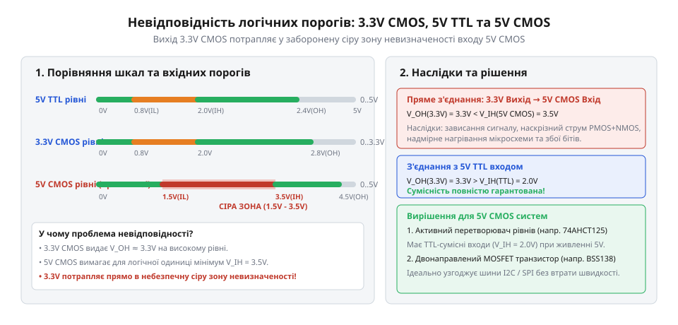
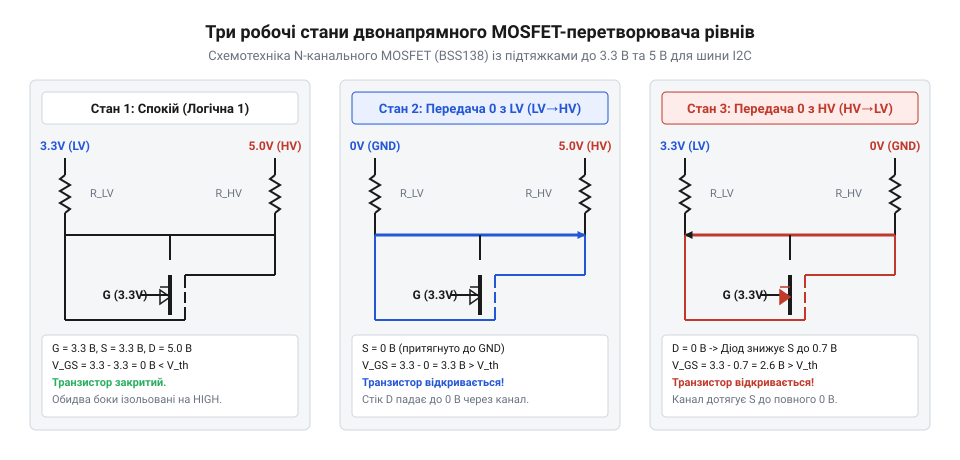
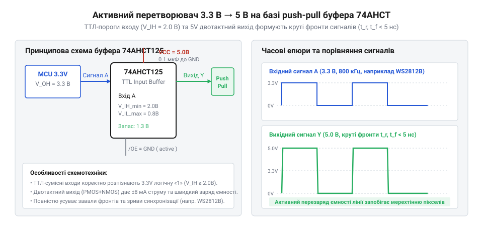

# Перетворювач логічних рівнів

<preknowlist>
- [Буфер із трьома станами виходу 74LVC1G125](root:cat-hw-parts/logic-buffer-74lvc1g125) — Принцип дії шинного буфера з виходом High-Z та керувальними входами OE
- [Логіка серії 74AHCT у системній схемотехніці](root:cat-hw-parts/74ahct-logic-family) — Схемотехнічні відмінності вхідних порогових напруг TTL-сумісної логіки 74AHCT при живленні 5 В
</preknowlist>

## Несумісність напруг та ризики з'єднання

Пряме з'єднання цифрових мікросхем із різними напругами живлення (наприклад, мікроконтролера 3.3 В та периферії 5 В) спричиняє аварійні режими вхідних каскадів. У класичній логіці @@en|CMOS@@ (від англ. @@en|Complementary Metal-Oxide-Semiconductor@@) з живленням 5 В поріг розпізнавання логічної одиниці становить `V_IH = 0.7 × V_DD = 3.5 В`. Оскільки вихідний рівень 3.3 В є нижчим за 3.5 В, сигнал потрапляє в зону невизначеності, викликаючи хаотичні помилки зчитування.

*Розбіжність логічних порогів TTL та CMOS показує ризик потрапляння 3.3 В сигналу в заборонену зону 5 В CMOS.*

При передачі сигналу з 5 В виходу на 3.3 В вхід виникає зворотна небезпека. Струм тече через внутрішній захисний діод до шини 3.3 В, викликаючи небезпечне паразитне живлення (від англ. @@en|back-powering@@) знеструмлених вузлів. Якщо захисний діод відсутній, електричне поле пробиває тонкий підзатворний діелектрик польового транзистора, а тривалий струм викликає тиристорний ефект защіпання (від англ. @@en|latch-up@@) і повне руйнування кристала.

## Двонапрямний пасивний перетворювач на MOSFET

Для безпечного узгодження шин із відкритим стоком (від англ. @@en|open-drain@@), таких як I2C, застосовують схему на одному N-канальному польовому транзисторі (від англ. @@en|MOSFET@@) BSS138 та двох підтягувальних резисторах. Затвор транзистора підключають до живлення 3.3 В, витік — до лінії 3.3 В, а стік — до лінії 5 В.

*Три робочі стани MOSFET-перетворювача ілюструють напрямки струмів розряду шини через відкритий канал та вбудований діод.*

Схема працює у трьох станах. У спокої на обох лініях утримується високий рівень через підтяжки, а напруга затвор-витік `V_GS = 0 В` надійно закриває транзистор. Коли сторона 3.3 В виставляє нуль, `V_GS` зростає до 3.3 В, транзистор відкривається і притягує лінію 5 В до землі. При передачі нуля з боку 5 В спочатку відкривається вбудований діод підкладки (від англ. @@en|body diode@@), знижуючи напругу на витоку до 0.7 В, після чого транзистор відмикається й дотягує лінію до 0 В. Швидкодія схеми обмежена постійною часу заряду паразитної ємності монтажу через підтяжки.

## Активні буфери та автовизначники напрямку

На високих частотах (понад 1 МГц), зокрема в інтерфейсах SPI та лініях адресної підсвітки WS2812B, повільні фронти відкритого стоку спотворюють дані. У таких вузлах застосовують активні двотактні (від англ. @@en|push-pull@@) буфери, такі як [буфер із трьома станами виходу 74LVC1G125](root:cat-hw-parts/logic-buffer-74lvc1g125) для зниження рівня з 5 В до 3.3 В, та мікросхеми серії [логіка серії 74AHCT у системній схемотехніці](root:cat-hw-parts/74ahct-logic-family) для підвищення з 3.3 В до 5 В. Завдяки ТТЛ-порогу `V_IH = 2.0 В` мікросхема 74AHCT125 надійно розпізнає сигнал 3.3 В і формує круті 5 В фронти тривалістю менше 5 нс.

*Формування повноамплітудного 5 В push-pull сигналу з крутими фронтами активним буфером 74AHCT.*

Для складних двонапрямних шин без ліній вибору напрямку розроблені спеціалізовані трансивери. Серія @@en|TXS@@ містить схему детекції висхідного фронту (від англ. @@en|one-shot edge accelerator@@), яка імпульсно прискорює заряд лінії open-drain, тоді як серія @@en|TXB@@ використовує слабкі вихідні буфери (від англ. @@en|weak buffer@@) для швидкісних push-pull ліній.