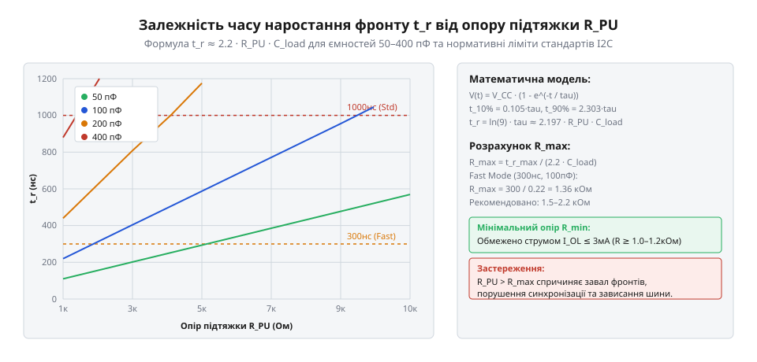

# Математичний розрахунок підтягувальних резисторів та часових параметрів фронтів

<preknowlist>
- [Буфер із трьома станами виходу 74LVC1G125](root:cat-hw-parts/logic-buffer-74lvc1g125) — розрахунок перехідних процесів та паразитної ємності цифрової шини
</preknowlist>

## Невизначеність логічних порогів та завали фронтів

Коли цифрові пристрої обмінюються даними через спільні лінії зв'язку, напруга на них ніколи не змінюється миттєво. Будь-який перехід із низького рівня на високий чи навпаки вимагає часу на перезаряд паразитної ємності монтажу та входів мікросхем. Якщо лінія навантажена довгими провідниками або великою кількістю периферійних пристроїв, фронти сигналу розтягуються в часі й набувають похилої форми. Це створює серйозну загрозу для коректності прийнятих даних, оскільки вхідні приймачі логічних мікросхем мають чітко визначені границі напруги для розпізнавання станів, відомі як логічні порогові значення.

Вхідна напруга нижче від нижнього порогового рівня незмінно сприймається схемою як логічний нуль, а напруга вище від верхнього порогового рівня — як логічна одиниця. Проте проміжок між цими порігами є зоною невизначеності. Якщо через повільний фронт напруга на входах цифрових мікросхем затримується в цій забороненій зоні на помітний час, внутрішні транзистори приймача опиняються в лінійному режимі часткового відкриття. Через це різко зростає споживання струму живлення на перемикання, виникають хибні спрацьовування від найменших електромагнітних завад, а іноді й подвійне зчитування одного біта через шум на пороговому переході.

Особливо гостро ця проблема постає в інтерфейсах з відкритим стоком, таких як шина I2C, де лінія переводиться в активний нуль транзистором, а в одиницю повертається пасивно — через резистор підтяжки до джерела живлення. Швидкість зростання напруги в такому разі повністю залежить від сталої часу перезаряду ємності навантаження через опір резистора. Щоб уникнути катастрофічного завалу фронтів, розробник мусить точно розрахувати допустимі межі опору підтяжки. Занадто великий опір призведе до критичного сповільнення фронту та зависання сигналу в зоні невизначеності, тоді як занадто малий перевантажить вихідний ключовий транзистор надлишковим струмом і порушить вимоги щодо допустимого падіння напруги логічного нуля. Для розуміння ширшого контексту побудови цифрових інтерфейсів корисно звернутися до матеріалів про [логіку серії 74AHCT у системній схемотехніці](root:cat-hw-parts/74ahct-logic-family), де детально описано сумісність рівнів та вимоги до фронтів.

## Розрахунок мінімального опору підтяжки R_min

Визначення нижньої межі опору підтяжки базується на захисті вихідних ключових елементів від надмірного струму та забезпеченні надійного логічного нуля на шині. Коли вихідний транзистор драйвера відкривається, він з'єднує лінію зв'язку із загальним проводом, створюючи шлях для струму від джерела живлення через резистор підтяжки. Опір цього резистора не може бути довільно малим, інакше через відкритий ключ потече струм, що перевищує його максимально допустиме значення, визначене виробником у технічній документації.

Окрім власне струму через резистор підтяжки, драйвер приймає на себе сумарний вхідний струм витоку всіх підключених до цієї ж шини приймачів сигналів. Усі ці струми додаються і створюють на відкритому транзисторі додаткове падіння напруги. Напруга насичення ключа разом із цим падінням не повинна перевищувати максимально допустимого значення напруги логічного нуля для найвимогливішого приймача в системі. Необхідно враховувати і характеристики компонентів, зокрема надійність комутації, яку забезпечує [буфер із трьома станами виходу 74LVC1G125](root:cat-hw-parts/logic-buffer-74lvc1g125), котрий часто використовується для ізоляції та узгодження ліній у складних цифрових вузлах.

Математично мінімальний опір підтяжки `R_min` обчислюється через джерело живлення, допустимі напруги та струми за таким співвідношенням:

```
R_min = (V_CC - V_OL_max) / (I_OL_max - Sum(I_IL))      [закон Ома та правило суми струмів вузла]
```

У цій формулі напруга джерела живлення позначена як `V_CC`, максимально допустима напруга логічного нуля на виході драйвера — як `V_OL_max`, граничний допустимий струм стоку або виходу драйвера у відкритому стані — як `I_OL_max`, а сумарний вхідний струм усіх приймачів, що підключені до лінії, — як сума вхідних струмів `Sum(I_IL)`. Застосування цього виразу гарантує, що транзистор не вийде з ладу від перегріву, а напруга на шині в активному стані гарантовано розпізнається всіма мікросхемами як твердий логічний нуль без ризику зсуву порогових рівнів.

## Динаміка перехідного процесу та максимальний опір R_max

Після вимкнення ключового транзистора починається фаза формування висхідного фронту сигналу. Резистор підтяжки під'єднує шину до напруги живлення, починаючи поступово заряджати сумарну паразитну ємність лінії. Оскільки процес перезаряду конденсатора через резистор підпорядкований експоненційному закону, напруга на шині змінюється нелінійно, повільно наближаючись до встановленого значення. Для розрахунку часу, необхідного для переходу сигналу від нижнього порогового рівня до верхнього, використовують стандартну інженерну апроксимацію часу наростання фронту від 10% до 90% повної амплітуди.


*Залежність часу наростання висхідного фронту t_r від номіналу резистора підтяжки R_PU для різних значень сумарної паразитної ємності шини C_load.*

Аналітичний опис тривалості висхідного фронту `t_r` та його зв'язку з параметрами кола виводиться через сталу часу RC-ланцюга. Спочатку визначається стала часу як добуток опору підтяжки на ємність навантаження, після чого через логарифмічні співвідношення рівнянь розряду й заряду контура отримується кінцевий вираз:

```
t_r = ln(9) * tau ≈ 2.2 * R_PU * C_load      [розв'язок диференціального рівняння заряду ємності]
```

Тут під сталою часу розуміється добуток опору підтяжки `R_PU` на сумарну ємність навантаження `C_load`, а числовий коефіцієнт відображає часовий інтервал між досягненням 10% та 90% рівня напруги живлення. З цього співвідношення безпосередньо виводиться обмеження для визначення верхньої межі номіналу резистора підтяжки, виходячи з максимально допустимої тривалості фронту `t_r_max`, яка визначається тактовою частотою або вимогами протоколу обміну даними:

```
R_max = t_r_max / (2.2 * C_load)      [вираження опору з формули часу наростання фронту]
```

Якщо обрати опір підтяжки більшим за розрахований `R_max`, фронт сигналу стане занадто пологим, що призведе до збоїв прийому на високих частотах. Наприклад, для стандартного режиму шини I2C з частотою 100 кГц максимальна тривалість фронту обмежена значно жорсткіше, ніж для низькошвидкісних дискретних сигналів, змушуючи розробника ретельно підсумовувати ємність доробок друкованої плати та ніжок мікросхем.

## Статичне та динамічне розсіювання потужності

Будь-яка реальна цифрова схема споживає енергію, і вибір номіналів підтягувальних резисторів безпосередньо впливає на тепловий режим та загальне енергоспоживання пристрою. Втрати потужності в такій схемі поділяються на дві основні складові: статичні втрати, які виникають під час утримання лінії в активному низькому стані, та динамічні втрати, зумовлені регулярним перезарядом ємнісного навантаження при кожній зміні логічного рівня.

Статичне розсіювання потужності відбувається тоді, коли вихідний транзистор утримує лінію в стані логічного нуля. У цей момент через резистор підтяжки від джерела живлення до загального проводу постійно тече струм. Рівень цих втрат обернено пропорційний опору підтяжки: що менший опір обрано, то більший статичний струм споживається системою. Для обчислення середньої статичної потужності `P_stat` застосовується формула з урахуванням коефіцієнта заповнення сигналу:

```
P_stat = (V_CC^2 / R_PU) * D      [закон Джоуля-Ленца та часове усреднення за циклом]
```

У цьому виразі `V_CC` — напруга живлення, `R_PU` — опір резистора підтяжки, а `D` — коефіцієнт заповнення, що дорівнює відношенню часу перебування лінії в низькому стані до загального періоду сигналу. Звідси випливає інженерне правило: для мінімізації статичних втрат у пристроях із живленням від батарей слід прагнути до максимального збільшення опору підтяжки, проте лише настільки, наскільки це дозволяють обмеження за швидкодією з попереднього розділу.

З іншого боку, динамічна потужність `P_dyn`, яка витрачається на перемикання ємнісного навантаження шини, залежить від частоти перемикань та амплітуди напруги і не залежить безпосередньо від номіналу резистора підтяжки, оскільки енергія акумулюється в електричному полі ємності під час кожного заряду:

```
P_dyn = C_load * f * V_CC^2      [інтегрування струму заряду ємності за період]
```

Тут `C_load` позначає сумарну ємність навантаження шини, `f` — робочу частоту сигнальних перемикань, а `V_CC` — розмах напруги живлення. Обидва види втрат вимагають спільного аналізу: зменшення номіналу резистора прискорює фронти та знижує ризик зриву зв'язку, але неминуче збільшує статичне споживання енергії, змушуючи розробника знаходити точний компроміс між енергоефективністю та надійністю передачі сигналів.