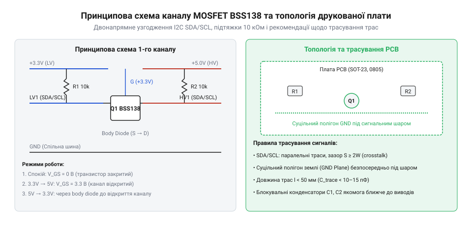

# Модуль двонапрямного перетворювача рівнів на MOSFET для I2C

<preknowlist>
- [Буфер із трьома станами виходу 74LVC1G125](root:cat-hw-parts/logic-buffer-74lvc1g125) — специфіка ліній зв'язку у стані високого імпедансу
</preknowlist>

## Проблема несумісності напруг на I2C

Пряме підключення мікроконтролера з напругою живлення 3.3 В (наприклад, ESP32 чи STM32) до периферійного давача з напругою живлення 5 В через спільну двопровідну шину I2C призводить до апаратного конфлікту та виходу з ладу вхідних кіл мікросхем. Суть проблеми полягає в топології вхідних каскадів мікроконтролера, де кожен цифровий вивід захищений від електростатичних розрядів парою внутрішніх діодів, один із яких з'єднаний із загальним проводом, а другий — із внутрішньою шиною живлення 3.3 В. Коли 5-вольтовий ведений пристрій або зовнішній резистор підтяжки подає на лінію потенціал 5 В, верхній захисний діод мікроконтролера відкривається у прямому напрямку, створюючи паразитний струм від лінії в шину 3.3 В. Це викликає неконтрольоване зростання напруги живлення внутрішніх вузлів кристала, так зване паразитна живильна підкачка, що спричиняє перегрів, деградацію напівпровідникових переходів або стан тиристорного замикання (англ. *latch-up*).

Шина I2C принципово відрізняється від класичних двотактних інтерфейсів SPI чи UART своєю двонапрямною природою та використанням каскадів із відкритим стоком (англ. *open-drain*). В обох лініях зв'язку — лінії даних SDA (англ. *Serial Data*) та лінії тактування SCL (англ. *Serial Clock*) — логічний рівень формується виключно за рахунок підтягувальних резисторів до шини живлення у пасивному стані або замиканням виводу на землю транзистором приладу у стані логічного нуля. Через це прості односпрямовані рішення, такі як резистивний подільник напруги чи діодний обмежувач, на шині I2C не працюють: подільник не дає веденому 5-вольтовому пристрою передати логічний нуль назад до 3.3-вольтового контролера без суттєвого спотворення форми сигналу та порушення порогу напруги низького рівня.

Для надійного зв'язку між різновольтними вузлами потрібен симетричний двонапрямний транслятор рівнів, здатний миттєво пропускати логічний нуль в обох напрямках і забезпечувати електричну ізоляцію високих логічних рівнів. При цьому транслятор не повинен вносити надмірної затримки поширення сигналу, аби не порушувати часові діаграми специфікації I2C, зокрема час наростання фронту та час утримання даних. Сформульовані технічні вимоги диктують використання спеціалізованої схеми на базі малопотужного польового транзистора, керованого різницею напруг між низьковольтною та високовольтною підсистемами.

## Схемотехніка вузла на транзисторі BSS138

Основою класичного двонапрямного перетворювача рівнів є N-канальний польовий МОН-транзистор (англ. *MOSFET*) збагаченого типу BSS138, увімкнений за схемою зі спільним затвором. Вивід затвора підключається безпосередньо до низьковольтного джерела живлення LV (3.3 В). Вивід витоку з'єднується з низьковольтною лінією шини LV_SDA (або LV_SCL) і підтягується через резистор R_PU1 опором 10 кОм до напруги 3.3 В. Вивід стоку з'єднується з високовольтною лінією HV_SDA (або HV_SCL) і підтягується через резистор R_PU2 опором 10 кОм до джерела живлення HV (5 В). Вбудований антипаралельний діод підкладки транзистора анодом підключений до витоку, а катодом — до стоку, що відіграє ключову роль у двосторонній трансляції.

Схема функціонує в трьох послідовних фізичних фазах залежно від стану передавача та приймача:

1. Стан спокою (логічна одиниця з обох сторін): обидві сторони шини пасивні, і їхні внутрішні вихідні транзистори закриті. Низьковольтна лінія підтягнута резистором R_PU1 до рівня 3.3 В, а високовольтна лінія — резистором R_PU2 до рівня 5 В. Оскільки потенціал затвора дорівнює 3.3 В, а потенціал витоку також становить 3.3 В, напруга затвор-витік V_GS дорівнює 0 В. Це значення істотно нижче порогової напруги відкриття транзистора V_th (для BSS138 поріг становить від 0.8 до 1.5 В), тому канал транзистора надійно перекритий, повністю ізолюючи шину 5 В від чутливих кіл 3.3 В.

2. Передача нуля від 3.3 В до 5 В: мікроконтролер притискає низьковольтну лінію до землі через свій внутрішній відкритий стік, і потенціал витоку падає майже до 0 В. Напруга затвор-витік стрімко зростає до V_GS = 3.3 В - 0 В = 3.3 В, що значно перевищує поріг V_th. Транзистор BSS138 миттєво відкривається, і через його низький опір відкритого каналу R_DS(on) (близько 3.5 Ом) високовольтна лінія швидко розряджається на землю через контролер, встановлюючи на стороні 5 В стабільний логічний нуль із залишковою напругою не більше 0.1 В.

3. Передача нуля від 5 В до 3.3 В: ведений 5-вольтовий пристрій притискає високовольтну лінію до землі. У початковий момент транзистор залишається закритим, оскільки на його витоку зберігається напруга 3.3 В. Проте оскільки потенціал стоку падає до 0 В, внутрішній діод підкладки транзистора зміщується у прямому напрямку (анод на витоку при 3.3 В, катод на стоці при 0 В). Струм починає протікати через діод, розряджаючи ємність низьковольтної лінії до рівня прямого спаду на діоді (близько 0.7 В). Щойно напруга на витоку опускається нижче 2.5 В, напруга затвор-витік V_GS досягає значення 3.3 В - 0.7 В = 2.6 В, що відкриває канал польового транзистора. Відкритий опір каналу R_DS(on) шунтує діод підкладки, притискаючи низьковольтну лінію до потенціалу землі з мінімальним падінням напруги.

Розрахунок номіналів підтягувальних резисторів є критичним компромісом між швидкістю заряду паразитної ємності та допустимим струмом розряду. Максимальний час наростання фронту t_r для стандартного режиму I2C (100 кГц) становить 1000 нс, а для швидкісного режиму Fast Mode (400 кГц) — 300 нс. Оскільки тривалість фронту наростання визначається формулою t_r = 0.8473 * R_PU * C_bus, для сумарної ємності лінії C_bus = 50 пФ граничний опір резистора підтяжки для 400 кГц становить R_max = 300 нс / (0.8473 * 50 пФ) = 7.08 кОм. Стандартні резистори номіналом 10 кОм ідеально підходять для 100 кГц, але для стабільної роботи на частоті 400 кГц паралельні резистори доцільно зменшувати до 2.2 кОм - 4.7 кОм.

## Трасування друкованої плати та монтаж

При компонуванні 4-канального модуля перетворювача рівнів на друкованій платі ключовим завданням є мінімізація паразитної міжканальної ємності та паразитних індуктивностей ліній зв'язку. Довгі паралельні сигнальні доріжки SDA та SCL, прокладені поруч на одному шарі текстоліту, утворюють паразитний конденсатор із розподіленою ємністю близько 0.5-1.0 пФ на кожен сантиметр довжини. Швидкі зміни напруги на лінії тактування SCL з крутими фронтами наводять у сусідній лінії даних SDA паразитні ємнісні струмові сплески I_crosstalk = C_mutual * (dV/dt), що може призводити до появи хибних стартових або стопових послідовностей і повного зависання автомату станів апаратного I2C контролера.

Для надійної розв'язки ліній живлення безпосередньо біля виводів LV і HV плати встановлюються блокувальні багатошарові керамічні конденсатори ємністю 0.1 мкФ (типорозмір 0603 або 0805 з діелектриком X7R). Вони замикають високочастотні струмові імпульси заряду паразитної ємності шини на землю, запобігаючи просіданню напруги на затворах транзисторів під час масового перемикання каналів. Лінії землі GND низьковольтної та високовольтної частин повинні бути об'єднані суцільним полігоном на нижньому шарі плати, створюючи замкнений контур зворотного струму з мінімальною петлевою індуктивністю. Сигнальні лінії SDA та SCL розводяться з мінімальною довжиною та розділяються між собою екранною земляною доріжкою або виносяться на відстань не менше трьох ширин провідника (правило 3W).

Монтаж модуля виконується з використанням малогабаритних компонентів поверхневого монтажу (SMD): транзисторів BSS138 у корпусі SOT-23 та резисторних збірок або окремих резисторів 0805. Пайка має проводитися нейтральними безвідмивними флюсами з наступним ретельним змиванням залишків ізопропіловим спиртом. Залишки активного флюсу у вологому повітрі утворюють іонізовані плівки витоку з опором порядку десятків кілоомів між затвором і стоком, що призводить до часткового відкриття транзистора в пасивному стані та непередбачуваних збоїв шини.

## Осцилографічна діагностика та перевірка шини

Інструментальна верифікація функціонування зібраного перетворювача рівнів здійснюється за допомогою двоканального цифрового осцилографа з активними пробниками малої вхідної ємності (не більше 10-12 пФ). Перший канал осцилографа підключається до низьковольтної лінії LV_SDA (3.3 В), а другий канал — до відповідної високовольтної лінії HV_SDA (5 В). При передачі послідовності байтів синхронізація осцилографа налаштовується на спадний фронт лінії SCL.

:::tabs
@tab c
:::code proj-i2c-mosfet-level-shifter/c/include/i2c_level_shifter.h
:::code proj-i2c-mosfet-level-shifter/c/src/i2c_level_shifter.c
:::code proj-i2c-mosfet-level-shifter/c/src/main.c
@tab cpp
:::code proj-i2c-mosfet-level-shifter/cpp/include/I2cLevelShifter.hpp
:::code proj-i2c-mosfet-level-shifter/cpp/src/I2cLevelShifter.cpp
:::code proj-i2c-mosfet-level-shifter/cpp/src/main.cpp
:::

Осцилографічний аналіз дає змогу виявити три основні типи дефектів узгодження:

По-перше, затягнутий експоненційний фронт наростання сигналу свідчить про завеликий опір підтягувальних резисторів R_PU відносно сумарної паразитної ємності шини C_bus. Якщо напруга не встигає піднятися до порогового рівня логічної одиниці V_IH (0.7 * V_CC = 3.5 В для сторони 5 В) за відведений специфікацією час, ведений пристрій фіксує помилку біта або формує біт NACK. Усунення дефекту досягається зменшенням номіналу підтягувальних резисторів до 3.3 кОм або 2.2 кОм.

По-друге, підвищений рівень логічного нуля V_OL (понад 0.4 В) виникає через високий внутрішній опір каналу польового транзистора R_DS(on) або занадто малий опір підтяжки R_PU, що викликає протікання надмірного струму I_OL через вихідний каскад драйвера мікроконтролера. Якщо V_OL перевищує поріг розпізнавання нуля V_IL (0.3 * V_CC = 0.99 В для сторони 3.3 В), приймач не реєструє біт підтвердження.

По-третє, ситуація «зависання шини» (англ. *bus lockup*), коли лінія SDA безперервно залишається притиснутою до нуля веденим сенсором у разі збою живлення або обриву тактування під час передачі байта. Для виходу з такого стану програмна бібліотека реалізує механізм примусового відновлення шини (англ. *Clock Recovery*): мікроконтролер переводить вивід SCL у режим програмного керування GPIO та генерує 9 послідовних тактових імпульсів, змушуючи ведений пристрій завершити поточний внутрішній цикл зсуву бітів та звільнити лінію даних SDA.