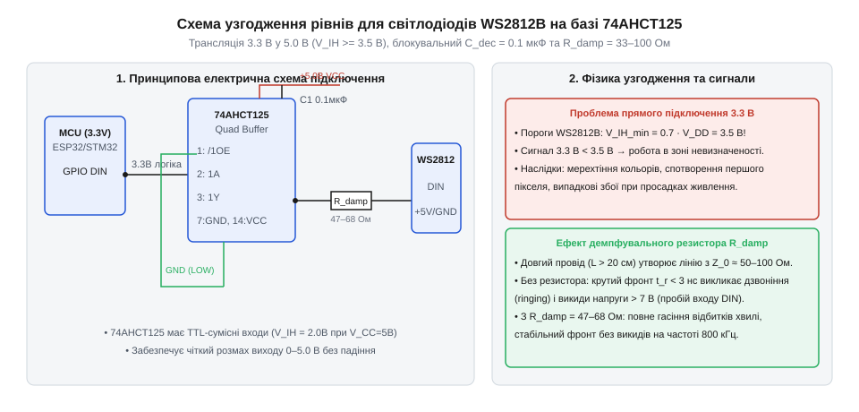

# Адаптер керування адресними світлодіодами WS2812B на базі 74AHCT125

<preknowlist>
- [Логіка серії 74AHCT у системній схемотехніці](root:cat-hw-parts/74ahct-logic-family) — ТТЛ-сумісні пороги перемикання V_IH = 2.0 В при живленні 5 В
- [Буфер із трьома станами виходу 74LVC1G125](root:cat-hw-parts/logic-buffer-74lvc1g125) — Принцип роботи входу дозволу виходу OE та стан високого імпедансу
</preknowlist>

## Проблема узгодження напруги керування WS2812B

Підключення адресних світлодіодних стрічок на чіпах WS2812B (або сумісних WS2813 чи SK6812) безпосередньо до цифрових виходів сучасних мікроконтролерів із напругою живлення 3.3 В (ESP32, STM32, RP2040) є поширеною причиною нестабільної роботи ілюмінації. Проблема проявляється у вигляді спонтанного мерехтіння окремих світлодіодів, хаотичної зміни кольорів або повної відсутності реакції ланцюжка на команди контролера. Хоча на коротких провідниках довжиною кілька сантиметрів схема іноді здається працездатною за кімнатної температури, найменше коливання напруги живлення чи збільшення довжини кабелю призводить до зриву синхронізації.

Фізична причина криється в електричних специфікаціях вхідного каскаду вбудованого контролера WS2812B. Живлення світлодіодної стрічки становить V_DD = 5.0 В. Згідно з офіційною документацією виробника, мінімальна порогова напруга вхідного високого рівня V_IH становить:

    V_IH = 0.7 · V_DD
         = 0.7 · 5.0 В
         = 3.5 В

У той самий час вихідний каскад 3.3-вольтового мікроконтролера навіть за відсутності струмового навантаження формує напругу високого рівня V_OH не більше ніж 3.2–3.3 В, а під навантаженням або при живленні через LDO-стабілізатор вона нерідко просідає до 3.0–3.1 В. Таким чином, вихідний сигнал мікроконтролера гарантовано потрапляє в небезпечну зону невизначеності (між 1.5 В та 3.5 В), де цифрові тригери Шмітта світлодіода не можуть надійно зафіксувати стан логічної одиниці. Якщо напруга живлення стрічки дещо підвищується (наприклад, до 5.2 В від якісного блоку живлення), поріг V_IH зростає до 3.64 В, і зв'язок втрачається остаточно.

Однопровідний інтерфейс WS2812B передає дані за допомогою кодування тривалості імпульсів (англ. *Non-Return-to-Zero*, NRZ) на високій тактовій частоті 800 кГц. Кожен біт передається за фіксований час 1.25 мкс: логічний нуль кодується коротким імпульсом тривалістю близько 400 нс, а логічна одиниця — довшим імпульсом тривалістю близько 800 нс. Завалені фронти 3.3-вольтового сигналу спотворюють часові інтервали під час їхнього розпізнавання вхідним компаратором першого світлодіода, що призводить до хибної інтерпретації одиниць як нулів. Для усунення цієї проблеми необхідний швидкодіючий активний транслятор логічних рівнів, що перетворює круті 3.3-вольтові імпульси в повноцінні 5-вольтові сигнали з розмахом не менше 4.5–5.0 В.

## Схемотехніка активного буфера 74AHCT125

Найефективнішим і найдешевшим технічним рішенням для активного перетворення односпрямованого швидкісного сигналу є використання мікросхеми чотириканального буфера [74AHCT125](root:cat-hw-parts/74ahct-logic-family). Суфікс «T» у маркуванні серії (англ. *TTL-compatible inputs*) має вирішальне значення: на відміну від стандартної КМОН-логіки серії 74HC, де пороги залежать від напруги живлення, входи серії AHCT розроблені спеціально під рівні транзисторно-транзисторної логіки (ТТЛ). При номінальному живленні мікросхеми напругою V_CC = 5.0 В гарантований поріг розпізнавання високого рівня V_IH становить лише 2.0 В, а поріг низького рівня V_IL становить 0.8 В. Це створює надійний запас завадостійкості у понад 1.2 В відносно 3.3-вольтового сигналу контролера.

Кожен із чотирьох незалежних буферних елементів мікросхеми має прямий вхід даних A, вихід Y та інверсний вхід дозволу виходу OE (англ. *Output Enable*). Принципи керування лінією [OE та переведення в стан високого імпедансу](root:cat-hw-parts/logic-buffer-74lvc1g125) дозволяють гнучко керувати підключенням. Для стабільного виведення даних на світлодіодну стрічку вхід OE відповідного каналу з'єднується з цифровим виводом мікроконтролера або притягується безпосередньо до землі (GND). Підтяжка до землі переводить буфер у стан постійної активності, де будь-яка зміна сигналу на вході транслюється на вихід із затримкою поширення менше ніж 5.5 нс. Якщо ж вивід OE підключено до мікроконтролера, підтягувальний резистор опором 10 кОм до шини 3.3 В утримує буфер у безпечному вимкненому стані Hi-Z під час завантаження прошивки, запобігаючи паразитному засвічуванню стрічки від хаотичних імпульсів перехідних процесів.

Критично важливою вимогою для стабільної роботи швидкодіючого буфера є наявність блокувального конденсатора ємністю 0.1 мкФ безпосередньо біля виводу живлення VCC (вивід 14 мікросхеми 74AHCT125). Під час перезаряджання вихідної ємності лінії потужні вихідні каскади мікросхеми споживають короткочасні імпульсні струми амплітудою до десятків міліампер. Якщо блокувальний конденсатор відсутній або розташований далеко від корпусу, індуктивність доріжок живлення викликає просідання напруги кристала та високочастотний дзвін, здатний спричинити збій роботи сусідніх цифрових вузлів.

## Демпфування лінії та боротьба з відбиттями

При передачі високочастотних імпульсів наносекундної тривалості (фронти наростання буфера 74AHCT125 складають всього 2–4 нс) провідник між виходом буфера та першим світлодіодом стрічки поводиться як лінія з розподіленими параметрами (довга лінія). Характеристичний хвильовий імпеданс Z_0 типового монтажного проводу чи коаксіального кабелю становить від 75 до 120 Ом, тоді як внутрішній вихідний опір відкритого транзистора буфера R_out складає всього 15–25 Ом. Вхід першого чіпа WS2812B є виключно ємнісним і має надвисокий опір постійному струму.

Така невідповідність імпедансів викликає багаторазове відбиття електромагнітної хвилі від обох кінців лінії. Хвиля, доходячи до високого імпедансу входу світлодіода, відбивається з тим самим знаком, утворюючи стрибок перенапруги (англ. *overshoot*), амплітуда якого може досягати 7–8 В. Це перевищує гранично допустиму напругу пробою входу WS2812B і поступово руйнує його кристал. Відбиваючись назад до низькоомного виходу буфера, хвиля змінює фазу, утворюючи провал напруги (англ. *undershoot*) та паразитні коливання (дзвін), які приймач хибно сприймає як додаткові тактові імпульси.

Для повного придушення хвильових відбитків застосовують метод послідовного кінцевого узгодження на стороні джерела (англ. *source termination*). Безпосередньо біля виходу буфера 74AHCT125 у розрив сигнального провідника встановлюють послідовний резистор демпфування R_damp номіналом від 33 до 100 Ом. Опір резистора добирають таким чином, щоб сума вихідного опору драйвера та резистора дорівнювала хвильовому імпедансу лінії зв'язку:

    R_damp = Z_0 - R_out
           ≈ 100 Ом - 20 Ом
           = 80 Ом

Резистор R_damp разом із паразитною ємністю монтажного кабелю C_cable утворює фільтр низьких частот першого порядку. Це дещо згладжує надмірно крутий фронт сигналу до безпечних 15–20 нс, що цілком вкладається у допуски специфікації WS2812B, але повністю ліквідує резонансні викиди та усуває наведення на сусідні ланцюги живлення.

## Налагодження сигналу та верифікація осцилограми

Остаточна перевірка правильності функціонування вузла узгодження проводиться за допомогою цифрового осцилографа зі смугою пропускання не менше 50–100 МГц. Пробник осцилографа з дільником 1:10 підключається безпосередньо до вхідного контакту DIN першого світлодіода стрічки, а земляний контакт пробника фіксується на земляній шині якомога ближче до діода мінімальною довжиною дроту.

:::code proj-ws2812b-active-buffer-driver/cpp/include/Ws2812bBuffer.hpp
:::code proj-ws2812b-active-buffer-driver/cpp/src/Ws2812bBuffer.cpp
:::code proj-ws2812b-active-buffer-driver/cpp/src/main.cpp

Під час виведення тестового шаблону чергування кольорів на екрані осцилографа контролюють такі ключові параметри:

1. Розмах амплітуди: вершина імпульсу логічної одиниці має впевнено досягати рівня 4.8–5.0 В без суттєвих викидів понад 5.3 В. Якщо спостерігаються викиди понад 5.5 В, номінал демпфувального резистора R_damp збільшують на 20–30 Ом.

2. Рівень нуля: нижня полиця імпульсу повинна бути притиснута до землі з потенціалом не більше 0.2–0.3 В. Наявність постійного зміщення вказує на погане заземлення або падіння напруги на загальному проводі через великий струм споживання світлодіодів.

3. Часові параметри: для біта нуля тривалість позитивного імпульсу T0H повинна становити 400 ± 150 нс, а для біта одиниці T1H — 800 ± 150 нс. Тривалість стану низького рівня між імпульсами має відповідати інтервалам T0L (850 нс) та T1L (450 нс).

4. Пауза скидання (Reset): після передачі повного кадру лінія даних повинна утримуватися на рівні нуля щонайменше 280–300 мкс (для сучасних чіпів WS2812B-V5 рекомендовано не менше 300 мкс). Тільки після цього внутрішні регістри зрушення світлодіодів фіксують прийняті дані у вихідних ШІМ-драйверах, і стрічка спалахує новим статичним кольором.

Впровадження буфера 74AHCT125 із демпфувальним резистором повністю знімає проблему довжини з'єднувального кабелю, забезпечуючи стабільну трансляцію сигналу на відстань до 5–10 метрів без спеціалізованих диференційних приймально-передавачів.