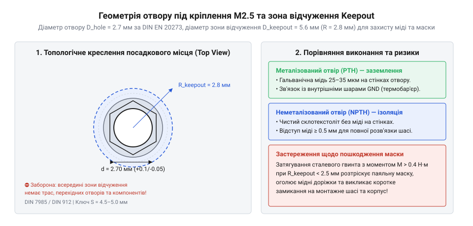
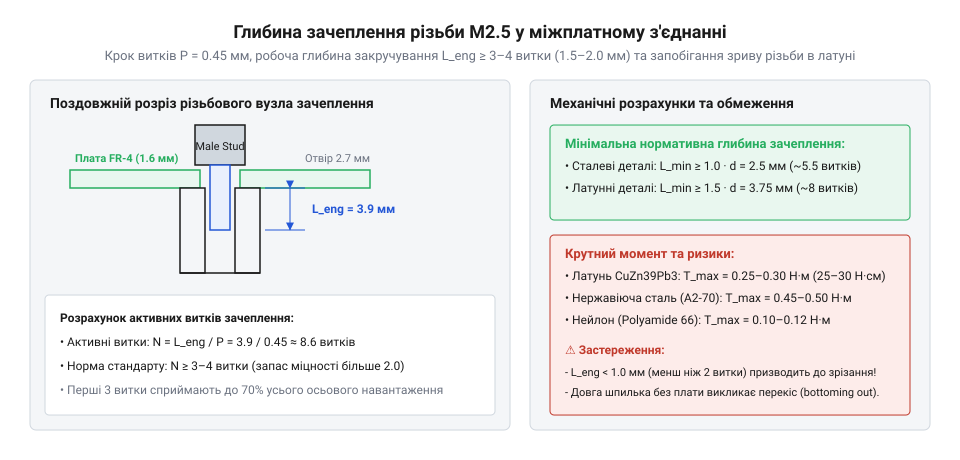

# Залізний інтерфейс та геометричні стандарти кріплення М2.5

<preknowlist>
- [Стійки М2/М3 (латунь, нейлон)](root:cat-hw-parts/standoffs) — Конструктивні типи міжплатних стійок та різниця між металевими й пластиковими виробами
- [Набори гвинтів М3 (шестигранник, потайні DIN7991)](root:cat-hw-parts/m3-screw-kits) — Базові поняття метричного кроку різьби та стандартизації
</preknowlist>

## Механічна геометрія та профілі різьби М2.5

Під час конструювання компактної електронної апаратури та приладів із щільним компонуванням виникає нагальна потреба в надійному, але мініатюрному механічному з'єднанні плат, корпусних елементів і внутрішніх модулів. Перехід від більших різьбових з'єднань дозволяє зекономити цінний простір на платі та зменшити загальну вагу виробу, однак висуває підвищені вимоги до дотримання стандартів точності. Основою для уніфікації такого кріплення виступає загальноприйнятий стандарт метричної різьби M2.5x0.45 за ISO 261, який визначає основні лінійні параметри стрижнів, внутрішніх отворів та допускові поля. Для зручності роботи інженеру під час підбору компонентів із каталогу корисно мати під рукою стандартизований [органайзері дрібних деталей](root:cat-hw-parts/parts-organizer), що запобігає плутанині між близькими за розміром типорозмірами кріплення.

Ключовим параметром будь-якого різьбового виробу є @@en|nominal diameter@@, який для даного типорозміру становить рівно 2.5 міліметри у зовнішньому вимірі вершини профілю. Другим невіддільним елементом геометрії є @@en|thread pitch@@, тобто лінійний відрізок між сусідніми витками вздовж осі стрижня, що дорівнює 0.45 міліметра. Профіль різьби має класичну трикутну форму з кутом при вершині 60 градусів, причому вершини та впадини трохи зрізані за радіусними кривими, що забезпечує рівномірний розподіл навантаження та запобігає заклинюванню під час закручування.

Окрім самого стрижня, критичне значення має форма та габарити головок кріпильних гвинтів і опорних елементів. У сучасній приладобудівній практиці найчастіше застосовують два основних типи головок гвинтів, що регламентуються відповідними промисловими стандартами. Перший тип базується на специфікації DIN 7985 і передбачає напівкруглу головку з циліндричною основою, яка забезпечує велику площу притиску та естетичний зовнішній вигляд лицьової панелі. Другий тип базується на специфікації DIN 912 і має циліндричну високу головку з внутрішнім шестигранним шліцом під торцевий ключ, що дозволяє передавати значний крутний момент у глибоких колодязях корпусу.

Для розрахунку просторових зазорів та габаритів посадкових місць необхідно чітко розуміти лінійні співвідношення основних розмірів стрижня М2.5. Наведемо базові співвідношення для розрахунку діаметрів:

d = 2.5 мм              [номінальний зовнішній діаметр різьби]
d1 = d - 1.08253 × P    [розрахунок внутрішнього діаметра різьби через крок P]
d1 = 2.5 - 1.08253 × 0.45
d1 ≈ 2.013 мм          [внутрішній діаметр різьби у впадинах]

Отримані значення демонструють, що глибина зачеплення профільних витків становить менше чверті міліметра з кожного боку, що вимагає високої чистоти обробки поверхні та точного дотримання допусків у процесі виробництва металевих стійок і гвинтів.

Окрім гвинтів, невіддільною частиною конструкції є стійки, які часто виготовляються у вигляді шестигранних тіл під монтажний ключ розміром 4.5 або 5.0 міліметрів. Ширина під ключ визначається зовнішнім габаритом шестикутника і безпосередньо впливає на мінімальну відстань від краю друкованої плати або сусідніх радіодеталей до осі отвору. Паралельно з цим надійність з'єднання залежить від якості виготовлення різноманітних [наборах кріплення М3](root:cat-hw-parts/m3-screw-kits) та дрібних металевих елементів, які формують єдину екосистему конструктиву.

## Монтажні отвори друкованих плат та допуски

Правильне свердління та фрезерування отворів у текстоліті є критичним етапом, від якого залежить успішність подальшого механічного складання електронного модулю в єдиний конструктивний блок. Якщо отвір буде занадто малим, гвинт почне заклинювати або пошкоджуватиме стінки текстоліту; якщо ж отвір виконано з надмірним запасом, плата отримає неконтрольований люфт, що призведе до перекосів при затягуванні та механічних напружень у паяних з'єднаннях сусідніх компонентів. Нормування таких зазорів здійснюється відповідно до міжнародних норм, де ключовим документом слугує стандарт DIN EN 20273, який регламентує діаметри наскрізних отворів під кріпильні вироби загального призначення.

Згідно з інженерними розрахунками для метричного кріплення М2.5, оптимальний номінальний діаметр наскрізного отвору для вільного проходу гвинта становить 2.7 міліметра. Такий розмір забезпечує достатній технологічний зазор для компенсації похибок свердління на платних фабриках, але не дозволяє головці гвинта провалюватися крізь отвор без використання спеціальної опорної шайби. Для забезпечення електричного контакту з шасі або, навпаки, повної гальванічної розв'язки конструктори обирають один із двох принципово різних типів посадкових місць.

*Креслення монтажного отвору плати 2.7 мм із зоною відчуження для кріплення М2.5.*

Першим варіантом є @@en|plated through-hole@@, тобто металізований отвір, стінки якого вкриті шаром гальванічної міді та з'єднані з внутрішніми полігонними шарами заземлення або екранування плати. Через такий отвір струм від металевої стійки або головки гвинта передається безпосередньо на мідні полігони, забезпечуючи надійне електромагнітне екранування та нульовий потенціал корпусу. Другим варіантом є @@en|clearance hole@@, тобто неметалізований отвір, навколо якого створюється суцільне кільце без міді, що гарантує повну електричну ізоляцію внутрішніх ланцюгів від металевого кріплення.

Для розрахунку допустимих відхилень діаметра отвору при створенні конструкторської документації використовують такі допускові співвідношення:

D_nom = 2.7 мм         [номінальний діаметр отвору за DIN EN 20273]
D_min = D_nom - 0.05   [нижня межа допуску свердління]
D_max = D_nom + 0.10   [верхня межа допуску свердління]
ΔD = D_max - D_min     [загальний допусковий діапазон отвору]
ΔD = 0.15 мм           [ширина допускового поля для стабільного монтажу]

Дотримання цього допускового поля гарантує, що стрижень гвинта проходитиме крізь плату з мінімальним тертям, а можливі технологічні зміщення отвору в межах 0.1 міліметра не призведуть до блокування складання.

## Зони відчуження міді та захист маски

Під час затягування металевих гвинтів, гайок або торців шестигранних стійок опорна поверхня створює значний питомий тиск на поверхню друкованої плати. Якщо в безпосередній близькості від монтажного отвору розташовуються мідні доріжки, сигнальні полігони або перехідні отвори (vias), існує високий ризик механічного продавлювання захисного шару та виникнення аварійного замикання. Для запобігання подібним дефектам у САПР електроніки обов'язково налаштовуються спеціальні геометричні обмеження, які виключають розміщення будь-яких провідних елементів у зоні підвищеного навантаження.

Ця заборонена область навколо отвору називається @@en|keepout zone@@ і визначається зовнішніми габаритами опорної поверхні головки гвинта чи стійки з урахуванням технологічного запасу на допуски позиціонування та можливий мікрозсув шайби. Для стандартного кріплення М2.5 із зовнішнім діаметром опорної поверхні або ключа стійки близько 5.0 міліметрів радіус зони відчуження повинен становити не менше 2.8 міліметра від центру отвору. Будь-яке порушення цієї вимоги неминуче призводить до того, що під тиском металу виникає @@en|solder mask damage@@, тобто пошкодження чи відшарування паяльної маски з оголенням мідної проводки під нею.

Для оцінки безпечної відстані від краю отвору до найближчого мідного провідника використовують просте геометричне співвідношення радіусів:

R_hole = 1.35 мм       [радіус монтажного отвору 2.7 мм]
R_head = 2.50 мм       [радіус опорної поверхні головки або стійки]
R_margin = 0.30 мм     [технологічний запас на зміщення маски]
R_keepout = R_head + R_margin [мінімальний радіус зони відчуження]
R_keepout = 2.50 + 0.30 = 2.80 мм [повний радіус захисної зони]

Якщо конструкція вимагає обов'язкового підключення заземлення через спеціальні [міжплатними стійками](root:cat-hw-parts/standoffs), мідний полігон підводиться лише до чітко визначеної контактної площадки з термоба'єрами, тоді як решта периферії залишається вкрита маскою.

## Глибина зачеплення різьби та міжплатне збирання

Коли кілька плат об'єднуються в єдиний багатоярусний конструктивний блок за допомогою різьбових стійок і шпильок, критично важливим стає забезпечення достатньої довжини з'єднання в кожному вузлі. Недостатня глибина вгвинчування призводить до зриву витків при найменшому вібраційному навантаженні, тоді як надмірна довжина створює зайві механічні напруги або впирається у внутрішні елементи сусідньої плати. Для досягнення максимальної міцності з'єднання необхідно дотримуватися суворих норм проектування глибини посадки в латунні або сталеві різьбові отвори.

Мінімально необхідна глибина закручування різьби М2.5 повинна становити не менше 3–4 повних витків різьби, що в лінійному вимірі відповідає 1.5–2.0 міліметрам робочої довжини. Це забезпечує надійне @@en|thread engagement@@, тобто взаємне зачеплення витків стрижня та внутрішньої різьби, при якому навантаження розподіляється на кілька витків одночасно. Перевищення цього порогу дозволяє уникнути досягнення критичної @@en|stripping force@@, тобто зусилля, за якого відбувається механічне зрізання м'яких латунних витків внутрішньої різьби під дією надмірного моменту затягування.

*Схема зачеплення витків різьби М2.5 у внутрішньому різьбовому отворі стійки.*

Для коректного розрахунку загальної висоти міжплатного стека та вибору стійок застосовують такі балансні співвідношення висот:

H_stack = H_spacer + H_board + H_washer [загальна висота ярусу]
H_spacer = 10.0 мм     [виконавча довжина тіла стійки]
H_board = 1.6 мм       [товщина стандартної друкованої плати]
H_washer = 0.5 мм      [товщина опорної шайби]
H_stack = 10.0 + 1.6 + 0.5 = 12.1 мм [сумарна висота монтажного шару]

Під час проектування багаторівневих систем обов'язково чергують типи стійок за схемою «шпилька-гайка» та «гайка-гайка», що дозволяє рівномірно розподілити навантаження по всій висоті конструктиву без перекосів і накопичення сумарної похибки паралельності плат.