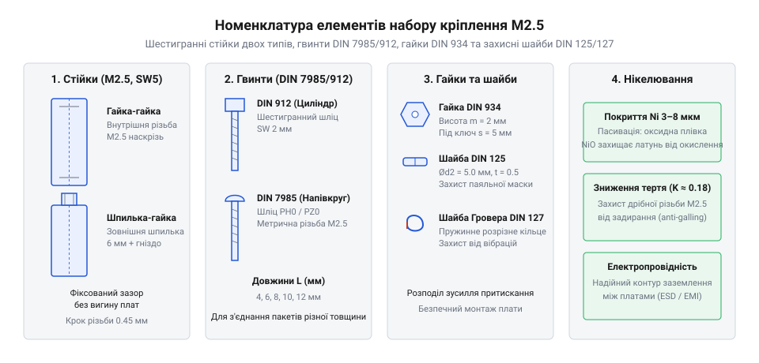
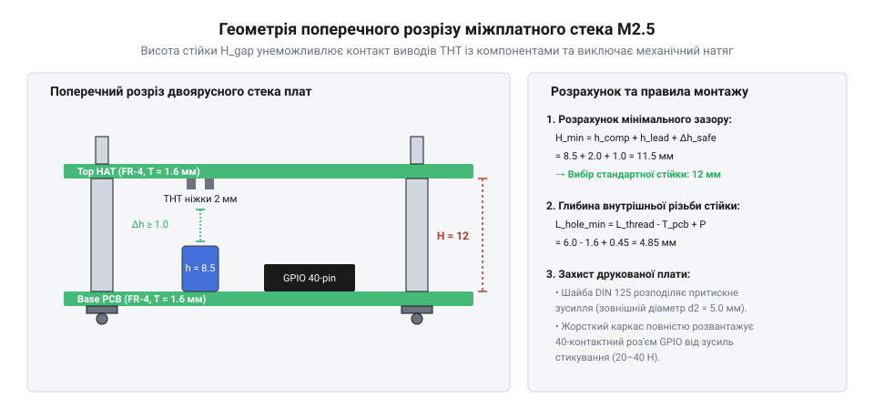

# Набір кріплення М2.5 (нікельований)

<preknowlist>
- [Стійки М2/М3 (латунь, нейлон)](root:cat-hw-parts/standoffs) — базові принципи застосування міжплатних стійок та різницю між металевими й діелектричними матеріалами
- [Набори гвинтів М3 (шестигранник, потайні DIN7991)](root:cat-hw-parts/m3-screw-kits) — загальну концепцію метричної різьби, кроку та роботи з наборами кріплення
</preknowlist>

## Проблема жорсткого з'єднання планарних плат

Уявіть типову ситуацію під час розробки компактного приладу або розширення функціонала одноплатного комп'ютера: вам потрібно об'єднати в єдиній системі процесорну плату, модуль живлення, сенсорний @@en|shield@@ та плату керування моторами. За браком спеціальних міжплатних елементів розробники-початківці нерідко намагаються зістикувати друковані плати (від англ. @@en|Printed Circuit Board@@ — друкована плата, скорочено @@en|PCB@@) напряму через багатоконтактні штирьові з'єднувачі або просто вкладають їх одна на одну через ізоляційні прокладки. Зовні така конструкція може здаватися працездатною, проте під час першої ж спроби підключити кабель чи натиснути на монтажний роз'єм система починає прогинатися, втрачати контакт або навіть виходити з ладу через коротке замикання.

Головна механічна проблема ненадійного монтажу полягає у низькій жорсткості базового матеріалу друкованих плат — склотекстоліту марки @@en|FR-4@@ (від англ. @@en|Flame Retardant 4@@ — вогнестійкий композитний матеріал з епоксидної смоли та склотканини). Під дією вертикального зусилля, яке виникає під час з'єднання 40-контактних колодок @@en|GPIO@@ (сумарне зусилля сочленення може досягати 20–40 Н), текстолітова пластина товщиною 1.6 мм зазнає вигину. Такий пружний вигин створює критичні локальні напруження у мідних провідниках та місцях паяння поверхнево-монтованих компонентів (від англ. @@en|Surface Mount Device@@, @@en|SMD@@). У результаті в крихких паяних з'єднаннях виникають мікротріщини, що призводить до непостійного електричного контакту або повного обриву кіл живлення та сигнальних шин.

Другою критичною пасткою відсутності фіксованого міжплатного зазору є ризик прямого електричного контакту між суміжними ярусами. На зворотній стороні будь-якої друкованої плати виступають металеві виводи елементів наскрізного монтажу (від англ. @@en|Through-Hole Technology@@, @@en|THT@@), гострі паяні конуси та незахищені перехідні отвори. Якщо верхня плата прогинається або зміщується під дією зовнішньої вібрації, металеві виводи пробивають тонкий шар паяльної маски нижньої плати та торкаються її провідних доріжок або корпусових поверхонь поверхневих конденсаторів чи транзисторів. Це викликає раптові короткі замикання шин живлення на земляний провідник, що часто призводить до вигорання портів мікроконтролера та виходу з ладу дорогих напівпровідникових компонентів.

Третій негативний чинник ненадійного з'єднання пов'язаний із механічним перевантаженням роз'ємів. Штирьові з'єднувачі типу @@en|Pin Header@@ розраховані виключно на передачу електричних сигналів, а не на сприйняття несучих силових навантажень. Коли планарні плати не мають жорсткої зовнішньої точки опори, будь-який бічний зсув або перекіс під час збирання створює зсувні зусилля на кутові штирі. Це спричиняє деформацію контактних пелюсток у відповідній розетці, збільшення перехідного опору контакту та прискорений знос золоченого чи олов'яного покриття виводів.

Для усунення цих ризиків у приладобудуванні застосовують нормоване метричне кріплення, яке утворює жорсткий просторовий каркас. Використання металевих елементів фіксованої довжини дає змогу перенести всі механічні навантаження, зусилля сочленення роз'ємів та вібраційні коливання з крихких електронних компонентів на спеціально передбачені монтажні отвори плат. Детальний порядок розрахунку висоти міжплатних інтервалів висвітлено в [розрахунках міжплатних зазорів](root:cat-hw-parts/m25-fastener-kit/math-m25-stack-and-torque-math.md), а правила проєктування геометрії отворів і крайових зон плат описано у [проектуванні корпусного кріплення](root:hw-pcb/kontur-platy-kriplennia-i-zony-zaborony) друкованих плат.

## Захисні властивості нікельованого покриття елементів

Вибір матеріалу та поверхневого захисту міжплатного кріплення безпосередньо визначає довговічність приладу та стабільність його електричних параметрів у процесі експлуатації. Більшість металевих елементів набору М2.5 виготовляють із латуні (від нім. @@de|Messing@@ — сплав міді та цинку) або вуглецевої сталі (від англ. @@en|Carbon Steel@@). Латунь є ідеальним матеріалом для точного токарного обточування дрібних різьбових деталей завдяки своїй пластичності та легкості механічної обробки, тоді як сталь забезпечує високу міцність на розрив. Однак необроблена латунь у контакті з повітрям швидко окислюється, вкриваючись темним шаром оксидів і карбонатів міді, а сталь без захисту піддається швидкому корозійному руйнуванню під дією атмосферної вологи.

Щоб запобігти окисленню та покращити експлуатаційні характеристики деталей, на їхню поверхню методом гальванічного осадження (від англ. @@en|Electroplating@@) або хімічного нікелювання (від англ. @@en|Electroless Nickel Plating@@) наносять тонкий шар нікелю товщиною від 3 до 8 мкм. Нікель має властивість пасивації: потрапляючи на повітря, він миттєво утворює на своїй поверхні суцільну надтонку оксидну плівку @@en|NiO@@, яка є хімічно інертною до кисню, вологи та слабких органічних кислот. Завдяки цьому нікельоване покриття надійно ізолює базовий метал від навколишнього середовища, запобігаючи виникненню як рівномірної атмосферної корозії, так і пітингової корозії у закритих приладових корпусах.

Окрім захисту від іржі, нікельоване покриття суттєво змінює трибологічні властивості різьбової пари. Нікель має відносно низький коефіцієнт тертя ковзання та високу мікротвердість (до 500–600 @@en|HV@@ за Віккерсом у випадку хімічного нікелювання). Під час загвинчування сталевого або латунного гвинта у внутрішню різьбу шестигранної стійки нікельовані поверхні запобігають явищу задирання металу (від англ. @@en|Galling@@ — холодне зварювання витків різьби під тиском). Це критично важливо для дрібної різьби М2.5 з малим кроком, де найменша задирка здатна зрізати витки або заклинити кріпильний елемент. Нікельовані деталі витримують багаторазові цикли збирання та розбирання без деградації різьбового профілю.

Ще однією важливою функцією нікельованого покриття є забезпечення стабільного електричного заземлення між ярусами конструкції. На відміну від анодованого алюмінію чи лакового покриття, які є діелектриками, шар нікелю добре проводить електричний струм і зберігає низький омичний опір контакту протягом багатьох років. Коли шестигранна стійка затискається між металізованими монтажними майданчиками (від англ. @@en|PCB Pad@@) двох плат, нікельовані торці утворюють безперервний електричний контур із низьким імпедансом. Це дає змогу ефективно скидати статичну електрику (від англ. @@en|Electrostatic Discharge@@, @@en|ESD@@) на загальний корпус та створювати екранувальні контури для зниження рівня електромагнітних перешкод (від англ. @@en|Electromagnetic Interference@@, @@en|EMI@@).

У порівнянні з нейлоновими (пластиковими) стійками, нікельований метал не піддається температурній плинності (від англ. @@en|Thermal Creep@@) та деструкції під дією ультрафіолету чи високої температури у нагрітих блоках живлення. Порівняно ж з необробленою латунню, нікельовані елементи не виділяють токопровідного оксидного пилу, який міг би спричинити коротке замикання на високощільних платах. Детальніше про процеси міжметалевої взаємодії та протидію корозійним парам можна дізнатися у [захисних гальванічних покриттях](root:hw-components/galvanic-corrosion-and-surface-coatings) металів в електроніці.

## Функціональні елементи набору та стійки

Стандартний набір кріплення М2.5 являє собою збалансовану систему взаємозамінних деталей, розрахованих на фіксацію периферійних плат та створення міжплатних стеків довільної поверховості. Головними структурними елементами цього набору є шестигранні міжплатні стійки (від англ. @@en|Standoff@@ — дистанційна стійка), гвинти, гайки та комплект ущільнювальних й захисних шайб.

Шестигранні стійки поділяються на два базових конструктивних типи:
1. **Стійки типу «гайка-гайка»** (від англ. @@en|Female-Female Standoff@@) — мають шестигранний корпус із наскрізним або двостороннім внутрішнім різьбовим отвором М2.5. Вони застосовуються як ізольовані дистанційні блоки між двома паралельними платами, у які з обох боків загвинчуються зовнішні гвинти. 2. **Стійки типу «шпилька-гайка»** (від англ. @@en|Male-Female Standoff@@) — оснащені внутрішньою різьбою з одного торця та виступаючою різьбовою шпилькою з протилежного торця. Така геометрія є ключовою для побудови багатоярусних систем: шпилька першої стійки проходить крізь монтажний отвір друкованої плати й накручується безпосередньо у внутрішню різьбу наступної стійки. Це дає змогу нарощувати висоту стека без використання наддовгих гвинтів.

Історія стандартизації кріплення М2.5 в мікроелектроніці бере свій початок із переходу від дюймових систем різьб до єдиного міжнародного стандарту @@en|ISO@@ (від англ. @@en|International Organization for Standardization@@). У ранніх обчислювальних машинах та американському обладнанні тривалий час панували дюймові стандарти на кріплення (наприклад, різьби `#4-40` або `#2-56`), що створювало значні труднощі під час міжнародної кооперації та цивільного приладобудування. Поширення компактної побутової електроніки та портативних комп'ютерів у другій половині XX століття вимагало зменшення габаритів елементів з'єднання, що привело до створення дрібнорозмірних метричних серій за стандартом `ISO 261`. Різьба М2.5 з номінальним діаметром 2.5 мм та кроком 0.45 мм стала золотим стандартом для компактних друкованих плат, оскільки її геометричні розміри ідеально відповідали діаметру стандартних монтажних отворів (2.7–3.0 мм) та технологічним полям навколо них. З появою одноплатних комп'ютерів, таких як @@en|Raspberry Pi@@, стандартизація М2.5 остаточно закріпилася як базовий формат для розширювальних планок та шилдів. Паралельно відбувся перехід від простих латунних стійок до нікельованих деталей, що гарантувало довговічний корозійний захист приладів у жорстких експлуатаційних умовах.

*Конструктивне різноманіття елементів набору М2.5: шестигранні стійки двох типів, гвинти, гайки та шайби для надійного міжплатного монтажу.*

Для безпосереднього затискання плат у наборі використовуються метричні гвинти з напівкруглою або циліндричною головкою та шестигранні гайки (від нім. @@de|Mutter@@ — гайка) стандарту `DIN 934`. Проте надійність вузла залежить від використання шайб двох типів. Плоскі шайби (від англ. @@en|Flat Washer@@) стандарту `DIN 125` призначені для збільшення опорної площі притискання. Вони розподіляють зусилля затягування по поверхні склотекстоліту, запобігаючи стиранню захисної паяльної маски та продавлюванню матеріалу плати кутами шестигранної гайки чи головки гвинта. 

Пружинні шайби Гровера (від англ. @@en|Spring Lock Washer@@) стандарту `DIN 127` являють собою розрізане металеве кільце зі зсунутими кінцями. Під час затягування шайба стискається у площину, створюючи постійне осьове пружне зусилля у різьбовій парі. Це пружне натягнення створює високе тертя між витками різьби, що унеможливлює самовідгвинчування кріплення під дією циклічних вібрацій або температурних розширень деталей.

Порівняти геометрію М2.5 із більшими розмірами можна у [наборах кріплення М3](root:cat-hw-parts/m3-screw-kits) та класичними [міжплатними стійками](root:cat-hw-parts/standoffs). Ознайомитися з прикладом застосування цих деталей можна під час [збирання двоярусного стека](root:cat-hw-parts/m25-fastener-kit/proj-raspberry-pi-stack-assembly.md), а вичерпні геометричні допуски різьб наведено у [залізному інтерфейсі М2.5](root:cat-hw-parts/m25-fastener-kit/api-m25-hardware-specifications.md). Для зручного зберігання великої кількості дрібних елементів різьбового кріплення рекомендується використовувати спеціальні чарунки в [органайзерах для деталей](root:cat-hw-parts/parts-organizer).

## Розрахунок зазорів багатоярусних планарних стеків

Конструювання багатоярусних електронних модулів на базі одноплатного комп'ютера @@en|Raspberry Pi@@ або спеціалізованого мікроконтролера вимагає точного геометричного узгодження міжплатних інтервалів. Коли на базову плату встановлюється додатковий планарний модуль розширення @@en|HAT@@ (від англ. *hardware attached on top* — апаратне забезпечення, прикріплене зверху), між поверхнями текстоліту @@en|FR-4@@ створюється закритий просторовий зазор. Головна механічна та електрична проблема полягає у виникненні перешкод між компонентами різної висоти. З верхнього боку нижньої плати виступають габаритні електролітичні конденсатори, екрануючі кожухи та штирьові з'єднувачі @@en|Pin Header@@ (від англ. *pin header* — штирьова колодка контактів), а з нижнього боку верхньої плати стирчать зрізи виводів @@en|THT@@ (від англ. *through-hole technology* — монтаж у наскрізні отвори) та гострі шишки паяних з'єднань. Якщо обрати висоту міжплатного кріплення навмання, то високий елемент нижнього ярусу впреться в паяні точки верхнього ярусу, що призведе до згину текстоліту, виникнення внутрішніх механічних напружень у пайці @@en|SMD@@ (від англ. *surface-mount device* — пристрій поверхневого монтажу) та ризику короткого замикання.

Для виключення деформацій висота шестигранного тіла стійки @@en|standoff@@ (від англ. *stand off* — триматися на відстані) повинна суворо розраховуватися на основі критичної висоти компонентів та габаритів міжплатного з'єднувача. Мінімально припустимий міжплатний зазор `H_gap` визначається сумою найбільшої висоти компонента на нижній платі `h_comp`, довжини виступу паяних виводів верхньої плати `h_lead` та безпекового зазору `Δh_safe`, який запобігає електричному пробою та забезпечує вентиляцію:

H_min = h_comp + h_lead + Δh_safe
= 8.50 + 2.10 + 1.00      [підстановка параметрів компонента, виводів та безпекового зазору]
= 11.60 мм                [мінімально необхідна висота міжплатного інтервалу]

Отримане значення `H_min` округлюється до найближчої більшої стандартної висоти шестигранного тіла стійки М2.5 (наприклад, 12.0 мм або 15.0 мм). Водночас висота тіла стійки мусить суворо відповідати точній висоті сочленення міжплатних штирьових колодок, щоб контактні пластини з'єднувача повністю входили у гніздо без проміжків і без поздовжнього вигинання контактів. Додатково слід враховувати різницю у коефіцієнтах лінійного теплового розширення: латунь стійки розширюється зі швидкістю приблизно 19 × 10⁻⁶ 1/K, тоді як склотекстоліт @@en|FR-4@@ у перпендикулярному напрямку має розширення від 50 до 70 × 10⁻⁶ 1/K. За умови робочого нагріву процесора до 70 °C виникає мікроскопічний температурний натяг, який легко компенсується пружністю шайб. При грамотному [проектуванні міжплатного монтажу](root:hw-pcb/kontur-platy-kriplennia-i-zony-zaborony) механічне навантаження від власної ваги плат та зовнішніх вібрацій повністю сприймається жорстким металевим каркасом зі стійок, розвантажуючи тендітні електричні роз'єми.

*Геометричні параметри міжплатного зазору багатоярусного стека: висота шестигранного тіла стійки визначає відстань між платами FR-4 для виключення механічного натягу з'єднувачів.*

Другим критичним параметром багатоярусного монтажу є довжина різьбового хвостовика стійок типу «шпилька-гайка» @@en|Male-Female@@ (від англ. *male-female* — вилка-розетка або шпилька-гайка). Зовнішня різьба довжиною `L_thread` проходить крізь монтажний отвір друкованої плати товщиною `T_pcb` (стандартно 1.6 мм) і закручується у внутрішнє різьбове гніздо стійки наступного ярусу (тип @@en|Female-Female@@ або наступна @@en|Male-Female@@). Глибина внутрішньої різьби `L_hole` повинна перевищувати залишок довжини шпильки з урахуванням кроку різьби `P` (для М2.5 крок `P = 0.45` мм):

L_hole_min = L_thread - T_pcb + P
= 6.00 - 1.60 + 0.45      [підстановка довжини шпильки 6 мм, товщини плати 1.6 мм та кроку 0.45 мм]
= 4.85 мм                [мінімальна глибина внутрішньої різьби стійки]

Якщо довжина виступу шпильки `L_thread - T_pcb` виявиться більшою за глибину внутрішньої різьби `L_hole`, хвостовик впреться в дно гнізда до того, як торцева шестигранна площадка стійки притисне поверхню плати. Спроба дотягнути таке з'єднання призведе до зрізання витків м'якої латуні або до розклинювання стійки. Для точного коригування нестандартних зазорів допускається встановлення каліброваних латунних або нейлонових шайб-проставок товщиною 0.5–1.0 мм. Повні стандарти розмірів та геометричні допуски різьбових елементів наведено у довіднику [залізний інтерфейс кріплення](root:cat-hw-parts/m25-fastener-kit/api-m25-hardware-specifications.md).

Під час планування складних багатоповерхових конструкцій використовується покроковий [математичний розрахунок зазорів](root:cat-hw-parts/m25-fastener-kit/math-m25-stack-and-torque-math.md), який дає змогу комбінувати стійки різної довжини під нестандартні габарити корпусів. Практичний порядок компонування та перевірки міжплатних інтервалів розкрито у керівництві [збирання двоярусного стека](root:cat-hw-parts/m25-fastener-kit/proj-raspberry-pi-stack-assembly.md).

## Правила монтажу та затягування М2.5

Різьбові деталі калібру М2.5 мають зовнішній діаметр різьби 2.5 мм і малий крок 0.45 мм, що вимагає високої точності при складанні та суворого контролю механічного зусилля. Основна пастка під час роботи з цим розміром — це схильність до надмірного затягування @@en|overtorquing@@ (від англ. *over-torquing* — надмірне затягування). При ручному монтажі стандартною викруткою людина легко прикладає момент обертання від 0.8 до 1.2 Н·м. Однак для латунної стійки М2.5 граничний руйнівний момент становить лише близько 0.35–0.45 Н·м. Перевищення цієї межі викликає миттєвий @@en|thread strip@@ (від англ. *thread stripping* — зрізання витків) — зрізання м'яких витків латуні або зрізання зовнішнього різьбового хвостовика.

Для розрахунку безпечного моменту затягування `T_max` використовується співвідношення між нормативним натягом з'єднання `F_preload` та коефіцієнтом тертя `K`, який для нікельованої поверхні становить приблизно 0.18:

T_max = K × d × F_preload
= 0.18 × 0.0025 × 550     [підстановка коефіцієнта тертя нікелю, діаметра 2.5 мм та допустимого натягу 550 Н]
= 0.2475 Н·м              [граничний безпечний робочий момент затягування]

Наявність якісного тонкого шару нікелю (3–8 мкм) забезпечує стабільний коефіцієнт тертя та захищає поверхню від @@en|galling@@ (від англ. *galling* — задирання поверхні металу при терті під високим тиском). Без нікелювання сильне тертя латуні об латунь призводить до прихоплювання різьбових витків і передчасного руйнування при спробі демонтажу.

Окрім руйнування різьби, пряме закручування сталевого нікельованого гвинта безпосередньо по поверхні плати призводить до пошкодження захисного покриття. Коли головка гвинта обертається по монтажному контактному майданчику @@en|PCB Pad@@ (від англ. *PCB pad* — контактна площадка друкованої плати), край головки здирає шар паяльної маски та нікелеве покриття мідного кільця. Утворена металева стружка осідає на платі, створюючи ризик коротких замикань між контактами @@en|SMD@@ компонентів. Для відвернення цієї проблеми під головку гвинта та під гайку @@en|DIN 934@@ обов'язково встановлюються плоскі шайби @@en|DIN 125@@. Шайба переносить тертя ковзання на свою верхню поверхню, а нижньою площадкою рівномірно розподіляє притискне зусилля по склотекстоліту без його локального зминання.

Критичним фактором надійності є вибір монтажного інструменту. Використання викруток із невідповідним профілем або більшим розміром (наприклад, PH1 замість точного PH0 під хрестоподібний шліц @@en|Phillips@@) викликає ефект @@en|cam-out@@ (від англ. *cam-out* — виштовхування викрутки зі шліца під дією крутного моменту). Лезо викрутки висковзує з зачеплення під навантаженням, зминаючи хрестоподібні грані нікельованого гвинта і роблячи подальший демонтаж неможливим. Затягування слід виконувати динамометричною викруткою з контролем моменту у діапазоні 0.18–0.25 Н·м. Для утримання шестигранних стійок від прокручування слід застосовувати спеціальні торцеві головки або ключі на 5 мм, а не пасатижі, які деформують грані та здирають захисний шар нікелю.

Технологічний процес збирання вузла М2.5 передбачає послідовність дій:

1. Нажвинтити гвинт або стійку вручну на 2–3 витки для перевірки збігу різьбового кроку та відсутності перекосу (від англ. *cross-threading* — нарізання хибного витка). 2. Встановити плоску шайбу @@en|DIN 125@@ для захисту ізоляційного шару текстоліту. 3. При монтажі прямокутних друкованих плат затягувати кріплення по діагоналі (хрест-навхрест), щоб рівномірно розподілити внутрішні напруження та уникнути перекосу плат. 4. У вібраційних середовищах додати під гайку пружинну шайбу Гровера @@en|DIN 127@@ або нанести краплю анаеробного фіксатора різьби слабкої фіксації.

Порівняно з [більшим калібром М3](root:cat-hw-parts/m3-screw-kits), кріплення М2.5 має значно менший запас міцності на скручування, тому вимагає акуратного зберігання в [органайзері дрібних деталей](root:cat-hw-parts/parts-organizer) та точного дотримання монтажних норм. Докладний аналіз того, як якісні [захисні гальванічні покриття](root:hw-components/galvanic-corrosion-and-surface-coatings) зменшують тертя та запобігають задиранню витків, наведено в матеріалознавчому огляді. Загальні вимоги та геометричні допуски за [стандартами метричних різьб](root:cat-hw-parts/threaded-fasteners-overview) розглядаються в базовій нормативній документації.