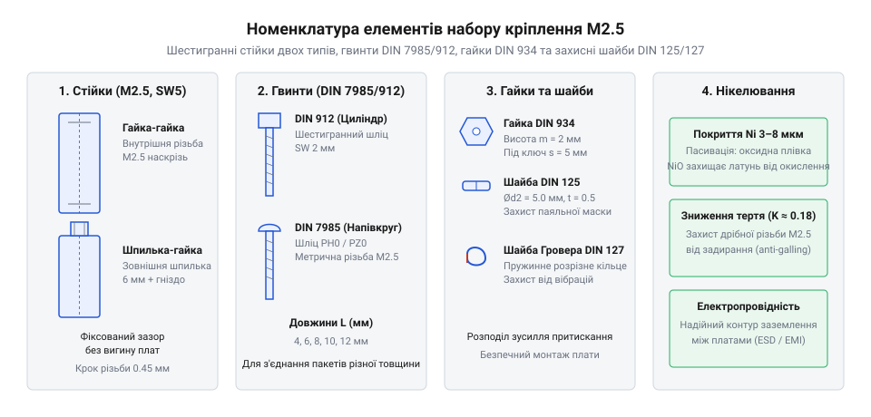
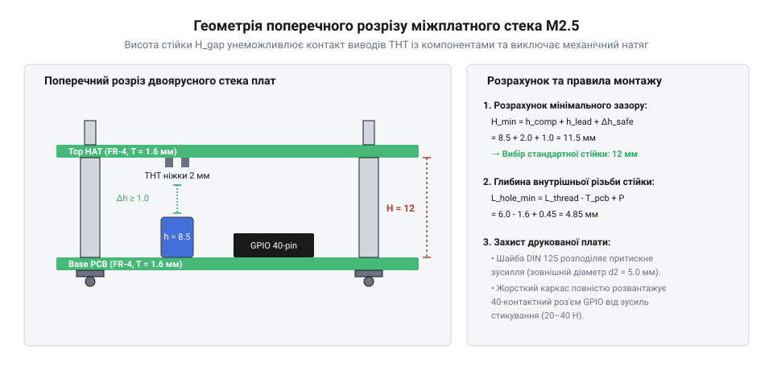

# Набір кріплення М2.5 (нікельований)

<preknowlist>
- [Стійки М2/М3 (латунь, нейлон)](root:cat-hw-parts/standoffs) — Конструктивні типи міжплатних стійок та різниця між металевими й діелектричними матеріалами
- [Набори гвинтів М3 (шестигранник, потайні DIN7991)](root:cat-hw-parts/m3-screw-kits) — Базові поняття метричного кроку різьби та стандартизації
</preknowlist>

## Проблема жорсткого з'єднання планарних плат

Під час розробки компактних електронних вузлів та модулів розширення постає задача об'єднання кількох плат у єдиний жорсткий блок. Спроба зістикувати друковані плати (від англ. @@en|Printed Circuit Board@@ — друкована плата, скорочено @@en|PCB@@) виключно через штирьові з'єднувачі без механічної опори призводить до згину склотекстоліту марки @@en|FR-4@@ (від англ. @@en|Flame Retardant 4@@ — вогнестійкий композитний матеріал з епоксидної смоли та склотканини).

Під час підключення кабелів або модулів значне зусилля сочленення створює пружний вигин плати. За відсутності жорстких бічних опор виникає небезпечний перекіс, який незворотно деформує пружні контактні пелюстки самого роз'єму @@en|GPIO@@, призводячи до втрати надійного електричного контакту або виламування контактної гребінки. Водночас вигин основи викликає мікротріщини в паяних з'єднаннях поверхнево-монтованих компонентів (від англ. @@en|Surface Mount Device@@, @@en|SMD@@) та обрив тонких сигнальних доріжок. Крім того, без фіксованого зазору металеві виводи наскрізного монтажу (від англ. @@en|Through-Hole Technology@@, @@en|THT@@) верхньої плати торкаються провідників нижньої, викликаючи аварійні короткі замикання. Для запобігання пошкодженням конструкцію зміцнюють нормованими міжплатними стійками калібру М2.5.

## Нікельовані стійки та елементи набору

Стандартний набір кріплення М2.5 містить шестигранні стійки (від англ. @@en|Standoff@@ — дистанційна стійка), метричні гвинти, шестигранні гайки стандарту DIN 934 та комплект захисних шайб. Шестигранні стійки виготовляють двох базових типів: «гайка-гайка» (від англ. @@en|Female-Female Standoff@@) із внутрішньою різьбою з обох боків та «шпилька-гайка» (від англ. @@en|Male-Female Standoff@@) із виступаючою різьбовою шпилькою для нарощування наступного ярусу.

*Конструктивне різноманіття елементів набору М2.5: шестигранні стійки двох типів, гвинти, гайки та шайби для надійного міжплатного монтажу.*

Деталі виготовляють із латуні та вкривають шаром нікелю завтовшки 3–8 мкм. Нікельоване покриття пасивується оксидною плівкою @@en|NiO@@, захищаючи метал від корозії, та зменшує коефіцієнт тертя, усуваючи задирання різьби (від англ. @@en|Galling@@). Також шар нікелю забезпечує надійний контакт захисного заземлення між платами. Порівняти метричні розміри можна у [наборах кріплення М3](root:cat-hw-parts/m3-screw-kits) та з класичними [міжплатними стійками](root:cat-hw-parts/standoffs), а зберігати дрібні вироби зручно в [органайзерах для деталей](root:cat-hw-parts/parts-organizer).

## Розрахунок зазору та правила монтажу

Висота шестигранного тіла стійки визначає безпечний міжплатний інтервал. Вона повинна перевищувати суму висоти найвищого компонента нижньої плати `h_comp`, довжини виступу паяних ніжок верхньої плати `h_lead` та безпекового зазору:

H_min = h_comp + h_lead + Δh_safe
= 8.50 + 2.00 + 1.00      [підстановка параметрів компонентів та повітряного проміжку]
= 11.50 мм                [мінімально необхідна висота стійки]

*Геометричні параметри міжплатного зазору багатоярусного стека: висота шестигранного тіла стійки визначає відстань між платами FR-4.*

Під час монтажу під головку сталевого гвинта обов'язково встановлюють плоску шайбу стандарту DIN 125, яка розподіляє тиск і захищає паяльну маску плати від стирання. Дрібна різьба М2.5 із кроком 0.45 мм чутлива до перетягування (від англ. @@en|over-torquing@@). Момент затягування латунних деталей не повинен перевищувати 0.20–0.25 Н·м, щоб уникнути зрізання витків (від англ. @@en|thread stripping@@).