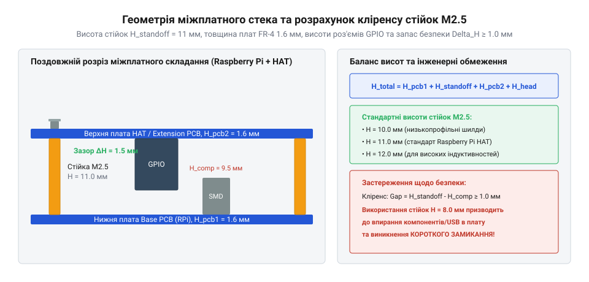

# Розрахунок зазорів міжплатний та моменту затягування М2.5

<preknowlist>
- [Стійки М2/М3 (латунь, нейлон)](root:cat-hw-parts/standoffs) — Конструктивні відмінності різьбових стійок типу мама-мама та тато-мама
- [Болти М5/М6 і шайби М3/М4](root:cat-hw-parts/bolts-and-washers) — Роль плоских і пружинних шайб у розподілі механічного тиску різьбових з'єднань
</preknowlist>

## Геометрія міжплатного зазору та висоти компонентів

Під час проєктування багатоярусних електронних модулів та складних пристроїв інженери незмінно стикаються з проблемою компактного та безпечного розміщення кількох друкованих плат одна над одною в обмеженому просторі корпусу. Якщо висоту міжплатних стійок підібрати без ретельного аналізу геометричних габаритів навісних елементів, неминуче виникає високий ризик механічних колізій та аварійних коротких замикань. Наприклад, об'ємні електролітичні конденсатори, роз'єми живлення та сигналів, високі дроселі фільтрів чи електромагнітні реле, розташовані на верхній стороні нижньої плати, можуть упертися в основу верхньої плати або в гострі виводи паяних виводів виводних компонентів, що призведе до продавлювання захисної маски, пошкодження струмопровідних доріжок або повного механічного руйнування вузла. Крім того, різниця коефіцієнтів лінійного теплового розширення латунних стійок і склотекстоліту при нагріванні компонентів спричиняє термомеханічний згин плати, що суттєво зменшує реальний міжелементний зазор під час роботи під навантаженням. Для запобігання подібним дефектам у конструкції застосовують високоякісні @@en|standoff@@ [міжплатними стійками](root:cat-hw-parts/standoffs), які задають жорстку, фіксовану та прогнозовану геометрію простору між ярусами електроніки з урахуванням температурного запасу.

*Розрахункова схема визначення висоти міжплатних стійок М2.5 на основі габаритів компонентів та виступів паяних виводів.*

Щоб гарантувати абсолютну електробезпеку та механічну надійність з'єднання, інженерний розрахунок висоти міжплатного простору завжди починають із визначення найвищої точки на поверхні нижньої друкованої плати. Геометричний аналіз враховує максимальну висоту компонента над площиною склотекстоліту, максимальну висоту виступних паяних виводів з тильного боку верхньої плати, а також необхідний технологічний запас на температурні деформації та допуски виготовлення корпусних деталей. Цю фундаментальну залежність описує формула мінімальної висоти міжплатного зазору:

H_min = h_comp + h_lead + Δh_safe
= 8.0 + 1.5 + 0.5
= 10.0 мм

де `H_min` — мінімальна розрахункова висота міжплатного зазору в міліметрах; `h_comp` — максимальна висота електронного компонента над поверхнею нижньої плати; `h_lead` — максимальний виступ паяних виводів або ніжок висновків на нижній стороні верхньої плати; `Δh_safe` — страховий технологічний зазор для компенсації можливого вигину плат під навантаженням та допусків висоти корпусних стійок. Отримане значення `H_min` є вихідною точкою для вибору стандартного каталожного розміру стійки М2.5. Правильний вибір зазору не лише повністю захищає чутливі компоненти від механічного стискання, але й створює сприятливий простір для циркуляції повітря та природного охолодження вузла.

## Розрахунок загальної довжини кріпильного стека

Після того як конструктивна висота міжплатного зазору успішно визначена, інженер переходить до розрахунку геометричних параметрів кріпильних виробів — гвинтів і різьбових стійок М2.5, які формують єдиний синергетичний стек усього багатоярусного пристрою. Помилки при виборі довжини гвинта призводять до критичних наслідків: занадто довгий гвинт у глухому отворі стійки досягне дна раніше, ніж щільно притисне плату до опорної поверхні, залишаючи з'єднання розхитаним; натомість надто короткий гвинт забезпечить зачеплення лише кількох початкових витків різьби, які миттєво зриваються під дією найменшого зусилля. Подібні розрахунки є базовими для конструювання будь-яких корпусів і аналогічні тим принципам, що застосовуються в розширених [наборах кріплення М3](root:cat-hw-parts/m3-screw-kits), де кожен міліметр різьби визначає міцність усього виробу. Для зручності організації робочого місця та швидкого підбору елементів усі відсортовані гвинти доцільно зберігати у спеціалізованому [органайзері дрібних деталей](root:cat-hw-parts/parts-organizer).

Аналітичний розрахунок мінімальної довжини різьбової частини гвинта для надійного скріплення кількох шарів базується на сумі товщин усіх компонентів пакету. Повний стек охоплює товщину друкованої плати з базового склотекстоліту FR-4, товщину підкладних шайб та необхідну глибину якісного зачеплення різьби в стійці чи монтажній гайці. Для цього використовують такі математичні співвідношення:

L_thread_min = T_pcb + t_washer + n * P
= 1.6 + 0.5 + 4 × 0.45
= 3.9 мм

де `L_thread_min` — мінімально необхідна довжина різьбової частини гвинта; `T_pcb` — номінальна товщина стандартної друкованої плати зі склотекстоліту FR-4, яка за промисловими стандартами становить 1.6 мм; `t_washer` — сумарна товщина плоских чи пружинних шайб, що встановлюються під головкою гвинта; `n` — мінімальна кількість повних робочих витків різьби для забезпечення міцності (для різьби М2.5 зазвичай обирають не менше 4–5 витків); `P` — крок різьби М2.5, який становить рівно 0.45 мм.

Для визначення мінімальної глибини різьбового отвору `L_hole_min` у тілі стійки застосовують рівняння:

L_hole_min = L_thread - T_pcb + P
= 5.0 - 1.6 + 0.45
= 3.85 мм

Цей розрахунок гарантує, що внутрішня різьба стійки повністю заповнена стержнем гвинта без утворення небезпечних зон концентрації напружень на неповних витках. Строге дотримання цих формул повністю виключає перекоси в пакеті плат і забезпечує рівномірне розподілення зусилля по периметру монтажних отворів.

## Момент затягування різьбового з'єднання М2.5

Формування надійного механічного та електричного з'єднання в електронній апаратурі неможливе без точного контролю сили попереднього затягування різьбових елементів. Недостатнє зусилля неминуче призводить до самовідгвинчування з'єднань під дією вібраційних навантажень, тоді як надмірне затягування руйнує витки різьби або пошкоджує друковану плату. Фізична сутність процесу затягування полягає у перетворенні прикладеного монтажником крутного моменту на осьовий натяг стержня гвинта, який створює необхідну силу стискання між усіма шарами стека. Цей зв'язок описується фундаментальним інженерним рівнянням через коефіцієнт тертя:

T = K * F_preload * d
= 0.18 × 220 × 0.0025
= 0.10 Н·м

де `T` — крутний момент затягування в ньютон-метрах; `K` — безрозмірний коефіцієнт затягування, що враховує тертя в різьбі та під головкою гвинта (для сухих або злегка нікельованих поверхонь становить близько 0.18); `F_preload` — розрахункова сила попереднього осьового натягу в ньютонах; `d` — номінальний зовнішній діаметр різьби М2.5, що дорівнює 0.0025 метра.

У реальній інженерній практиці під час складання приладів керуються перевіреними нормативними допусками на моменти затягування. Для стандартних кріпильних виробів М2.5 граничні значення суворо обмежені фізико-механічними властивостями металів: `K ≈ 0.18` для нікельованих чи сухих сталевих і латунних поверхонь, `d = 0.0025` м, а робочий момент затягування становить `T_tight ≈ 0.20–0.25` Н·м для латунних стійок (оскільки латунь є відносно м'яким сплавом і легко злизується при перевищенні зусилля), в той час як для високоміцних сталевих стійок допускається підвищення моменту до `0.40` Н·м. Суворе дотримання цих меж гарантує збереження цілісності різьби та запобігає пластичним деформаціям матеріалу.

## Механічні деформації та надійність з'єднання

Будь-яке різьбове з'єднання в сучасній радіоелектронній апаратурі в процесі експлуатації зазнає складного комплексного впливу зовнішніх чинників: циклічних температурних коливань, механічних вібрацій, ударів та акустичних шумів. Якщо під час монтажу було перевищено допустимий момент затягування, виникають небезпечні незворотні деформації: відбувається злизування витків різьби в м'яких латунних стійках (@@en|thread stripping@@) або утворюються мікротріщини у крихкій скловолокнистій структурі склотекстоліту FR-4 навколо монтажних отворів (@@en|substrate cracking@@). Такі деформації різко знижують надійність конструкції та можуть спричинити розрив внутрішніх мідних шарів плати.

Для захисту друкованих плат від руйнівного точкового тиску головок гвинтів і торців стійок обов'язково застосовують плоскі металеві або діелектричні шайби. Вони суттєво збільшують площу контактної поверхні, рівномірно розподіляючи зусилля стискання та запобігаючи врізанню металу в маску плати. Комплексний підхід до проєктування, що об'єднує точний розрахунок геометрії зазору, суворе дотримання моментів затягування та використання захисних шайб, забезпечує високу довговічність і безвідмовну роботу електроніки.