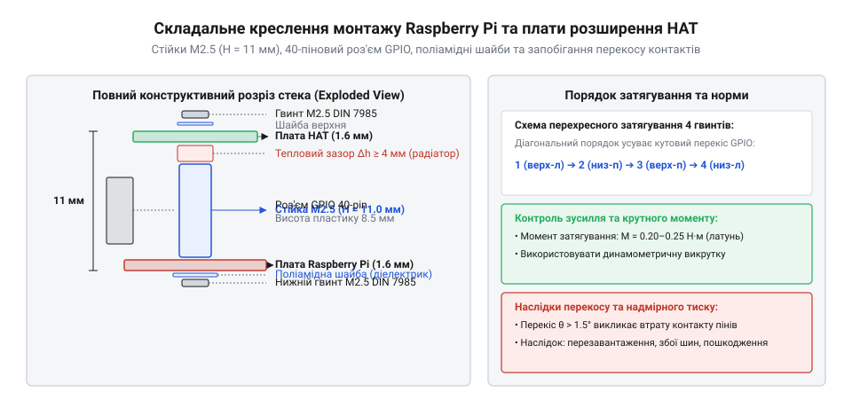

# Збирання двоярусного стека Raspberry Pi із сенсорним шилдом на стійках М2.5

<preknowlist>
- [Стійки М2/М3 (латунь, нейлон)](root:cat-hw-parts/standoffs) — Конструктивні відмінності різьбових стійок типу мама-мама та тато-мама
- [Болти М5/М6 і шайби М3/М4](root:cat-hw-parts/bolts-and-washers) — Роль шайб у запобіганні пошкодженню поверхні деталей
</preknowlist>

## Вимоги до геометрії стека Raspberry Pi

Збирання компактних обчислювальних вузлів на базі одноплатних комп'ютерів Raspberry Pi (моделей 3B+, 4B чи 5) разом із сенсорними або комунікаційними платами розширення стандарту HAT (англ. *Hardware Attached on Top*) вимагає суворого дотримання міжплатних геометричних допусків. Найпоширенішою помилкою при монтажі є спроба прямого з'єднання плати розширення без жорсткої фіксації на різьбових стійках, коли шилд тримається виключно на контактах 40-пінового роз'єму GPIO. У мобільних роботах, промислових контролерах або автомобільних реєстраторах вібрація неминуче спричиняє мікрозсуви контактів, брязкіт сигнальних ліній I2C і SPI, а також втомні злами паяних з'єднань штирьового роз'єму.

Офіційна специфікація Raspberry Pi HAT чітко регламентує розташування та діаметри монтажних отворів, а також висоту міжплатного зазору. Друкована плата комп'ютера має прямокутну сітку з чотирьох отворів діаметром 2.7 мм, розташованих із міжосьовими відстанями 58.0 мм по довжині та 49.0 мм по ширині. Цей діаметр розрахований виключно під метричне кріплення різьби М2.5 (номінальний зовнішній діаметр гвинта 2.45–2.48 мм). Спроба розсвердлювання отворів під гвинти М3 неприпустима, оскільки навколо отворів проходять внутрішні сигнальні траси та захисні мідні полігони, пошкодження яких безповоротно виводить одноплатник із ладу.

Ключовим параметром вертикальної геометрії є висота міжплатного простору `H_stack`. Стандартний 40-піновий роз'єм GPIO типу «розетка-вилка» у з'єднаному стані задає фіксовану висоту між площинами друкованих плат `H_stack = 11.0 мм`. При відхиленні висоти стійок від номіналу на ±1 мм у металі штирів виникає небезпечне згинальне напруження: заниження висоти до 10 мм змушує штирі впиратися в дно ізолятора ще до моменту посадки плати на різьбові опори, через що все осьове зусилля затягування гвинтів передається безпосередньо на пайку і викликає згин тонких латунних контактних ламелей із перевищенням границі плинності металу, а перевищення висоти до 12 мм призводить до неповної посадки та консольного перекосу штирів у гнізді під дією бічних вібрацій, що різко зменшує контактну площу, підвищує перехідний опір і спричиняє мікродугове іскріння контактів.

    H_stack = 11.0 мм

Якщо використати стійки висотою 10 мм, контакти роз'єму упруться в дно гнізда до моменту посадки плати на стійки, що призведе до вигину текстоліту, розтріскування поверхневих SMD-компонентів біля отворів та перекосу пінів. Навпаки, при використанні стійок висотою 12 мм контактні штирі виявляться частково висунутими з гнізда, площа електричного контакту зменшиться вдвічі, а опір з'єднання різко зросте. Крім того, міжплатний простір повинен вміщувати тепловідвідний радіатор системного кристала SoC (Broadcom BCM2711/BCM2712), висота якого разом із термопрокладкою зазвичай становить 5–7 мм, залишаючи вільний зазор 4–6 мм для циркуляції повітря.

## Підбір стійок, шайб та заземлення

Для створення міцного та довговічного двоярусного модуля застосовують спеціалізовані [різьбові стійки типу мама-мама та тато-мама](root:cat-hw-parts/standoffs) номіналу М2.5. Конструкція складається з чотирьох основних опорних стійок висотою 11 мм, що монтуються між платами, та чотирьох базових стійок (зазвичай висотою 6–10 мм), які підтримують материнську плату над основою корпусу. Найзручнішим варіантом є стійки типу «тато-мама» з довжиною зовнішнього нарізного хвостовика 6 мм: хвостовик проходить крізь отвір Raspberry Pi та вкручується у внутрішню різьбу нижньої опорної стійки або фіксується низькопрофільною гайкою.

Вибір матеріалу стійок визначається вимогами до електромагнітної сумісності та електричної безпеки:

1. Латунні стійки з нікелевим покриттям забезпечують найвищу механічну міцність на зсув та вібростійкість. Латунь є електропровідним матеріалом, тому такі стійки електрично з'єднують металізовані паски монтажних отворів обох плат із загальним шасі пристрою, створюючи захисний контур заземлення та екранування від високочастотних шумів.

2. Нейлонові (поліамідні PA66) стійки є діелектриками. Їх застосовують у вимірювальних приладах із чутливими аналоговими сенсорами, де необхідно виключити утворення паразитних контурів заземлення (англ. *ground loops*) між платою обчислювача та вимірювальною підсистемою.

Для запобігання пошкодженню друкованого монтажу обов'язково встановлюють шайби, правила використання яких детально викладено у практиці [застосування шайб для захисту поверхні деталей](root:cat-hw-parts/bolts-and-washers). Навколо отворів Raspberry Pi прокладено вузькі сигнальні доріжки шини пам'яті та живлення. Пряме затягування сталевого гвинта з головкою типу Torx або шестигранником [за стандартом гвинтів DIN 7991](root:cat-hw-parts/m3-screw-kits) може зірвати захисну паяльну маску й закоротити доріжки на землю. Щоб цього уникнути, під кожну головку гвинта та гайку встановлюють ізоляційну шайбу з червоного фібрового картону або поліаміду товщиною 0.5 мм із зовнішнім діаметром 5.0 мм.

## Покроковий монтаж та запобігання перекосу

Процес збирання двоярусного стека виконується за чітким покроковим регламентом, що виключає появу несиметричних напружень у матеріалі плат:

Крок 1: Підготовка материнської плати. Одноплатний комп'ютер Raspberry Pi знеструмлюють, знімають карту microSD та очищають поверхню процесора спиртом. На кристал SoC наклеюють теплопровідну прокладку товщиною 0.5 мм і встановлюють алюмінієвий низькопрофільний радіатор.

Крок 2: Встановлення нижніх опор. У чотири отвори знизу плати вставляють гвинти М2.5 довжиною 6 мм з надітими діелектричними шайбами, або вкручують нижні різьбові ніжки. З верхнього боку плати на різьбу накручують шестигранні латунні стійки М2.5 довжиною 11 мм (тип «тато-мама»). Затягування виконують вручну торцевим ключем із контрольованим моментом не більше 0.35–0.40 Н·м, щоб не зірвати дрібну різьбу латуні.

Крок 3: Спряження плат. Плату розширення HAT орієнтують строго паралельно до Raspberry Pi, поєднуючи 40-піновий роз'єм GPIO та монтажні отвори. Плавним зусиллям обох рук без перекосів натискають на зону роз'єму до повного входження штирів у гніздо. При цьому плата HAT має одночасно торкнутися опорних торців усіх чотирьох стійок без видимого проміжку.

Крок 4: Фіксація верхніх гвинтів. У верхні різьбові отвори стійок наживляють гвинти М2.5 довжиною 5–6 мм із поліамідними шайбами. Затягування гвинтів проводять хрест-навхрест у два проходи: спочатку по діагоналі (1-4, потім 2-3) до легкої фіксації, а потім остаточно підтягують із моментом 0.3 Н·м. Такий порядок гарантує рівномірне прилягання контактів роз'єму по всій довжині колодки.

## Перевірка надійності та температурного режиму

Після завершення механічного складання проводять комплексну апаратну перевірку стека, що включає діагностику електричного контакту, термопрофілю та вібростійкості. Для автоматизованого стрес-тестування надійності шини I2C у зібраному стеку використовують спеціалізовану утиліту.

:::tabs
@tab c
:::code proj-raspberry-pi-stack-assembly/c/include/hat_contact_tester.h
:::code proj-raspberry-pi-stack-assembly/c/src/hat_contact_tester.c
:::code proj-raspberry-pi-stack-assembly/c/src/main.c
@tab cpp
:::code proj-raspberry-pi-stack-assembly/cpp/include/HatMonitor.hpp
:::code proj-raspberry-pi-stack-assembly/cpp/src/HatMonitor.cpp
:::code proj-raspberry-pi-stack-assembly/cpp/src/main.cpp
:::

Тестування починається з перевірки опору контуру заземлення цифровим мультиметром у режимі міліомметра. Опір між контактом GND роз'єму GPIO плати HAT та металевим корпусом роз'єму USB або HDMI Raspberry Pi не повинен перевищувати 0.05–0.1 Ом при використанні латунних стійок. Якщо опір вищий, це свідчить про наявність оксидної плівки на різьбі або недостатнє зусилля затягування.

Наступним кроком є тепловий стрес-тест під максимальним навантаженням. Оскільки встановлена плата HAT дещо перекриває вільну конвекцію гарячого повітря над радіатором процесора, за допомогою команди `vcgencmd measure_temp` контролюють рівноважну температуру ядра. У стані спокою температура не повинна перевищувати 45–50 °C, а під тривалим стрес-тестом утилітою `stress-ng` — не більше 75–78 °C, що запобігає переходу процесора в режим теплового тротлінгу (англ. *thermal throttling*).

Завершальним етапом є вібраційна перевірка з'єднання. Під час виконання циклічного опитування регістрів сенсора плату піддають легким механічним поштовхам. За відсутності перекосів стійок та ослаблення різьби утиліта фіксує нульовий рівень збоїв (Loss Rate 0.0%), підтверджуючи високу монолітність та вібростійкість зібраного стека.