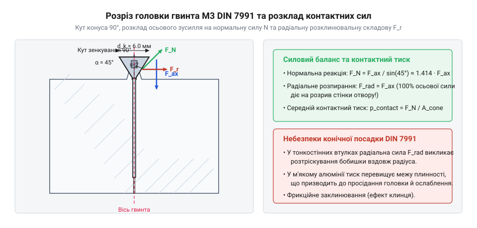

## Конструктивні вимоги та геометрія головки

Під час конструювання компактних приладових корпусів, вимірювальних шасі та електронних модулів часто виникає проблема виступу головок стандартних кріпильних виробів над поверхнею корпусу. Виступаючі елементи створюють перешкоди для монтажу лицьових панелей, заважають герметичному приляганню захисних кришок і можуть призводити до механічних задирів під час експлуатації виробу. Для розв'язання цієї проблеми застосовують спеціальні гвинти з потайною головкою, які дозволяють занурити елемент кріплення повністю врівень з монтажною площиною, забезпечуючи ідеально рівну поверхню. Головним представником такого кріплення для мікромеханічних та приладових збірок є виріб з метричною різьбою М3, виготовлений згідно з нормативними вимогами міжнародного стандарту DIN 7991, який є повним аналогом ISO 10642. Конструкція цього гвинта підпорядкована суворим геометричним співвідношенням, що гарантують рівномірний розподіл навантаження та надійне центрування в отворі під час затягування.

Основою геометрії виробу є стрижень з номінальним зовнішнім діаметром різьби три міліметри та основним кроком 0.5 міліметра, який переходить у конусоподібну головку з кутом при вершині рівно 90 градусів. Така конусність відповідає стандартному куту зенкування монтажних отворів, що дозволяє головці щільно контактувати з фаскою корпусної деталі без утворення зазорів чи клинових перекосів. Номінальний зовнішній діаметр конічної головки становить рівно шість міліметрів, а її загальна висота дорівнює 1.7 міліметра. Для передачі крутного моменту затягування в тілі головки передбачено внутрішній шестигранний шліц, відомий у технічній літературі як @@en|hex socket@@ або шліц Inbus, під ключ номінальним розміром два міліметри. Глибина шестигранного гнізда та його розмір підібрані таким чином, щоб витримувати високі зусилля кручення без злизування граней, забезпечуючи глибоке занурення силового інструмента. Для забезпечення герметичності та запобігання потраплянню вологи в приладові відсіки такі з'єднання часто доповнюють спеціальними ущільнювачами, наприклад, встановлюючи [захисні клапани ePTFE](root:cat-hw-parts/eptfe-protective-vents) для вирівнювання внутрішнього тиску. Коли конструкція вимагає зменшених габаритів у тісних приладах, розробники також звертаються до [набору кріплення М2.5](root:cat-hw-parts/m25-fastener-kit) для делікатних друкованих плат.



*Геометричні розміри конічної головки М3 DIN 7991 з кутом 90°, шестигранний шліц s = 2 мм та розклад сил при затягуванні.*

Аналіз взаємодії конічної поверхні головки з конічною фаскою зенкованого отвору демонструє характерний механічний ефект: під час затягування осьове зусилля перетворюється не лише на притискання деталей, але й створює значну радіальну складову сили. Внаслідок розклинюючого ефекту кута 90 градусів головка гвинта прагне самоцентруватися в отворі, що повністю усуває будь-які люфти в площині стику, але водночас вимагає високої міцності матеріалу корпусної деталі, щоб запобігти розтріскуванню навколо отвору. Внутрішній шестигранний шліц забезпечує передачу моменту без зсуву інструмента вбік, на відміну від традиційних хрестоподібних шліців, проте вимагає суворого дотримання співвісності шестигранника та ключа. Для організації зручного зберігання таких дрібних елементів під час складання майстри використовують [органайзер деталей](root:cat-hw-parts/parts-organizer), який запобігає втраті кріплення. У випадку складних багаторівневих компоновок приладів часто виникає потреба у додатковій фіксації плат на певній відстані, для чого залучаються [стійки М2/М3](root:cat-hw-parts/standoffs), що дозволяють вибудувати надійний каркас електронного пристрою.

## Ряд довжин та супутнє кріплення

Під час проектування вузлів на базі потайних гвинтів критично важливо правильно підібрати довжину стержня та супутні елементи кріплення, оскільки геометрія потайної головки суттєво впливає на правила вимірювання розмірів. На відміну від кріпильних виробів із циліндричною чи шестигранною головкою, де довжина різьбової частини вимірюється виключно під опорною площиною голови, повна довжина потайного гвинта за стандартами DIN 7991 вимірюється разом із самою конічною головкою. Це зумовлено тим, що головка повністю занурюється в матеріал і її верхня площина утворює єдину поверхню з деталями корпусу. Стандартизований ряд довжин для різьби М3 охоплює широкий спектр розмірів від 4 до 30 міліметрів у звичному кроковому виконанні, що дозволяє підібрати оптимальний варіант для будь-якої товщини з'єднуваних листів чи панелей. Правильний вибір номінальної довжини гарантує, що кінець гвинта не впреться в дно глухого отвору і водночас забезпечить повне зачеплення різьби в несучій гайці або різьбовому отворі корпусу.

Для забезпечення нерухомості з'єднання в умовах вібрацій та динамічних навантажень недостатньо лише закрутити гвинт у різьбовий отвір — часто виникає необхідність застосування супутніх елементів кріплення, таких як гайки та шайби різного призначення. У наскрізних з'єднаннях, де неможливо нарізати різьбу безпосередньо в стінці корпусу, використовують стандартні шестигранні гайки DIN 934, які забезпечують надійне внутрішнє різьбове зачеплення. Якщо ж прилад працює в умовах постійних вібрацій, звичайні гайки можуть самовідкручуватися, тому для запобігання цьому застосовують самоконтрні гайки з нейлоновим кільцем, які у вітчизняній та закордонній практиці називаються @@en|nylon-insert locknut@@ за стандартом DIN 985. Нейлонова вставка створює додатковий тертя-фіксуючий момент на різьбі, надійно утримуючи гайку в заданому положенні без втрати натягу. Для захисту м'яких поверхонь корпусів з алюмінію чи пластику від задирів та рівномірного розподілу зусилля притискання під гайки або під головки гвинтів встановлюють плоскі шайби DIN 125, а для збільшення опорної площадки на тонких або композитних матеріалах використовують збільшені шайби DIN 9021. Під час підбору таких елементів для складних вузлів також корисно звертатися до розширених каталогів, де представлені [болти М5/М6 і шайби М3/М4](root:cat-hw-parts/bolts-and-washers) для силових кіл приладу.

Організація правильного зберігання та сортування всього розмаїття довжин гвинтів, гайок і шайб є запорукою ефективної роботи монтажної дільниці, адже деталі різьби М3 надзвичайно малі і їх легко переплутати. Для цього кожен майстер тримає під рукою зручний органайзер деталей із регульованими комірками, що дозволяє миттєво знаходити потрібний розмір від найкоротшого 4-міліметрового гвинта до довгих 30-міліметрових стержнів. Правильний підбір супутніх шайб і гайок забезпечує довговічність усього механічного вузла, виключаючи перекоси та точкові перенапруження в місцях контакту. Крім того, у багатьох приладових конструкціях кріпильні елементи доповнюються іншими монтажними деталями, наприклад, потужними [неодимовими магнітами](root:cat-hw-parts/neodymium-magnets) для фіксації знімних сервісних кришок або допоміжними елементами каркаса. Комплексний підхід до комплектації збірки гарантує високу якість готового виробу та стійкість до зовнішніх механічних впливів.

## Класи міцності та крутний момент

Надійність будь-якого різьбового з'єднання безпосередньо залежить від механічних властивостей матеріалу, з якого виготовлений кріпильний виріб, та правильності дозування зусилля затягування. Для потайних гвинтів М3 стандарту DIN 7991 критично важливо витримувати високі навантаження на розрив та зріз, особливо враховуючи зменшену товщину стінок головки через наявність внутрішнього шестигранного шліца. Промисловість випускає ці гвинти з різних матеріалів, серед яких чітко виділяються вуглецеві сталі високих класів міцності 10.9 та 12.9, а також корозійностійкі аустенітні нержавіючі сплави марок A2-70 і A4-70. Вироби класу 10.9 та 12.9 призначені для високо навантажених силових каркасів, де вимагається максимальна межа текучості, тоді як нержавіючі варіанти використовують у приладах, що працюють у вологому середовищі або агресивних умовах, хоча вони мають трохи нижчі показники міцності на розрив.

Під час монтажу вкрай важливо контролювати силу затягування за допомогою спеціалізованого інструмента, щоб досягти необхідного осьового натягу і водночас не пошкодити шліц та не зірвати різьбу. Основною характеристикою, що визначає межу безпечного затягування, є максимальний крутний момент, який інженер розраховує з урахуванням геометрії різьби та коефіцієнта тертя в з'єднанні. Для забезпечення надійного попереднього натягу без пластичної деформації стержня розрахунок проводять за чіткими співвідношеннями механіки матеріалів:

```
A_s = 0.7854 · (d - 0.9382 · P)^2
= 0.7854 · (3.0 - 0.9382 · 0.5)^2      [підстановка номінального діаметра 3.0 мм та кроку 0.5 мм]
= 5.03 мм^2                            [обчислення площі напруженого перерізу]

F_p = 0.7 · R_p0.2 · A_s
= 0.7 · 900 · 5.03                     [підстановка межі текучості 900 МПа та площі перерізу]
= 3169 Н                               [обчислення осьового натягу в ньютонах]

M_max = 0.2 · d · F_p
= 0.2 · 0.003 · 3169                   [переведення діаметра в метри та підстановка натягу]
= 1.90 Н·м                             [кінцевий розрахунковий момент затягування]
```

Отримане значення максимального крутного моменту становить приблизно 1.9 ньютон-метра для сталі класу 10.9, тоді як для класів 12.9 цей показник буде дещо вищим, а для нержавіючої сталі A2-70 — суттєво нижчим через меншу межу текучості матеріалу. Перевищення цього моменту призводить до злизування граней внутрішнього шестигранника або до незворотного витягування стержня гвинта. Під час затягування важливо пам'ятати, що конусна головка створює значний розклинюючий ефект, який додається до загального напруженого стану. Для стабілізації зусилля та запобігання заїданню різьби в деяких конструкціях застосовують спеціальні фіксатори або захисні покриття, а також контролюють якість поверхонь. Надійний контроль моменту затягування гарантує, що прилад витримає експлуатаційні вібрації та збереже цілісність корпусу протягом усього терміну служби.
