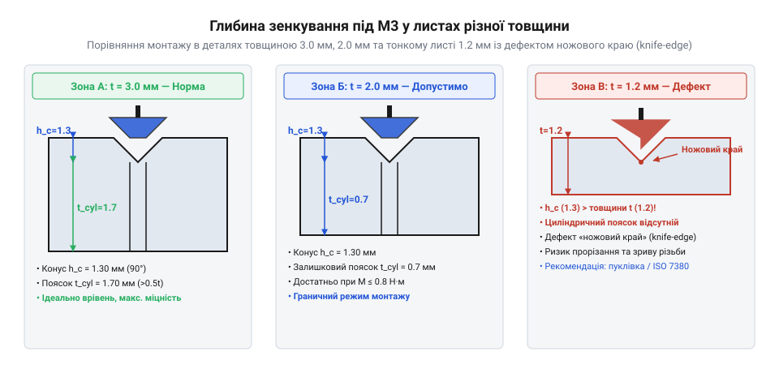
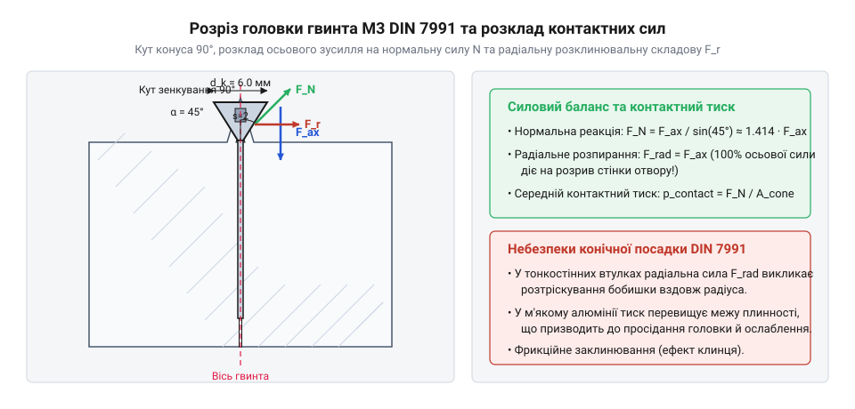
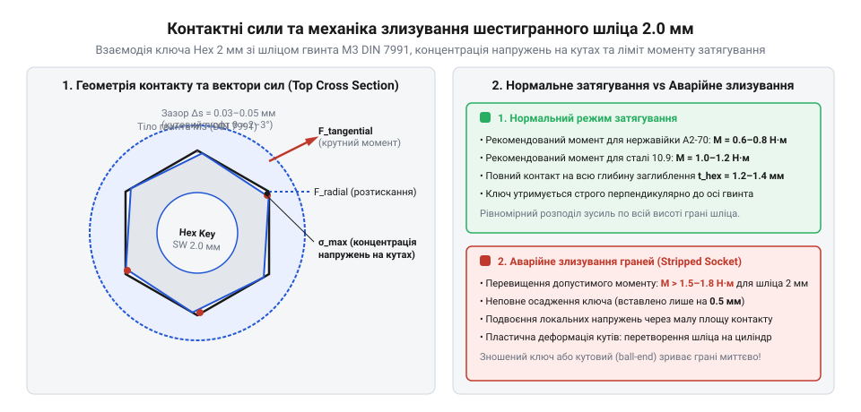
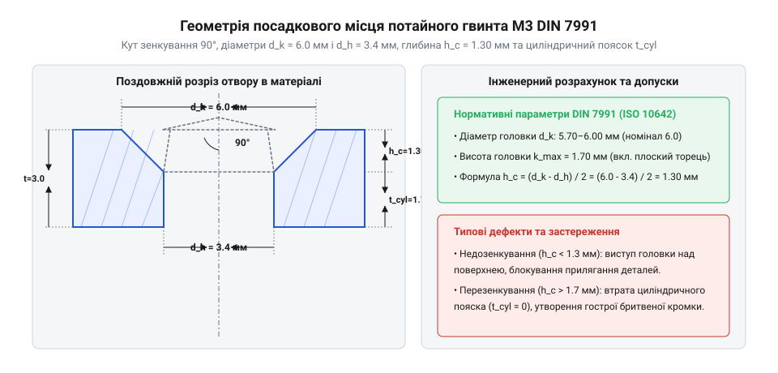
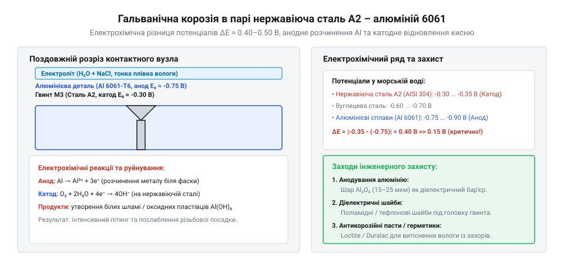
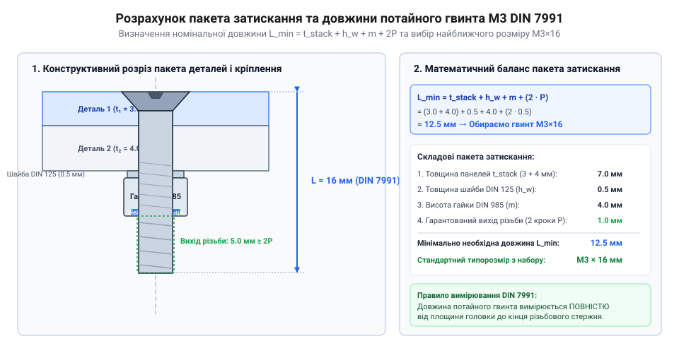

# Набори гвинтів М3 (шестигранник, потайні DIN7991)

<preknowlist>
- [Стійки М2/М3 (латунь, нейлон)](root:cat-hw-parts/standoffs) — принципи з'єднання різьбових елементів з платами та різьбовими втулками у корпусах
- [Болти М5/М6 і шайби М3/М4](root:cat-hw-parts/bolts-and-washers) — призначення та взаємодія підкладних шайб М3 у метричних нарізних з'єднаннях
</preknowlist>

## Виступаюче кріплення у компактній корпусурі

Коли всередині пластикового чи алюмінієвого корпусу електронного приладу щільно компонуються друковані плати, акумуляторні батареї та рухомі елементи, кожен міліметр вільного простору стає критичним. Використання традиційних метизів із циліндричними або сочевицеподібними головками створює виступ висотою від 1.5 до 3.0 мм над поверхнею деталі. У компактній корпусурі такий виступ перетворюється на фізичну перешкоду: виступаюча головка гвинта блокує рух висувних кришок, заклинює внутрішні слайдери або впирається у корпус сусіднього модуля. Спроба розсунути деталі чи збільшити проміжок неминуче веде до роздуття зовнішніх габаритів виробу, погіршення ергономіки та зайвої витрати матеріалу.

Ще гостріше проблема виступаючого кріплення проявляється на внутрішніх поверхнях приладу, де плата зафіксована за допомогою [різьбових латунних стійок](root:cat-hw-parts/standoffs). Якщо капелюшок гвинта виступає з протилежного боку стінки, він може торкнутися струмопровідних доріжок або контактів поверхневого монтажу (з @@en|англійської@@ @@en|Surface Mount Technology@@, SMT), що викликає коротке замикання та вихід з ладу всієї електроніки. Спроби компенсувати цей виступ шляхом збільшення товщини стінки корпусу за допомогою циліндричного зенкування (з @@de|німецької@@ @@de|Zenken@@ — утворювати циліндричне заглиблення) створюють нові проблеми: у тонколистовому металі або у 3D-друкованому пластику циліндричний потай залишає занадто тонку та крихку перемичку під головкою, яка легко виривається під дією робочих навантажень, як описує [загальний огляд нарізного кріплення](root:cat-hw-parts/threaded-fasteners-overview).

Розв'язанням цієї інженерної суперечності стало потайне з'єднання (з @@en|англійської@@ @@en|countersink@@ — зенкувати впотай), яке дозволяє повністю сховати головку гвинта вглиб стінки деталі. Для цього капелюшок гвинта виконують у формі зрізаного конуса з кутом розхилу 90°, який занурюється у попередньо підготовлену конічну фаску отвору. У результаті верхня площина головки стає врівень із зовнішньою або внутрішньою поверхнею деталі, утворюючи абсолютно гладку площину. Це не лише усуває ризик механічних заклинювань і коротких замикань, а й забезпечує естетичний вигляд виробу та запобігає зачіпанню внутрішніх дротів під час монтажу чи обслуговування приладу.

Однак монтаж впотай накладає суворі обмеження на геометричні параметри отвору та товщину матеріалу. Щоб конічна головка гвинта М3 повністю утопилася у деталь, товщина стінки `T` повинна бути не меншою за висоту конуса головки `t_k`. Якщо деталь занадто тонка, конічна фаска наскрізь прорізає матеріал, залишаючи на виході гостру крайку, позбавлену циліндричної частини отвору.


*Осадження потайної головки гвинта М3 залежно від товщини деталі: у товстій стінці головка утоплюється урівень з поверхнею, а в тонколистовому матеріалі утворюється гострий край отвору та ризик прориву матеріалу.*

Як видно на схемі розрізу посадкового отвору, при товщині деталі, що перевищує висоту конуса, фаска переходить у циліндричний напрямний отвір, який сприймає зсувні навантаження та забезпечує центрування. У випадку тонкого листового металу або тонкостінного 3D-друку конус виходить за межі матеріалу. Це призводить до прокручування гвинта, деформації країв отвору під час затягування та різкого зниження тримальної здатності з'єднання. Для забезпечення надійної посадки у тонких стінках застосовують спеціальні технологічні прийоми: формувальну викутку фасок штампуванням або виготовлення локальних потовщень (з @@en|англійської@@ @@en|bosses@@ — бобишки), використовуючи [технологію та інструменти зенкування](root:cat-hw-instruments/countersinking-tools-and-techniques) для точної підготовки поверхні. Такий підхід дає змогу зберегти компактні зовнішні габарити корпусу і водночас гарантує відсутність виступаючих елементів біля внутрішніх блоків приладу, таких як [магнітні фіксатори](root:cat-hw-parts/neodymium-magnets) чи [захисні дихаючі мембрани](root:cat-hw-parts/eptfe-protective-vents).

## Геометрія конуса та внутрішній шестигранник

Перехід від потреби у плоскій поверхні до реалізації з'єднання вимагає точного розуміння геометричних параметрів гвинтів М3 за стандартом @@de|DIN 7991@@ (міжнародний аналог @@en|ISO 10642@@). Головка гвинта утворює конус із вершиною, спрямованою до стержня з метричною різьбою М3. Номінальний діаметр різьби `d` становить 3.0 мм, а максимальний зовнішній діаметр конічної головки `d_k` дорівнює 6.0 мм. Кут конуса головки `α` за стандартом становить точно 90°, що задає стандартний профіль для зенкувального інструменту.

Щоб обчислити глибину конічної фаски та необхідне заглиблення отвору, виводять теоретичну висоту головки `t_k`. Вона визначається через різницю зовнішнього діаметра головки та діаметра стержня, поділену на подвоєний тангенс половинного кута конуса:

```
t_k = (d_k - d) / (2 × tan(α / 2))
    = (6.0 - 3.0) / (2 × tan(90° / 2))     [підстановка геометричних параметрів М3]
    = 3.0 / (2 × tan(45°))                  [обчислення різниці діаметрів]
    = 3.0 / (2 × 1.0)                       [значення тангенса кута 45°]
    = 1.5 мм                                [підсумкова висота конуса]
```

Завдяки куту 90° тангенс 45° дорівнює одиниці, тому теоретична висота конуса `t_k` для гвинта М3 становить точно 1.5 мм. На практиці стандарти @@de|DIN 7991@@ та @@en|ISO 10642@@ передбачають невеличкий притуплений перехід на крайці та укорочену плоску вершину головки, через що реальна глибина посадки становить близько 1.7 мм із урахуванням технологічного допуску на зенкування.

Потреба точного приладобудування та аерокосмічної галузі у гладких зовнішніх поверхнях без виступаючих елементів при одночасному забезпеченні високого моменту затягування привела до створення конічних потайних головок під внутрішній шестигранник. Історично потайне кріплення виконувалося із прямим шліцом, який легко деформувався і вимагав постійного центрування викрутки, позбавляючи можливості застосовувати автоматизоване збирання. Перехід від класичного німецького регламенту @@de|DIN 7991@@ до міжнародного стандарту @@en|ISO 10642@@ висвітлив еволюцію конструктивних вимог: у сучасному стандарту уточнено допуски геометричних кутів фаски, радіуси переходу від конуса до стержня та глибину заглиблення шестигранника. Паралельно відбувся технологічний стрибок у виробництві метизів: токарне виточування кожного гвинта з прутка було замінено масовим холодним висаджуванням (з @@en|англійської@@ @@en|cold heading@@ — формування металу тиском без нагріву), що знизило собівартість виготовлення у сотні разів і зробило асортиментні набори високоміцних гвинтів М3 доступними для будь-якого конструювання.

Незважаючи на взаємозамінність у більшості побутових та аматорських завдань, стандарти @@de|DIN 7991@@ та @@en|ISO 10642@@ мають відмінності у геометрії з'єднання стержня з головкою. В @@en|ISO 10642@@ збільшено радіус підголовка, що знижує концентрацію напружень у найнебезпечнішому перерізі гвинта. Також у специфікаціях @@en|ISO 10642@@ жорсткіше нормується допуск на глибину шестигранного гнізда, оскільки занадто глибокий шліц у потайній головці зменшує товщину металевої перемички між дном шліца та конусом, що може призвести до відриву головки при затягуванні. Детальні значення допусків та розмірні сітки наведені у [специфікаціях розмірів DIN 7991](root:cat-hw-parts/m3-screw-kits/api-din-7991-m3-specifications.md).


*Розподіл навантажень у потайному з'єднанні DIN 7991: при затягуванні осьове зусилля створює додатковий радіальний тиск на конічну фаску отвору.*

Конструктивна геометрія конуса 90° докорінно змінює характер розподілу механічних сил у з'єднанні порівняно зі звичайними болтами із плоскою опорною поверхнею. Під час затягування гвинта ключем створюється осьове зусилля попереднього затягування `F_a`, яке притискає конічну поверхню головки до фаски отвору. Через конусність нормальна сила контактного тиску розділяється на дві складові: осьову `F_a` та радіальну `F_r`, яка діє перпендикулярно до осі гвинта і намагається розперти стінки отвору.

Обчислимо величину радіальної сили розклинювання `F_r`, яка передається на матеріал деталі при заданому осьовому зусиллі `F_a` та куті конуса `α`:

```
F_r = F_a ÷ tan(α / 2)
    = F_a × tan(90° / 2)                  [значення кута фаски DIN 7991]
    = F_a × tan(45°)                      [спрощення кутового аргументу]
    = F_a × 1.0                           [значення тригонометричної функції]
    = F_a                                 [рівність радіального та осьового зусиль]
```

Отримана формула показує, що при куті конуса 90° радіальне зусилля розклинювання точно дорівнює осьовому зусиллю затягування (`F_r = F_a`). Цей радіальний тиск створює колові напруження розтягу у матеріалі навколо отвору. У крихких матеріалах (акрил, оргскло, кераміка) або у тонкостінних детальках 3D-друку цей тиск спричиняє появу тріщин і розколювання деталі уздовж фаски. Водночас конічна геометрія дає важливий позитивний ефект — самоцентрування: гвинт автоматично вирівнює притискувану деталь відносно осі отвору. Проте якщо між отворами у жорсткій металевій пластині є похибка міжцентрової відстані, потайні гвинти не зможуть зміститися вбік, що спричинить виникнення великих згинальних та зсувних напружень у стержнях. Детальний математичний аналіз цього явища наведено у [математичному розрахунку зенкування](root:cat-hw-parts/m3-screw-kits/math-countersink-geometry-stress.md).

Для передачі крутного моменту в гвинтах М3 @@de|DIN 7991@@ використовується внутрішній шестигранник (з @@de|німецької@@ @@de|Inbus@@ — скорочення від @@de|Innensechskantschraube Bauer und Schaurte@@, або @@en|hex socket@@) розміром `s = 2.0 мм` під шестигранний ключ Аллена (з @@en|англійської@@ @@en|Allen key@@). Оскільки конічна головка звужується донизу, об'єм металу для формування шліца є обмеженим. Глибина шестигранного заглиблення `t` у гвинтах М3 становить лише 0.9–1.2 мм, що значно менше, ніж у гвинтів з циліндричною головкою @@de|DIN 912@@.


*Контактні точки та напруження у шестигранному шліці гвинта М3 при передачі крутного моменту від ключа.*

Як видно з перерізу шестигранного заглиблення, передача крутного моменту `M_z` від ключа до гвинта відбувається через шість вузьких контактних ліній на гранях шліца. Малий розмір шестигранника 2 мм створює невеликі плечі прикладання сили, через що при затягуванні у кутах шліца виникає висока концентрація контактних напружень. Якщо притискне зусилля ключа перевищує допустимий момент затягування (близько 0.9–1.2 Н·м для нержавіючої сталі A2/A4 та 1.5–1.8 Н·м для вуглецевої сталі класу міцності 10.9), грані 2 мм шестигранника деформуються, що призводить до злизування (зрізання) граней шліца. Після злизування шестигранника демонтаж гвинта без висвердлювання стає неможливим. Для запобігання деформації шліца необхідно контролювати момент динамометричним інструментом та застосовувати [методи фіксації різьбових з'єднань](root:cat-hw-parts/thread-locking-methods) на основі анаеробних фіксаторів замість надмірного затягування, що особливо важливо, коли розробляється [практика складання корпусу](root:cat-hw-parts/m3-screw-kits/proj-m3-countersunk-enclosure-assembly.md).

## Розрахунок зенкування та товщини матеріалу

Спроба закрутити гвинт із потайною головкою у звичайний циліндричний отвір неминуче призводить до того, що конічна поверхня головки впирається у гострий верхній край отвору, залишаючи весь капелюшок виступати над поверхнею деталі. Щоб головка сховалася строго врівень із площиною, у верхній частині отвору створюють конічне заглиблення — @@de|зенкування@@ (від нім. @@de|Senken@@ — опускати, заглиблювати). Геометрія цього заглиблення повинна точно повторювати форму конуса (від лат. @@la|conus@@ — соснова шишка, шпиль) головки гвинта. Для стандарту DIN 7991 кут при вершині конуса становить строго 90°, що задає рівнобедрений прямокутний трикутник у поздовжньому перерізі. Будь-яке відхилення кута зенкера від 90° зменшує площу контакту між гвинтом і деталлю до точкової лінії, що викликає місцеву концентрацію напружень і продавлювання матеріалу при затягуванні.

Для формування правильного посадкового місця необхідно розрахувати глибину конічної @@de|фаски@@ (від нім. @@de|Fase@@ — скошений край, грань), яку повинен утворити ріжучий інструмент. Розрахунок спирається на три основні параметри: зовнішній діаметр головки гвинта `d_k`, діаметр наскрізного отвору `d_h` та кут конуса `α`. За стандартом DIN 7991 для гвинта М3 максимальний діаметр головки `d_k` становить 6.0 мм, а нормальний прохідний отвір під різьбу виконують діаметром `d_h = 3.4 мм` (середній клас точності). Розрахуємо глибину конічної фаски `h_c`, необхідну для того, щоб верхня площина головки гвинта розташовувалася строго врівень із поверхнею деталі, виходячи з геометричних співвідношень прямокутного трикутника:

```
h_c = (d_k - d_h) ÷ (2 × tan(α / 2))
    = (6.0 - 3.4) ÷ (2 × tan(45°))      [підстановка параметрів М3 та кута 90°]
    = 2.6 ÷ (2 × 1.0)                  [значення тангенса 45° дорівнює 1]
    = 1.3 мм                            [підсумкова теоретична глибина фаски]
```

Отримане значення `h_c = 1.3 мм` показує теоретичну висоту зрізаного конуса головки в межах зенкованого отвору. Загальна висота головки гвинта М3 становить 1.7 мм, з яких верхні 0.2 мм припадають на циліндричний поясок капелюшка. Точний геометричний допуск описано у [габаритних специфікаціях кріплення](root:cat-hw-parts/m3-screw-kits/api-din-7991-m3-specifications.md), що регламентують граничні відхилення діаметрів. Якщо розточити фаску глибиною менше 1.3 мм, край головки виступатиме над поверхнею деталі й зачіпатиме суміжні рухомі елементи. Навпаки, надмірне заглиблення призведе до утоплення гвинта нижче рівня площини, що погіршує зовнішній вигляд та зменшує ефективну довжину зачеплення різьби.

Якщо прохідний отвір виконують за точним класом `d_h = 3.2 мм` (наприклад, для прецизійного позиціонування плати), необхідна глибина конуса збільшується до `(6.0 - 3.2) / 2 = 1.4 мм`. Для вільного отвору `d_h = 3.6 мм` глибина конуса зменшується до `1.2 мм`. Для розрахунку зрізувальних та згинальних напружень у матеріалі деталі використовують [математичну модель зенкування](root:cat-hw-parts/m3-screw-kits/math-countersink-geometry-stress.md), яка дозволяє оцінити міцність стінки під конусом у разі дії комбінованих навантажень.


*Геометричні параметри посадкового місця гвинта М3 DIN 7991 та співвідношення глибини зенкування з товщиною матеріалу.*

Глибина зенкування безпосередньо накладає жорсткі обмеження на товщину матеріалу деталі. Якщо товщина листового металу або стінки корпусу `t` дорівнює або менша за глибину конуса `h_c`, ріжучий інструмент повністю зріже циліндричні стінки отвору. В результаті отвір перетвориться на гострий ножовий край, позбавлений напрямної циліндричної частини. При затягуванні гвинта конічна головка діє як клин: вона продавлює тонкий метал, вигинає краї деталі та втрачає осьовий попередній натяг. Обчислимо мінімально припустиму товщину деталі `t_min`, яка запобігає зрізанню наскрізного отвору до утворення гострого ножового краю:

```
t_min = h_c + t_cyl
      = 1.3 + 0.5                      [прийнято мінімальний поясок 0.5 мм для металу]
      = 1.8 мм                         [найменша товщина металевої пластини]
```

Для деталей із конструкційної сталі або твердих алюмінієвих сплавів мінімальна товщина залишкового циліндричного пояска `t_cyl` повинна становити не менше 0.5 мм, що вимагає загальної товщини листа від 1.8 мм. У разі роботи з листовим металом товщиною 1.0–1.2 мм класичне @@de|зенкування@@ застосовувати не можна — замість зняття стружки виконують штампувальне пуклювання (формування конічної заглибини випресовкою без зрізання металу). Практичну послідовність збирання металевих та пластикових елементів викладено у [керівництві з монтажу](root:cat-hw-parts/m3-screw-kits/proj-m3-countersunk-enclosure-assembly.md) захисного корпусу електроніки.

Окремої уваги вимагають деталі, виготовлені методом 3D-друку або лиття з термопластиків (ABS, PETG, PLA). Полімери мають значно нижчу границю плинності порівняно з металами й виявляють схильність до міжшарового розшарування. Коли потайна головка М3 затягується у пластику, осьове зусилля створює потужні радіальні розпірні сили, які намагаються розсунути пластик убік. Якщо навколо отвору немає технологічного потовщення (босу), стінка деталі тріскається вздовж ліній друку. Для надійного кріплення в пластику товщина стінки під зенкування повинна становити щонайменше 2.5–3.0 мм, а діаметр виступаючого потовщення має бути не меншим за подвійний діаметр головки (від 12 мм). Докладні конструктивні вимоги описано в [проєктуванні босів 3D-друку](root:hw-pcb/boss-design-3d-printing), де враховано специфіку міжшарової адгезії.

Для отримання чистих посадкових місць без заусенців та здригання інструменту використовують спеціальні трипелюсткові конічні @@de|зенкери@@ з кутом 90°. Свердління звичайним спіральним свердлом з кутом заточування 118° або 135° дає неправильний кут конуса, через що гвинт спирається лише зовнішньою кромкою головки й швидко послаблюється від вібрацій. При серійній обробці деталей застосовують зенкери з мікрометричними обмежувачами глибини, які зупиняють подачу ріжучої кромки при досягненні строго заданої глибини 1.30 мм. Детальні інструменти та професійну техніку зняття фасок розкрито у [технологіях зенкування отворів](root:cat-hw-instruments/countersinking-tools-and-techniques). При монтажі плати всередині корпусу гвинти зенкують у зовнішню стінку, після чого їхній різьбовий хвостовик вкручують у [різьбові металеві стійки](root:cat-hw-parts/standoffs), розташовані всередині приладу.

## Матеріали, класи міцності та корозія

Після підготовки посадкових місць постає завдання вибору матеріалу та механічних характеристик гвинтів М3. У наборах кріплення DIN 7991 найчастіше зустрічаються два класи матеріалів: нержавіючі аустенітні сталі та вуглецеві леговані сталі високої міцності. Вибір між ними визначається не лише необхідною несучою здатністю з'єднання, а й хімічною агресивністю навколишнього середовища, вологістю та контактною парою металів.

Нержавіючі гвинти виготовляють із хромонікелевих сплавів марок A2 (AISI 304) та A4 (AISI 316). Стійкість до окиснення цих сталей забезпечується феноменом @@de|пасивації@@ (від лат. @@la|passivus@@ — бездіяльний, той що не реагує) — утворенню на поверхні надтонкої самовідновлюваної плівки оксиду хрому. Марка A2 підходить для більшості стандартних умов експлуатації, кімнатного обладнання та приладів, що працюють у прісній воді. Для агресивних середовищ, морського туману чи хімічних виробництв використовують сталь A4, до складу якої додано 2–3% молібдену. Необхідно враховувати, що стандартні нержавіючі гвинти М3 мають клас міцності @@en|A2-70@@ або @@en|A4-70@@, що відповідає границі міцності на розрив 700 МПа. Оскільки потайна головка DIN 7991 має заглиблення під шестигранник розміром всього 2 мм, стінка під шліцом виходить відносно тонкою. Застосування надмірного моменту затягування до нержавіючого гвинта може призвести до зрізання граней внутрішнього шестигранника або навіть відриву головки від стержня.

При зкручуванні нержавіючого гвинта в нержавіючу стійку або гайку без змащування виникає специфічний дефект — холодне зварювання або схоплювання металів під тиском (@@en|galling@@). Через відсутність поверхневого оксидного шару при терті чистого аустеніту мікронерівності різьби зварюються між собою, унеможливлюючи подальше розбирання з'єднання. Для запобігання заклинюванню різьби слід використовувати графітові або дисульфід-молібденові протизаклинювальні пасти.

Коли з'єднання піддається високим динамічним або зрізувальним навантаженням, застосовують гвинти з загартованої вуглецевої сталі класів міцності 10.9 та 12.9. Число перед крапкою означає 1/100 від границі міцності в мегапаскалях (1000 МПа для 10.9 та 1200 МПа для 12.9), а число після крапки — співвідношення границі плинності до границі міцності у відсотках (90% і 90% відповідно). Потайна головка з випрофованої сталі 12.9 витримує значно більший момент затягування без деформації 2-мм шестигранного шліца. Завдяки високій границі витривалості такі гвинти краще витримують циклічні вібраційні навантаження в силових конструкціях.

Проте вуглецева сталь без захисного покриття миттєво піддається іржавінню. Для захисту від атмосферної вологи гвинти піддають хімічному оксидуванню (чорнінню) або електролітичному цинкуванню. Чорне оксидне покриття утримує технологічне мастило, але забезпечує лише мінімальний захист у сухому приміщенні. Цинкове покриття діє як жертовний анод, захищаючи сталеву основу навіть при дрібних подряпинах. При виконанні електролітичного цинкування високоміцних сталей 12.9 існує ризик водневої крихкості (@@en|hydrogen embrittlement@@), тому вироби піддають обов'язковому зневоднювальному відпалу. Щоб не втратити дрібні гвинти та швидко підбирати потрібну довжину під час збирання, весь асортимент розкладають в [органайзері дрібних деталей](root:cat-hw-parts/parts-organizer).

Найбільш підступною загрозою для довговічності з'єднання є @@la|корозія@@ (від лат. @@la|corrosio@@ — роз'їдання), яка виникає на стику різнорідних металів у присутності вологи. Коли нержавіючий або вуглецевий сталевий гвинт вкручують безпосередньо в алюмінієву деталь або корпус, утворюється гальванічний елемент. Алюміній має значно від'ємніший електродний потенціал (близько -0.75 В) порівняно з нержавіючою сталлю (близько +0.05 В). За наявності водяної плівки алюміній стає анодом і починає прискорено руйнуватися, перетворюючись на пухкий білий порошок оксиду алюмінію.


*Схема виникнення гальванічного елемента в різьбовому з'єднанні та руйнування алюмінієвої деталі навколо потайного гвинта.*

Утворені продукти корозії збільшуються в об'ємі, що викликає заклинювання різьби або повністю викришує зенковану фаску в алюмінії, через що гвинт провалиться всередину корпусу. Складні електрохімічні процеси у контактах детально описано в [гальванічній корозії кріплення](root:hw-components/galvanic-corrosion-fasteners).

Для запобігання гальванічному руйнуванню застосовують кілька ефективних бар'єрних методів:
1. Захисне @@de|анодування@@ алюмінієвих деталей, яке створює діелектричний оксидний шар на поверхні конуса та різьби. 2. Використання ізолюючих шайб із фторопласту або нейлону під підкладні елементи; відповідні підкладні елементи з [асортименту шайб і болтів](root:cat-hw-parts/bolts-and-washers) вирівнюють тиск і запобігають прямому металевому контакту. 3. Нанесення консерваційних аерозолей чи анаеробних фіксаторів різьби, які повністю герметизують мікрозазори між різьбовими витками від проникнення вологи та електролітів. Ефективні технології нанесеного герметика та [методи фіксації різьби](root:cat-hw-parts/thread-locking-methods) блокують розвиток електрохімічних реакцій та запобігають самовільному відкручуванню від вібрацій. 4. Контроль мікроклімату всередині герметичних приладових корпусів: вирівнювання тиску та видалення вологи здійснюють через [вентиляційні захисні клапани](root:cat-hw-parts/eptfe-protective-vents), що унеможливлює утворення конденсатного електроліту на різьбових з'єднаннях.

Правильне поєднання класу міцності гвинта, антикорозійного покриття та ізоляції контактних пар гарантує долговічність і розбірність вузла протягом усього терміну експлуатації приладу.

## Момент затягування 2-мм шестигранника

Головний технологічний виклики при роботі з потайними гвинтами калібру М3 за стандартом DIN 7991 (ISO 10642) пов'язаний із конструктивним компромісом між міцністю головки та розміром внутрішнього інструментального шліца. На відміну від гвинтів із циліндричною головкою DIN 912, де застосовується 2.5-мм шестигранник, конічна форма потайного гвинта вимагає зменшення розміру внутрішнього шліца @@de|Inbus@@ (від німецького скорочення *@@de|Innensechskantschraube Bauer und Schaurte@@*, що позначає гвинт із внутрішнім шестигранником) до `s = 2.0 мм`. Таке зменшення є неминучим: кут конуса головки 90° означає, що при максимальному зовнішньому діаметрі `d_k = 6.0 мм` діаметр конуса на глибині заглиблення `t = 1.1 мм` звужується до 3.8 мм. Якби виробники залишили 2.5-мм шестигранник із описом габаритної діагоналі близько 2.87 мм, товщина металевої стінки між заглибленням і зовнішньою фаскою становила б менше 0.47 мм, що викликало б відрив головки від стержня при висаджуванні або затягуванні.

Зменшення розміру шліца до 2.0 мм та обмеження глибини заглиблення в межах від 0.95 мм до 1.15 мм суттєво зменшують площу контактних граней. Передача затягувального моменту від ключа до гвинта відбувається через шість вузьких прямокутних площин. Оскільки ефективний радіус прикладення сил від центра обертання становить лише 1.155 мм, для створення необхідного осьового зусилля попереднього затискання потрібен надзвичайно високий питомий контактний тиск на гранях.

Формування дотичного зусилля на гранях внутрішнього шестигранника описується геометричним співвідношенням між моментом затягування та ефективним радіусом розміщення граней:

r_eff = s ÷ √3
= 2.0 ÷ 1.73205          [підстановка розміру шестигранника під ключ s = 2.0 мм]
= 1.1547 мм              [обчислення ефективного радіуса важеля]

При застосуванні нормативного крутного моменту для гвинта з нержавіючої сталі дотичне зусилля, що діє на площини заглиблення, розраховується через відношення моменту до радіуса важеля:

F_t = T ÷ r_eff
= 0.65 ÷ 0.0011547       [підстановка моменту T = 0.65 Н·м та радіуса важеля 1.1547 мм у метрах]
= 562.9 Н                [ділення моменту на радіус]

Отримане дотичне зусилля у понад 560 Н розподіляється по п'яти-шести мікроскопічних площинах із робочою висотою близько 1 мм. Якщо інструмент встановлено з найменшим кутовим перекосом або зазором, напруження зсуву в кутах заглиблення перевищують границю плинності матеріалу. Це викликає @@en|stripping@@ (від англійського *@@en|strip@@* — злизувати грані шліца), при якому шестигранний отвір пластично деформується і перетворюється на кругле заглиблення.

Згідно з [механічними специфікаціями гвинтів М3](root:cat-hw-parts/m3-screw-kits/api-din-7991-m3-specifications.md), гранично допустимі моменти затягування суттєво залежать від матеріалу гвинта та стану його різьбової поверхні:
- Аустенітна нержавіюча сталь марки A2-70 / A4-70: границя плинності становить близько 450 МПа. Рекомендований робочий момент затягування становить `0.55–0.65 Н·м`. Перевищення `0.75 Н·м` призводить до деформації 2-мм шестигранника. - Високомічна вуглецева сталь класу 10.9: границя плинності сягає 900 МПа. Допустимий момент затягування становить `0.9–1.1 Н·м`. - Вуглецева сталь класу 12.9: рекомендований граничний момент становить `1.1–1.3 Н·м`.

Тут виникає важливий фізичний парадокс потайного кріплення: міцність різьбової частини М3 класу 10.9 або 12.9 здатна витримати осьове навантаження при моменті до `1.8–2.0 Н·м`, проте внутрішній 2-мм шестигранний шліц пластично руйнується вже при `1.2–1.3 Н·м`. Таким чином, слабкою ланкою з'єднання є геометрія інструментального заглиблення, а не міцність витків різьби.


*Контактні напруження та деформація граней внутрішнього шестигранника під дією крутного моменту.*

Використання стандартних Г-подібних ключів при монтажі потайних гвинтів створює додатковий небезпечний чинник: оператор миволі прикладає згинальне зусилля, через що ключ нахиляється у шліці. При нахилі лише на 3–5° площа контакту зменшується з повної площини до точкової зони у верхньому краї заглиблення. Це спричиняє локальну концентрацію напружень, яка миттєво зрізає грани шліца навіть при нормативному моменті.

Категорично забороняється застосовувати ключі з кульовим закінченням (@@en|ball-end key@@) для остаточного затягування гвинтів М3 DIN 7991. Кульове закінчення призначене лише для швидкого попереднього закручування під кутом. Через точковий контакт зі стінками воно зменшує робочу площу на 70% і гарантовано руйнує 2-мм внутрішній шестигранник при спробі прикласти момент понад `0.3 Н·м`.

Для забезпечення надійності та відтворюваності в серійному збиранні використовують @@en|torque screwdriver@@ (від англійського *@@en|torque@@* — крутний момент та *@@en|screwdriver@@* — викрутка) з точним регулюванням граничного зусилля та жорсткою фіксацією осі. Застосування викруткових бітів із твердих інструментальних сплавів (S2, Chrome-Vanadium або із титан-нітридним покриттям TiN) із точним дотриманням допуску розміру `2.00⁺⁰ˑ⁰² мм` повністю виключає люфт та утримує контакт по всій глибині шліца. Контрольований динамометричний монтаж запобігає пошкодженню голівок під час збирання [метричних кріпильних елементів](root:cat-hw-parts/threaded-fasteners-overview).

## Комплектування та захист від дефектів

Грамотне застосування потайних гвинтів М3 вимагає точного підбору всіх елементів різьбового пакета з асортиментного набору та комплексної нейтралізації монтажних дефектів. Типовий асортиментний набір містить гвинти DIN 7991 різної довжини `L` (від 6 мм до 25 мм), шестигранні гайки DIN 934 (ISO 4032), самоконтруючі гайки DIN 985 (ISO 7040) з нейлоновим кільцем та плоскі шайби DIN 125 (ISO 7089).

При розрахунку необхідної довжини гвинта `L` слід обов'язково враховувати специфіку стандарту DIN 7991: на відміну від гвинтів із циліндричною або напівкруглестою головкою, де довжина вимірюється під головкою, номінальна довжина потайного гвинта `L` вимірюється по всій його висоті — від плаского торця головки до кінця різьбового стержня. Загальна довжина має покривати товщину скріплюваного пакета деталей, товщину підкладних шайб під гайкою, висоту гайки та забезпечувати мінімальний вихід різьби на 1.5–2 кроки (від 0.75 мм до 1.0 мм для М3 з кроком `P = 0.5 мм`).

Розрахунок необхідної довжини потайного гвинта для надійного з'єднання двох конструкційних деталей із виходом різьби під самоконтруючу гайку визначається формулою:

L_min = t_stack + h_w + m + (2 × P)
= (3.0 + 4.0) + 0.5 + 4.0 + (2 × 0.5)      [підстановка товщини деталей 7.0 мм, шайби 0.5 мм, гайки 4.0 мм та перекриття 1.0 мм]
= 12.5 мм                                  [сумування складових пакета затискання]

Оскільки довжина 12.5 мм відсутня у стандартній сітці наборів, з асортименту обирають найближчий більший розмір — гвинт М3×16 мм. Для зменшення габаритів та ваги кріплення у надкомпактних електронних приладах замість М3 доцільно розглядати [набір кріплення М2.5](root:cat-hw-parts/m25-fastener-kit).

У процесі експлуатації обладнання під дією вібрацій, шокових навантажень чи циклічних коливань температури в різьбовому з'єднанні виникають поперечні мікрозсуви витків. Це руйнує статичне тертя й призводить до швидкого спаду сили попереднього затягування та самовільного відкручування кріплення. Ззвичайні плоскі шайби, аналоги яких використовують як підкладки під [болти й шайби М3](root:cat-hw-parts/bolts-and-washers), монтують виключно з боку гайки. Під потайну конічну головку шайби не ставлять, оскільки це порушує рівну площину монтажу.


*Складові елементи потайного з'єднання М3, товщина пакета та зони запобігання монтажним дефектам.*

Для надійного запобігання самовідкручуванню потайних з'єднань застосовують три основні технологічні підходи:
1. Використання самоконтруючих гайок — @@en|nyloc nut@@ (від англійського *@@en|nylon locking nut@@* — гайка з нейлоновим фіксатором). Внутрішнє нейлонове кільце гайки пружно деформується витками гвинта М3 при закручуванні, створюючи постійне фрикційне гальмування, яке не втрачається при вібрації. 2. Застосування анаеробних фіксаторів різьби — @@en|threadlocker@@ (від англійського *@@en|thread locking fluid@@* — рідкий фіксатор різьби). Рідкий полімер низької (фіолетовий маркер) або середньої (синій маркер) міцності заповнює мікрозазори між витками та полімеризується без доступу повітря при контакті з металом. Детальні [методи фіксації різьбових з'єднань](root:cat-hw-parts/thread-locking-methods) описано у відповідному технологічному огляді. Слід пам'ятати, що замість спеціальних фіксаторів іноді помилково застосовують [ціаноакрилатний клей](root:cat-hw-parts/cyanoacrylate-glue), проте він має високу крихкість і миттєво руйнується від вібраційних ударів, втрачаючи фіксуючу здатність. 3. Застосування пружинних шайб Гровера (DIN 127) або зубчастих шайб (DIN 6798) під шестигранну гайку з зворотного боку з'єднання.

Критичним монтажним дефектом потайних з'єднань є кутовий або осьовий перекіс при зенкуванні отвору під головку гвинта. Якщо вісь зенкера відхиляється від осі перпендикулярного отвору хоча б на 2–3°, конуси головки та деталі не збігаються. Головка гвинта спирається лише на одну сторону конічної фаски, викликаючи високий згинальний момент на стержні, нерівномірний розподіл напружень і виступання протилежного краю головки над поверхнею корпусу. Суворе дотримання технологічних правил через [технологію зенкування отворів](root:cat-hw-instruments/countersinking-tools-and-techniques) забезпечує повний контакт по всій твірній конуса 90°.

При монтажі потайних гвинтів у деталі з м'яких матеріалів (алюмінієві сплави, магній, 3D-друкований пластик) виникає ризик зрізу внутрішньої різьби при затягуванні. Щоб уникнути цього дефекту, у пластикових корпусах застосовують спеціальні нарізні втулки — @@en|heat-set insert@@ (від англійського *@@en|heat-set insert@@* — втулка, що вплавляється теплом), які запресовують паяльником або ультразвуком. У металевих та комбінованих корпусах застосовують [резервні латунні стійки](root:cat-hw-parts/standoffs) з внутрішньою різьбою М3. Для точного розрахунку контактного тиску та товщини матеріалу під потайною головкою використовують формули з [геометрії зенкування та напружень](root:cat-hw-parts/m3-screw-kits/math-countersink-geometry-stress.md).

Додатковим чинником руйнування різьбових вузлів на відкритому повітрі або у вологому середовищі є @@en|galvanic corrosion@@ (від італійського прізвища вченого *Luigi Galvani* та латинського *@@la|corrosio@@* — роз'їдання). Контакт нержавіючого гвинта A2/A4 з алюмінієвою детальною плитою створює гальванічну пару з різницею потенціалів близько 0.80 В. У присутності вологи алюміній швидко анодно руйнується, викришуючи різьбу та утворюючи білий наліт оксидів. Щоб зупинити [гальванічну корозію кріплення](root:hw-components/galvanic-corrosion-fasteners), застосовують захисне анодування алюмінію, цинкове покриття або використовують ізолюючі пасти. При цьому внутрішній захист електроніки від конденсату реалізують через [захисні клапани ePTFE](root:cat-hw-parts/eptfe-protective-vents).

Покрокова послідовність проєктування, розрахунку та виготовлення захисного корпусу приладу на потайних гвинтах висвітлена в [практиці монтажу корпусу](root:cat-hw-parts/m3-screw-kits/proj-m3-countersunk-enclosure-assembly.md). Для прискорення монтажу та запобігання плутанині метизи рекомендується організувати у спеціальному [органайзері для дрібних деталей](root:cat-hw-parts/parts-organizer).