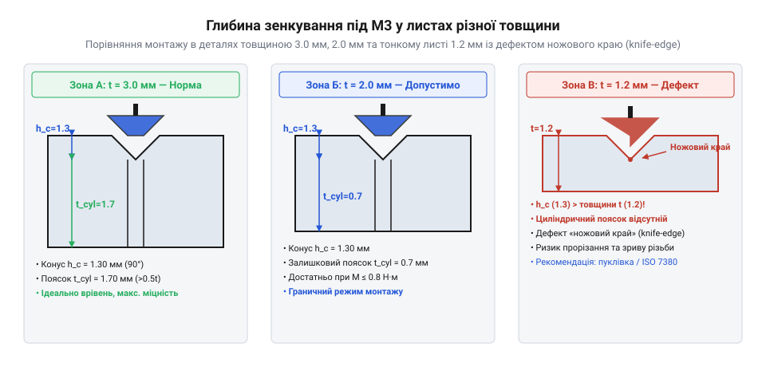

# Набори гвинтів М3 (шестигранник, потайні DIN7991)

<preknowlist>
- [Стійки М2/М3 (латунь, нейлон)](root:cat-hw-parts/standoffs) — Принципи монтажу різьбових з'єднань у корпусах
- [Болти М5/М6 і шайби М3/М4](root:cat-hw-parts/bolts-and-washers) — Призначення підкладних шайб М3 у нарізних з'єднаннях
</preknowlist>

## Потайне кріплення у компактних корпусах

У сучасних електронних пристроях і компактних корпусах на рахунку кожен міліметр внутрішнього простору, а будь-які виступаючі елементи конструкції створюють проблеми для компонування плат, акумуляторів та шлейфів. Звичайні гвинти з циліндричною або напівсферичною головкою неминуче піднімаються над поверхнею металевої чи пластикової стінки, заважаючи щільному приляганню сусідніх деталей. Для розв'язання цієї проблеми застосовують потайні гвинти стандартів DIN 7991 або ISO 10642, конічна головка яких розрахована на монтаж врівень із площиною матеріалу. Геометрична суть такого рішення полягає у тому, що кут при вершині конуса головки становить рівно 90 градусів, що дозволяє їй повністю занурюватися в зенкований отвір аналогічної конусності, не створюючи жодних перешкод на зовнішній поверхні виробу.

*Геометрія потайного отвору під гвинт М3 у листах різної товщини та небезпека утворення гострого краю.*

Під час проєктування потайних з'єднань критично важливо правильно співвідносити товщину листового матеріалу з висотою конічної головки гвинта. Якщо стінка корпусу занадто тонка, під час зенкування конічний отвір прорізає матеріал наскрізь або залишає лише мікроскопічну товщину на периметрі, утворюючи небезпечний гострий край. У технічній практиці це явище називається дефектом ножового краю (англ. @@en|knife-edge condition@@), коли навантаження від затягнутого гвинта призводить до зрізання або деформації тонкої кромки матеріалу, і головка провалюється крізь отвір. Для надійного утримання кріплення врівень необхідна достатня товщина стінки, щоб повністю розмістити конус головки (для різьби М3 повна висота головки становить близько 1.7 мм), залишаючи під ним міцний опорний поясок. Коли товщина листового металу є обмеженою, доводиться використовувати додаткові підкладні елементи, такі як спеціальні шайби М3/М4, або застосовувати інші види з'єднань. Для герметизації корпусів з потайним кріпленням часто використовують [вентиляційними захисними клапанами ePTFE](root:cat-hw-parts/eptfe-protective-vents), які вирівнюють тиск без порушення захисних властивостей оболонки.

## Матеріали, корозія та затягування шліца

Довговічність та надійність розбірного з'єднання безпосередньо залежать від правильного добору марок металу та дотримання регламенту монтажу. У приладобудуванні найчастіше використовують нержавіючу сталь марки A2, яка забезпечує відмінну стійкість до атмосферної корозії та не потребує додаткових захисних покриттів. Проте в умовах підвищених механічних навантажень виникає потреба у високоміцних виробах класів міцності 10.9 або 12.9 із вуглецевої сталі, які витримують значно більші зусилля на розрив та зріз. З іншого боку, прямий контакт нержавіючої чи вуглецевої сталі з алюмінієвими корпусами в присутності вологи неминуче активує процес гальванічної корозії (англ. @@en|galvanic corrosion@@), за якого менш благородний алюміній руйнується електрохімічним шляхом. Щоб запобігти цьому ефекту, алюмінієві деталі обов'язково піддають захисному анодуванню або використовують діелектричні ізолюючі прокладки.

Закручування потайних гвинтів М3 вимагає використання точного інструменту, оскільки їхній внутрішній шестигранник (англ. @@en|hex socket@@) має розмір ключа лише 2.0 мм. Через малу площу контакту між гранями ключа та стінками шліца надмірне зусилля або перекіс інструмента дуже швидко призводять до злизування граней, після чого викрутити або дотягнути кріплення стає вкрай складно. Для контролю зусилля використовують викрутки з обмеженням крутного моменту або дотримуються відчуття м'якого упору без ривків. Порядок у таких вузлах допомагають підтримувати зручний [органайзері деталей](root:cat-hw-parts/parts-organizer) та надійний [набором кріплення М2.5](root:cat-hw-parts/m25-fastener-kit) для менших вузлів, а під час остаточного фіксування відповідальних різьбових пар часто застосовують спеціальний [ціаноакрилатним клеєм](root:cat-hw-parts/cyanoacrylate-glue) або анаеробні фіксатори різьби. Усі елементи каркаса додатково зв'язуються за допомогою [стійками М2/М3](root:cat-hw-parts/standoffs), які формують жорстку тривимірну структуру приладу.