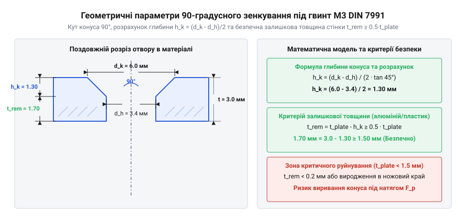

# Геометрія зенкування та розрахунок міцності потайного з'єднання М3

<preknowlist>
- [Набір кріплення М2.5 (нікельований)](root:cat-hw-parts/m25-fastener-kit) — Базові поняття метричного кроку різьби та затягування
- [Стійки М2/М3 (латунь, нейлон)](root:cat-hw-parts/standoffs) — Механічні властивості різьбових деталей та матеріалів
</preknowlist>

## Геометрія конуса 90° та глибина зенкування

Під час проєктування корпусів електронних пристроїв, металевих шасі або лицьових панелей часто виникає потреба закріпити деталі так, щоб головки гвинтів не виступали за зовнішню площину. Виступаючі елементи кріплення заважають встановленню захисних кришок, ускладнюють монтаж плат і можуть призвести до зачеплення сторонніх предметів. Для вирішення цієї проблеми застосовують потайні гвинти, які вимагають попереднього формування конічного поглиблення навколо отвору. Геометричний розрахунок такого зенкування базується на стандартизованих параметрах різьбових виробів, зокрема для гвинтів М3 згідно з вимогами DIN 7991 або ISO 10642. Головка гвинта має форму зрізаного конуса з номінальним кутом при вершині 90°.

*Геометричні параметри 90-градусного зенкування під потайний гвинт М3 DIN 7991.*

Для забезпечення ідеального прилягання головки врівень із поверхнею необхідно точно визначити глибину, на яку слід занурити інструмент (зенківку). Цей параметр безпосередньо залежить від зовнішнього діаметра конічної голівки гвинта та діаметра скрізного отвору під стрижень різьби. Вузол потайного кріплення утворюється за рахунок взаємодії конічної поверхні головки гвинта @@en|countersunk head@@ та конічної фаски в матеріалі деталі. 

Аби обчислити вертикальну відстань від поверхні деталі до початку циліндричної частини отвору, використовується аналітична формула глибини зенкування @@en|countersink depth@@. У загальному випадку для конічної фаски з довільним кутом при вершині 2·alpha глибина розраховується з геометричного прямокутного трикутника через різницю радіусів (d_k - d_h) / 2 та тангенс половинного кута alpha: h_k = (d_k - d_h) / (2 · tan alpha). Оскільки для гвинтів стандарту DIN 7991 номінальний кут конуса становить рівно 90°, половинний кут дорівнює alpha = 45°, а тангенс 45° тотожно дорівнює одиниці, що спрощує формулу до чистої піврізниці діаметрів (d_k - d_h) / 2. Якщо ж фактичний кут різальних крайок інструмента відхиляється від 90° на похибку Delta_alpha (наприклад, застосовано зенківку на 82° або 100°), лінійний контакт уздовж твірної конуса руйнується: при куті фаски, меншому за 90°, контакт вироджується у вузьке кільце на зовнішній кромці головки з концентрацією пластичних деформацій, а при куті понад 90° головка спирається лише нижнім пояском біля переходу в циліндричний отвір, через що гвинт провалюється глибше розрахункового рівня.

- h_k = (d_k - d_h) / (2 * tan 45°) = (6.0 - 3.4) / 2 = 1.30 мм (при куті 90° tan 45° = 1.0)
= 1.30 мм [геометричний розрахунок глибини зенкування для М3]

У цьому співвідношенні номінальний зовнішній діаметр головки гвинта М3 приймається рівним `d_k` = 6.0 мм, а діаметр попередньо просвердленого отвору під стержень `d_h` = 3.4 мм (що забезпечує необхідний монтажний зазор для різьби М3).

## Залишкова товщина стінки та ризик продавлювання

Після формування конічного поглиблення глибиною `h_k` у листовому матеріалі або стінці корпусу залишається обмежена товщина твердого тіла між дном фаски та тильною стороною деталі. Якщо панель є занадто тонкою, залишкова товщина стінки виявляється недостатньою для сприймання зусиль затягування, що призводить до механічного руйнування матеріалу. У процесі затягування гвинта конічна головка створює не лише осьову силу, але й потужну розклинюючу (радіальну) складову, яка прагне видавити конус наружу або продавлити його всередину деталі.

Для запобігання подібним руйнуванням вводиться поняття залишкової товщини стінки @@en|residual wall thickness@@, яка визначається як різниця між повною товщиною пластини та глибиною зенкування.

- t_rem = t_plate - h_k (вимога t_rem ≥ 0.5 * t_plate для алюмінію та пластику)
= t_plate - 1.30 мм [обчислення залишкової товщини для пластини]

Якщо розрахункова залишкова товщина стає меншою за половину загальної товщини матеріалу (тобто `t_rem` < 0.5 * `t_plate`), виникає критичний ризик продавлювання або виривання конуса @@en|pull-through failure@@. Особливо гостро ця проблема постає при роботі з м'якими конструкційними пластиками (акрил, полікарбонат, ABS) та листовим алюмінієм марок серії 6000. У таких випадках під головку часто доводиться встановлювати додаткові елементи, наприклад, спеціальні [шайби М3](root:cat-hw-parts/bolts-and-washers), або переходити на використання різьбових втулок, які монтуються в попередньо висвердлені отвори більшого діаметра. Необхідність збереження міцності також узгоджується із загальною конструкцією вузлів, де для забезпечення герметичності корпусу використовують [вентиляційні захисні клапани ePTFE](root:cat-hw-parts/eptfe-protective-vents), які вимагають надійного та рівномірного притиску без деформації тонких стінок.

## Осьовий натяг та момент затягування М3

Надійність рознімного з'єднання безпосередньо залежить від зусилля, з яким гвинт притискає з'єднувані деталі. Під час закручування гвинта ручка викрутки або динамометричного ключа передає крутний момент, який частково витрачається на подолання тертя в різьбі, частково на тертя під головкою гвинта, і лише решта перетворюється на корисне натягнення стержня. Для гвинтів мікро- та приладового формату, зокрема стандарту М3, надзвичайно важливо не перевищити граничні значення, оскільки шліц або внутрішній шестигранник розміром 2 мм надзвичайно чутливі до перевантаження і можуть бути зірвані.

Для визначення необхідного зусилля застосовується розрахунок нормального осьового натягу @@en|preload force@@ та пов'язаного з ним граничного крутного моменту затягування @@en|tightening torque@@.

- M_tight = K * F_p * d (де d = 0.003 м, K ≈ 0.18–0.20, моменти 0.9–1.8 Н·м для класів міцності 8.8, 10.9)
= 0.18 · F_p · 0.003 м [визначення крутного моменту затягування через коефіцієнт зав’язки]

У цій формулі `d` позначає номінальний діаметр різьби (0.003 м для М3), `K` — емпіричний коефіцієнт зав'язки (який для сухих або злегка змащених сталевих різьб зазвичай лежить у межах 0.18–0.20), а `F_p` — створюване осьове зусилля. Для сталевих гвинтів класу міцності 8.8 допустимий осьовий натяг забезпечує надійну фіксацію без пластичної деформації стержня, при цьому рекомендований момент затягування становить від 0.9 до 1.2 Н·м. Для високоміцних гвинтів класу 10.9 цей показник може бути збільшений до 1.5–1.8 Н·м, проте вимагає ретельного контролю інструментом. У складних монтажних збірках для точного позиціювання плат і вузлів спільно з потайними гвинтами часто застосовують латунні або нейлонові [міжплатними стійками](root:cat-hw-parts/standoffs), для яких норми моментів затягування суттєво нижчі через обмеженість міцності матеріалу стійок.

## Концентрація напружень та контактний тиск

Після завершення затягування гвинта навантаження в зоні контакту головки з конічною фаскою розподіляється нерівномірно. Через жорсткість металевої головки та пружність матеріалу панелі максимальні зусилля виникають на краях конічного зрізу. Будь-які зовнішні експлуатаційні навантаження, такі як вібрації, зсувні зусилля або вигинальні моменти, що діють на корпус пристрою, викликають локальне зростання напружень у тілі деталі. 

Для оцінки працездатності вузла необхідно розрахувати розподіл контактного тиску @@en|contact pressure distribution@@ на конічній поверхні фаски та проаналізувати можливу концентрація напружень @@en|stress concentration@@ навколо отвору.

- sigma_contact = F_p / (pi * (d_k + d_h) * l_cone / 2)
= F_p / (π · (6.0 + 3.4) · 1.2 / 2) [обчислення середнього контактного тиску на конічній поверхні фаски]

У цьому виразі `l_cone` визначає ефективну довжину твірної конічної поверхні контакту головки з фаскою. Якщо розрахункове значення `sigma_contact` перевищує допустиму межу плинності або м'якості матеріалу панелі (наприклад, для м'якого алюмінію чи склотекстоліту FR-4), відбувається поступове пластичне сплющування кромок отвору. Це призводить до ослаблення натягу, появи люфту в з'єднанні та потенційного руйнування деталі від циклічних навантажень. Тому під час конструювання вузлів із потайними гвинтами М3 обов'язково враховують механічні властивості матриці та забезпечують достатній запас міцності.