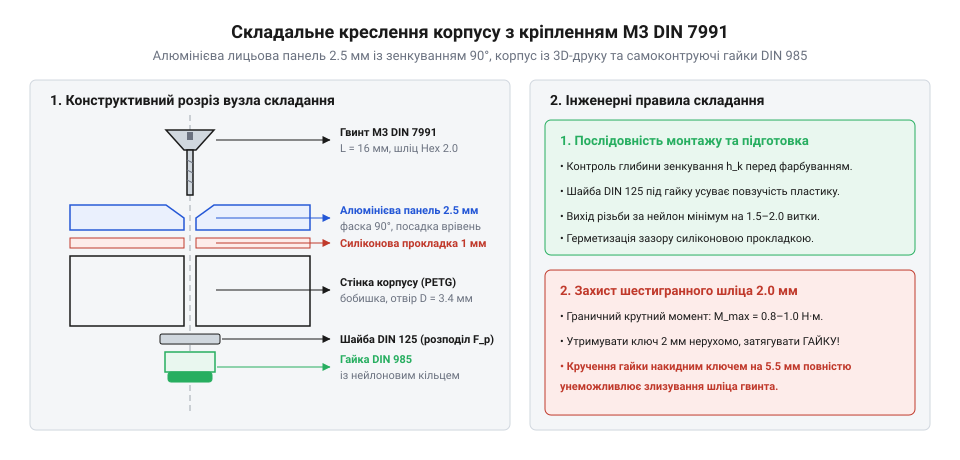

# Практика проєктування та монтажу корпусу приладу на потайних гвинтах М3

<preknowlist>
- [Набір кріплення М2.5 (нікельований)](root:cat-hw-parts/m25-fastener-kit) — Базові принципи застосування метричного кріплення в електроніці
- [Стійки М2/М3 (латунь, нейлон)](root:cat-hw-parts/standoffs) — Монтаж електронних модулів та правила різьбових з'єднань
</preknowlist>

## Проблема виступного кріплення та потайні гвинти

При проєктуванні портативних приладів, лабораторних пристроїв та радіоелектронної апаратури одним із головних конструкторських викликів є отримання ідеально рівної зовнішньої поверхні корпусу. Використання стандартних гвинтів із напівкруглою (ISO 7380) або циліндричною головкою (DIN 912) створює помітні виступи висотою до 3.0 мм над площиною лицьової панелі. У кишенькових вимірювачах чи приладах, що монтуються у стійки впритул один до одного, такі виступні елементи чіпляються за одяг та кабелі, заважають наклеюванню захисного скла чи гнучких клавіатур і підвищують ризик випадкового механічного пошкодження кріплення при падінні.

Розв'язанням цієї інженерної проблеми є перехід на гвинти з потайною головкою стандарту DIN 7991 (міжнародний еквівалент ISO 10642). Геометрія потайного гвинта М3 має конічну опорну поверхню з кутом розкриття 90° та плоску верхню грань, що при правильній посадці лягає строго врівень (употай) із площиною панелі. Це не лише забезпечує естетичний зовнішній вигляд, але й підвищує аеродинамічну та захисну якість корпусу.

Проте потайне з'єднання має специфічні обмеження, які часто ігнорують розробники-початківці. На відміну від плоскої опорної поверхні циліндричної головки, де притискна сила спрямована строго вздовж осі різьби, конічна головка з кутом розкриття 90° під час затягування діє за принципом клина. Осьове зусилля попереднього натягу розкладається на нормальну силу притискання та потужну радіальну складову розклинювання, яка діє на стінки отвору з інтенсивністю, що залежить від половинного кута конуса. У тонкостінних алюмінієвих панелях чи надрукованих на 3D-принтері деталях цей радіальний тиск створює розтяжні тангенціальні напруження, здатні розірвати або спучити крайку деталі навколо монтажного отвору. Якщо ж посадкове конічне гніздо виконано некоректно або товщина панелі менша за висоту головки, виникає дефект ножового краю (англ. *knife-edge*), коли матеріал на стику конуса та отвору стоншується майже до нуля. Під навантаженням цей край пластично зрізається, гвинт провалюється всередину отвору, а натяг з'єднання повністю втрачається.

## Підготовка 3D-моделі та зенкування отворів

Для надійної фіксації панелі необхідно правильно розрахувати параметри отвору та конічної фаски. Номінальний діаметр потайної головки гвинта М3 складає d_k = 6.0 мм, а кут зенкування становить alpha = 90°. Наскрізний отвір для вільного проходження нарізної частини М3 виконують діаметром d_h = 3.4 мм (проміжний зазор середньої точності за ISO 273). Розрахункова глибина конічної частини h_k визначається геометричним співвідношенням:

    h_k = (d_k - d_h) / (2 · tg(45°))
        = (6.0 мм - 3.4 мм) / 2
        = 1.30 мм

При проєктуванні деталей під адитивне виробництво (3D-друк термопластиками PETG або ABS) враховують усадку матеріалу та похибку оплавлення периметрів. У САПР отвір моделюють діаметром 3.5–3.6 мм, а кут конуса закладають рівним 90° з глибиною 1.4 мм, що компенсує вертикальне стиснення шарів і дозволяє голівці гвинта заглибитися на 0.1 мм нижче рівня пластику для гарантованого усунення виступів.

Для алюмінієвих або сталевих панелей (сплав 6061-T6) зенкування виконують конічним тризубим зенкером 90° на свердлильному верстаті на низьких обертах (400–600 об/хв) із застосуванням мастильно-охолоджувальної рідини (ізопропанол або легка мінеральна олива). Для уникнення дефекту knife-edge мінімальна товщина металевої пластини `t_plate` повинна становити не менше 2.0 мм: у такому разі залишковий циліндричний поясок під конусом складе `t_rem = 2.0 мм - 1.3 мм = 0.7 мм`, що перевищує безпечний поріг 0.5 мм і гарантує здатність панелі витримувати натяг. Точність глибини зенкування обов'язково контролюють інструментально: глибиноміром штангенциркуля вимірюють фактичне заглиблення конічної фаски, або використовують еталонний калібр-пробку зі сходинкою допуску. При прикладанні металевої лекальної лінійки до площини панелі над встановленим контрольним гвинтом чи калібром зазор або випинання голівки не повинні перевищувати 0.05 мм, що гарантує бездоганне прилягання накладних сенсорних рамок чи захисного скла.

## Підбір довжин гвинтів та фіксація гайок

Довжина потайного гвинта DIN 7991, на відміну від гвинтів із циліндричними головками, вимірюється на всю довжину виробу разом із конічною головкою. Пакет з'єднання корпусу складається з трьох ключових елементів: лицьової панелі товщиною t_panel, опорного фланця основи корпусу товщиною t_flange та кріпильного елемента (різьбова втулка або гайка).

Для розбірних з'єднань найвищу вібростійкість демонструють самоконтруючі низькі гайки DIN 985, оснащені поліамідним деформованим кільцем-вставкою (нейлоновим фіксатором). Висота гайки DIN 985 М3 становить h_nut = 4.0 мм. Для надійного законтрення нарізний кінець гвинта повинен виступати над верхнім краєм гайки щонайменше на 1.5–2 кроки різьби (для М3 крок P = 0.5 мм, тобто виступ складає delta_L = 1.0 мм). Розрахунок мінімальної номінальної довжини гвинта L_screw виконують за формулою:

    L_screw = t_panel + t_flange + h_nut + delta_L

Наприклад, для панелі товщиною 2.0 мм та фланця корпусу 3.0 мм мінімальна розрахункова довжина дорівнює:

    L_screw = 2.0 + 3.0 + 4.0 + 1.0
            = 10.0 мм

Зі стандартного набору кріплення обирають гвинт М3×10 мм. Якщо застосовується глухе нарізне гніздо у металевій стійці, аналогічно до [монтажу модулів на різьбових стійках](root:cat-hw-parts/standoffs), глибина закручування повинна становити не менше 1.5 діаметра різьби (4.5 мм для алюмінію). У глухих отворах для запобігання самовідкручуванню від вібрації замість контргайок використовують анаеробний фіксатор середньої міцності (синій Loctite 243).

## Порядок складання та контроль моменту затягування

Затягування потайних гвинтів вимагає особливої обережності через геометрію внутрішнього шестигранного шліца (HEX). Для гвинта DIN 7991 М3 розмір під ключ становить s = 2.0 мм, а глибина шліца t складає лише 1.1 мм, що на 45% менше, ніж у гвинта з циліндричною головкою DIN 912. Перевищення крутного моменту або використання зношеного ключа миттєво злизує внутрішні грані заглиблення, перетворюючи шліц на круглий отвір і унеможливлюючи подальше розбирання без висвердлювання.

:::tabs
@tab c
:::code proj-m3-countersunk-enclosure-assembly/c/include/m3_countersink_calc.h
:::code proj-m3-countersunk-enclosure-assembly/c/src/m3_countersink_calc.c
:::code proj-m3-countersunk-enclosure-assembly/c/src/main.c
@tab cpp
:::code proj-m3-countersunk-enclosure-assembly/cpp/include/EnclosureJointCalculator.hpp
:::code proj-m3-countersunk-enclosure-assembly/cpp/src/EnclosureJointCalculator.cpp
:::code proj-m3-countersunk-enclosure-assembly/cpp/src/main.cpp
:::

Складання лицьової панелі корпусу виконують за наступним алгоритмом:

1. Всі гвинти встановлюють у конічні гнізда та наживляють гайки від руки без затягування. Це дозволяє конусам голівок відцентрувати отвори панелі відносно фланця корпусу.

2. За допомогою динамометричної викрутки або якісного Г-подібного ключа затягують гвинти хрест-навхрест (по діагоналях) у два проходи. Попередній прохід роблять із моментом 0.5 Н·м, вирівнюючи прилягання ущільнювальних поверхонь.

3. Остаточний прохід виконують із граничним моментом:
   - для сталевих гвинтів класу міцності 8.8 у парі з алюмінієвою панеллю 6061-T6 момент затягування становить 0.9–1.0 Н·м;
   - для нержавіючих гвинтів А2-70 (м'якший сплав) момент обмежують до 0.7–0.8 Н·м, щоби запобігти зрізанню шліца 2 мм;
   - для корпусів із термопластиків (ABS/PETG) момент не повинен перевищувати 0.4–0.5 Н·м через ризик роздавлювання пластикового конуса та релаксації напружень.

Такий контроль забезпечує жорстку фіксацію деталей без короблення панелі та зберігає цілісність різьбових елементів при повторних розбираннях.