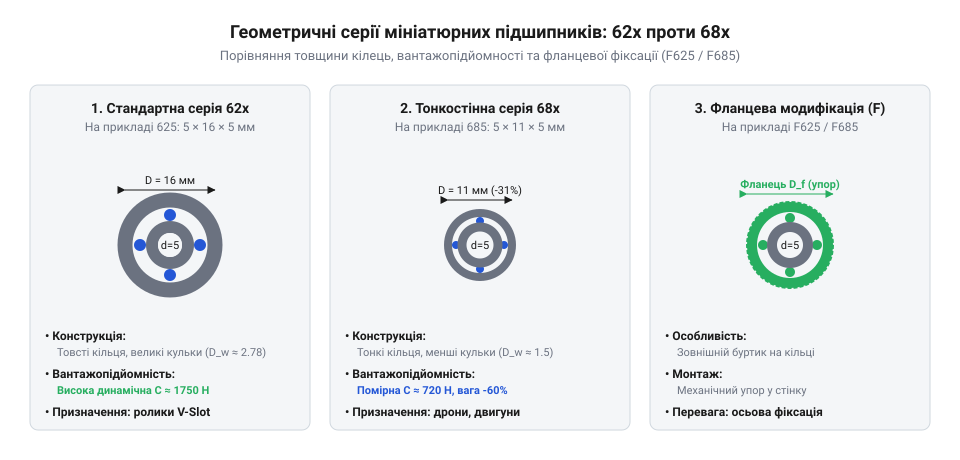

# Геометричні характеристики, допуски та посадки підшипників 623, 625, 685, 686

<preknowlist>
- [Гнучка муфта 5×5 мм](root:cat-hw-parts/flexible-shaft-coupling) — Принципи передачі крутного моменту без радіального перекосу вала
- [Силіконова змазка SI-180](root:cat-hw-parts/silicone-grease) — Сумісність консистентних мастил із матеріалами підшипникових вузлів
</preknowlist>

## Стандартизовані розміри та маркування серій

У малогабаритних приладах, прецизійних механізмах і компактних приводах вантаж та швидкість обертання часто передаються через вузли з надзвичайно обмеженим простором для монтажу. Використання стандартних підшипників тут неможливе, оскільки їхні габарити перевищують доступні посадкові місця у корпусах. Для розв'язання цієї проблеми проєктувальники використовують спеціалізовані серії підшипників, які забезпечують мінімальний зовнішній діаметр при збереженні достатньої несучої здатності та точності обертання. Геометричні співвідношення таких деталей підпорядковуються міжнародним стандартам, що гарантує їхню взаємозамінність у будь-якому обладнанні.

Основою стандартизації мініатюрних деталей є норми ISO 15, які визначають граничні розміри, радіуси заокруглень та допуски для радіальних шарикопідшипників. Відповідно до цих норм, основні розмірні рядки поділяються на кілька серій, серед яких найпоширенішими є стандартна серія `62x` та тонкостінна серія `68x`. Серія `62x` розроблена для помірних навантажень і має відносно товсті кільця, що витримують значні радіальні зусилля. Натомість серія `68x` створена для умов, де радіальний простір критично обмежений: її кільця та тіла кочення тонші, що дозволяє зменшити загальний габарит вузла. У багатьох конструкціях виникає потреба в осьовій фіксації підшипника без використання додаткових стопорних кілець чи кришок; для цього застосовуються модифікації з упорним фланцем на зовнішньому кільці.

*Порівняння розмірних рядів серій 62x та 68x, геометричні параметри d, D, B та упорний фланець D_f.*

Аналіз наведеної схеми дозволяє чітко простежити різницю в геометричних пропорціях між різними виконаннями. Параметр `d` позначає внутрішній діаметр підшипника, який відповідає посадковому місцю на валу. Зовнішній діаметр `D` визначає габарит в отворі корпусу, а ширина `B` характеризує осьовий простір, який займає виріб. Для фланцевих версій ключовим розміром є діаметр фланця `D_f` та його товщина, які забезпечують упор під час осьового позиціонування у сквозному отворі без необхідності виготовлення внутрішнього уступу в корпусі.

Система маркування мініатюрних підшипників побудована за суворими правилами міжнародних кодировок, що дозволяє інженеру миттєво зчитати основні параметри виробу з креслення чи специфікації. Цифровий або буквено-цифровий код містить інформацію про тип конструкції, розмірну серію та номінальний внутрішній діаметр. Наприклад, у позначенні `623` перша цифра `6` вказує на те, що це стандартний однорядний радіальний кульковий підшипник (@@en|deep groove ball bearing@@), цифра `2` визначає серію розмірів `62x`, а кінцева цифра `3` позначає номінальний внутрішній діаметр `d = 3` мм. Аналогічно, маркування `625` означає внутрішній діаметр `5` мм у тій самій серії `62x`. Для тонкостінної серії `68x` прикладом є типорозміри `685` та `686`, де внутрішній діаметр дорівнює відповідно `5` та `6` мм. Якщо ж підшипник має на зовнішньому кільці кільцевий виступ для осьового базування, перед цифровим кодом додається літера `F`, що перетворює позначення на `F623` або `F625`, вказуючи на приналежність до категорії @@en|flanged bearing@@. Точні геометричні параметри ключових типорозмірів регламентовані стандартом:

| Типорозмір | Внутрішній діаметр d, мм | Зовнішній діаметр D, мм | Ширина B, мм | Діаметр фланця D_f, мм | Товщина фланця C, мм |
| :--- | :--- | :--- | :--- | :--- | :--- |
| **623 / F623** | 3.0 | 10.0 | 4.0 | 11.5 | 1.0 |
| **625 / F625** | 5.0 | 16.0 | 5.0 | 18.0 | 1.2 |
| **685 / F685** | 5.0 | 11.0 | 5.0 | 12.5 | 0.8 |
| **686 / F686** | 6.0 | 13.0 | 5.0 | 15.0 | 1.1 |

Подібні компактні вузли часто працюють у складі складних механізмів поряд із такими елементами, як [гнучка муфта 5×5 мм](root:cat-hw-parts/flexible-shaft-coupling), котра компенсує кутові та радіальні перекоси валів, запобігаючи передчасному руйнуванню доріжок кочення.

## Вантажопідйомність та типи ущільнень

Під час обертання вала в опорі виникають складні силові взаємодії між кульками, сепаратором та доріжками кочення внутрішнього і зовнішнього кілець. Здатність витримувати зовнішні зусилля без руйнування матеріалу визначається двома ключовими параметрами: базовою динамічною вантажопідйомністю `C` та базовою статичною вантажопідйомністю `C0`. Динамічна вантажопідйомність `C` розраховується виходячи з умов досягнення базового номінального ресурсу в один мільйон обертів за стандартом ISO 281 і є головним критерієм вибору підшипника для тривалої безперервної роботи: для стандартного підшипника 623 `C ≈ 630 Н` (`C0 ≈ 220 Н`), для 625 `C ≈ 1750 Н` (`C0 ≈ 670 Н`), тоді як для тонкостінної серії 685 через менший діаметр кульок показники становлять `C ≈ 715 Н` (`C0 ≈ 280 Н`), а для 686 — `C ≈ 1080 Н` (`C0 ≈ 440 Н`). Статична вантажопідйомність `C0` за ISO 76 описує граничне допустиме навантаження на нерухомий або повільно хитний підшипник, при якому сумарна залишкова контактна деформація кульки й доріжки не перевищує 0.0001 діаметра тіла кочення (контактний тиск близько 4200 МПа). Перевищення `C0` спричиняє утворення локальних пластичних вм'ятин (бринелювання) та незворотне зростання вібрації. Крім навантажень, каталоги жорстко лімітують граничну частоту обертання: при рідкому змащуванні оливою вона сягає 45 000–50 000 об/хв для 623/685 та 40 000 об/хв для 625, тоді як при застосуванні пластичного консистентного мастила допустима межа швидкості знижується приблизно на 20–25% (до 32 000–38 000 об/хв) через внутрішнє гідродинамічне тертя й нагрівання змащувального шару.

Окрім здатності протистояти навантаженням, довговічність вузла критично залежить від ефективності захисту внутрішньої порожнини від пилу, вологи та сторонніх часточок. У мініатюрних підшипниках застосовуються два основних типи захисних елементів: металеві захисні шайби та гумові контактні ущільнення. Металеві шайби, що маркуються індексом `ZZ`, є безконтактними елементами; вони утворюють мінімальний зазор з канавкою на внутрішньому кільці, завдяки чому не створюють додаткового тертя і дозволяють підшипнику обертатися з максимально можливими частотами. Натомість гумові ущільнення з армованого синтетичного каучуку NBR, які позначаються як `2RS`, утворюють щільний механічний контакт із поверхнею внутрішнього кільця. Таке виконання належить до категорії @@en|contact seal@@ і забезпечує герметичність, що перешкоджає проникненню найдрібніших забруднень, проте створює додатковий момент тертя і дещо знижує граничну швидкість обертання. Для забезпечення стабільного змащування та зниження втрат на тертя в закритих вузлах використовують спеціалізовані мастильні матеріали, зокрема [силіконова змазка SI-180](root:cat-hw-parts/silicone-grease), яка зберігає свої реологічні властивості в широкому діапазоні температур.

## Допуски валів, корпусів та радіальний зазор

Правильний вибір геометричних розмірів підшипника втрачає сенс, якщо посадочні поверхні вала та отвору корпуса виконані з невідповідними допусками. Монтаж підшипника з надмірним натягом призводить до пружного деформування кілець та зменшення внутрішнього зазору, що може спричинити повне заклинювання кульок між доріжками кочення. З іншого боку, занадто вільна посадка викликає прослизання кільця відносно посадкової шийки вала чи стінки корпуса, що спричиняє інтенсивне зношування та руйнування з'єднання. Тому інженери обирають стандартизовані поля допусків за системою ISO, які забезпечують оптимальний характер з'єднання залежно від характеру навантаження та умов експлуатації.

Для посадки внутрішнього кільця на вал у більшості приладів та точних механізмів використовують перехідні посадки або легкі натяги, такі як квалітети `js6` або `h6`. Поле допуску `js6` забезпечує симетричне розташування поля відносно номінального розміру з мінімальним зазором або натягом, що є ідеальним для нерухомого навантаження на вал. Для отворів у корпусах із легких сплавів або сталі застосовують допуски `H7` або `J7`. Посадка в отвір за стандартом `H7` гарантує нульовий або мінімальний зазор, дозволяючи зовнішньому кільцю вільно переміщуватися в осьовому напрямку при температурних коливаннях, тоді як `J7` створює легкий натяг для надійної фіксації зовнішнього кільця.

Взаємозв'язок між натягом посадки та внутрішньою геометрією підшипника безпосередньо впливає на його радіальний зазор (`radial clearance`). Початковий внутрішній зазор підшипників за замовчуванням належить до нормальної групи `C0` (або спеціальної зменшеної групи `MC3` для мініатюрних серій), яка забезпечує мікроскопічний вільний хід тіл кочення. Оскільки при запресовуванні внутрішнього кільця на вал діаметр доріжки кочення збільшується, а при посадці зовнішнього кільця в корпус — зменшується, вільний зазор у змонтованому вузлі скорочується. Для запобігання небезпечній інтерференції посадок (@@en|interference fit@@) і виключення заклинювання необхідно ретельно розраховувати поля допусків деталей, враховуючи нагрів під час роботи та матеріали сполучуваних деталей.