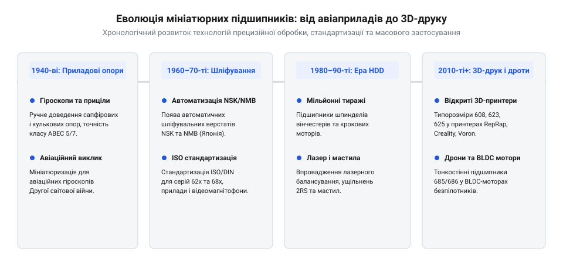

# Історія розвитку та стандартизації мініатюрних підшипників качення

<preknowlist>
- [Гнучка муфта 5×5 мм](root:cat-hw-parts/flexible-shaft-coupling) — Застосування стандартних валів 5 мм у кінематиці
</preknowlist>

## Криза тертя в ранньому приладобудуванні

Розвиток авіації та навігаційних систем у першій половині двадцятого століття зіткнувся з фундаментальною фізичною перешкодою — неконтрольованим опором рухомих з'єднань у компактних приладах. Ранні авіаційні гіроскопи компанії Sperry Gyroscope Company, такі як моделі штучного горизонту Sperry A-2 та автопілота Sperry A-3, вимагали надзвичайно високої плавності обертання роторів зі швидкістю понад 10 000 об/хв. Будь-яка асиметрія в опорі опор викликала паразитний гіроскопічний момент прецесії та швидке накопичення кутової похибки курсу літака. Традиційні опори ковзання, що спиралися на прецизійні бронзові втулки або синтетичні годинникові камені з корунду та сапфіру, спочатку задовольняли стаціонарні прилади завдяки мінімальним розмірам. Однак у динамічних польотних умовах, під дією знакозмінних перевантажень, вібрацій і перепадів температур від -60°C на висоті до +50°C у кабіні, виникали непереборні труднощі динамічного балансування. Мастило в мікроскопічних зазорах втулок швидко окислювалося, густішало або витікало, спричиняючи сухе тертя, заклинювання та катастрофічне дрейфування нульової точки гіроскопа.

Цей феномен, відомий як дрейф моменту тертя або @@en|friction torque drift@@, унеможливлював створення надійних автопілотів для далеких польотів. Інженери намагалися компенсувати втрати на тертя збільшенням потужності привідних електромоторів або застосуванням складних демпфірних систем, але це неминуче суперечило вимогам мініатюризації та зниження маси бортового обладнання. Будь-яке збільшення габаритів приладу вевело до зростання споживання енергії та навантаження на каркас літального апарата. Виникла гостра потреба принципово змінити саму кінематичну схемку та замінити поверхні тертя ковзання на опори кочення зменшеного масштабу. Згодом для таких рішень утвердився термін спеціалізований підшипник або @@en|instrument bearing@@. 

Перехід до кулькових опор у мікромасштабі спочатку здавався тупиковим через технологічні бар'єри механічної обробки. Зменшення розмірів підшипника до зовнішнього діаметра менш як десять міліметрів вимагало виготовлення мікроскопічних кульок діаметром менше міліметра та канавок кочення з субмікронною точністю профілю. Ручне сортування чи класичні токарні методи тут не працювали, оскільки дефекти поверхні чи неоднорідність сталі викликали миттєві мікрозаклинювання. Для передачі обертання від мікромоторів до виконавчих механізмів у таких приладах часто застосовувалися додаткові елементи сполучення, де [Гнучка муфта 5×5 мм](root:cat-hw-parts/flexible-shaft-coupling) дозволяла нівелювати радіальні та кутові зміщення валів, запобігаючи перекосу крихких мініатюрних опор. Проте самі кулькові опори залишалися вузьким місцем інженерії аж до появи промислових технологій надточного шліфування кілець.

## Технологічний прорив та стандартизація ABEC

У сорокових роках двадцятого століття тиск військових замовлень під час Другої світової війни стимулював вибуховий розвиток виробництва прецизійних мікропідшипників у Сполучених Штатах та Японії. Переломним моментом стало заснування у 1941 році інженером Вінслоу Пірсом молодшим (Winslow S. Pierce, Jr.) у місті Кін, штат Нью-Гемпшир, компанії Miniature Precision Bearings (MPB), створеної спеціально для випуску надмалих кулькових опор для бомбових прицілів Нордена та авіаційних гіроскопів. Разом із такими підприємствами, як Barden Corporation (заснована Теодором Барденом для потреб компанії Sperry) та пізніше Nippon Miniature Bearing (NMB), вони розробили принципово нові методи механічної обробки загартованої хромистої сталі ШХ15 (AISI 52100). Ключовим інженерним досягненням стало впровадження високошвидкісного внутрішнього безцентрового шліфування та суперфінішного доведення канавок — прецизійного шліфування доріжок або @@en|precision raceway grinding@@. Використання мікрошпинделів із частотою обертання понад 80 000 об/хв, прецизійного алмазного правлення абразивних кругів та оптичного контролю профілю дозволило досягти мікрошорсткості доріжки Ra < 0.02 мкм, бездоганної концентричності та зниження радіального биття кульок до субмікронного рівня.

Для класифікації точності виготовлення таких мікроопор Асоціація виробників антифрикційних підшипників розробила спеціальну шкалу класів точності ABEC, яка згодом була гармонізована з міжнародними стандартами ISO 15 та DIN 625. Наявність суворого класу точності ABEC або @@en|ABEC tolerance class@@ гарантувала, що радіальні та осьові биття мікропідшипника не перевищують визначених мікронних меж, що було критично для гіроскопічних платформ балістичних ракет і бомбардувальних прицілів.

*Хронологія розвитку прецизійних кулькових опор: від авіаційних гіроскопів Другої світової до відкритої платформи RepRap.*

Історія еволюції мініатюрних опор демонструє неперервний рух від унікальних військових розробок до масових промислових каталогів. Якщо в сорокових роках мікропідшипники виготовлялися одиничними партіями для секретних оборонних проєктів і коштували дорожче за самі прилади, то в шістдесятих-сімдесятих роках стандартизація розмірних рядів серій 62x та 68x перетворила їх на універсальні компоненти загального машинобудування. Виробники навчилися штампувати тонкі сталеві захисні шайби та інтегрувати їх у мікрокорпуси, захищаючи вузли від пилу та бруду без суттєвого збільшення моменту опору. Це заклало фундамент для переходу до побутової електроніки, комп'ютерних дисководів та офісної техніки.

## Ера персонального цифрового виробництва

На початку двадцятого століття ніхто не міг передбачити, що авіаційні мікропідшипники стануть основою домашнього ручного інструменту та побутових пристроїв для творчості. Справжній переворот у поширенні мініатюрних опор стався у двотисячних роках завдяки появі відкритої платформи побутових тривимірних принтерів RepRap та алюмінієвих конструкційних профілів з роликами системи OpenBuilds V-Slot. Усім цим рухомим вузлам потрібні були дешеві, стандартизовані та доступні в кожному куточку світу кулькові підшипники з певними посадковими розмірами.

Типорозміри підшипників 623, 625, 685 та 686 раптово перетворилися на абсолютні світові стандарти завдяки глобальному руху відкритих апаратних платформ або @@en|open-source hardware standard@@. Розробники перших доступних 3D-принтерів свідомо проєктували деталі рами та кареток під ці конкретні номенклатурні номери, оскільки їх масово випускали заводи в Китаї та Індії завдяки автопрому і ринку побутової техніки. Паралельно бурхливий розвиток ринку компактних квадрокоптерів і безколекторних електродвигунів вимагав надзвичайно легких опор, здатних витримувати високі оберти без заклинювання.

Проте перехід до масового ринку оголив глибокий технологічний компроміс масового виробництва або @@en|mass manufacturing compromise@@. Дешеві підшипники з ринку часом постачалися з мінімальною кількістю неякісного консистентного мастила або взагалі без захисту від корозії. Для досягнення тиші та довговічності у вузлах побутових верстатів інженери змушені ретельно промивати підшипники та закладати спеціалізовані суміші, де якісна [Силіконова змазка SI-180](root:cat-hw-parts/silicone-grease) забезпечує стабільне зниження тертя і захищає металеві кульки від вологи без агресивного впливу на пластикові деталі конструкції. Таким чином, шлях мініатюрних підшипників замкнувся: від секретних військових гіроскопів через сувору стандартизацію до всесвітньої доступності в кожному гаражному стартапі та цифровій майстерні.