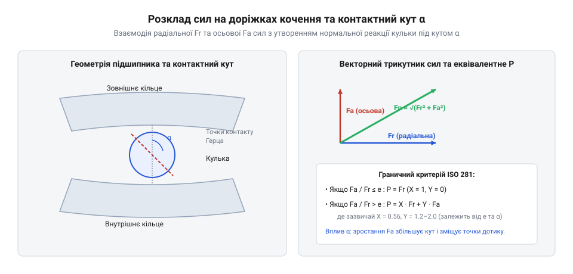

# Математичний розрахунок навантажень, ресурсу та посадок мініатюрних підшипників

<preknowlist>
- [Гнучка муфта 5×5 мм](root:cat-hw-parts/flexible-shaft-coupling) — Компенсація кутових і радіальних неспіввісностей
</preknowlist>

## Еквівалентне навантаження та контактний кут

Під час роботи мініатюрних підшипників у складі механічних вузлів на їхні елементи кочення діють не лише чисті радіальні чи осьові сили, а їхня комбінація. Радіальні навантаження спрямовані перпендикулярно до осі обертання вала, тоді як осьові навантаження діють уздовж неї. Через конструктивні особливості радіальних кулькових підшипників, які часто з'єднуються з валами через елементи на зразок @@en|flexible shaft coupling@@ [Гнучка муфта 5×5 мм](root:cat-hw-parts/flexible-shaft-coupling), точки контакту кульок із доріжками кочення розташовані під певним кутом до площини обертання. Цей кут називається @@en|contact angle@@ (контактний кут) `α`. Під дією осьової сили `F_a` та радіальної сили `F_r` вектори навантажень передаються через тіла кочення на кільця підшипника під нахилом, що вимагає переведення складної просторової системи сил до єдиного розрахункового параметра — @@en|equivalent dynamic load@@ (еквівалентного динамічного навантаження) `P`.

Згідно зі стандартом ISO 281, безпосередньо порівнювати змінні або комбіновані навантаження з лабораторними характеристиками підшипника неможливо, оскільки випробування базової динамічної вантажопідйомності проводяться за чистим радіальним навантаженням. Тому виникає потреба в математичній моделі, яка зводить комбінований вплив `F_r` та `F_a` до еквівалентної радіальної сили, що створює аналогічний втомний ефект. Для популярного мікропідшипника серії 608 (базова статична вантажопідйомність C_0 = 1370 Н) граничний поріг визначається за співвідношенням f_0 · F_a / C_0: зазвичай e становить від 0.22 до 0.38. Якщо відношення осьового навантаження до радіального F_a / F_r ≤ e, то радіальний фактор X = 1, а осьовий Y = 0, тому підшипник сприймає силу виключно за радіальним фактором. Якщо ж навантаження перевищує поріг (F_a / F_r > e), то приймають X = 0.56, а коефіцієнт Y зростає в діапазоні від 1.4 до 2.0 залежно від напруження на доріжці кочення, що суттєво підвищує еквівалентне навантаження P.


*Розклад комбінованих сил Fr та Fa на доріжках качення та формування робочого кута контакту alpha.*

Фізичний зміст граничного коефіцієнта `e` полягає у визначенні межі, за якою кут контакту `α` починає змінюватися під навантаженням, викликаючи перерозподіл зусиль між тілами кочення. Значення `e` залежить від конструктивного відношення осьового зазору та початкового кута контакту. Розрахунок еквівалентного динамічного навантаження виконується за умовою порівняння співвідношення сил із табличним порогом:

```
P = X · F_r + Y · F_a       [якщо відношення Fa / Fr ≤ e]
P = F_r                     [якщо осьове навантаження відсутнє або незначне]
```

Якщо ж `F_a / F_r > e`, формула набуває розширеного вигляду з урахуванням констант `X` та `Y`, які для мініатюрних підшипників наводяться в каталогах виробників залежно від відношення осьового зусилля до базової статичної вантажопідйомності. У такому разі еквівалентне навантаження визначається як сума зважених компонентів:

```
P = X · F_r + Y · F_a       [розрахунок еквівалентного навантаження при Fa / Fr > e]
= 0.56 · F_r + 1.25 · F_a   [стандартні коефіцієнти для глибоких жолобів при високому осьовому тиску]
```

Завдяки цьому перетворенню інженер отримує єдине скалярне значення `P`, яке повністю характеризує руйнівний вплив складного напружено-деформованого стану на доріжки кочення та кульки підшипника.

## Розрахунок ресурсу за стандартом ISO 281

Після визначення еквівалентного навантаження `P` виникає наступна інженерна задача — прогнозування довговічності підшипника до появи перших ознак втоми матеріалу (втумного викришування або пітингу). Базовим критерієм оцінки є @@en|basic rating life@@ (номінальний ресурс) `L_10`, виражений у мільйонах обертів. Цей показник описується степеневою залежністю @@en|fatigue life equation@@ (рівнянням втомного ресурсу), де базою є відношення динамічної вантажопідйомності `C` до еквівалентного навантаження `P`. Показник степеня для кулькових підшипників дорівнює трьом, що відображає нелінійну втомну міцність контактних поверхонь за теорією Герца.

Математична модель номінального ресурсу в мільйонах обертів виводиться з емпіричних даних випробувань підшипників на втомну довговічність:

```
L_10 = (C / P)³             [базове рівняння номінального ресурсу за ISO 281]
= (C / P) · (C / P) · (C / P) [розгортання кубічної залежності втомного руйнування]
```

Оскільки на практиці швидкість обертання вузла вимірюється в обертах за хвилину, номінальний ресурс зручно переводити в робочі години `L_10h`. Для цього враховується частота обертання `n`, переведена в обрти за годину шляхом множення на шістдесят. Розрахунок годинного ресурсу здійснюється за допомогою наступного виразу:

```
L_10h = (10⁶ / (60 · n)) · L_10 [переведення мільйонів обертів у години роботи]
= (10⁶ / (60 · n)) · (C / P)³   [повна формула номінального ресурсу в годинах]
```

Проте реальні умови експлуатації мініатюрних підшипників рідко відповідають ідеальним лабораторним умовам. На довговічність суттєво впливають якість мастила (чи забезпечено розділення поверхонь стійкою мастильною плівкою, наприклад, із застосуванням спеціальних засобів на зразок @@en|silicone grease@@ [Силіконова змазка SI-180](root:cat-hw-parts/silicone-grease)), чистота робочого середовища та наявність твердих забруднювачів. Для врахування цих факторів стандарт ISO 281 запроваджує скоригований ресурс `L_na`, який множить базовий показник на спеціальний коефіцієнт `a_ISO`.

Коефіцієнт `a_ISO` інтегрує параметри надійності, чистоти робочого середовища та ефективності гідродинамічної мастильної плівки. Ключовим критерієм розділення поверхонь є коефіцієнт в'язкості `κ = ν / ν_1`, що обчислюється як відношення фактичної кінематичної в'язкості оливи чи базової оливи пластичного мастила `ν` при робочій температурі до номінальної мінімально необхідної в'язкості `ν_1`, розрахованої за середнім діаметром підшипника d_m та частотою обертання n. Якщо `κ < 1`, гідродинамічний шар руйнується, виникає режим граничного тертя зі схопленням мікронерівностей, через що коефіцієнт `a_ISO` стрімко падає нижче одиниці. Навпаки, забезпечення режиму `κ ≥ 2...4` гарантує повне пружногідродинамічне розділення кульок і доріжок, піднімаючи `a_ISO` до максимальних значень. Розрахунок скоригованого ресурсу виконується за формулою:

```
L_na = a_ISO · L_10         [розрахунок скоригованого ресурсу з урахуванням умов експлуатації]
= a_ISO · (C / P)³          [інтеграція мастильного та екологічного факторів у рівняння втоми]
```

Такий підхід дозволяє конструктору уникати передчасних відмовлянь вузла, заздалегідь підбираючи клас підшипника та систему ущільнення під реальні експлуатаційні навантаження.

## Зазори, посадковий натяг та попереднє стискання

Під час монтажу мініатюрних підшипників у корпуси та на ваги виникає критичний фактор, що впливає на геометрію контакту — зміна внутрішнього радіального зазору. Початковий зазор підшипника призначений для компенсації теплових розширень та зменшення посадкових натягів. Проте при запресовуванні внутрішнього кільця на вал або зовнішнього в корпус відбувається пружна деформація кілець, що призводить до зменшення внутрішнього простору. Це явище описується як @@en|radial clearance reduction@@ (редукція радіального зазору) `Δ_r`.

Якщо посадковий натяг перевищує допустимі значення, радіальний зазор може повністю зникнути, що призведе до заклинювання кульок, різкого зростання тертя, перегріву та руйнування вузла. Математичне моделювання редукції зазору враховує величину ефективного натягу на валу та в корпусі, а також товщину стінок кілець:

```
Δ_r = Δ_eff_shaft + Δ_eff_housing [сумарна редукція зазору від посадкових натягів кілець]
= δ_eff_i · f_i + δ_eff_o · f_o   [врахування ефективних натягів та геометричних коефіцієнтів кілець]
```

Окрім механічних натягів, на зазор впливає температурний перепад між внутрішнім і зовнішнім кільцями. Оскільки внутрішній вал часто нагрівається сильніше від робочих елементів, його теплоємність та розширення зменшують зазор додатково. Для забезпечення стабільної роботи високоточних мікромеханізмів часто застосовують @@en|axial preload force@@ (осьове попереднє натягування) `F_preload`. Попередній натяг усуває радіальний та осьовий люфти, підвищує жорсткість опори та запобігає прослизанню кульок при високих швидкостях обертання.

Розрахунок мінімального зусилля осьового натягу базується на необхідності подолати зовнішні змінні сили та забезпечити стабільний кут контакту без перевантаження тіл кочення:

```
F_preload = K_a · F_a_max   [визначення мінімальної сили натягу за максимальним осьовим зусиллям]
= 1.5 · F_a_max             [коефіцієнт запасів для стабілізації положення кульок у доріжках]
```

Правильно розрахований попередній натяг разом із контрольованими посадками гарантує мінімальне биття вала, плавний хід та максимальний ресурс мікропідшипника в реальних умовах експлуатації.