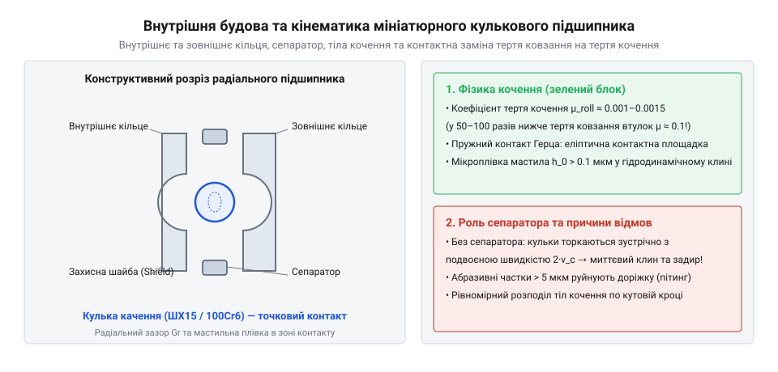
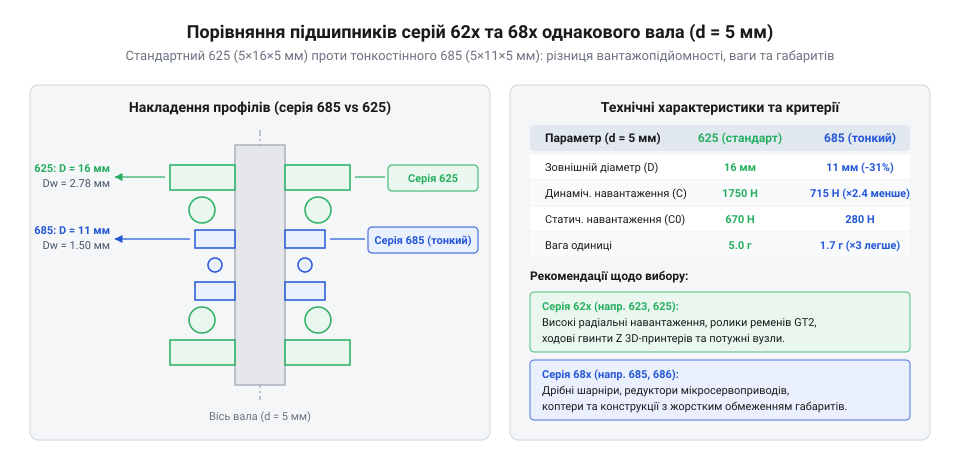
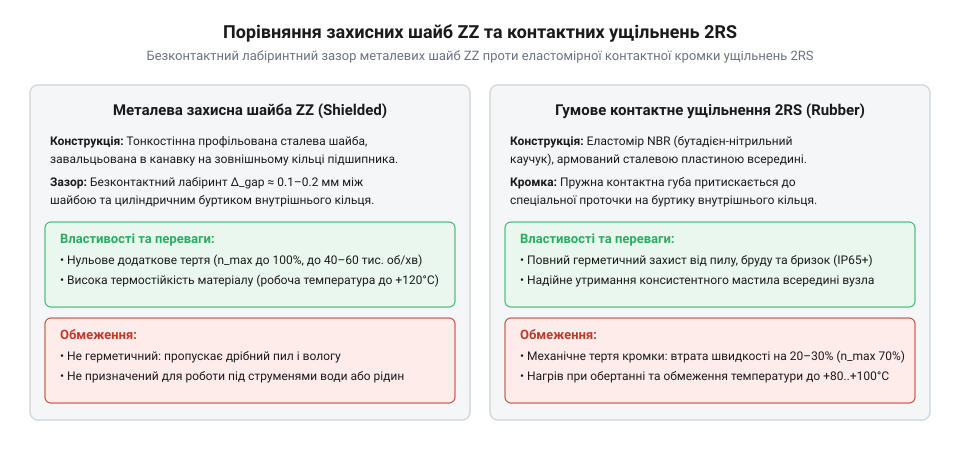
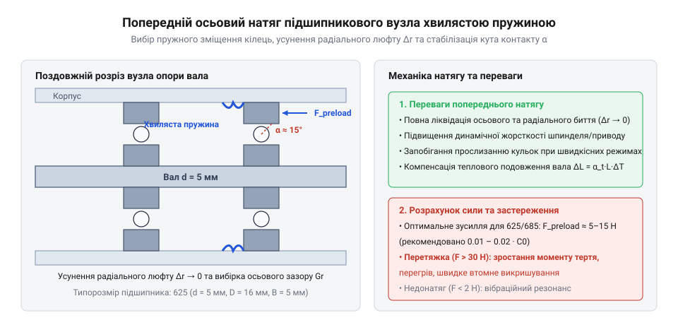
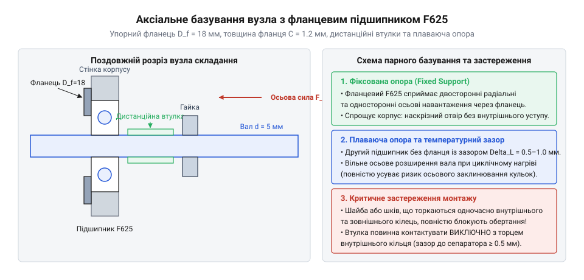

# Мініатюрні кулькові підшипники (623, 625, 685, 686)

<preknowlist>
- [Гнучка муфта 5×5 мм](root:cat-hw-parts/flexible-shaft-coupling) — принципи компенсації несоосності валів та відсутність передачі паразитичних радіальних навантажень на підшипникові опори
- [Силіконова змазка SI-180](root:cat-hw-parts/silicone-grease) — фізико-хімічні властивості силіконових пластичних мастил, діапазон робочих температур та сумісність із захисними ущільненнями 2RS
</preknowlist>

## Тертя та люфти в мікромеханізмах

Під час проєктування малогабаритних механічних вузлів — екструдерів 3D-принтерів, сервоприводів робототехніки, підвісів камер та настільних верстатів ЧПУ — розробники часто намагаються спростити конструкцію, встановлюючи вали безпосередньо в отвори деталей або використовуючи прості @@de|втулка ковзання@@ (нім. *Hülse* — гільза, втулка). На перших етапах таке рішення здається компактним та дешевим, проте під час роботи вузла під навантаженням проявляються нищівні фізичні обмеження.

Головна проблема втулок ковзання в мікромеханізмах — високий коефіцієнт @@en|тертя ковзання@@ (англ. *sliding friction*), який для пар трення «метал–пластик» або «метал–метал» без примусового рідкого змащування становить від 0.15 до 0.30. У малогабаритних приводах із кроковими двигунами NEMA 14 чи NEMA 17 таке тертя відбирає значну частку крутного моменту, викликає локальне нагрівання та прискорює знос. Крім того, при мікрокроковому позиціонуванні виникає ефект «переривчастого ковзання» (англ. *stick-slip*), коли сухе тертя спокою значно перевищує тертя руху, викликаючи ривки й втрату точності.

Паралельно з тертям виникає технологічний @@de|люфт@@ (нім. *Luft* — повітря, вільний простір між деталями). У результаті абразивного зносу матеріалу отвору посадочний зазор між валом і втулкою стрімко зростає. У 3D-принтерах радіальний та осьовий @@de|люфт@@ у декілька десятих часток міліметра призводить до перекосу ходових гвинтів, виникнення воблінгу (неперервної хвилястості вертикальних стінок виробу) та деградації повторюваності позиціонування друкуючої голівки.

Конструктивним розв'язком цієї проблеми є заміна тертя ковзання на @@en|тертя качення@@ (англ. *rolling friction*) за допомогою мініатюрних кулькових підшипників. Завдяки контактній взаємодії загартованих сталевих кульок із доріжками качення коефіцієнт тертя знижується до 0.0015–0.003, тобто у 50–100 разів порівняно із втулками ковзання. Це дозволяє механізму працювати плавно, без виділення надлишкового тепла та з відсутністю ефекту stick-slip навіть при високих радіальних навантаженнях.

Мініатюрний радіальний кульовий підшипник складається з чотирьох основних конструктивних елементів:

1. **Зовнішнє кільце (outer ring):** Монтується в корпус механізму. На його внутрішній поверхні вишліфовано тороїдальну канавку — зовнішню доріжку качення. 2. **Внутрішнє кільце (inner ring):** Фіксується на обертовому валу та має зовнішню доріжку качення. 3. **Кульки качення (rolling elements):** Виготовляються з високохромистої підшипникової сталі (100Cr6 / ШХ15) або корозійностійкої сталі (AISI 440C) з точністю сферичної форми до часток мікрона. 4. **@@la|сепаратор@@ (лат. *separator* — розділювач):** Штампована металева або профільна полімерна обойма, яка утримує кульки на однаковій кутовій відстані одна від одної.

Роль сепаратора є критичною: без нього сусідні кульки в зоні навантаження торкалися б одна одної. Оскільки поверхні суміжних кульок у точці контакту рухаються в протилежних напрямках, відсутність сепаратора викликала б миттєве зростання тертя ковзання, задири металу та заклинювання підшипника.


*Внутрішньоконструктивні елементи мініатюрного кулькового підшипника: радіальний контакт між кульками та доріжками качення зовнішнього і внутрішнього кілець.*

Розвиток мініатюрних підшипників розпочався з потреб точної механіки XX століття — авіаційних гіроскопів, годинникових механізмів та приладів військової техніки. Згодом параметри мініатюрних підшипників були суворо стандартизовані за міжнародними нормами ISO та ANSI, що дозволило створити уніфіковані серії підшипників, доступні для масового використання у робототехніці та 3D-друку. Докладніше про етапи [історії стандартизації приладових](root:cat-hw-parts/miniature-ball-bearings/hist-miniature-bearings-evolution.md) підшипників качення можна дізнатися у відповідній історичній довідці.

Кожен готовий підшипник володіє первинним внутрішнім @@la|радіальний зазор@@ (лат. *radialis* — променевий, вихідний зазор між кульками та доріжками). Від величини цього зазору та правильності вибору серії залежить жорсткість підшипникового вузла, його здатність протистояти деформаціям під дією зовнішніх сил та відсутність люфтів під час експлуатації.

## Вибір між серіями 62x та 68x

Після прийняття рішення про використання кулькових підшипників перед розробником постає завдання вибору конкретної стандартизованої серії. У малогабаритних механізмах основними конкуруючими родинами є середня серія 62x та тонкостінна серія 68x. Найпопулярнішими типорозмірами в конструкціях 3D-принтерів, сервоприводів та механізмів чпу є 623, 625, 685 та 686.

Геометричні й конструктивні відмінності між цими серіями визначають їхню поведінку під навантаженням:

* **Силова серія 62x (на прикладі 623 та 625):**
  - Підшипник 623: внутрішній діаметр d = 3 мм, зовнішній діаметр D = 10 мм, ширина B = 4 мм. - Підшипник 625: внутрішній діаметр d = 5 мм, зовнішній діаметр D = 16 мм, ширина B = 5 мм. - Особливість: відносно велика товщина стінок кілець та збільшений діаметр кульок. Товсті кільця забезпечують високу структурну жорсткість та стійкість до овальної деформації під час запресування в пластикові або алюмінієві корпуси.

* **@@en|тонкостінна серія@@ 68x (англ. *thin-section series*, на прикладі 685 та 686):**
  - Підшипник 685: внутрішній діаметр d = 5 мм, зовнішній діаметр D = 11 мм, ширина B = 3 мм. - Підшипник 686: внутрішній діаметр d = 6 мм, зовнішній діаметр D = 13 мм, ширина B = 5 мм. - Особливість: гранично зменшений радіальний переріз. Порівняно з 625, підшипник 685 розрахований на той самий вал діаметром 5 мм, проте його зовнішній діаметр становить лише 11 мм проти 16 мм у 625. Це дозволяє радикально зменшити радіальні габарити та масу вузла.


*Геометричні відмінності між підшипниками 625 та 685 при однаковому діаметрі вала 5 мм: зменшення радіального профілю в серії 68x заощаджує простір, але знижує граничні навантаження.*

Зменшення радіального профілю в серії 68x вимагає використання кульок меншого діаметра, що безпосередньо впливає на силові характеристики. Здатності підшипника протистояти руйнуванню оцінюються двома базовими параметрами:

1. **@@en|динамічна вантажопідйомність@@ (англ. *dynamic load rating*, позначення C):** Постійне радіальне навантаження, яке група ідентичних підшипників витримує протягом 1 мільйона обертів до появи перших ознак втомного викришування металу на 10% зразків. 2. **@@en|статична вантажопідйомність@@ (англ. *static load rating*, позначення C₀):** Навантаження, яке викликає сумарну залишкову пластичну деформацію кульки та доріжки качення в точці найвищого напруження, що не перевищує 0.0001 від діаметра кульки.

Для порівняння: підшипник 625 має динамічну вантажопідйомність C ≈ 1730 Н та статичну C₀ ≈ 670 Н. У тонкостінного підшипника 685 при тому ж внутрішньому діаметрі 5 мм динамічна вантажопідйомність становить лише C ≈ 430 Н, а статична C₀ ≈ 190 Н. Тобто підшипник серії 625 здатен витримувати більш ніж у чотири рази більше динамічне навантаження, ніж 685.

Під час розрахунку ресурсу підшипника сумісну дію радіального Fᵣ та осьового Fₐ навантажень зводять до еквівалентного динамічного радіального навантаження P за формулою:

```
P = X · Fᵣ + Y · Fₐ
```
[де X — радіальний коефіцієнт навантаження, Y — осьовий коефіцієнт навантаження]

Після цього розраховують номінальний ресурс L₁₀ (у мільйонах обертів) згідно з міжнародним стандартом ISO 281:

```
L₁₀ = (C ÷ P)³
```
[де C — динамічна вантажопідйомність, P — розраховане еквівалентне навантаження, кубічний показник степеня відповідає кульковим підшипникам]

Вичерпний порядок обчислення еквівалентних сил, значень коефіцієнтів X та Y залежно від зазору, а також розрахунок ресурсу в годинах безперервної роботи наведено у матеріалі, що описує [методику розрахунку ресурсу](root:cat-hw-parts/miniature-ball-bearings/math-miniature-bearings-calculation.md) та еквівалентних навантажень підшипників. Довідникові значення допусків кілець, рекомендовані посадки на вал і в корпус та геометричні таблиці доступні у посібнику, де зібрані [довідникові геометричні допуски](root:cat-hw-parts/miniature-ball-bearings/api-miniature-bearings-spec-and-fits.md) для 623, 625, 685 та 686.

Практичні правила вибору серії для проєктування вузлів формулюються так:

* **Обирайте серію 62x (623, 625), якщо:**
  - Вузол зазнає значного натягу ременів (наприклад, обвідні ролики ременів GT2 у 3D-принтерах схеми CoreXY чи Prusa). - Навантаження прикладене з консольним вилетом, що створює високий згинальний момент на валу. - Корпус виготовлено з 3D-друкованого пластику (PETG, ABS), де через нерівномірність посадочного отвору тонке кільце підшипника 68x могло б зігнутися овалом. - Потрібна максимальна радіальна жорсткість та захист від ударних навантажень.

* **Обирайте серію 68x (685, 686), якщо:**
  - Жорстко обмежені зовнішні радіальні габарити та маса каретки або поворотного вузла робота. - Вал має порівняно великий діаметр (наприклад, 5 мм або 6 мм), проте радіальне навантаження є незначним (наприклад, опора поворотної осі легкого датчика або напрямна філаменту). - Вузол монтується в прецизійний металевий корпус (оброблений алюміній або латунь), який гарантує ідеальну циліндричність посадочного отвору.

Після визначення серії підшипника наступним етапом є вибір типу захисних елементів (відкриті, металеві шайби ZZ або контактні гумові ущільнення 2RS) для запобігання витіканню змазки та захисту від пилу.

Крім того, для запобігання передчасному зносу доріжок качення через згинальні моменти та перекоси валів використовують вузли [компенсації несоосності валів](root:cat-hw-parts/flexible-shaft-coupling). Покрокові інструкції з проєктування корпусних деталей, вибору фланцевих версій F623/F625 та регулювання зазору описані в керівництві, що розкриває [принципи створення попереднього](root:cat-hw-parts/miniature-ball-bearings/proj-miniature-bearing-assembly-and-preload.md) натягу та монтажу підшипників. Правильний вибір мастильних матеріалів, зокрема [силіконових пластичних мастил](root:cat-hw-parts/silicone-grease), гарантує довговічну та безшумну роботу підшипникового вузла.

## Захист доріжок качення та змащування

Навіть ідеально підібраний за динамічною вантажопідйомністю підшипник серії 62x чи 68x може повністю вийти з ладу за кілька годин роботи, якщо його доріжки качення не захищені від зовнішнього середовища або позбавлені мастильного матеріалу. У малогабаритних механізмах — екструдерах 3D-принтерів, шарнірах роботів чи ходових гвинтах — діаметр кулькових елементів становить лише від 1.0 до 2.5 мм, а робочий радіальний зазор вимірюється мікронами. Потрапляння в зону контакту кульки з доріжкою качення єдиної твердої частки пилу розміром 10–20 мкм діє подібно до клина. Під дією контактного напруження, яке сягає 1.5–3.0 ГПа, пилинка викликає локальну пластичну деформацію полірованої сталі з утворенням мікрократера з піднятими краями. Кожен наступний прохід кульки вдаряє об цей край, провокуючи підповерхневі втомні тріщини, інтенсивний шум та швидке викришування металу. З іншого боку, відсутність захисту призводить до швидкого витікання або вибризкування мастила під дією відцентрових сил, що перетворює тертя качення на сухе металеве тертя з миттєвим перегріванням і заклинюванням.

Для запобігання цим явищам мініатюрні кулькові підшипники виготовляють у трьох базових конструктивних виконаних захисту:

* **Відкриті підшипники (без додаткового індексу):**
  Конструктивно позбавлені бічних кришок, залишаючи кульки та сепаратор повністю відкритими. Відсутність ущільнювальних елементів означає повну відсутність додаткового механічного опору, що забезпечує мінімальний стартовий та робочий момент тертя. Завдяки цьому відкриті підшипники мають найвищу @@en|гранична частота обертання@@ (англ. *limiting speed* — максимально допустима швидкість обертання без ризику перегріву). Проте вони абсолютно незахищені від пилу та вимагають постійної подачі мастила із зовнішньої герметичної масляної ванни чи системи туманоутворення. У відкритому повітрі приладових вузлів їхнє застосування недоцільне.

* **Металеві захисні шайби (індекс ZZ або 2Z):**
  Використовують тонкі профільовані сталеві пластини, завальцьовані або зафіксовані в канавках зовнішнього кільця. Спеціальна @@en|захисна шайба@@ (англ. *shield*, від *to shield* — захищати) утворює з циліндричною поверхнею внутрішнього кільця вузький лабіринтний або щельовий зазор шириною близько 0.1 мм. Оскільки металева шайба не торкається внутрішнього кільця, що обертається, вона не створює додаткового тертя ковзання. Поверхневий натяг пластичного мастила у вузькому зазорі утворює динамічний мікроменіск, який додатково затримує дрібні частки. Підшипники з індексом ZZ заправляються пластичним мастилом на заводі на весь термін служби. Вони надійно утримують мастило всередині та захищають доріжки качення від великих часток пилу, стружки чи пластикового абразиву 3D-друку, зберігаючи високу швидкохідність.

* **Гумові контактні ущільнення (індекс 2RS, 2RS1 або LLU):**
  Оснащуються еластомірними накладками з синтетичного нітрильного каучуку (NBR), армованого тонким сталевим каркасом. Еластична кромка, якою володіє @@en|контактне ущільнення@@ (англ. *contact seal* — герметизуючий елемент притискного типу), з легким натягом спирається на спеціальну канавку внутрішнього кільця. Це створює герметичний бар'єр, який повністю блокує проникнення дрібного дисперсного пилу, вологи та бризок рідини, а також унеможливлює витікання мастила навіть при сильних вібраціях. Ціною абсолютної герметичності є постійний @@en|момент тертя@@ (англ. *friction torque* — опір обертанню від механічного притиску кромки).

Механічна потужність втрат на тертя в контактному ущільненні розраховується за формулою:

```
P_friction = M_friction · ω
```
[де M_friction — момент тертя ущільнення, ω — кутова швидкість обертання вала]

Цей момент тертя підвищує самонагрівання підшипника та знижує його граничну частоту обертання приблизно на 30–50% порівняно з безконтактною версією ZZ.


*Порівняльний розріз конструкцій захисних шайб ZZ та контактних ущільнень 2RS: безконтактний зазор шайби ZZ мінімізує тертя, тоді як притискна кромка 2RS забезпечує повну герметичність.*

Окрім вибору конструкції захисних кришок, критичну роль відіграє тип та кількість мастильного матеріалу. У мініатюрних кулькових підшипниках рідкі оливи застосовують вкрай рідко — переважно у високопрецизійних шпинделях чи гіроскопах із примусовим змащуванням. У 95% приладових застосувань використовують пластичні мастила, що складаються з базової оливи, згущеної мильним або синтетичним каркасом. У зоні контакту кульки з доріжкою створюється режим еластогідродинамичного змащування (EHL), де тонкий шар оливи товщиною 0.1–1.0 мкм під надвисоким тиском тимчасово набуває властивостей твердого тіла, розділяючи металеві поверхні.

Під час заповнення підшипника пластичним мастилом виникає поширена пастка: прагнення закласти якнайбільше мастила. Якщо внутрішній вільний простір заповнити мастилом повністю (на 100%), під час обертання кульки почнуть інтенсивно перемішувати мастильну масу, викликаючи високий гідродинамічний опір. Це призводить до стрімкого перегріву вузла, розрідження мастила та його видавлювання крізь ущільнення. Для високих та середніх обертів нормативна ступінь заповнення становить лише від 20% до 30% вільного об'єму підшипника.

Серед мастильних речовин особливе місце посідають синтетичні складники. Фізико-хімічні властивості [силіконових пластичних мастил](root:cat-hw-parts/silicone-grease) забезпечують широкий діапазон робочих температур (від -40 °C до +180 °C), високу термоокислювальну стабільність та абсолютну хімічну інертність до синтетичних еластомерів NBR. На відміну від деяких мінеральних олив, які викликають набухання чи розтріскування гумових крайок 2RS, силіконові мастильні матеріали зберігають еластичність ущільнень протягом усього терміну експлуатації.

На практиці вибір типу захисту здійснюють за такими критеріями:

* **Обирайте металеві шайби ZZ:** Для натяжних роликів GT2 та кареток 3D-принтерів, ходових гвинтів та високошвидкісних мікромоторів, де першочерговими є низьке тертя, мінімальний крутний момент та висока частота обертання при відсутності прямого контакту з рідинами. * **Обирайте гумові ущільнення 2RS:** Для поворотно-рухомих шарнірів роботів, колісних модулів, вузлів, що працюють у запилених приміщеннях, на вулиці або в умовах підвищеної вологості, де надійний захист від бруду важливіший за втрати на тертя.

Оформлений та змащений підшипник готовий до встановлення, однак його працездатність остаточно визначається точністю монтажних посад на вал та в корпус.

## Посадки та компенсація температурних розширень

Навіть найякісніший підшипник із належно вибраним ущільненням втратить свої характеристики під час збірки, якщо розміри посадочних поверхонь вала й корпуса визначені без урахування допусків. Конструктор-початківець стикається з двома протилежними небезпеками:

1. **Занадто вільна посадка (зазор між кільцем і детальною поверхнею):**
   Якщо посадити внутрішнє кільце на вал із зазором, під дією радіального навантаження кільце починає прокручуватися й обкочуватися по валу. Постійне мікроковзання руйнує цементаційний шар металу, викликає @@en|фретинг-корозія@@ (англ. *fretting corrosion*, від *to fret* — протирати, зношувати — утворення іржі та дрібних часток зносу через мікрозміщення). У результаті прецизійний вал розбивається, виникає радіальне биття та люфт. 2. **Занадто щільна посадка (надмірний натяг при запресуванні):**
   Коли підшипник запресовують на вал зі значним натягом, тонкостінне внутрішнє кільце розтягується назовні. Аналогічно, при щільному запресуванні зовнішнього кільця в жорсткий корпус воно стискається всередину. У результаті початковий вихідний радіальний зазор між кульками та доріжками качення повністю зникає. Кульки виявляються затиснутими між кільцями ще до прикладання зовнішнього навантаження, що викликає величезні контактні напруження, важкий хід, гул і швидкий абразивний знос.

Щоб уникнути цих крайнощів, вибір допусків здійснюють за принципом виду навантаження. Загальне правило свідчить: кільце, яке обертається відносно вектора радіального навантаження, повинно мати посадку з натягом, а кільце, яке є нерухомим відносно навантаження, монтується з зазором або по перехідній посадці.

Конструктивно це реалізується за допомогою стандартних квалітетів та відхилень:

* **@@en|посадка з натягом@@ (англ. *interference fit* або *press fit*):**
  Застосовується для внутрішнього кільця при обертовому валу. Для мініатюрних валів діаметром 3–6 мм використовують поля допусків вала `k5`, `m5` або `js6`. Завдяки тому, що допуск внутрішнього отвору підшипника виконується від нульової лінії в мінус (наприклад, 0...-8 мкм), посадка на вал `k5` гарантує натяг у межах від 2 до 8 мкм, що достатньо для запобігання прокручуванню кілець. * **@@de|посадка з зазором@@ (англ. *clearance fit*):**
  Застосовується для зовнішнього кільця, якщо воно нерухомо встановлюється в корпус. Стандартним полем допуску отвору корпуса є `H7` або `J7`. Зазор від 2 до 12 мкм дозволяє зовнішньому кільцю вільно монтуватися без деформації та компенсувати осьові переміщення при нагріванні. * **@@de|перехідна посадка@@ (англ. *transition fit*):**
  Застосовується у вузлах високої точності (поля `js6` або `K7`), де залежно від фактичних розмірів виготовлених деталей може виникнути як незначний зазор, так і легкий натяг.

При розрахунку посадок обов'язково враховують вихідний клас радіального зазору підшипника (`CN`, `C2` або `C3`). Зменшення радіального зазору при запресуванні обчислюється за наближеною залежністю:

```
ΔGr ≈ 0.8 · Δd_n
```
[де ΔGr — зменшення радіального зазору, Δd_n — ефективний натяг посадки внутрішнього кільця]

Запресування внутрішнього кільця з натягом зменшує початковий радіальний зазор приблизно на 70–80% від величини натягу. Якщо вихідний зазор нормованої групи `CN` становив 5 мкм, а натяг після запресування досягає 6 мкм, залишковий радіальний зазор стає близьким до нуля або від'ємним. Якщо вузол додатково нагрівається під час роботи, слід обов'язково обирати підшипники зі збільшеним радіальним зазором групи `C3` (8–23 мкм), щоб після збірки в підшипнику залишався робочий зазор у 2–5 мкм. Вичерпні таблиці відхилень та рекомендовані допуски валів і корпусів зібрані в довіднику, де наведено [довідникові геометричні допуски](root:cat-hw-parts/miniature-ball-bearings/api-miniature-bearings-spec-and-fits.md) для серій 62x та 68x.

Особливе конструктивне завдання виникає при експлуатації вузла в умовах змінного нагріву. Під час роботи двигуна або тертя в механізмі вал видовжується за рахунок температурного розширення:

```
ΔL = L · α · ΔT
```
[де L — відстань між опорами, α — коефіцієнт лінійного температурного розширення матеріалу вала, ΔT — перепад температур]

Якщо обидва підшипники вала жорстко зафіксувати в корпусі від осьових переміщень, температурне видовження вала `ΔL` створить гігантську осьову силу. Кульки будуть притиснуті до бічних бортів доріжок качення, що призведе до заклинювання механізму.

Для запобігання цьому застосовують розносну схему з фіксованою та плаваючою опорами. Внутрішні кільця обох підшипників жорстко затискають на валу. Зовнішнє кільце фіксованого підшипника закріплюють у корпусі в обох осьових напрямках, а зовнішнє кільце плаваючого підшипника залишають рухомим у циліндричному отворі корпуса з посадкою `H7`.

Щоб плаваючий підшипник не бовтався і не створював паразитичних вібрацій, за його зовнішнім кільцем встановлюють пружний елемент — хвилясту пружину або шайбу Бельвіля.


*Конструктивна схема підшипникового вузла з хвилястою пружиною для створення попереднього натягу: пружний елемент підтискає зовнішнє кільце плаваючої опори, вибираючи зазори та компенсуючи температурне видовження вала.*

Хвиляста пружина створює легкий постійний @@en|попередній натяг@@ (англ. *preload* — попередньо створене осьове зусилля), який обирає внутрішній радіальний та осьовий зазор у кожному підшипнику. При нагріванні та видовженні вала пружина стискається, дозволяючи плаваючому підшипнику зміститися вздовж корпуса без зростання осьового навантаження на кульки.

При проєктуванні корпусних деталей із пластику (надрукованих на 3D-принтері) або тонколистового металу звичайні підшипники вимагають точного виточування внутрішніх упорних буртиків, що ускладнює технологію. Крім того, пластикові деталі схильні до позучості (крипу) під навантаженням. У таких випадках незамінним є @@en|фланцевий підшипник@@ (англ. *flanged bearing*, серії F623, F625, F685, F686).

Зовнішнє кільце фланцевого підшипника має інтегрований опорний фланець. Це дозволяє запресовувати підшипник у простий наскрізний отвір корпусної деталі до упору фланця в зовнішню площину, розподляючи осьове зусилля по великій площі пластику.

При монтажі двох підшипників на один вал або у спільному ролик-пакеті (наприклад, у натяжних блоках ременів 3D-принтерів) виникає небезпека перекосу кілець при затягуванні осьового гвинта. Для запобігання перетисканню кульок між підшипниками встановлюється металева @@en|дистанційна втулка@@ (англ. *spacer sleeve* — розпірна гільза).


*Схема збірки вузла з фланцевим підшипником F625 та дистанційною втулкою у корпусі: опорний фланець забезпечує точну базу в наскрізному отворі, а дистанційна втулка передає зусилля затягування безпосередньо між внутрішніми кільцями.*

Довжина дистанційної втулки повинна суворо відповідати відстані між опорними буртиками корпуса. Під час затягування монтажного болта стягуюче зусилля передається виключно через ланцюг сталевих внутрішніх кілець та дистанційну втулку, не створюючи жодних паразитичних осьових сил на кульках качення.

Для запобігання передачі згинальних моментів від можливої несоосності валів у складних кінематичних ланцюгах застосовують спеціальні [вузли компенсації несоосності](root:cat-hw-parts/flexible-shaft-coupling). Докладний покроковий порядок розрахунку робочих зазорів, зусиль попереднього натягу та вибору посадок детально описує [практичне керівництво з проєктування](root:cat-hw-parts/miniature-ball-bearings/proj-miniature-bearing-assembly-and-preload.md) підшипникових вузлів, а інженерні методи обчислення статичної та динамічної міцності викладені у матеріалах, де наведено [методику математичного обчислення](root:cat-hw-parts/miniature-ball-bearings/math-miniature-bearings-calculation.md) ресурсу підшипників.

## Налаштування попереднього натягу та монтаж

Змонтований підшипниковий вузол у малогабаритних механізмах, 3D-принтерах чи робототехнічних приводах нерідко демонструє небажану поведінку: вал під навантаженням зазнає радіального биття, у системі виникають паразитичні резонансні коливання, а кульки качення швидко зношуються. Причиною цього є початковий радіальний зазор (від англійського @@en|radial play@@, корінь латинського @@la|radialis@@ — променевий), який залишається всередині підшипника після його виготовлення та пресової посадки. У вільному стані кулька контактує з доріжками качення (від англійського @@en|raceway@@) строго перпендикулярно до осі обертання. Коли на такий вузол діє комбіноване або осьове навантаження, кульки вільно зміщуються в межах зазору, через що робоче зусилля сприймається лише двома-трьома кульками. Це створює локальне перевантаження металу та викликає мікроударні деформації. Для усунення люфтів, перерозподілу сил між усіма тілами качення та підвищення жорсткості вузла застосовують попередній натяг (від англійського @@en|preload@@).

Фізичний механізм створення попереднього натягу полягає у примусовому осьовому зміщенні внутрішнього кільця відносно зовнішнього на контрольовану величину. Під дією осьової сили радіальний зазор вибирається, а кулька качення переміщується вздовж сферичного профілю доріжки, піднімаючись на її бічну стінку. У результаті лінія контакту між кулькою та кільцями відхиляється від радіальної площини на певний кут, який називається контактним кутом (від англійського @@en|contact angle@@, корінь латинського @@la|angulus@@ — кут). Завдяки цьому звичайний радіальний кульковий підшипник серій 62x чи 68x починає працювати як радіально-упорний. Завдяки натягу всі кульки в підшипникові одночасно перебувають у пружному контакті з доріжками качення, що виключає вільне прослизання, зменшує рівень вібрацій та підвищує точність позиціонування вала.

Мінімальне необхідне зусилля попереднього натягу `F_preload` обчислюють як частку від статичної вантажопідйомності `C_0`, детальний розрахунок якої містить відповідний [математичний розрахунок навантажень](root:cat-hw-parts/miniature-ball-bearings/math-miniature-bearings-calculation.md):

```
F_preload = C_0 × 0.01
= 250 N × 0.01          [підстановка статичної вантажопідйомності C_0 = 250 N для підшипника 625ZZ]
= 2.5 N                 [мінімальне осьове зусилля попереднього натягу]
```

Розраховане значення показує, що навіть невелике статичне зусилля в `2.5 N` здатне повністю вибрати внутрішні проміжки та стабілізувати кінематику обертання кульок.

Створити попередній натяг у конструкції можна двома основними способами: пружинним або жорстким. 

Пружинний попередній натяг (від англійського @@en|spring preload@@) реалізують шляхом встановлення пружного елемента між торцем зовнішнього або внутрішнього кільця та опорною поверхнею корпусу. Як пружний елемент застосовують хвилясту пружину (від англійського @@en|wave spring@@ чи @@en|wave washer@@) або тарілчасту пружину Бельвіля (від імені винахідника @@en|Belleville washer@@). Пружина створює постійну осьову силу, яка практично не змінюється при незначних осьових зміщеннях деталей. Головна перевага пружинного методу полягає у здатності компенсувати температурне розширення вала: при нагріванні підшипникового вузла вал подовжується, пружина трохи стискається, але осьове зусилля залишається стабільним. Це запобігає заклинюванню кульок та гарантує довговічність приводу на високих обертах.

Жорсткий попередній натяг (від англійського @@en|rigid preload@@) застосовують у вузлах із підвищеними вимогами до осьової жорсткості та точного фіксування положення вала під дією змінних навантажень. Його формують шляхом фіксованого затискання кілець підшипника за допомогою нарізних гайок (від англійського @@en|locknut@@), точних регулювальних шайб (від англійського @@en|shim@@) або дистанційних втулок (від англійського @@en|spacer sleeve@@). Оскільки позиція кілець зафіксована жорстко, вузол має максимальну опору проти деформацій. Проте жорсткий натяг надзвичайно чутливий до температурних коливань та точності виготовлення деталей. Якщо вал нагрівається швидше за корпус, внутрішнє кільце розширюється, викликаючи різке зростання контактних напружень, перегрів мастила й передчасне руйнування доріжок. Щоб додатково захистити систему від небезпечних згинальних моментів при жорсткій фіксації, для з'єднання з валом двигуна часто застосовують [гнучку муфту 5×5 мм](root:cat-hw-parts/flexible-shaft-coupling). Граничні допуски на розміри деталей для жорсткого натягу можна звірити у [технічній специфікації допусків](root:cat-hw-parts/miniature-ball-bearings/api-miniature-bearings-spec-and-fits.md).


*Розподіл векторів сил та контактного кута при створенні попереднього натягу пружинними та жорсткими елементами, а також напрямки застосування монтажного зусилля при установці на вал та в корпус.*

Вирішальним етапом забезпечення працездатності є правильний монтаж підшипника. Головна пастка, на якій спотикаються під час збирання мікромеханізмів, — це прикладання монтажного зусилля через тіла качення. У мініатюрних підшипниках серій 623, 625, 685 чи 686 площа контакту між кулькою та доріжкою є мікроскопічною. Якщо під час запресування на вал прикласти зусилля до зовнішнього кільця (або при встановленні в корпус — до внутрішнього), вся сила преса чи удару молотка передається безпосередньо через кульки.

У цьому разі місцеве контактне напруження перевищує границю плинності матеріалу. Кульки залишають на доріжках качення мікроскопічні заглибини — відбувається пластична деформація поверхні, яка називається бринелюванням (від англійського @@en|brinelling@@, за прізвищем інженера Бринелля @@en|Brinell@@). Після такого монтажу підшипник стає непридатним до експлуатації: під час обертання кульки регулярно провалюються у вм'ятини, викликаючи підвищений шум, вібрацію та швидке втомне викришування металу.

Щоб запобігти бринелюванню, під час монтажу слід дотримуватися суворого правила спрямування сил:
1. **При монтажі на вал** зусилля запресування прикладають **виключно до внутрішнього кільця** (від англійського @@en|inner ring@@) за допомогою порожнистої оправки, діаметр якої відповідає торцю внутрішнього кільця. 2. **При монтажі в корпус** зусилля прикладають **виключно до зовнішнього кільця** (від англійського @@en|outer ring@@) через суцільну або кільцеву оправку по діаметру отвору корпусу. 3. **При одночасному монтажі на вал та в корпус** застосовують спеціальну ступенчату оправку, яка одночасно й рівномірно тисне на торці обох кілець, повністю розвантажуючи кульки від монтажних зусиль.

Для полегшення збирання та виключення великих механічних навантажень використовують термічний метод. Підшипник перед монтажем на вал рівномірно нагрівають до температури 80–100 °C у спеціальному нагрівачі або масляній ванні. Завдяки температурному розширенню внутрішнє кільце збільшується в діаметрі на кілька мікронів і вільно вдягається на посадочну шийку вала без застосування преса. Після остигання утворюється надійна посадка з натягом.

Після завершення збирання та налаштування натягу здійснюють перевірку плавності ходу. Вал має обертатися легко від руки, без поштовхів, заїдань чи сторонніх звуків. Будь-який хрускіт свідчить про потрапляння бруду або початкове бринелювання доріжок. Крім того, перевіряють стан змащувального матеріалу. Якщо у вузлі застосовується [силіконова змазка SI-180](root:cat-hw-parts/silicone-grease), необхідно переконатися, що захисні шайби ZZ або ущільнення 2RS не деформувалися під час монтажу і мастило надійно утримується в робочій зоні.

Докладний покроковий алгоритм розрахунку та проєктування підшипникових вузлів описано у [практичному проєкті монтажу](root:cat-hw-parts/miniature-ball-bearings/proj-miniature-bearing-assembly-and-preload.md), а еволюцію вимог до точності монтажу викладено в [історії розвитку підшипників](root:cat-hw-parts/miniature-ball-bearings/hist-miniature-bearings-evolution.md).