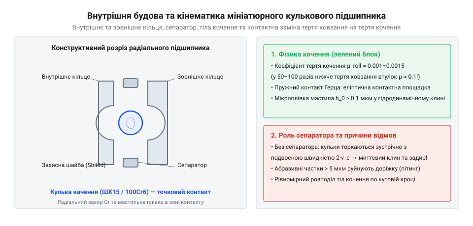
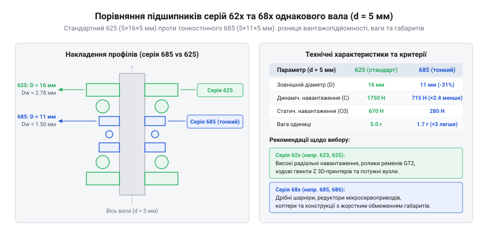

# Мініатюрні кулькові підшипники (623, 625, 685, 686)

<preknowlist>
- [Гнучка муфта 5×5 мм](root:cat-hw-parts/flexible-shaft-coupling) — компенсація несоосності валів та запобігання паразитним радіальним навантаженням
- [Силіконова змазка SI-180](root:cat-hw-parts/silicone-grease) — сумісність із гумовими ущільненнями 2RS та захист доріжок качення від зносу
</preknowlist>

## Тертя та будова підшипників качення

У малогабаритних механізмах і 3D-принтерах рухомі частини під час обертання зазнають значних радіальних навантажень. Якщо вал обертається у звичайній втулці ковзання, між поверхнями виникає постійне тертя ковзання, яке призводить до швидкого нагрівання, зношування матеріалу та значних втрат енергії. Для усунення цього ефекту та зниження опору руху використовують підшипники качення, які замінюють поверхні тертя контактом загартованих тіл. Завдяки цьому коефіцієнт тертя зменшується до 0.0015, а ефект переривчастого ковзання повністю зникає, забезпечуючи плавний хід конструкції.

Основою будь-якого такого вузла є внутрішнє та зовнішнє кільця, між якими розміщуються рухомі елементи — @@en|rolling element@@. Для рівномірного розподілу цих елементів по колу та запобігання їх зіткненню між собою використовується спеціальний фіксатор, відомий як @@en|cage retainer@@. Поточне взаємне положення внутрішніх елементів у розрізі демонструє схема внутрішньої будови.

*Внутрішня будова мініатюрного підшипника: кільця, загартовані кульки та сепаратор для заміни тертя ковзання.*

Зовнішнє кільце зазвичай фіксується в корпусі пристрою, тоді як внутрішнє насаджується на вал. Коли вал починає обертатися, зусилля передається через внутрішнє кільце на кульки, які перекочуються доріжками кочення безперервно й без ривків. Для забезпечення стабільної роботи механізму та запобігання перекосам під час високих навантажень може знадобитися додаткова компенсація несоосності валів, про яку детально розказано в матеріалі про [Гнучка муфта 5×5 мм](root:cat-hw-parts/flexible-shaft-coupling). Щоб поверхні доріжок і кульок не зазнавали сухого тертя та передчасного стирання, на поверхню наносять шар мастила, наприклад, [Силіконова змазка SI-180](root:cat-hw-parts/silicone-grease), яка ефективно захищає деталі від зносу та сумісна з ущільнювачами.

## Серії, захист та правила монтажу

Під час проєктування вузла обертання постає питання вибору відповідної серії деталей залежно від наявного простору та навантажень. Масивні силові вироби розраховані на підвищені навантаження, проте в умовах обмеженого простору та малогабаритних корпусів краще застосовувати тонкостінні аналоги. Порівняння геометрії стандартної серії 625 та тонкостінної 685 при спільному діаметрі вала 5 мм показує різницю в товщині кілець та габаритах.

*Геометричне порівняння стандартної серії 625 та тонкостінної 685 при спільному діаметрі вала 5 мм.*

Окрім геометрії, важливим критерієм є захист внутрішньої порожнини від пилу, бруду та витікання мастила. Для високошвидкісних застосувань, де критично мінімізувати опір обертанню, використовують безконтактні металеві шайби типу ZZ, які створюють мінімальний зазор. Якщо ж вузол працює у забитому пилом або вологому середовищі, обирають захист із гумовими армованими манжетами, які утворюють @@en|contact seal@@ і надійно ізолюють внутрішні порожнини від зовнішніх забруднень.

Для правильного осьового базування та запобігання зміщенню вала використовують спеціальні фланцеві виконання, такі як F623 або F625, що мають буртик на зовнішньому кільці. Під час монтажу кількох деталей на один вал часто виникає проблема теплового розширення металу, яка може призвести до заклинювання. Для її усунення застосовують спеціальний осьовий натяг за допомогою еластичних елементів, відомий як @@en|wave spring preload@@, який компенсує температурні коливання довжини вала без перевантаження кульок.