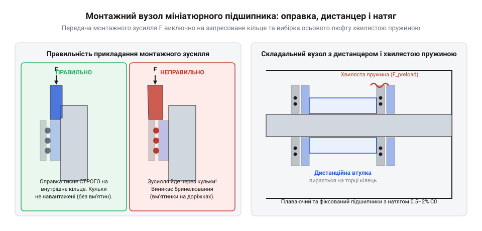

# Практичне проєктування, монтаж та налаштування підшипникового вузла

<preknowlist>
- [Гнучка муфта 5×5 мм](root:cat-hw-parts/flexible-shaft-coupling) — Спряження підшипникового вузла з приводним валом
- [Силіконова змазка SI-180](root:cat-hw-parts/silicone-grease) — Правила внесення мастила у відкриті та закриті підшипники
</preknowlist>

## Проєктування посадкових місць та упорів

Під час конструювання вузлів точного лінійного переміщення та обертальних систем у 3D-принтерах і робототехніці головним завданням є забезпечення стабільної геометрії обертання без перекосів і заклинювань. Коли вал або корпус навантажені радіальними та осьовими зусиллями, мініатюрні кулькові підшипники типу `@@en|625ZZ@@` (з номінальними розмірами зовнішнього діаметра `D = 16` мм, внутрішнього `d = 5` мм та шириною `B = 5` мм) або фланцеві підшипники `@@en|F623RS@@` вимагають бездоганної точності виготовлення посадкових поверхонь. Будь-яке відхилення форми гнізда чи вала призводить до нерівномірного розподілу навантаження на тіла кочення та передчасного виходу вузла з ладу.

Для досягнення надійної посадки в алюмінієвих деталях (наприклад, фрезерованих плитах з алюмінію марки АД31 або Д16Т) та пластикових деталях, виготовлених методом `@@en|FDM-друку@@` з ABS чи PETG пластику, застосовуються суворі поля допусків. Для вала зі сталі рекомендується використовувати посадкове поле `h6` або перехідне поле `js6`, яке забезпечує контрольований мікронатяг або щільну посадку без надмірного розширення внутрішнього кільця. Розглянемо числовий приклад розрахунку натягу для посадки `js6` на вал діаметром 5 мм під підшипник `@@en|625ZZ@@`: поле `js6` для інтервалу діаметрів від 3 до 6 мм дає симетричне граничне відхилення `±4` мкм (`+0.004` мм / `-0.004` мм), тоді як допуск на отвір внутрішнього кільця за нормальним класом точності `@@en|ISO 492@@` становить від 0 до `-8` мкм. У найнесприятливішому поєднанні розмірів — коли вал виготовлено за верхньою межею `+4` мкм, а отвір кільця за нижньою `-8` мкм — максимальний натяг сягає 12 мкм (`0.012` мм), що призводить до пружного розширення доріжки кочення внутрішнього кільця приблизно на 80% від величини натягу (близько 9.6 мкм) і майже повністю вибирає початковий радіальний зазор нормальної групи `@@en|CN@@` (від 8 до 13 мкм), виключаючи заклинювання кульок; на нижній же межі відхилення вала утворюється щільна збірка із зазором до 4 мкм, яка фіксується вал-втулковим клеєм. Для отворів в алюмінієвому корпусі використовується поле `H7` або `JS7`. Водночас для пластикових деталей 3D-друку через усадку матеріалу та його пружність номінальний діаметр отвору проєктується з мінусовим припуском у межах від 0.05 до 0.1 мм із подальшим калібруванням розгорткою або термофіксацією запресованої латунної різьбової втулки з посадковим пояском.

Особливу увагу під час проєктування слід приділяти конструкції упорних буртиків і дистанційних втулок. Головне правило механіки підшипникових вузлів полягає в тому, що осьовий упор повинен концентруватися СТРОГО на торці лише одного кільця — або внутрішнього, або зовнішнього. Якщо буртик або корпус одночасно впирається і в ущільнювальні захисні шайби, і в торці обох кілець, виникає неконтрольоване тертя, яке призводить до нагріву, руйнування гумово-металевих ущільнень (`@@en|RS@@-шайб`) або заклинювання сепаратора. Для передачі крутного моменту від крокового двигуна через такий вузол часто використовується [Гнучка муфта 5×5 мм](file:///E:/develop/courses/inwork/053e37b464/cat-hw-parts/flexible-shaft-coupling), яка нівелює мікрозміщення та не передає радіальні згинальні моменти на підшипник. Змащування внутрішніх порожнин проводиться з урахуванням сумісності матеріалів, де добре себе зарекомендувала [Силіконова змазка SI-180](file:///E:/develop/courses/inwork/053e37b464/cat-hw-parts/silicone-grease), яка не руйнує пластикові оболонки та захищає металеві деталі від окиснення.

## Технологія запресування та пружинний натяг

Монтаж підшипників у посадові гнізда вимагає дотримання суворих технологічних регламентів, порушення яких неминуче призводить до пошкодження доріжок кочення. Категорично заборонено прикладати монтажне зусилля запресування через незапресовуване кільце (наприклад, запресовувати підшипник у корпус, тиснути при цьому на внутрішнє кільце через кульки). Зусилля запресування `F` повинно передаватися циліндричною оправкою виключно на те кільце, яке зазнає посадки з натягом. Якщо запресовується вал у внутрішнє кільце, торцева поверхня монтажної оправи повинна контактувати виключно з торцем внутрішнього кільця.

*На складальному кресленні показано правильне положення циліндричної оправи, яка передає зусилля запресування на внутрішнє кільце підшипника, а також використання дистанційної втулки та хвилястої пружини для забезпечення стабільного осьового натягу без перекосів.*

Для забезпечення плавності ходу та усунення осьового люфту в конструкціях із двома підшипниками застосовують схему з однією фіксованою опорою та однією плаваючою опорою. Фіксована опора жорстко затискає підшипник з обох боків по аксіальному напрямку, тоді як плаваюча опора дозволяє зовнішньому кільцю мікроскопічно зсуватися в осьовому напрямку під впливом теплового розширення вала. Для вибірки залишкових зазорів та запобігання осьовому биттю використовується `@@en|хвиляста пружина@@` (`@@en|wave spring@@`), яка створює дозований попередній натяг `F_preload`. Розрахунок мінімального та максимального рекомендованого зусилля натягу базується на статичній вантажопідйомності `C_0` підшипника і зазвичай становить від 0.5% до 2% від `C_0`. Підбір жорсткості хвилястої пружини (`@@en|spring rate@@`, `k`) є критичним етапом розрахунку: пружина працює в зоні лінійної пружної деформації, де створюване зусилля визначається різницею між висотою у вільному стані `h_0` та робочою висотою в гнізді `h_w` за співвідношенням `F = (h_0 - h_w) * k`. Якщо обрати занадто високу жорсткість (наприклад, понад 50 Н/мм для мініатюрного підшипника), будь-яке технологічне відхилення глибини посадкового гнізда чи тепловий розгин вала лише на 0.2 мм призведе до стрибка осьового навантаження на 10 Н і більше, що перевищить поріг у 2% `C_0`, спричинить перевантаження кульок, пластичне зминання доріжок кочення та значний ріст моменту тертя; натомість вибір помірної жорсткості в діапазоні 15–25 Н/мм забезпечує пологу пружну характеристику, за якої пружина надійно компенсує тепловий хід і люфти в межах 0.5–1.0 мм робочого стиснення, гарантуючи стабільне зусилля натягу в безпечному коридорі.

Консольна утиліта розрахунку натягу та параметрів запресування реалізована в мові Сі:
:::code proj-miniature-bearing-assembly-and-preload/c/bearing_calc.h
:::code proj-miniature-bearing-assembly-and-preload/c/bearing_calc.c
:::code proj-miniature-bearing-assembly-and-preload/c/main.c

Для об'єктно-орієнтованої валідації допусків посадок на валу та в корпусі використовується модуль на C++:
:::code proj-miniature-bearing-assembly-and-preload/cpp/include/bearing_validator.hpp
:::code proj-miniature-bearing-assembly-and-preload/cpp/src/bearing_validator.cpp
:::code proj-miniature-bearing-assembly-and-preload/cpp/src/main.cpp

## Змащування, діагностика та обкатка вузла

Довговічність та безшумність роботи мініатюрного підшипникового вузла безпосередньо залежать від кількості та якості внесеного мастила. Поширена помилка початківців полягає у повному заповненні внутрішньої порожнини підшипника консистентним мастилом. Надлишок мастила створює надлишковий гідродинамічний опір при високих обертах, що призводить до інтенсивного перегріву, розрідження мастила та його витікання через захисні шайби. Норма внесення пластичного мастила становить від 20% до 30% вільного об'єму підшипника. Для високошвидкісних шпинделів та екструдерів 3D-принтерів, що працюють на швидкостях понад 10000 об/хв, використовують маловязкі синтетичні оливи на основі поліальфаолефінів (`@@en|PAO@@`) або естерів із високою стійкістю до зсувних навантажень.

Після завершення монтажу необхідно провести ретельну діагностику якості збирання. Вал повинен обертатися рукою плавно, без ривків, заїдань чи відчутного опору. Будь-який металевий хрускіт, точкові вібрації або відчуття перекочування кульок через рівні інтервали свідчать про те, що під час запресування було допущено перекіс або сталося пошкодження доріжок кочення (бринелювання). Для перевірки наявності осьового та радіального люфту використовується індикатор годинникового типу з ціною поділки 0.01 мм.

Фінальним етапом є температурна стабілізація та обкатка вузла. Обкатка виконується поступово: привід запускається на 50% від номінальних обертів протягом 15-20 хвилин. У цей період відбувається припрацювання поверхонь контакту тіл кочення з доріжками та перерозподіл мастила по всій внутрішній порожнині. Контроль температури корпусу підшипникового вузла здійснюється безконтактним пірометром; перевищення температури вище 50 градусів Цельсія свідчить про надмірний попередній натяг або надлишок мастила, що вимагає негайного розбирання та корекції параметрів посадки.