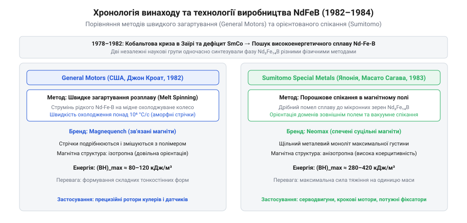

# Історія винаходу та еволюції рідкісноземельних неодимових магнітів

<preknowlist>
- [Вентиляційні захисні клапани та мембрани ePTFE: вирівнювання тиску, гідрофобність та захист від конденсату](root:cat-hw-parts/eptfe-protective-vents) — захист внутрішніх порожнин корпусів від вологи та запобігання корозійному руйнуванню чутливих металевих компонентів
</preknowlist>

## Кобальтова криза та витоки NdFeB

Наприкінці 1970-х років глобальна електронна та приладобудівна промисловість зіткнулася з глибокою сировинною кризою, яка поставила під загрозу подальший стабільний розвиток мініатюрних електродвигунів, датчиків, високоточних перетворювачів, професійної аудіоапаратури та обчислювальної техніки. Домінуючими постійними магнітами високої енергетичної ємності на той момент залишалися передові сплави системи самарій-кобальт (SmCo), що демонстрували безпрецедентну стійкість до розмагнічування та виняткову максимальну енергетичну добуток. Проте кобальт був надзвичайно дефіцитним, стратегічним і геополітично вразливим ресурсом. У травні 1978 року драматичні події в провінції Шаба у Заїрі, де озброєні угруповання захопили ключові мідно-кобальтові рудники в районі міста Колвезі, спричинили паніку на світових сировинних ринках і моментальний, багаторазовий стрибок цін на кобальт. Цей геополітичний шок, що увійшов в історію як @@en|cobalt supply crisis@@, оголив усю небезпеку залежності передового технологічного сектору від постачанок стратегічного металу з політично нестабільних регіонів Центральної Африки. Виробники електроніки, аерокосмічної техніки та військового обладнання гостро усвідомили життєву необхідність термінового пошуку альтернативних магнітних матеріалів, які б повністю виключали використання дорогого кобальту та спиралися на набагато поширеніші у земній корі елементи.

Пошук альтернатив неминуче зосередився на заміні дефіцитного самарію та кобальту на залізо та легкі рідкісноземельні елементи, передусім неодим і празедим, які відзначалися значно більшою природною поширеністю та нижчою вартістю видобутку. Проте перші спроби дослідників створити двійкові сполуки на основі заліза та рідкісноземельних металів зіткнулися з фундаментальними термодинамічними та кристалографічними перешкодами. Чисті сполуки неодиму з залізом не утворювали стабільних кристалічних решіток із необхідною намагніченістю насичення та задовільною коерцитивною силою при кімнатній чи підвищеній температурах. Температура Кюрі таких двійкових фаз була вкрай низькою, а проста кристалічна структура не забезпечувала анізотропії, здатної надійно утримувати магнітне поле під дією зовнішніх розмагнічувальних факторів. Провідні лабораторії світу бачили, що для стабілізації потрібної магнітнотвердої фази необхідний третій компонент — легкий металоїд із меншим атомним радіусом, який зміг би компактно вбудуватися у кристалічну решітку, суттєво змінити електронну структуру та підвищити енергію зв'язку.

Вирішальний прорив стався внаслідок системного та наполегливого пошуку серед металоїдів і перехідних елементів. Дослідники виявили, що введення контрольованої кількості бору до розплаву неодиму та заліза докорінно змінює фазову діаграму стану нової системи. Бор завдяки своєму мінімальному атомному радіусу гармонійно вбудовується у міжвузля кристалічної решітки, утворюючи унікальну термічно та структурно стабільну @@en|intermetallic phase@@ складу Nd2Fe14B. Ця складтівна тетрагональна кристалічна структура володіла колосальною константою одноосьової магнітної анізотропії та надзвичайно високою намагніченістю насичення, суттєво перевершуючи за теоретичним енергетичним потенціалом усі відомі доти магнітні матеріали, включаючи самірій-кобальтові сплави. 

Отримання та подальше практичне використання нового матеріалу вимагало розробки надійних конструкційних рішень та захисних оболонок. У сучасній інженерній практиці мініатюрні неодимові магніти інтегруються у складні пристрої за допомогою точного механічного кріплення: широко застосовуються [Набори гвинтів М3](root:cat-hw-parts/m3-screw-kits) для жорсткої фіксації металевих корпусів, [Набір кріплення М2.5](root:cat-hw-parts/m25-fastener-kit) для монтажу друкованих плат і чутливих сенсорних модулів, а також [Стійки М2/М3](root:cat-hw-parts/standoffs) для створення необхідних ізоляційних зазорів між компонентами. Для надійного нероз'ємного з'єднання металевих, магнітних та пластикових елементів конструкцій активно використовується [Клей ціаноакрилатний](root:cat-hw-parts/cyanoacrylate-glue), тоді як під час складного ручного чи автоматизованого збирання усі дрібні деталі та кріплення зручно сортувати в [Органайзер для дрібних деталей](root:cat-hw-parts/parts-organizer). Зі свого боку, міцні [Болти М5/М6 і шайби М3/М4](root:cat-hw-parts/bolts-and-washers) забезпечують надійне силове стягування важких корпусних елементів потужних приводів. Оскільки неодимові магніти надзвичайно чутливі до вологи та схильні до швидкої корозії, готові пристрої ретельно герметизують, а для вирівнювання тиску й ефективного захисту від утворення руйнівного конденсату встановлюють [Вентиляційні захисні клапани та мембрани ePTFE](root:cat-hw-parts/eptfe-protective-vents).

## Паралельний прорив GM та Sumitomo

На початку 1980-х років одразу дві абсолютно незалежні дослідницькі групи у різних куточках світу здійснили історичний прорив, винайшовши принципово нові технології промислового виробництва постійних магнітів на основі нещодавно відкритого сплаву неодим-залізо-бор. Незважаючи на спільну фундаментальну хімічну основу — складну тетрагональну фазу Nd2Fe14B, — обидві команди обрали докорінно відмінні фізико-технологічні маршрути синтезу, які на десятиліття визначили розвиток усієї світової магнітної промисловості.

*Хронологія винаходу та порівняння технологічних маршрутів Magnequench і Neomax у створенні магнітів NdFeB.*

Перший шлях був розроблений талановитою дослідницькою групою корпорації General Motors під керівництвом Джона Кроата на початку 1982 року. У пошуках перспективних магнітних матеріалів для автомобільних датчиків, приводів та допоміжних приладів команда застосувала інноваційний метод @@en|melt spinning@@ — надзвичайно швидке загартування рідкого розплаву шляхом спрямованого виливання розплавленого сплаву на поверхню потужного обертального охолоджуваного мідного барабана. Швидкість охолодження у цьому процесі сягала мільйона градусів за секунду, що призводило до миттєвої кристалізації та утворення ультрадрібнокристалічної або нанокристалічної структури з повністю хаотичним орієнтуванням магнітних зерен. Отриманий у такий спосіб матеріал ретельно подрібнювали у тонкий порошок та зв'язували спеціальним полімерним сполучником, формуючи ізотропні пластичні або зв'язані магніти, які згодом здобули всесвітню комерційну назву Magnequench. Цей технологічний метод дозволяв із неймовірною точністю виготовляти складні конструкційні деталі методами лиття під тиском або пресування без необхідності складного високотемпературного спікання.

Практично паралельно, у жовтні 1982 року, аналогічну за значенням, але протилежну за технічним виконанням розробку завершила команда японської компанії Sumitomo Special Metals під керівництвом Масато Сагави. Дослідники Sumitomo пішли перевіреним шляхом класичної порошкової металургії та розробили передову технологію виготовлення високоенергетичних анізотропних магнітів через пресування та спекання у рідкій фазі, яка згодом отримала комерційну назву Neomax. Інженерний шлях Сагави передбачав виплавку якісного злитка заданого складу, його глибоке подрібнення до стану мікропорошку, а потім пресування отриманого порошку у потужному зовнішньому магнітному полі. Таке магнітне поле змушувало кожну мікроскопічну частинку зайняти суворо визначене положення, забезпечуючи ідеальну кристалографічну орієнтацію осей легкого намагнічування всього масиву. Після цього пресовку спекали при високій температурі у вакуумі або в середовищі очищеного інертного газу й піддавали багатоступеневій термічній обробці для досягнення максимальної коерцитивної сили. На відміну від ізотропних магнітів GM, високоякісні спечені магніти Sumitomo демонстрували абсолютні рекордні показники магнітної енергії, значно перевершуючи найкращі зразки традиційних самарій-кобальтових аналогів.

Обидві дослідницькі групи подали заявки на фундаментальні патенти у 1983 році, що породило тривалі патентні дискусії та водночас забезпечило неймовірний ефект синергії для бурхливого розвитку нової індустрії. Технологія Magnequench забезпечила масове виготовлення дешевих і точних магнітів для мікромоторів і побутових датчиків, тоді як Neomax відкрив нову епоху надпотужних компактних приводів для сучасних електромобілів, промислових вітрогенераторів, робототехніки та високоємних комп'ютерних жорстких дисків.

## Боротьба з корозією та легування

Попри високу магнітну енергію нових інтерметалічних сплавів, їхнє масове застосування на початку комерціалізації наштовхнулося на критичну перешкоду — вкрай низьку стійкість до зовнішнього середовища. Хімічна активність неодиму та наявність багатої на рідкісноземельний елемент фази на межах зерен робили матеріал надзвичайно вразливим. У вологому повітрі чи при контакті з вологою починалася катастрофічна @@en|intergranular corrosion@@. Кристалічна решітка руйнувалася зсередини: внаслідок окиснення та утворення гідридів магніт швидко розсипався в дрібний сірий порошок оксидів і гідроксидів неодиму. Для захисту крихких виробів у корпусах пристроїв інженери змушені були розробляти надійні багатоступеневі бар'єрні технології. Потужним промисловим стандартом стало багатошарове гальванічне покриття Ni-Cu-Ni із шарів нікелю, міді та нікелю загальною товщиною від десяти до двадцяти мікрометрів, яке герметично ізолювало активну основу від найменших проявів атмосферної вологи. У менш вимогливих умовах використовували також захисні епоксидні покриття або гальванічне цинкування. Щоб забезпечити надійне механічне кріплення захищених виробів усередині приладів без ризику руйнування їхньої структури під час монтажу, розробники використовували [набори гвинтів М3](root:cat-hw-parts/m3-screw-kits) разом із точними латунними та нейлоновими [стійками М2/М3](root:cat-hw-parts/standoffs) та універсальним [набором кріплення М2.5](root:cat-hw-parts/m25-fastener-kit), ретельно уникаючи утворення гальванічних пар, здатних прискорити електрохімічну корозію в місцях щільних металевих контактів.

Окрім корозійної вразливості, серйозним обмеженням стала низька температура Кюрі, яка для базового стехіометричного складу становила близько 312 градусів Цельсія. Через це нагрівання вже до 60–80 градусів призводило до різкого та незворотного падіння коерцитивної сили, роблячи магніти непридатними для потужних тягових двигунів, автомобільних датчиків, акустичних систем чи промислових генераторів, де робочі температури значно перевищують кімнатні. Проблема вимагала принципового перегляду підходів до легування та мікроструктури. Повне легування всього об'єму вимагало великої кількості дорогих важких рідкісноземельних металів, що знижувало загальну залишок магнітної індукції. Вирішенням цієї кризи стала розробка технології дифузії важких рідкісноземельних елементів по межах зерен, відомої як @@en|grain boundary diffusion process@@ або GBDP. У цьому процесі на поверхню спечених магнітних блоків наносили тонкі шари порошків або сполук диспрозію чи тербію, після чого проводили контрольовану високотемпературну термообробку. Під час випалювання ці атоми проникали виключно вздовж міжзеренних прошарків, утворюючи там високоефективні локальні зони з надзвичайно високою анізотропією магнітного орієнтування. Це радикально підвищувало коерцитивну силу `H_cj` без значного погібшення залишкової індукції, оскільки дорогий важкий метал не витрачався на марне легування внутрішньої частини зерен. Завдяки цій інновації світова промисловість отримала цілу номенклатуру високотемпературних марок — від стандартних M та H до SH, UH, EH і найстійкіших AH, здатних стабільно функціонувати за температур до 220 градусів Цельсія. Під час монтажу таких складних термостійких вузлів часто застосовували міцні [болти М5/М6 і шайби М3/М4](root:cat-hw-parts/bolts-and-washers), а для відведення тепла та запобігання накопиченню руйнівного конденсату корпуси обладнували спеціальними [вентиляційними захисними клапанами та мембранами ePTFE](root:cat-hw-parts/eptfe-protective-vents).

Поряд із технічними викликами на шляху глобального комерційного поширення матеріалу стояло гостре патентне протистояння. У середині та наприкінці 1980-х років американська корпорація General Motors через свій підрозділ Magnequench та японська Sumitomo Special Metals, яка виробляла продукцію під маркою Neomax, опинилися в стані жорсткої юридичної війни за глобальні інтелектуальні права на нові сплави NdFeB. Сторони володіли взаємовиключними патентами на порошкову металургію високоенергетичних спечених магнітів та технологію швидкого загартування розплаву для отримання зв'язаних матеріалів. Затяжні судові розгляди та патентні позови загрожували повністю паралізувати розвиток молодої галузі й зупинити інвестиції. Зрештою, наприкінці 1980-х і протягом 1990-х років корпорації дійшли згоди через систему взаємного ліцензування, чітко розділивши світові ринки між ізотропними зв'язаними та анізотропними спеченими виробами. Наступний етап тектонічних змін відбувся наприкінці 1990-х років, коли американські заводи та інженерні потужності Magnequench були викуплені китайськими промисловими консорціумами та перенесені до Азії. Це рішення остаточно сформувало сучасну глобальну індустрію виробництва неодимових магнітів, де великі обсяги випуску зосередилися поблизу родовищ сировини. На етапах складання та масового виробництва кінцевих пристроїв на цих підприємствах почали масово використовувати [органайзер для дрібних деталей](root:cat-hw-parts/parts-organizer) та надійний [клей ціаноакрилатний](root:cat-hw-parts/cyanoacrylate-glue) для фіксації магнітних елементів у робочих пазах.