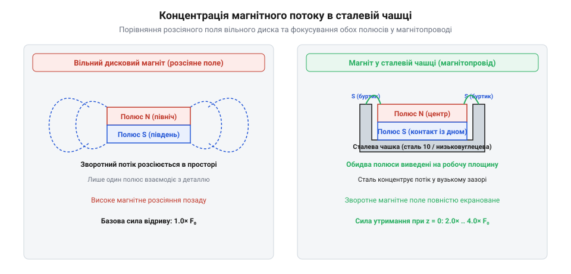

# Розрахунок концентрації магнітного потоку у сталевих чашках та магнітопроводах

## Замкнений магнітний контур чашки

Звичайний постійний магніт із висококоерцитивного сплаву неодим-залізо-бор створює в навколишньому просторі потужне розсіяне поле, силові лінії якого виходять із північного полюса, проходять через повітряне середовище у вигляді широких дуг і замкнотуються на південний полюс. В ізольованому стані дискового або циліндричного магніту значна частина магнітного потоку витрачається на формування цього далекого розсіяного поля, через що робоча індукція на торцевих поверхнях обмежується внутрішніми характеристиками матеріалу. Наприклад, для типового дискового неодимового магніту марки N35 діаметром 20 мм і товщиною 3 мм (D20×3 мм) із залишковою індукцією `Br = 1.18 Тл` індукція на відкритій торцевій поверхні становить лише близько 0.28–0.32 Тл, а сила відриву від товстої сталевої пластини не перевищує 35–40 Н (близько 3.8 кг). Якщо ж цей самий магніт помістити в чашку з низьковуглецевої сталі марки AISI 1010 із товщиною стінки 1.5 мм, зворотний потік повністю замикається через феромагнітний екран, індукція в контактному робочому зазорі зростає до 0.65–0.75 Тл, а сумарне утримуюче зусилля подвоюється або потроюється, досягаючи 90–110 Н (близько 10–11 кг). Для такого різкого підвищення ефективності кріплення та спрямування енергії поля безпосередньо на робочу зону застосовують феромагнітний корпус — сталеву чашку з низьковуглецевої сталі, яка формує повноцінний @@en|magnetic circuit@@.

Коли неодимовий магніт щільно запресовується або вклеюється всередину сталевої чашки, дно та стінки корпусу стають низькоомним за магнітним опором шляхом для зворотного потоку. Магнітні силові лінії, що в нещільному середовищі розходилися б у сторони, тепер зустрічають на своєму шляху сталеву стінку з високою магнітною проникністю. Замість того щоб розсіюватися в повітрі, зворотний магнітний потік повністю втягується в тіло чашки, рухається по її донній частині та стінках до виходу на робочу площину. У результаті такого перенаправлення північний та південний полюси системи концентруються на одній і тій самій робочій поверхні: центральний полюс магніту утворює внутрішню пляму індукції, а верхній край сталевої стінки чашки формує протилежний кільцевий полюс.

*Перенаправлення зворотного потоку магніту сталевою чашкою у концентричну систему полюсів на робочій площині.*

Цей архітектурний прийом забезпечує ефект @@en|flux concentration@@, при якому сумарний магнітний потік не розсіюється у простір, а стягується у вузький зазор між центральним сердечником і зовнішнім кільцем чашки. При контакті такої збірки з феромагнітною пластиною утворюється замкнений контур із мінімальним повітряним зазором, що призводить до багаторазового зростання сили утримання порівняно з голим магнітом однакового об'єму. Для надійного механічного монтажу подібних вузлів у конструкції пристроїв часто використовують [Набори гвинтів М3](root:cat-hw-parts/m3-screw-kits), [Набір кріплення М2.5](root:cat-hw-parts/m25-fastener-kit), а також різноманітні [Стійки М2/М3](root:cat-hw-parts/standoffs) і [Болти М5/М6 і шайби М3/М4](root:cat-hw-parts/bolts-and-washers). Під час складання дрібні компоненти зручно тримати впорядкованими через [Органайзер для дрібних деталей](root:cat-hw-parts/parts-organizer), а фіксацію елементів конструкції забезпечує [Клей ціаноакрилатний](root:cat-hw-parts/cyanoacrylate-glue). Герметичність корпусів із магнітними елементами у пристроях, що працюють у вологих середовищах, ефективно доповнюють [Вентиляційні захисні клапани та мембрани ePTFE](root:cat-hw-parts/eptfe-protective-vents).

## Розрахунок товщини та насичення

Проектування ефективної магнітної чашки вимагає точного математичного розрахунку геометричних параметрів сталевого корпусу, оскільки надто тонкі стінки не зможуть пропустити весь потік без втрат. Фізичною основою розрахунку є закон неперервності магнітного потоку, згідно з яким увесь потік, що генерується постійним магнітом, повинен повністю вміщуватися у поперечному перерізі сталевого магнітопроводу без виходу назовні в неконтрольованих місцях.

Рівняння балансу магнітного потоку має вигляд:

        Phi_mag = Phi_steel
        B_rem · A_m = B_steel · A_s      [рівняння неперервності магнітного потоку]

Де `Phi_mag` — повний магнітний потік магніту, `Phi_steel` — магнітний потік через стінку чашки, `B_rem` — залишкова індукція матеріалу неодимового магніту, `A_m` — площа поперечного перерізу магніту, `B_steel` — індукція магнітного поля в сталі стінки, а `A_s` — площа поперечного перерізу сталевої стінки чашки.

Якщо площа стінки `A_s` буде занадто малою, індукція `B_steel` у сталі неминуче досягне межі @@en|magnetic saturation@@, де `B_sat ≈ 1.6–2.0 Тл` для конструкційних низьковуглецевих сталей. У стані насичення сталь втрачає здатність приймати додатковий магнітний потік, і надлишок силових ліній починає виштовхуватися крізь стінки назовні, утворюючи паразитні зони розсіяння та знижуючи загальну ефективність концентрації.

Мінімально необхідна товщина стінки або дна чашки `t` розраховується з умови уникнення насичення феромагнетика за формулою `t = (B_rem · A_m) / (B_sat · P_s)`, де `P_s` — периметр розрахункового перерізу. Якщо сталь не насичена, обидва полюси замикаються на одну площину, а сумарне утримувальне зусилля системи описується формулою Максвелла @@en|Maxwell holding force@@. Розглянемо числовий розрахунок сили відриву при нульовому зазорі для дискового неодимового магніту марки N35 діаметром 20 мм (радіус `r = 0.01 м`, площа робочого торця `A_m = π · r² = 3.1416 · 10⁻⁴ м²`) із залишковою індукцією `B_rem = 1.2 Тл` у сталевій чашці AISI 1010, де магнітна стала вакууму `mu_0 = 4·π · 10⁻⁷ ≈ 1.2566 · 10⁻⁶ Гн/м`:

        F_pole = (B_rem² · A_m) / (2 · mu_0)
        = (1.2² · 3.1416 · 10⁻⁴) / (2 · 1.2566 · 10⁻⁶) [підстановка значень індукції та площі]
        = (1.44 · 3.1416 · 10⁻⁴) / (2.5133 · 10⁻⁶)     [множення чисельника та знаменника]
        ≈ 180.0 Н                                      [сила тяжіння одного центрального полюса]
        F_total = 2 · F_pole
        = 2 · 180.0                                    [додавання сили від кільцевого фланця чашки]
        = 360.0 Н                                      [сумарна теоретична сила утримання вузла]

Отримане значення `360 Н` (близько 36.7 кгс) демонструє подвоєння корисної сили утримання за рахунок концентратора, тоді як той самий відкритий магніт без чашки через значне розсіяння зворотного потоку та розмагнічувальний фактор забезпечує не більше 90–110 Н тяжіння.

        t = (B_rem · A_m) / (B_sat · P_s)      [розрахунок мінімальної товщини стінки чашки]

Де `P_s` — периметр перерізу сталевого елемента чашки на шляху проходження потоку. Дотримання цієї товщини гарантує, що весь потік зосередиться в робочій зоні, створюючи максимальне тяжіння, яке описується класичною формулою @@en|Maxwell holding force@@ для магнітних систем:

        F = (B^2 · A) / (2 · mu_0)             [формула Максвелла для сили утримання]
        F_max = (B_working^2 · A_total) / (2 · mu_0) [розрахунок максимальної сили відриву у контакті]

Де `F` — сила утримання, `B` — індукція в робочому зазорі, `A` — площа робочого контакту, а `mu_0` — магнітна стала вакууму. Точне витримання цих співвідношень дозволяє інженерам прогнозувати навантаження і уникати передчасного насичення матеріалу чашки.

## Зазори та екранування електроніки

На практиці чашкові магніти рідко контактують із металевою поверхнею в ідеальних умовах безпосереднього дотику; наявність навіть мікроскопічних немагнітних зазорів — таких як шар фарби, захисна плівка, сліди корозії чи пил — різко знижує ефективність утримання. Магнітне поле в повітряному зазорі затухає не лінійно, а за експоненційним або степеневим законом залежно від геометрії полюсів, оскільки магнітний опір повітря на кілька порядків перевищує опір сталевого контуру.

Навіть невеликий повітряний зазор `d` створює додатковий магнітний опір `R_g`, який зменшує загальну індукцію в контурі:

        R_g = d / (mu_0 · A_g)                 [розрахунок магнітного опору зазору]
        B_effective = B_working / (1 + (R_g / R_core)) [падіння робочої індукції через зазор]

Окрім силових характеристик, важливим аспектом застосування чашкових магнітів є взаємодія з навколишнім простором та чутливою мікроелектронною апаратурою. Закрита конструкція сталевої чашки виконує функцію ефективного екрану, який обмежує @@en|flux leakage@@ у бічних напрямках. Проте поблизу робочого торця залишається інтенсивне локальне поле. Розміщення таких потужних магнітів ближче ніж на критичну відстань до датчиків Холла, магнітометрів, прецизійних аналогових кіл або високошвидкісних цифрових шин може призводити до спотворення сигналів або насичення кремнієвих структур. Тому розрахунок просторового затухання поля та правильне геометричне зонування друкованих плат є критичною умовою забезпечення електромагнітної сумісності в пристроях із постійними магнітами.