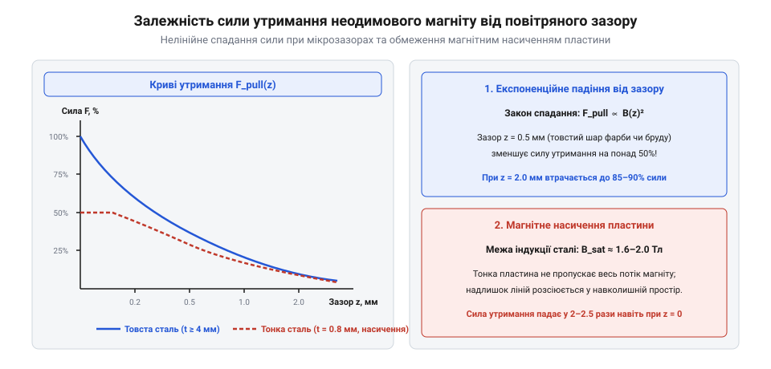

# Математичний розрахунок сили утримання та магнітного поля дисків і кілець

## Поле на осі диска й кільця

Коли ви проєктуєте магнітний вузол або механізм фіксації на основі постійних магнітів, ключовим питанням стає визначення того, яка саме магнітна індукція діє на певній відстані від поверхні полюса. Потужність та надійність взаємодії безпосередньо залежать від просторового розподілу магнітного поля, яке створює аксіально намагнічений диск чи кільце із залізо-неодим-боронового сплаву (NdFeB). Магнітне поле такого виробу не є рівномірним у просторі: воно концентрується біля країв і поступово спадає уздовж центральної осі симетрії у міру віддалення від торця. Для точного розрахунку цього спадання використовують фундаментальні закони магнетостатики, які виводяться з еквівалентних амперівських струмів поверхневого намагнічування.

Розподіл магнітної індукції уздовж центральної осі аксіально намагніченого циліндричного диска виводиться на основі інтегрування закону Біо — Савара — Лапласа для системи елементарних кругових струмів, що еквівалентні намагнічуванню матеріалу. Нехай диск має радіус `R`, загальну товщину або довжину `L`, а його матеріал характеризується залишковою індукцією `Br` (значення залишкової індукції визначає максимальну густину залишкового магнітного потоку в замкненому контурі). Якщо ввести координатну вісь `z`, яка перпендикулярна до площини полюса і проходить через його центр, де `z = 0` відповідає поверхні торця магніту, а `z > 0` — відстані по осі у зовнішній простір, то осьова складова магнітної індукції `B(z)` для диска описується аналітичним виразом:

        B(z)
        = (Br ÷ 2) · ((z + L) ÷ √(R² + (z + L)²) - z ÷ √(R² + z²))      [інтегрування елементарних контурних струмів по довжині циліндра]

Для наочності розглянемо компактний диск типорозміру D10×2 мм (радіус `R = 5` мм, товщина `L = 2` мм) з високоякісного неодимового сплаву марки N42 із залишковою індукцією `Br = 1.32 Тл`. Безпосередньо на поверхні полюса при `z = 0` формульне значення дає `B(0) = (1.32 ÷ 2) · (2 ÷ √(25 + 4) - 0) ≈ 0.66 · 0.371 ≈ 0.245 Тл` (245 мТл або 2450 Гаус). При віддаленні на повітряний зазор усього `z = 1` мм індукція стрімко спадає: `B(1) = 0.66 · (3 ÷ √(25 + 9) - 1 ÷ √(25 + 1)) = 0.66 · (0.514 - 0.196) ≈ 0.210 Тл` (210 мТл). А при віддаленні на `z = 5` мм поле падає практично на порядок: `B(5) = 0.66 · (7 ÷ √(25 + 49) - 5 ÷ √(25 + 25)) = 0.66 · (0.814 - 0.707) ≈ 0.071 Тл` (71 мТл).

```
B(z)
= (Br ÷ 2) · ((z + L) ÷ √(R² + (z + L)²) - z ÷ √(R² + z²))      [інтегрування елементарних контурних струмів по довжині циліндра]
```

Цей вираз дозволяє крок за кроком простежити, як геометричні розміри та властивості матеріалу впливають на результуюче поле. Коефіцієнт `Br ÷ 2` задає масштаб індукції на дуже малій відстані від нескінченно тонкого шару, тоді як різниця двох членів у дужках описує внесок від ближнього та дального торців циліндра висотою `L`. У міру збільшення осьової координати `z` внесок від дальнього торця частково компенсує поле ближнього, що призводить до швидкого, нелінійного спадання індукції. Якщо ж ми розглядаємо кільцевий магніт, який має внутрішній радіус `R_in` і зовнішній радіус `R_out`, то результуюче поле на осі визначається за принципом суперпозиції як різниця між полем суцільного циліндра радіусом `R_out` та суцільного циліндра радіусом `R_in`:

```
B_ring(z)
= B_out(z, R_out) - B_in(z, R_in)      [принцип суперпозиції для кільцевого магніту]
```

Знання точного значення `B(z)` на осі є абсолютно необхідним для проєктування взаємодії з герметичними вузлами, де часто використовують [Вентиляційні захисні клапани та мембрани ePTFE](root:cat-hw-parts/eptfe-protective-vents) для вирівнювання тиску без порушення герметичності корпусу, чи для опрацювання взаємодії з елементами кріплення, такими як [Набори гвинтів М3](root:cat-hw-parts/m3-screw-kits), виготовленими з немагнітної нержавіючої сталі або латуні.

## Сила відриву та формула Максвелла

Коли магніт наближається до масивної феромагнітної пластини або іншого аналогічного магнітопроводу, виникає потужна сила притягання, яка намагається замкнути магнітний потік через сталеве середовище. Щоб розрахувати це тяжіння без проведення складних чисельних симуляцій, застосовують класичний підхід на основі енергії магнітного поля в зазорі. Сила прямого відриву або сила утримання визначається через розподіл магнітної індукції в зоні контакту та площу перетину магнітного потоку.

Максимальна сила нормального відриву `F_pull` для випадку, коли магніт повністю прилягає до товстої сталевої пластини без будь-яких проміжків, обчислюється за формулою Максвелла. Розглянемо числовий розрахунок для високоенергетичного дискового магніту марки N52 діаметром 20 мм (радіус `r = 0.01 м`, площа полюса `A = π · r² = 3.1416 · 10⁻⁴ м²`) із залишковою індукцією `B = 1.45 Тл`, закріпленого на масивній сталевій плиті товщиною 10 мм, де магнітна стала вакууму `mu_0 = 4·π · 10⁻⁷ ≈ 1.2566 · 10⁻⁶ Гн/м` та прискорення вільного падіння `g = 9.81 м/с²`:

        F_pull = (B² · A) / (2 · mu_0)
        = (1.45² · 3.1416 · 10⁻⁴) / (2 · 1.2566 · 10⁻⁶) [підстановка індукції N52 та площі полюса]
        = (2.1025 · 3.1416 · 10⁻⁴) / (2.5133 · 10⁻⁶)    [обчислення чисельника та подвоєної константи]
        = (6.6052 · 10⁻⁴) / (2.5133 · 10⁻⁶)             [ділення значень]
        ≈ 262.8 Н                                       [теоретична нормальна сила відриву в ньютонах]
        m_hold = F_pull / g
        = 262.8 / 9.81                                  [переведення сили тяжіння у кілограми]
        ≈ 26.8 кг                                       [еквівалентна маса утримання в кілограмах]

Такий розрахунок наочно підтверджує колосальну густину енергії сплаву N52: невеликий дисковий магніт масою менше ніж 12 грамів здатний утримувати сталевий вантаж масою майже 27 кг за умови ідеального механічного контакту без повітряного проміжку.

```
F_pull
= (B² · A) ÷ (2 · μ_0)      [інтегрування густини магнітної енергії в повітряному зазорі за формулою Максвелла]
```

У цьому виразі `B` позначає магнітну індукцію в зоні контакту (яка зазвичай близька до залишкової індукції матеріалу або індукції на поверхні полюса), `A` — ефективну площу полюсної поверхні магніту, а `μ_0` — магнітну проникність вакууму (вакуумна магнітна стала, що дорівнює 4π × 10⁻⁷ Гн/м). Формула Максвелла показує квадратичну залежність сили від індукції: дворазове збільшення індукції приводить до чотириразового зростання сили утримання, що робить висококоерцитивні сплави надзвичайно ефективними.

Однак на практиці ідеальне нульове прилягання недосяжне через наявність захисних гальванічних покриттів (нікель, мідь, епоксидна смола), мікронерівностей поверхонь або випадкових часточок пилу. Навіть мікронний повітряний зазор створює величезний магнітний опір, оскільки магнітна проникність повітря дорівнює проникності вакууму, що на кілька порядків менше проникності сталі. У результаті сила утримання падає стрімко, експоненційно на перших десятих долях міліметра. Крім того, важливим обмежуючим фактором є магнітне насичення сталевої пластини: якщо її товщина занадто мала, матеріал пластини досягає межі насичення (`B_sat` в межах 1.6–2.0 Тл), і подальше збільшення потужності магніту не призводить до зростання сили відриву, оскільки сталь більше не може пропустити додатковий магнітний потік.


*Спадання сили утримання F_pull зі зростанням немагнітного зазору та критерій магнітного насичення сталевої пластини.*

Ці ефекти критично важливі враховувати під час механічного проєктування корпусів, коли для фіксації плат чи кришок застосовують [Набір кріплення М2.5](root:cat-hw-parts/m25-fastener-kit) або латунні [Стійки М2/М3](root:cat-hw-parts/standoffs), забезпечуючи чітко контрольований зазор і запобігаючи перекосам вузлів.

## Зсувні сили та розрахунок фіксаторів

Окрім прямого відриву перпендикулярно до поверхні, магнітні з'єднання та фіксатори часто зазнають навантажень, спрямованих паралельно до площини контакту. У багатьох конструкціях приладів магніти використовуються для утримання кришок, знімних панелей або навісних модулів, де основне механічне зусилля діє саме у зсувному напрямку. Розрахунок таких навантажень суттєво відрізняється від розрахунку сили відриву, оскільки опір зсуву ґрунтується на силах сухого тертя між контактуючими поверхнями магніту (або його сталевого корпусу) та ответної пластини.

Максимальна зсувна сила `F_shear`, яку може витримати магнітне з'єднання до початку ковзання, визначається через добуток сили нормального притискання та коефіцієнта тертя ковзання між матеріалами:

```
F_shear
= μ · F_pull      [закон сухого тертя Амонтона — Кулона для магнітного притискання]
```

Тут `μ` — безрозмірний коефіцієнт тертя ковзання для конкретної пари матеріалів (наприклад, для пари нікельований покритий NdFeB магніт та полірована сталева пластина коефіцієнт тертя зазвичай становить `μ ≈ 0.15–0.20`, тоді як при наявності тонкої гумової прокладки він може зростати до `0.4–0.5`). Формула демонструє фундаментальну слабкість чистих магнітних фіксаторів: оскільки зсувне зусилля становить лише 15-20% від сили відриву (`F_shear ≈ 0.15 · F_pull`), магніт, що здається надзвичайно потужним при відриві на себе, може легко зсунутися вздовж поверхні під дією навіть невеликої бокової вібрації чи поштовху.

Щоб запобігти цьому аварійному зсуву у приладобудуванні, інженери ніколи не покладаються виключно на силу тертя гладких поверхонь у відповідальних вузлах. Конструкція доповнюється механічними упорами, штифтами або заглибленнями. Для надійного збирання таких корпусних елементів використовують різноманітні [Болти М5/М6 і шайби М3/М4](root:cat-hw-parts/bolts-and-washers), а дрібні елементи конструкції та кріпильні деталі зручно сортувати й зберігати, використовуючи спеціальний [Органайзер для дрібних деталей](root:cat-hw-parts/parts-organizer). У випадках, коли магніти необхідно надійно зафіксувати всередині посадкових гнізд корпусу без ризику їхнього зміщення від власних сил притягання, застосовують високоміцний [Клей ціаноакрилатний](root:cat-hw-parts/cyanoacrylate-glue), який забезпечує жорстку та довговічну фіксацію компонентів.