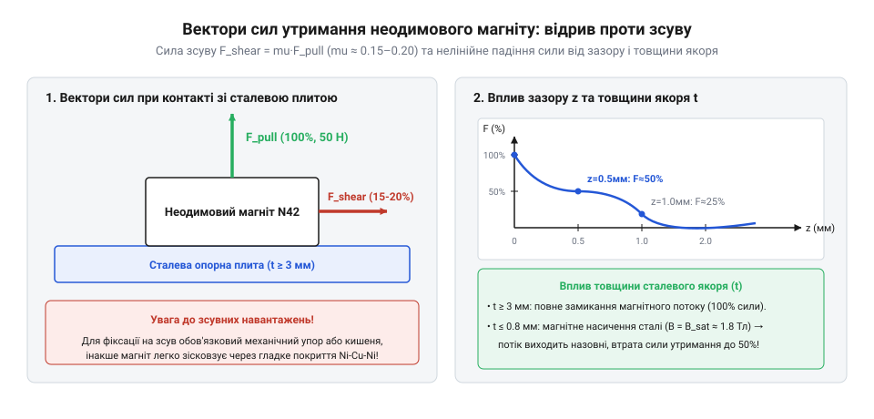
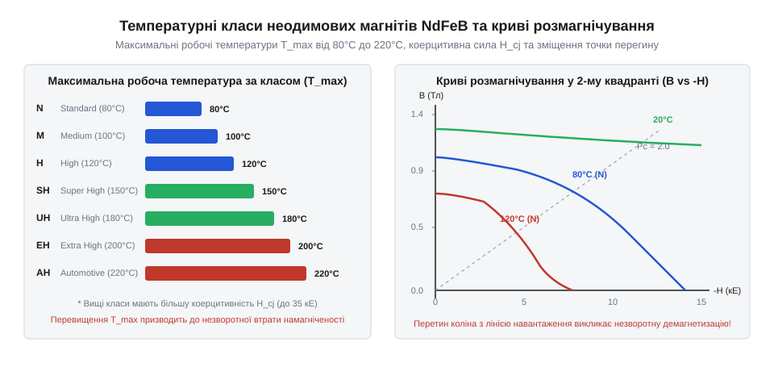
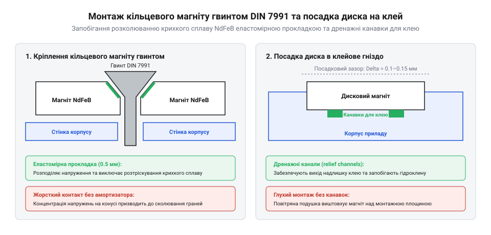
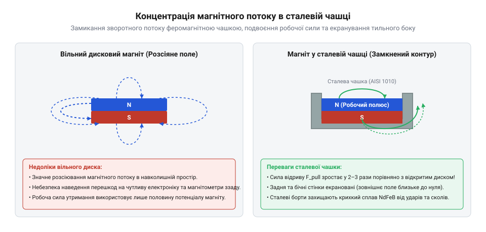
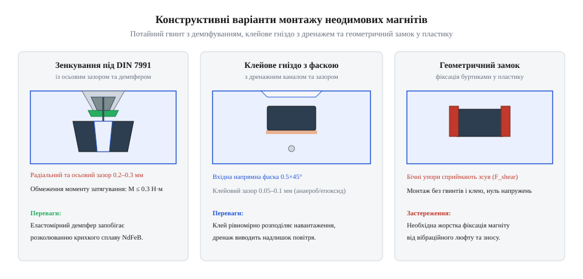

# Неодимові магніти (диски й кільця)

<preknowlist>
- [Набори гвинтів М3 (шестигранник, потайні DIN7991)](root:cat-hw-parts/m3-screw-kits) — геометрію потайної головки гвинта DIN7991 для безпечної фіксації кільцевого магніту без розколювання
- [Клей ціаноакрилатний](root:cat-hw-parts/cyanoacrylate-glue) — специфіку адгезії ціаноакрилатів до металевих нікельованих поверхонь та пластикових корпусів
</preknowlist>

## Причини відмов неодимових магнітних кріплень

Коли розробник приладового корпусу чи елемента робототехніки шукає компактне та потужне знімне кріплення для кришки, відсіку акумуляторів або сервісного люка, @@en|неодимові магніти@@ (від грец. @@grc|νέος@@ — новий та @@grc|δίδυμος@@ — близнюк) здаються ідеальним рішенням. Маленький диск розміром 10×2 мм здатний утримувати металеву деталь вагою понад кілограм. Проте на практиці магнітні фіксатори часто розчаровують: кришки корпусу злітають від найменшої бічної вібрації, магніти розколюються на гострі уламки при ударі, а сила зчеплення раптово падає під час експлуатації. Головна причина цих відмов полягає у помилковому сприйнятті магніту як монолітної сталевої деталі з постійною, ненаправленою силою утримання.

Щоб зрозуміти, чому сучасні магнітні фіксатори будують саме на цьому матеріалі, варто звернутися до історії виникнення рідкісноземельних магнітів. У 1980-х роках дослідники компаній @@en|General Motors@@ та @@en|Sumitomo Special Metals@@ створили інтерметалеву сполуку `Nd₂Fe₁₄B` як відповідь на світову кризу постачання @@en|кобальту@@ (від нім. @@de|Kobold@@ — гном-підземник), необхідного для @@en|самарій-кобальтових@@ (SmCo) магнітів. Поєднавши @@en|неодим@@, @@en|залізо@@ та @@en|бор@@, інженерія отримала рекордну густину магнітної енергії за відносно низької собівартості. Детальніше про хронологію та технічний контекст цього винаходу розкаже [історія рідкісноземельних магнітів](root:cat-hw-parts/neodymium-magnets/hist-ndfeb-development.md) у промисловості.

Перша фізична причина раптових відмов — механічна крихкість матеріалу. Спечений сплав `Nd₂Fe₁₄B` не володіє пластичністю конструкційної сталі чи латуні. За своєю структурою це спечений порошковий матеріал із високою @@en|анізотропією@@ (від грец. @@grc|ἄνισος@@ — нерівний та @@grc|τρόπος@@ — напрямок) кристалічної ґратки, але вкрай низькою ударною в'язкістю. Коли два неодимові магніти притягуються й хлопають один об одного без демпфування, швидкість зіткнення в момент удару досягає кількох метрів на секунду. Кінетична енергія притягання концентрується на вузькій лінії контакту, що спричиняє появу мікротріщин. Тріщина руйнує тонесенький шар захисного гальванічного покриття, відкриваючи доступ вологому повітрю до внутрішньої порошкової структури. Оскільки неодим є хімічно активним рідкісноземельним металом, незахищений порошок миттєво окислюється, перетворюючись на пухкий немагнітний оксид, а сам магніт розкришується на дрібні фрагменти.

Друга критична причина відмов — експоненційне падіння сили утримання через немагнітний зазор. Магнітна індукція `B` на осі дискового чи кільцевого магніту стрімко зменшується при віддаленні від його полюса. Щоб точно оцінити величину індукції на робочій відстані, застосовують [математичний розрахунок сили](root:cat-hw-parts/neodymium-magnets/math-magnet-holding-force.md) на основі закону Біо — Савара — Лапласа. Сила притягання `F_pull` між магнітом та феромагнітною плашкою прямо пропорційна квадрату магнітної індукції `B²` у зоні контакту:

    F_pull = (B² · A) ÷ (2 · μ₀)
           = (B² · A) ÷ (2 · 4π · 10⁻⁷)   [підстановка магнітної сталої μ₀]

де `B` — магнітна індукція на поверхні контакту (Тл), `A` — площа полюса магніту (м²), `μ₀` — магнітна стала (Гн/м).

Оскільки магнітна індукція `B` спадає з відстанню `z` за складною нелінійною залежністю, поява навіть мінімального немагнітного зазору `g` (шар фарби, шар клею, пил або пластикова стінка корпусу завтовшки 0.5–1.0 мм) різко знижує зчіпне зусилля. Наприклад, пластикова перегородка завтовшки 0.8 мм між магнітом діаметром 10 мм і сталевою пластиною зменшує силу утримання на 60–75% порівняно з прямим металевим контактом.

Третя й найпоширеніша конструкторська помилка — неврахування напрямку дії зовнішнього навантаження. Паспортна сила магніту завжди вказується для прямого відриву по нормалі до полюса (`F_pull`). Проте у реальних фіксаторах корпусів зовнішні сили найчастіше діють паралельно поверхні контакту у вигляді @@en|зсувного зусилля@@ (від англ. @@en|shear force@@). Опір зсуву `F_shear` визначається виключно коефіцієнтом статичного тертя `μ_s` між контактуючими поверхнями:

    F_shear = μ_s · F_pull

Для гладких нікельованих поверхонь магніту й сталі коефіціент тертя `μ_s` становить лише 0.15–0.20. Це означає, що магніт із паспортною силою відриву 50 Н (приблизно 5 кг) здатний утримати зсувне навантаження лише в 7.5–10 Н (0.75–1.0 кг). Якщо кришка корпусу не має механічних упорів чи пазів, що блокують поперечне зміщення, вона легко зсунеться й злетить від найменшого поштовху.

*Схема векторів сил відриву та зсуву залежно від немагнітного зазору та товщини сталевої відповідної пластини.*

Четвертий чинник відмови — недостатня товщина відповідної сталевої деталі. Якщо магніт прикріплено до тонкого листового металу (наприклад, сталевого листа завтовшки 0.5 мм), виникає @@en|магнітне насичення@@ (від лат. @@la|saturatio@@ — насичення). Конструкційна сталь має межу магнітного насичення `B_sat ≈ 1.6 - 2.1 Тл`. Коли товщини металу бракує для проведення всього магнітного потоку `Φ`, згенерованого неодимовим магнітом, магнітні лінії «видавлюються» в навколишнє повітря. Магнітний ланцюг стає розімкненим, і підсумкова сила притягання падає в рази. Щоб замкнути магнітний потік і суттєво підсилити тримальне зусилля без збільшення розмірів магніту, розраховують [концентрацію магнітного потоку](root:cat-hw-parts/neodymium-magnets/math-flux-concentration-cups.md) за допомогою сталевих чашок та магнітопроводів.

П'ята причина відмов — температурне розмагнічення під час роботи електронного пристрою. Якщо всередині корпусу розташовані силові компоненти, що нагріваються, перегрів магніту понад допустиму межу призводить до незворотної втрати його намагніченості, що детально розбирається при підборі марок матеріалу.

## Марки NdFeB та захисні покриття

Маркування неодимового магніту визначає його силові та температурні можливості в конкретних умовах експлуатації. У паспортних даних марка магніту завжди позначається буквено-цифровим кодом, наприклад `N35`, `N42`, `N45H` або `N52`. Розшифровка цього коду дає розробнику повну інформацію про магнітні властивості матеріалу та його стійкість до зовнішніх впливів.

Перша літера `N` вказує на належність сплаву до родини @@en|неодимових магнітів@@. Двозначне число після літери позначає максимальний магнітний добуток `(BH)_max` у мега-гаус-ерстедах (MGOe), який характеризує максимальну густину магнітної енергії, запасеної в одиниці об'єму матеріалу. У міжнародній системі одиниць SI `1 MGOe ≈ 7.96 кДж/м³`. Порівняємо найпоширеніші марки:

    (BH)_max (N35) = 35 MGOe ≈ 278 кДж/м³
    (BH)_max (N42) = 42 MGOe ≈ 334 кДж/м³
    (BH)_max (N45) = 45 MGOe ≈ 358 кДж/м³
    (BH)_max (N52) = 52 MGOe ≈ 414 кДж/м³

Чим вище число в маркуванні, тим більшу @@en|залишкову індукцію@@ `B_r` (від лат. @@la|remanens@@ — той, що залишається) має магніт за однакових геометричних розмірів. Магніт марки `N52` забезпечує максимальне зчіпне зусилля, проте має вужчий температурний діапазон та більшу крихкість порівняно з `N35` чи `N42`.

Буквений суфікс після числа позначає температурний індекс сплаву, тобто максимальну робочу температуру `T_max`, за якої магніт працює без зворотної втрати магнітних властивостей:

- Без суфікса (стандартна серія N): `T_max = 80 °C`
- Суфікс `M` (Medium): `T_max = 100 °C`
- Суфікс `H` (High): `T_max = 120 °C`
- Суфікс `SH` (Super High): `T_max = 150 °C`
- Суфікс `UH` (Ultra High): `T_max = 180 °C`
- Суфікс `EH` (Extra High): `T_max = 200 °C`
- Суфікс `AH` (Advanced High): `T_max = 230 °C`

Фізичний механізм підвищення термостійкості полягає в легуванні кристалічної матриці `Nd₂Fe₁₄B` важкими рідкісноземельними елементами — @@en|диспрозієм@@ (Dy, від грец. @@grc|δυσπρόσιτος@@ — важкодоступний) або @@en|тербієм@@ (Tb, від назви шведського селища Іттербю). Диспрозій заміщує атоми неодиму у кристалічній ґратці, що різко підвищує @@en|коерцитивну силу@@ `H_cJ` (від лат. @@la|coercitio@@ — утримання) — здатність матеріалу протистояти розмагнічуванню під дією високої температури та зовнішніх зворотних полів. Проте введення диспрозію дещо знижує залишкову індукцію `B_r`. Тому магніт `N42H` за кімнатної температури матиме трохи меншу силу відриву, ніж `N42`, але надійно працюватиме при нагріванні до 120 °C.

При подальшому підвищенні температури матеріал наближається до точки Кюрі (`T_C ≈ 310 - 340 °C`). Вище точки Кюрі тепловий рух атомів повністю руйнує впорядковану орієнтацію магнітних доменів, і феромагнетик перетворюється на @@en|парамагнетик@@ (від грец. @@grc|παρά@@ — біля та @@grc|μάγνης@@ — магніт). Зворотна зміна намагніченості описується кривими розмагнічування у другому квадранті петлі гістерезису.

*Графік залежності максимальної робочої температури від марки сплаву NdFeB та криві розмагнічування у другому квадранті при підвищенні температури.*

Якщо робоча точка магнітного ланцюга під впливом температури чи розмагнічувального поля опускається нижче «звалу» (загину) кривої розмагнічування, відбудеться незворотне розмагнічування. Після охолодження магніт уже не відновить початкову силу самостійно — знадобиться повторна намагніченість у зовнішньому імпульсному полі високої напруженості. Детальніший розрахунок робочої точки магнітного ланцюга та температурної поведінки матеріалу у другому квадранті висвітлено у статті про [криві розмагнічування та температурну стабільність неодимових магнітів](root:ph-condensed/ndfeb-demagnetization-curves).

Другий найважливіший критерій вибору — захисне покриття. Сплав `NdFeB` містить понад 60% заліза та близько 30% неодиму. Неодим є надзвичайно активним металом: у вологому повітрі незахищений магніт швидше ніж за кілька діб вкривається шарком оксиду заліза та неодиму, перетворюючись на сірий порошок. Для захисту від корозії застосовують кілька типів покриттів:

1. `Ni-Cu-Ni` (Нікель - Мідь - Нікель): Тришарове гальванічне покриття завтовшки 10–20 мкм. Проміжний шар міді забезпечує пластичність та високу адгезію, а зовнішні шари нікелю гарантують твердість і дзеркальний металевий блиск. Це стандартне покриття для більшості приладових застосувань у закритих приміщеннях. Стійкість у сольовому тумані становить 48–96 годин. 2. `Zn` (Цинк): Одношарове оцинкування завтовшки 5–10 мкм. Має матовий сірий колір, дешевше у виробництві, проте має меншу механічну стійкість до зношування порівняно з нікелем. Стійкість у сольовому тумані — 12–24 години. 3. `Epoxy` (Чорна епоксидна смола): Електроосаджений шар епоксидної смоли завтовшки 15–30 мкм. Забезпечує найвищу хімічну стійкість до води, солей, кислот та лугів. Електрично ізолює магніт. Стійкість у сольовому тумані перевищує 240 годин. Проте епоксидне покриття чутливе до подряпин під час тертя. 4. @@en|Parylene@@ (Парилен): Вакуумне полімерне покриття завтовшки 1–10 мкм без мікропор. Застосовується в медичних приладах, вакуумному обладнанні та агресивних хімічних середовищах.

В герметичних вуличних корпусах, де використовують [вентиляційні захисні клапани](root:cat-hw-parts/eptfe-protective-vents) для запобігання утворенню конденсату, правильно підбране покриття магніту забезпечує довговічність кріплення протягом десятиліть. А під час складання вузлів, коли магніти фіксують у пластикових чи металевих гніздах, застосовують [набори гвинтів М3](root:cat-hw-parts/m3-screw-kits) із потаємною головкою для кільцевих магнітів або фіксують їх за допомогою [ціаноакрилатного клею](root:cat-hw-parts/cyanoacrylate-glue), запобігаючи пошкодженню захисного покриття та механічному розколюванню сплаву.

## Механіка утримання та геометрія контакту

При проєктуванні приладового корпусу чи розробці швидкознімних вузлів розробники нерідко потрапляють у пастку паспортних специфікацій: обравши за каталогом @@en|дисковий магніт@@ із заявленою силою утримання 40 Н, у реальному виробі отримують фіксатор кришки, який розпадається від найменшої бічної вібрації. Причина полягає в тому, що паспортне значення зусилля відриву вимірюється в ідеальних лабораторних умовах — при прямому нормальному відриві від відшліфованої сталевої плити завтовшки понад 20 мм за нульового повітряного зазору. На практиці ж реальна геометрія контакту, товщина феромагнітної деталі та напрямок навантаження кардинально змінюють фізику магнітного притягання.

Головним чинником зниження зчіпної сили є @@en|повітряний зазор@@ `g` (від англ. @@en|air gap@@), який утворюється шаром клею, лакофарбовим покриттям, анодною плівкою або товщиною пластикової стінки корпусу. Для розрахунку індукції `B` уздовж осі симетрії `z` дискового магніту радіуса `R` та завтовшки `h` застосовують класичний [математичний розрахунок сили](root:cat-hw-parts/neodymium-magnets/math-magnet-holding-force.md), що ґрунтується на інтегруванні магнітного поля елементарних струмів за законом Біо — Савара — Лапласа:

    B(z) = (B_r ÷ 2) · [ (z + h) ÷ √((z + h)² + R²) - z ÷ √(z² + R²) ]   [індукція на осі диска]

де `B_r` — залишкова магнітна індукція матеріалу (Тл), `R` — зовнішній радіус магніту (м), `h` — товщина магніту (м), `z` — відстань від поверхні полюса до відповідної деталі (м).

Якщо використовується кільцевий магніт із зовнішнім радіусом `R_outer` та внутрішнім радіусом отвору `R_inner`, магнітна індукція на осі обчислюється як різниця внесків двох суцільних циліндрів:

    B_ring(z) = B_disk(z, R_outer) - B_disk(z, R_inner)                 [індукція на осі кільця]

Сила прямого відриву `F_pull` розраховується через квадратичну залежність від магнітної індукції `B(g)` на поверхні контакту:

    F_pull = (B(g)² · A) ÷ (2 · μ₀)
           = (B(g)² · π · (R_outer² - R_inner²)) ÷ (2 · 4π · 10⁻⁷)      [площа контакту кільця A та μ₀]

Оскільки магнітна індукція `B(z)` з відстанню спадає за нелінійним законом, навіть мікроскопічний зазор `g = 0.5 мм` для диска діаметром 10 мм зменшує силу утримання майже удвічі. Якщо ж магніт заховати всередину пластикової кришки з товщиною стінки 1.2 мм, сила відриву падає на 70–80% порівняно з прямим металевим контактом.

Другий критичний геометричний параметр — товщина `t_steel` відповідної пластини з @@en|феромагнітного матеріалу@@ (від грец. @@grc|σίδηρος@@ — залізо та @@grc|μάγνης@@ — магніт). Магнітний потік `Φ = B · A`, згенерований магнітом, повинен повністю пройти крізь переріз сталевої деталі й повернутися до протилежного полюса. Конструкційна сталь (наприклад, марки Сталь 10 чи S235) має межу @@en|магнітного насичення@@ `B_sat ≈ 1.6 - 1.8 Тл`. Якщо товщини сталі бракує, у зоні контакта виникає локальне насичення, і надлишок магнітних ліній витискається у повітряне середовище. Це робить магнітний ланцюг розімкненим і спричиняє стрімке падіння сили притягання. Мінімальна необхідна товщина сталевої пластини `t_steel_min` визначається з умови рівності магнітного потоку магніту та сталевого магістрального кільця радіусом `R`:

    Φ_mag = Φ_steel
    B_mag · (π · R²) = B_sat · (2π · R · t_steel)                  [рівність магнітних потоків]
    t_steel_min = (B_mag · R) ÷ (2 · B_sat)                         [розв'язок відносно товщини сталі]

**Розрахунок мінімальної товщини сталевої деталі:**
Для дискового магніту марки `N42` діаметром 12 мм (`R = 6 мм`) та завтовшки 3 мм із робочою індукцією на поверхні `B_mag ≈ 0.45 Тл` при взаємодії зі сталевою пластиною з індукцією насичення `B_sat = 1.7 Тл`:

    t_steel_min = (0.45 · 6) ÷ (2 · 1.7)
                = 2.7 ÷ 3.4                             [обчислення відношення]
                ≈ 0.79 мм                               [мінімальна товщина для замкнення потоку]

Якщо такий магніт прикріпити до тонкого сталевого листа завтовшки 0.4 мм, сила відриву становитиме лише 50–55% від максимально можливої через значний витік магнітного потоку в довкілля.

Окрему увагу слід приділити напрямку навантаження. Паспортна сила магніту стосується виключно нормального відриву. Проте у реальних фіксаторах корпусів зовнішні поштовхи, вага деталі та вібрації створюють @@en|зсувне зусилля@@ (від англ. @@en|shear force@@). Зчіпне зусилля на зсув `F_shear` визначається коефіцієнтом статичного тертя `μ_s`:

    F_shear = μ_s · F_pull

Для гладкої нікельованої поверхні магніту (`Ni-Cu-Ni`) по гладкій сталі коефіцієнт тертя становить лише `μ_s ≈ 0.15 - 0.18`. Це означає, що магніт із силою відриву 30 Н здатен утримати зсувне навантаження лише у 4.5–5.4 Н. Для компенсації цього недоліку в корпусах передбачають механічні сходинки, позиціонувальні штифти або посадочні заглиблення. 

**Порівняльний розрахунок стійкості до зсуву:**
Розглянемо випадок застосування гумованого покриття (шар термопластичного еластомеру завтовшки 0.4 мм):

    F_pull_bare = 40 Н,   μ_s_bare = 0.15   ⇒   F_shear_bare = 40 · 0.15 = 6.0 Н
    F_pull_rubber = 25 Н (через зазор 0.4 мм),   μ_s_rubber = 0.65   ⇒   F_shear_rubber = 25 · 0.65 = 16.25 Н

Висновок: незважаючи на падіння сили відриву на 37.5% через повітряний зазор, гумове покриття підвищує опір зсуву в 2.7 раза завдяки кратному зростанню коефіцієнта тертя.

За напрямком намагнічування диски й кільця поділяють на @@en|аксіально намагнічені@@ (полюси на пласких торцях) та @@en|діаметрально намагнічені@@ (полюси на циліндричних боковинах). Для кріпильних вузлів застосовують аксіальну орієнтацію.

Для жорсткої фіксації магнітів у корпусі застосовують кільцеві магніти з потаємним отвором (від англ. @@en|countersunk magnets@@). Потайний отвір із кутом зенкування 90° дозволяє запідлице утопити головку гвинта. Оскільки спечений сплав `NdFeB` володіє високою крихкістю, монтаж здійснюють через [набори гвинтів М3](root:cat-hw-parts/m3-screw-kits) із потаємною головкою DIN7991 з обмеженням моменту затягування (не більше 0.3–0.4 Н·м). Для запобігання розколюванню під головку гвинта підкладають тонку еластомірну або нейлонову демпферну шайбу. Застосування неелектромагнітних гвинтів із латуні або нержавіючої сталі запобігає спотворенню магнітного поля над поверхнею полюса.

*Креслення монтажу кільцевого магніту гвинтом DIN7991 у потайний отвір та посадки диска в клейове гніздо.*

При посадці дискових магнітів у глухі гнізда пластикових корпусів залишають радіальний зазор 0.05–0.1 мм для вільного виходу повітря й нанесення клею. Використовуючи [ціаноакрилатний клей](root:cat-hw-parts/cyanoacrylate-glue), поверхню нікельованого магніту знежирюють ізопропіловим спиртом. Детальні алгоритми складання описують [монтаж кільцевих магнітів](root:cat-hw-parts/neodymium-magnets/proj-countersunk-ring-mount.md) у тверді основи та покрокове [проєктування та монтаж знімної кришки](root:cat-hw-parts/neodymium-magnets/proj-magnetic-latch-assembly.md) для приладових корпусів.

## Концентрація магнітного потоку сталевими чашками

Відкритий дисковий або кільцевий неодимовий магніт створює симетричне об'ємне магнітне поле у формі тора. Значна частина магнітного потоку `Φ` вільно розсіюється у навколишньому просторі з тильного та бокових боків магніту. Це призводить до двох негативних наслідків: по-перше, марнується потенційна сила утримання на робочому торці; по-друге, розсіяне поле може наводити завади на чутливі елементи плати, магнітні датчики Холла або акумулятори.

Ефективним розв'язанням цієї проблеми є встановлення магніту у спеціальний металевий корпус — @@en|сталеву чашку@@ (від англ. @@en|pot magnet@@ або @@en|pot assembly@@). Чашка виготовляється з м'якої маловуглецевої сталі з високою магнітною проникністю `μ_r > 2000`. Вона повністю охоплює тильний торець і бокові стінки магніту, залишаючи відкритим лише один робочий полюс.

Сталева чашка виконує функцію @@en|магнітопроводу@@ (від англ. @@en|magnetic yoke@@) з мінімальним @@en|магнітним опором@@ `R_m` (від лат. @@la|reluctantia@@ — опір):

    R_m = l ÷ (μ₀ · μ_r · A)

де `l` — довжина магнітного шляху (м), `A` — площа поперечного перерізу сталі (м²), `μ_r` — відносна магнітна проникність середовища.

Щоб бокові стінки чашки не входили у магнітне насичення, товщина стінки чашки `t_cup` повинна розраховуватися за умовою пропускання половини повного магнітного потоку диска:

    t_cup_min = (B_mag · R_mag) ÷ (2 · B_sat)

Оскільки магнітна проникність сталі у тисячі разів вища за проникність повітря (`μ_r_steel ≫ μ_r_air = 1`), магнітний потік із тильного полюса магніту спрямовується крізь стінки чашки до робочої площини. У результаті на робочому торці виникають одразу два полюси: центральний полюс магніту (наприклад, `N`) та кільцевий полюс сталевого бортика чашки (`S`), розділені вузьким немагнітним кільцем.

Завдяки цьому довжина замкненого шляху магнітних ліній через повітря скорочується у кілька разів, а магнітна індукція `B` в зоні прямого контакту стрімко зростає, досягаючи меж магнітного насичення сталевого ободу чашки. Оскільки сила відриву `F_pull` пропорційна квадрату індукції `B²`, концентрація потоку підвищує підсумкове тримальне зусилля у 2–5 разів порівняно з однаковим за розміром відкритим магнітом.

*Розподіл ліній магнітного поля для вільного дискового магніту та магніту в сталевій чашці.*

Для математичного розрахунку замкнених магнітних ланцюгів застосовують [розрахунок концентрації магнітного потоку](root:cat-hw-parts/neodymium-magnets/math-flux-concentration-cups.md), що базується на аналогії з законом Ома для електричних кіл:

    Φ = F_m ÷ ∑R_m
      = (H_c · h) ÷ (R_m_mag + R_m_cup + R_m_gap + R_m_plate)   [еквівалентний магнітний потік]

де `F_m` — магніторушійна сила (А·т), `H_c` — коерцитивна сила магніту (А/м), `h` — товщина магніту (м), `∑R_m` — сума магнітних опорів усіх ділянок ланцюга.

**Порівняльний аналіз утримання відкритого магніту та магніту в сталевій чашці:**
Розглянемо магніт марки `N42` розміром 15×3 мм:

    Зазори g = 0.0 мм:
    F_open(0.0) = 32 Н
    F_cup(0.0) = 115 Н                                 [зростання в 3.6 раза за рахунок концентрації]

    Зазори g = 0.5 мм:
    F_open(0.5) = 18 Н
    F_cup(0.5) = 22 Н                                  [перевага чашки зменшується через замкнення всередині]

    Зазори g = 1.2 мм:
    F_open(1.2) = 9.5 Н
    F_cup(1.2) = 5.2 Н                                 [відкритий магніт ефективніший при великому зазорі!]

Висновок: сталеві чашки дають колосальний виграш у силі лише при безпосередньому металевому контакті (`g < 0.3 мм`). Якщо у конструкції є товста пластикова стінка, чашковий магніт працюватиме гірше за звичайний відкритий диск.

Окрім підвищення тримального зусилля при прямому контакті, сталева чашка діє як високоефективний магнітний екран. Вимірювання індукції розсіяного поля показують:

    Відстань d = 5 мм від тильного боку:
    B_open = 45 мТл (450 Гаус)                          [небезпечно для датчиків Холла та клок-генераторів]
    B_cup = 0.3 мТл (3 Гаус)                            [безпечний рівень, на рівні магнітного поля Землі]

Це дозволяє розміщувати чашкові магніти безпосередньо поблизу чутливих мікросхем та аналогових трактів. Інженерні методики мінімізації магнітного розсіювання та розрахунку сталевих екранів детально розглянуто у матеріалі про [проєктування та розрахунок замкнених магнітних ланцюгів](root:ph-electromagnetism/magnetic-circuit-design).

Виробники випускають сталеві чашки з різними конструктивними елементами фіксації: з різьбовим штифтом, внутрішньою різьбовою втулкою або потайним отвором. При складанні складних приладових вузлів використовують [набір кріплення М2.5](root:cat-hw-parts/m25-fastener-kit) або різноманітні [болти М5/М6 і шайби М3/М4](root:cat-hw-parts/bolts-and-washers) для надійного прикручування чашок до силових елементів несучого каркаса.

Для розмежування монтажних рівнів та ізоляції від друкованих плат застосовують несучі [стійки М2/М3](root:cat-hw-parts/standoffs) з латуні або нейлону. Для впорядкованого зберігання та монтажу дрібних магнітних елементів під час складання зручно використовувати [органайзер для дрібних деталей](root:cat-hw-parts/parts-organizer). У герметичних приладових блоках, обладнаних [вентиляційними захисними клапанами](root:cat-hw-parts/eptfe-protective-vents), чашкова конструкція додатково захищає бічні поверхні магніту від прямого контакту з агресивним зовнішнім середовищем та утворення конденсату.

## Конструктивні прийоми та безпека монтажу

Головний конструктивний виклик під час використання спечених рідкісноземельних елементів полягає у кардинальній відмінності їхніх механічних властивостей від ззвичайних конструкційних сталей. Спечений сплав @@en|NdFeB@@ за своєю внутрішньою структурою ближчий до технічної кераміки чи скла, аніж до пластичних металів. Висока питома магнітна енергія створює колосальні притягальні сили на малих відстанях, тоді як крихкість матеріалу робить його вразливим до нерівномірного механічного тиску, точкових ударів та вигинів. Спроба затиснути дисковий чи кільцевий магніт у лещата або запресувати його з надмірним натягом призводить до миттєвого викришування матеріалу та появи мікротріщин. Руйнування тонкого захисного гальванічного шару @@en|Ni-Cu-Ni@@ відкриває прямий доступ кисню й вологи до активного рідкісноземельного матричного сплаву, викликаючи прискорену міжкристалітну корозію, яка перетворює магніт на сірий порошок. Зі зіставляння з [історією розробки матеріалу](root:cat-hw-parts/neodymium-magnets/hist-ndfeb-development.md) видно, що захист сплаву від фізичних деформацій є обов'язковою умовою довговічності всієї конструкції.

Окрему увагу під час проєктування приділяють кільцевим магнітам з отвором під гвинти. Сполучення кільцевого елемента з потаємною головкою метизу за стандартом @@de|DIN 7991@@ на первісний погляд здається найпростішим рішенням для фіксації, проте містить приховану механічну пастку. Кут конуса потаємної головки гвинта становить рівно 90°. Під час затягування гвинта розточений сталевий конус діє на внутрішні стінки отвору як потужний розклинювальний клин. Оскільки спечений матеріал не володіє пружною пластичністю, виникаючі тангенціальні розтягувальні напруження миттєво перевищують межу міцності сплаву, викликаючи розколювання кільця вздовж радіуса.

*Конструктивні прийоми монтажу неодимових магнітів: порівняння безпечного зенкування гвинта, клейового гнізда з фаскою для виходу клею та пружного замка в пластиковому корпусі.*

Щоб уникнути руйнування кільця при закріпленні [потаємними метизами М3](root:cat-hw-parts/m3-screw-kits), дотримуються трьох суворих правил:
1. Кут @@de|зенкування@@ (нім. *senken* — заглиблювати) у магніті має відповідати куту головки гвинта, а момент затягування слід суворо обмежувати ручним інструментом або динамометричною викруткою із зусиллям не більше 0.2–0.3 Н·м. 2. Між конусом гвинта та магнітом обов'язково розраховують демпферну прокладку або беруть м'яку полімерну шайбу, яка рівномірно розподіляє контактний тиск по поверхні фаски. 3. Глибину @@de|зенкування@@ проєктують із технологічним запасом 0.1–0.2 мм, щоб головка гвинта утопала нижче лицьового зрізу магніту. Це виключає прямі механічні удари металевої головки об сталеву відповідну деталь під час притягання. Повний алгоритм конструювання та розрахунку таких вузлів подано у [керівництві з монтажу](root:cat-hw-parts/neodymium-magnets/proj-countersunk-ring-mount.md) кільцевих кріплень.

Суцільні диски та кільця без технологічних отворів монтують у пластикові чи металеві корпуси за допомогою клейових з'єднань. Головна складність вклеювання полягає у низькій адгезії тришарового покриття @@en|Ni-Cu-Ni@@, яке має високу гладкість та низьку поверхневу енергію. Застосування звичайного [ціаноакрилатного клейового складу](root:cat-hw-parts/cyanoacrylate-glue) забезпечує швидке технологічне схоплювання за кілька секунд, проте утворений шов виявляється надто крихким і швидко руйнується під дією зсувних чи вібраційних навантажень. Для відповідальних вузлів застосовують двокомпонентні @@en|епоксидні адгезиви@@ або ціаноакрилати, модифіковані каучуком.

Геометрію клейового гнізда розробляють із урахуванням витіснення клею. Посадочний отвір повинен мати гарантований діаметральний зазор 0.10–0.15 мм для утворення суцільної плівки клею та фаску по верхній кромці. Відсутність фаски спричиняє «поршневий ефект»: при опусканні магніту в глухе гніздо надлишок клею та затиснуте повітря створюють надлишковий тиск, який виштовхує елемент назовні до моменту повного тужавлення шва. Поверхню магніту перед вклеюванням знежирюють високочистим ізопропіловим спиртом. Використання абразивної зачистки або напилка суворо заборонено, оскільки це здирає шар нікелю й піддає корозії внутрішню структуру. Суміжні невузлові елементи конструкції можна зафіксувати за допомогою [набору нікельованого кріплення](root:cat-hw-parts/m25-fastener-kit) або ізолювати [діелектричними латунними стійками](root:cat-hw-parts/standoffs) для запобігання паразитному наведенню магнітного поля.

У пластикових корпусах з @@en|ABS@@ (англ. *Acrylonitrile Butadiene Styrene*) чи @@en|PETG@@ (англ. *Polyethylene Terephthalate Glycol*), виготовлених литвом або 3D-друком, інколи застосовують пружну запресовку. Пряма запресовка «метал-у-метал» для неодимових елементів недопустима через відсутність пластичної деформації сплаву, однак у термопластах можна використовувати мікронатяг 0.03–0.05 мм. Завдяки пружності пластикових стінок гніздо розширюється без виникнення небезпечних напружень у магніті. Ще надійнішим рішенням є застосування пружних засувок або замикаючих буртиків (snap-fits), які перекривають магніт після його занурення в гніздо, утримуючи його без механічного стискання.

При проєктуванні швидкознімних кришок та латчів приладових корпусів враховують співвідношення сил утримання. Зсувне зусилля неодимового магніту становить лише 15–20% від зусилля відриву по нормалі через низький коефіцієнт тертя нікельованих поверхонь. Якщо знімну кришку утримувати лише пласкими магнітами, вона легко зсунеться від бокового поштовху. Щоб сформувати надійне фіксування, застосовують комбінований замок: магніти забезпечують притискання вздовж нормалі, а механічні направляючі штифти чи виступи корпусу сприймають бічні зсувні зусилля. За потреби підсилення притискання без збільшення габаритів використовують сталеві стакани, спираючись на методику з [розрахунку концентрації потоку](root:cat-hw-parts/neodymium-magnets/math-flux-concentration-cups.md) у замкнених магнітопроводах.

При монтажі кількох магнітних пар по периметру корпусу суворо стежать за орієнтацією полюсів. Якщо елементи вкриті однаково та вмонтовані аксіально, чергування полярності (північ-південь) створює ключову орієнтацію кришки, унеможливлюючи її неправильне встановлення у перевернутому положенні. Оцінку падіння індукції при формуванні герметичних зазорів проводять за допомогою [математичних моделей індукції](root:cat-hw-parts/neodymium-magnets/math-magnet-holding-force.md) на осі диска. Практичні прийоми та конструктивні креслення таких вузлів висвітлено у [проєкті знімної кришки](root:cat-hw-parts/neodymium-magnets/proj-magnetic-latch-assembly.md) для електронних пристроїв. У герметичних корпусах із магнітними кришками для вирівнювання внутрішнього тиску та захисту від конденсату доцільно встановлювати [захисні дихаючі мембрани](root:cat-hw-parts/eptfe-protective-vents) з @@en|ePTFE@@.

Правила безпечного поводження з неодимовими магнітами під час складання визначаються їхньою високою магнітною енергією та експоненційним зростанням сили при наближенні. Магніти діаметром понад 15–20 мм розвивають зусилля притягання у десятки кілограмів. Неконтрольоване самовільне зближення двох магнітів або магніту зі сталевою деталлю на відстані менше 10–15 мм призводить до миттєвого прискорення й ударного зіткнення. Якщо між ними опиняться пальці оператора, це викликає важкі травми м'яких тканин, гематоми або переломи кісток. Ударне зіткнення також спричиняє вибухоподібне розкрошування сплаву з утворенням дрібних гострих осколків, що створює загрозу для очей.

Під час маніпуляцій з неодимовими елементами дотримуються таких правил безпеки:
- Зберігають та транспортують магніти відокремленими за допомогою товстих немагнітних прокладок із деревини або пінополістиролу. - Відокремлення одного магніту зі стосу виконують виключно зсувом убік уздовж площини контакту, а не відривом по нормалі. - При збиранні вузлів магніт підводять до відповідної деталі під кутом, спираючи одну кромку на корпус і плавно опускаючи другу, або використовують пластикові опрацювальні направляючі. - Робоче місце обладнують так, щоб інші феромагнітні деталі, наприклад від [болтів та шайб](root:cat-hw-parts/bolts-and-washers), перебували поза зоною дії магнітного поля, а дрібні елементи зберігалися у розгородженому [органайзері для компонентів](root:cat-hw-parts/parts-organizer).

Завершальним фактором безпеки є запобігання незворотній температурній деградації. Стандартні марки сплаву (з позначенням N35–N52) мають термостійкість до 80 °C. Нагрівання магніту вище цієї межі — наприклад, під час спроби припаяти дріт безпосередньо до нікельованого покриття або при сушінні клею у термокамері — призводить до термодинамічної дезорієнтації магнітних доменів і часткової або повної втрати намагніченості внаслідок наближення до @@fr|точки Кюрі@@ (фр. *Curie*, на честь фізика П'єра Кюрі). Будь-які паяльні або зварювальні роботи у зоні розташування магніту виконують строго до його встановлення в корпус, а для високотемпературних умов експлуатацій заздалегідь закладають спеціалізовані марки з підвищеною коерцитивною силою.