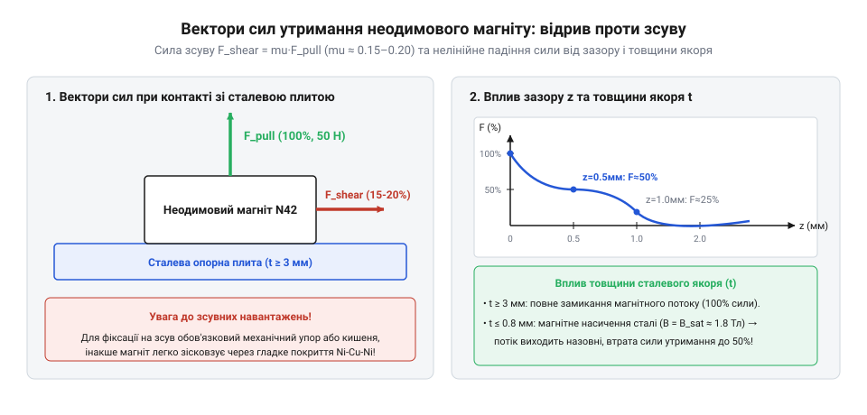
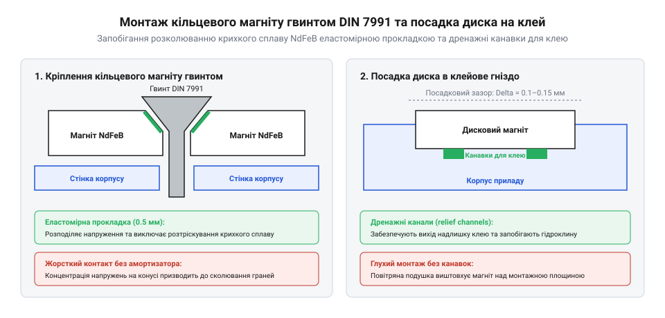

# Неодимові магніти (диски й кільця)

<preknowlist>
- [Набори гвинтів М3 (шестигранник, потайні DIN7991)](root:cat-hw-parts/m3-screw-kits) — геометрію потайної головки гвинта DIN7991 для безпечної фіксації кільцевого магніту без розколювання
- [Клей ціаноакрилатний](root:cat-hw-parts/cyanoacrylate-glue) — специфіку адгезії ціаноакрилатів до металевих нікельованих поверхонь та пластикових корпусів
</preknowlist>

## Фізична крихкість та механіка утримання

Неодимові постійні магніти на основі сплаву Nd2Fe14B виготовляють методом порошкової металургії: це спечений магніт (англ. @@en|sintered magnet@@). Через керамічну кристалічну ґратку матеріал позбавлений пластичності — при ударах чи перекосі він сколюється й кришиться, відкриваючи метал до швидкої корозії. Для жорсткого кріплення поряд із магнітами застосовують [Набори гвинтів М3](root:cat-hw-parts/m3-screw-kits), однак сам магнітний диск не можна затискати високим моментом.

Механіка рознімного з'єднання розрізняє силу нормального відриву та опір зсуву (англ. @@en|shear force@@) уздовж площини контакту, який залежить від тертя.

*Спадання сили утримання F_pull при зростанні зазору та різниця між нормальною силою відриву і зсувним опором F_shear.*

Зсувний опір розраховують через силу утримання та коефіцієнт сухого тертя:

        F_shear
        = μ · F_pull      [закон сухого тертя для контактної пари]
        = μ · F_pull      [граничний опір зсуву перед початком ковзання]

Для пари нікель–сталь коефіцієнт тертя μ становить лише 0.15–0.25, через що зсувна стійкість у 4–6 разів нижча за зусилля відриву. Інженери обов'язково компенсують це штифтами та упорами, застосовуючи [Стійки М2/М3](root:cat-hw-parts/standoffs). Крім того, шар фарби 0.2 мм або тонка сталева пластина знижують силу притискання на 50–70% через розсіювання магнітного потоку.

## Марки, захист та правила монтажу

Маркування магнітів містить літеру N та двозначне число (від N35 до N52), що вказує на питомий енергетичний добуток матеріалу в MGOe. Стандартні марки обмежені температурою 80 °C, вище якої виникає незворотна втрата намагніченості, а вище точки Кюрі (англ. @@en|curie temperature@@, ~310 °C) матеріал стає парамагнітним. Для гарячих вузлів обирають термостійкі серії з суфіксами M, H, SH (до 100–150 °C).

Через високий вміст заліза спечений NdFeB миттєво іржавіє, тому поверхню захищають тришаровим покриттям Ni-Cu-Ni (10–20 мкм) або стійким до солей епоксидом.

*Правильний монтаж потайним гвинтом DIN 7991 з демпферною прокладкою та посадка диска в клейову кишеню з дренажем.*

Кільцеві магніти встановлюють потайним кріпленням (англ. @@en|countersunk mounting@@) гвинтами DIN 7991. Оскільки конус гвинта розклинює та розколює крихкий магніт уже при моменті 0.3 Н·м, під голівку обов'язково кладуть демпферну шайбу 0.2–0.5 мм. При монтажі суцільних дисків у гнізда на [Клей ціаноакрилатний](root:cat-hw-parts/cyanoacrylate-glue) на дні моделюють дренажний отвір або фаску — інакше повітря й клей виштовхнуть магніт, створивши паразитарний зазор. Дрібне кріплення зручно впорядковувати через [Органайзер для дрібних деталей](root:cat-hw-parts/parts-organizer).