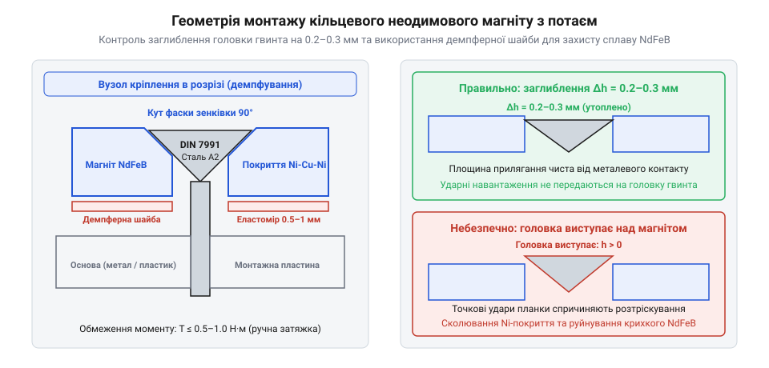

# Монтаж кільцевих магнітів із потаємним отвором на металеві та дерев'яні поверхні

<preknowlist>
- [Набори гвинтів М3 (шестигранник, потайні DIN7991)](root:cat-hw-parts/m3-screw-kits) — геометрія конічної головки гвинта DIN 7991 під кутом 90° та допустимі моменти затягування
</preknowlist>

## Ризики розколювання та геометрія зенкування

Неодимові магніти на основі інтерметаліду неодим-залізо-бор (@@en|NdFeB@@) є найпотужнішими джерелами постійного магнітного поля серед промислових матеріалів. Проте за своїми механічними властивостями спечений магніт подібний до технічної кераміки: він має високу твердість при стисканні, але вирізняється надзвичайною крихкістю (від лат. *fragilitas*, @@en|brittleness@@) та низькою границею міцності на згин і розтяг (близько 80–120 МПа). Коли кільцевий магніт із потайним отвором (англ. *countersunk ring magnet*, @@en|countersunk magnet@@) намагаються зафіксувати звичайним конічним гвинтом без урахування геометрії та допусків, магніт майже завжди тріскається ще на етапі складання або розсипається від першого ж удару металевої деталі у вузлі фіксації.

Головна причина руйнування полягає у клиновому ефекті конічної головки потайного гвинта. Стандартний гвинт із потайною головкою за нормативом DIN 7991 має кут конуса рівно 90°. Коли конічна головка впирається у відповідну фаску магніту, осьове зусилля затягування розкладається на дві складові: силу притиску до основи та радіальну силу розпирання. Радіальні напруження діють зсередини на розрив кільця по найтоншому перерізу стінки між внутрішнім отвором і зовнішнім діаметром. Оскільки розтяжні напруження для спеченого сплаву NdFeB є критичними, навіть незначний перекіс інструменту чи відсутність коаксіальності розриває кільце на два або три сегменти.

*Конструкція вузла монтажу кільцевого магніту із захисним заглибленням потайної головки та демпферною шайбою.*

Другий критичний фактор — глибина заглиблення конічної головки гвинта. Головка гвинта за жодних обставин не повинна виступати над плоскою робочою поверхнею магніту. Якщо капелюшок гвинта виступає хоча б на 0.05–0.1 мм, будь-який металевий предмет (пластина-якір, інструмент, заслінка) під час магнітного притягання з високою швидкістю бʼє не по розподіленій площині, а безпосередньо по сталевій головці гвинта. Цей динамічний точковий удар передається прямо на тонкий край зенкованого отвору магніту, викликаючи сколювання внутрішньої кромки або зріз різьби гвинта.

Щоб гарантувати довговічність, геометрія вузла повинна забезпечувати заглиблення (англ. *countersink recess*, @@en|countersink@@) верхнього зрізу головки гвинта на величину `h_recess = 0.2–0.3 мм` нижче магнітної площини. Для монтажу використовують сумісні за калібром [набори гвинтів М3 з потайною головкою DIN7991](root:cat-hw-parts/m3-screw-kits), вибираючи магніти з глибиною фаски, розрахованою на встановлення демпферної підкладки. Геометрична безпека монтажу безпосередньо залежить від залишкової товщини стінки магніту під конусом та в зоні опорного виступу. Для типорозміру D10x3 мм (зовнішній діаметр `D = 10 мм`, товщина `H = 3 мм`) отвір під гвинт М3 має діаметр зенкування `d_cone = 6.0 мм` та наскрізний отвір `d_hole = 3.2 мм`. При куті фаски 90° глибина конуса становить `h_cone = (d_cone - d_hole) / 2 = (6.0 - 3.2) / 2 = 1.4 мм`, що залишає товщину опорної полички магніту `h_shelf = H - h_cone = 3.0 - 1.4 = 1.6 мм`, а мінімальну радіальну ширину кільця на верхньому зрізі — `t_wall = (D - d_cone) / 2 = (10 - 6.0) / 2 = 2.0 мм`. Для більшого типорозміру D15x4 мм (`D = 15 мм`, `H = 4 мм`) під гвинт М4 (`d_cone = 8.0 мм`, `d_hole = 4.3 мм`) глибина конічної частини дорівнює `h_cone = (8.0 - 4.3) / 2 = 1.85 мм`, залишаючи поличку завтовшки `h_shelf = 4.0 - 1.85 = 2.15 мм` та радіальну стінку `t_wall = (15 - 8.0) / 2 = 3.5 мм`. Якщо ці розрахункові значення зменшуються через виробничі відхилення або надмірне розточування посадкового місця, спечений матеріал не витримує контактного тиску й розламується по концентратору перерізу.

## Демпфування напружень та момент затягування

Прямий механічний контакт між твердою сталлю гвинта та крихким магнітним кільцем створює локальні піки контактних напружень через мікронерівності обробки. Для захисту магніту від точкових концентраторів тиску між конічною головкою гвинта та фаскою магніту обовʼязково встановлюють еластичну або пластичну проміжну демпферну шайбу (@@en|cushioning washer@@).

Як матеріал демпфера найкраще зарекомендували себе:
- Поліамідні (нейлонові PA66) шайби товщиною 0.3–0.5 мм: вони мають високу пружність і під навантаженням текуть пластично, ідеально заповнюючи зазор між кутом фаски магніту та конусом гвинта;
- Фторопластові (PTFE) прокладки: забезпечують хімічну стійкість та мінімальне тертя при затягуванні;
- Тонкі силіконові мембрани: застосовуються у вузлах із підвищеними вібраціями.

Використання [класичних металевих шайб](root:cat-hw-parts/bolts-and-washers) під потайну конічну головку неможливе через геометрію конуса, тому застосовують спеціальні штамповані конічні поліамідні шайби або прорізні підкладки.

Крутний момент затягування при монтажі кільцевих магнітів повинен бути суворо обмеженим. Якщо для звичайної різьби М3 у металі стандартний момент становить 0.6–0.9 Н·м, то при кріпленні магніту NdFeB максимальний момент `T_max` не повинен перевищувати:
- Для гвинта М2: `T_max = 0.08–0.12 Н·м`
- Для гвинта М3: `T_max = 0.20–0.25 Н·м`
- Для гвинта М4: `T_max = 0.40–0.50 Н·м`

Перевищення вказаних значень створює клинове розпираюче зусилля `F_radial = F_axial / tan(45°) = F_axial`, яке розриває спечену структуру сплаву. Затягування виконують виключно ручною прецизійною викруткою з контролем моменту або в кілька обережних обертів до вибору пружного люфту демпферної шайби. Використання шурупокрутів чи ударних гайковертів категорично заборонено: інерційний удар біти розколює магніт миттєво.

Під час складання багатокомпонентних вузлів металовироби та магніти різного калібру зручно сортувати в [лабораторний органайзер для деталей](root:cat-hw-parts/parts-organizer), що запобігає випадковому встановленню занадто довгого гвинта, який упреться в дно глухого отвору й витисне магніт назовні.

## Монтаж на основи та спотворення поля

Властивості магнітного вузла суттєво залежать від матеріалу основи, на яку монтується кільце, та магнітних характеристик кріпильного металовиробу.

При виборі матеріалу гвинта інженер вирішує важливе фізичне завдання збереження форми силових ліній магнітного поля:

1. Немагнітні гвинти з аустенітної нержавіючої сталі А2 (AISI 304) або А4 (AISI 316). Мають магнітну проникність `μ_r ≈ 1.0`, не проводять через себе магнітний потік і не спотворюють тороїдальну картину силових ліній навколо кільця. Робоче поле залишається симетричним, а магнітна сила спрямована строго перпендикулярно площині кільця. Гвинти з латуні також є немагнітними, проте мають меншу міцність на розтяг і використовуються для легких вузлів, подібних до [міжплатних дистанційних стійок](root:cat-hw-parts/standoffs).

2. Феромагнітні гвинти з вуглецевої сталі. Мають високу магнітну проникність (`μ_r > 500–1000`). Сталевий стержень гвинта, що проходить крізь центральний отвір магніту, працює як феромагнітний сердечник: він замикає на себе значну частину магнітного потоку (магнітне шунтування). Це зменшує корисну силу утримання на зовнішній площині на 10–18%, а також створює локальну концентрацію силових ліній безпосередньо на голівці гвинта, спричиняючи підвищене притягання дрібного металевого пилу в зону шліца.

Особливості монтажу на різні типи опорних поверхонь:
- **Металева (сталева) основа.** Сталева пластина шасі слугує магнітопроводом (зворотним ярмом). Вона концентрує розсіяний потік заднього полюса й перенаправляє його у робочий простір, що збільшує підсумкове зусилля відриву деталі з лицьового боку на 25–40%. Під час вкручування гвинта в сталь магніт із силою притягується до шасі самостійно, тому гвинт виконує переважно функцію фіксації від зсуву вбік. - **Деревʼяні та пластикові поверхні.** Не проводять магнітний потік. Гвинт відчуває повне вириваюче навантаження під час кожного циклу зняття деталі. Якщо використовується шуруп або саморіз по дереву, отвір попередньо засвердлюють тонким свердлом на 70% глибини різьби, щоб уникнути розколювання масиву деревини та перекосу конічної головки.

Для фіксації магнітів у гніздах друкованих на 3D-принтері деталей поруч із механічним гвинтовим кріпленням часто застосовують [ціаноакрилатний клей](root:cat-hw-parts/cyanoacrylate-glue), який забезпечує рівномірне клейове прилягання дна магніту до пластикового ложа.

Критичним фактором довговічності є збереження антикорозійного покриття магніту. Сплав NdFeB містить активне залізо та рідкісноземельний неодим, які на відкритому повітрі миттєво окиснюються. Для захисту кільця вкривають тришаровим гальванічним покриттям нікель-мідь-нікель (Ni-Cu-Ni) товщиною всього 12–18 мкм. При ударах конічного кріплення або терті металевих деталей захисний шар здирається. Проникнення атмосферної вологи викликає підшарову корозію: матеріал магніту вспучується, розпадається на сірий токсичний порошок і повністю втрачає магнітні властивості. Для експлуатації у вуличних герметичних блоках для захисту від конденсату встановлюють [вентиляційні захисні мембрани ePTFE](root:cat-hw-parts/eptfe-protective-vents), що гарантують сухість повітря всередині приладу.