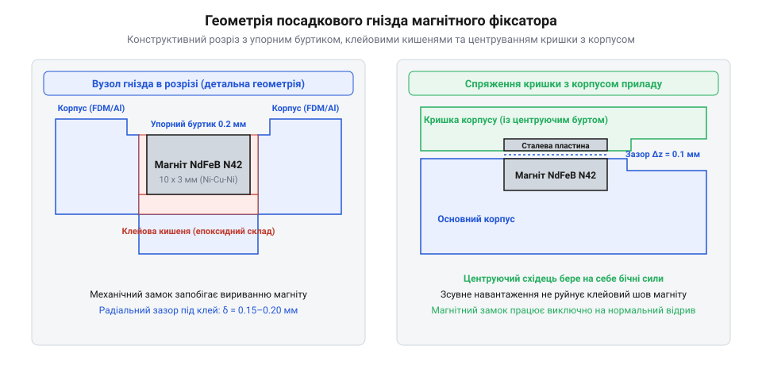

# Проєктування та монтаж знімної кришки приладового корпусу на неодимових магнітах

<preknowlist>
- [Клей ціаноакрилатний](root:cat-hw-parts/cyanoacrylate-glue) — вибір в'язкості ціаноакрилатного клею, час полімеризації та міцність з'єднання нікелю з конструкційними полімерами
</preknowlist>

## Геометрія гнізд та механічні замки

Швидкознімна кришка на постійних магнітах є ідеальним рішенням для електронних приладів, що потребують регулярного доступу для заміни елементів живлення, підключення налагоджувальних портів або огляду датчиків. На відміну від гвинтових зʼєднань, де багаторазове вкручування гвинтів у різьбу пластику швидко розбиває отвір або вимагає встановлення дорогих [різьбових латунних стійок](root:cat-hw-parts/standoffs), магнітний замок забезпечує миттєве зняття без інструментів і не зношується з часом.

Проте при прямому вклеюванні дискового магніту в гладкий отвір виникає типова відмова: сила магнітного притягання діє строго по нормалі до площини розʼєму і при відкриванні буквально вириває магніт із гнізда разом із клеєм. Щоб запобігти цьому, геометрію посадкового отвору проектують з урахуванням компенсації усадки матеріалу та механічного блокування.

*Геометрія гнізда магнітного фіксатора, клейові зазори та взаємне розташування кришки й корпусу.*

Основні конструктивні вимоги до проектування гнізда враховують фізику мікрозачеплення клейового з'єднання та технологічні обмеження друку. Під час пошарового наплавлення стандартним соплом діаметром 0.4 мм для формування надійного механічного замка зворотного конуса без увімкнення підтримувальних структур кут нависання внутрішньої стінки задають у межах 35–45°, а радіальне розширення порожнини вибирають рівним ширині одинарної екструзійної лінії `w = 0.42–0.45 мм` при висоті шару `h_layer = 0.16–0.20 мм`. На дні гнізда моделюють кільцеву замкову фаску з висотою переходу 0.6–0.8 мм, завдяки якій полімеризована епоксидна смола утворює міцне внутрішнє розклинювальне кільце, стійке до повторюваних ударних відривів:

1. **Компенсація допусків та усадки матеріалу корпусу.** При 3D-друку за технологією FDM пластики PETG та ABS зазнають термічної радіальної усадки, а внутрішні циліндричні отвори через натяг нитки друкуються на 0.2–0.3 мм меншими за номінальний CAD-розмір. При фрезеруванні деталей із дюралюмінію допуск на розточування отвору відповідає квалітету H8 (допуск +0.02 мм). Тому діаметр отвору `D_pocket` у моделі задають як суму номінального діаметра магніту `D_magnet`, подвійного клейового зазору `2 · δ_glue` (зазвичай 0.15–0.20 мм на сторону) та матеріальної поправки на усадку. 2. **Заглиблення магніту відносно площини стику.** Магніт повинен бути втоплений нижче зрізу корпусу на величину `h_recess = 0.10–0.15 мм`. Це створює гарантований технологічний повітряний зазор, який виключає жорсткий удар по крихкому нікельованому покриттю магніту під час закривання кришки та забезпечує ідеально плоский стик деталей корпусу без щілин. 3. **Дренажні канали та клейовий карман.** Коли магніт запресовується в глухий отвір, рідкий клей і замкнене повітря створюють гідравлічний тиск, який виштовхує деталь назовні до моменту полімеризації. На дні гнізда обовʼязково моделюють кільцеву канавку або центральне заглиблення для накопичення надлишку клею, а на бічній стінці — 1–2 вертикальні дренажні фаски для вільного виходу повітря. 4. **Механічний замок зворотного конуса.** У фрезерованих або литих деталях нижню частину гнізда розширюють піднутренням («ластівчин хвіст» або зворотний конус під кутом 3–5°). Після застигання клей утворює монолітний замок, що блокує магніт від осьового виривання незалежно від сили адгезії.

Для точного розрахунку контактних площ, напруження в клейовому шарі та перевірки достатності запасу міцності створено спеціалізовані модулі розрахунку, реалізовані мовами C та C++.

:::tabs
@tab C
:::code proj-magnetic-latch-assembly/c/include/magnet_calc.h
:::code proj-magnetic-latch-assembly/c/src/magnet_calc.c
:::code proj-magnetic-latch-assembly/c/src/main.c
@tab C++
:::code proj-magnetic-latch-assembly/cpp/include/magnetic_latch_configurator.hpp
:::code proj-magnetic-latch-assembly/cpp/src/magnetic_latch_configurator.cpp
:::code proj-magnetic-latch-assembly/cpp/src/main.cpp
:::

Програма на мові C розраховує нормальну силу притягання за формулою Максвелла `F = (B² · A) / (2 · μ₀)`, обчислює площу змочування бічної й донної поверхонь гнізда та порівнює напруження зсуву клею з гранично допустимим. Версія на мові C++ реалізує обʼєктно-орієнтований конфігуратор, який автоматично коригує розміри гнізда під конкретний матеріал деталі (алюміній, PETG або ABS) та формує розгорнутий звіт із рекомендаціями.

## Склеювання та адгезія покриттів

Неодимові магніти захищають від корозії тришаровим гальванічним покриттям нікель-мідь-нікель (Ni-Cu-Ni). Зовнішній шар полірованого нікелю має надзвичайно низьку поверхневу енергію та практично дзеркальну гладкість, що є головною перешкодою для надійного склеювання. Звичайний клей без попередньої підготовки відшаровується від нікелю цілою плівкою при першому ж навантаженні.

Технологічний процес склеювання складається з трьох послідовних кроків:

1. **Абразивна підготовка (створення мікрорельєфу).** Лицьовий бік магніту захищають малярною стрічкою, а бічну циліндричну поверхню та донний торець матують дрібнозернистим наждачним папером зернистістю P320–P400 або абразивною губкою. Завдання полягає у створенні розвиненої сітки мікроподряпин для механічного зачеплення клею без протирання захисного нікелю до мідного чи залізного підшару (знімати не більше 2–3 мкм). 2. **Знежирення.** Поверхні ретельно протирають безворсовою серветкою, змоченою в ізопропіловому спирті (IPA) високої чистоти або ацетоні (якщо корпус не з пластику ABS, який розчиняється ацетоном). Використовувати бензин або розчинники з маслянистими домішками суворо заборонено. 3. **Вибір клейової системи:**
   - **Двокомпонентна епоксидна смола.** Найкращий вибір для навантажених магнітів (наприклад, склад типу Loctite EA 3430 або Poxipol). Епоксидна смола має міцність на зсув 14–18 МПа, заповнює зазори товщиною до 0.5 мм без усадки, а час твердіння 15–30 хвилин дозволяє спокійно виставити деталі за глибиною. - **Ціаноакрилат підвищеної вʼязкості.** Для швидкого монтажу використовують гелевий [ціаноакрилатний клей](root:cat-hw-parts/cyanoacrylate-glue), модифікований каучуком (еластомерні добавки підвищують стійкість до ударів). Рідкий ціаноакрилат використовувати не можна: через капілярний ефект він розтікається по корпусу й утворює крихкий склоподібний шов.

Під час складання дрібні деталі, магніти та [кріпильні елементи М3](root:cat-hw-parts/m3-screw-kits) сортують у [лабораторний органайзер деталей](root:cat-hw-parts/parts-organizer), що запобігає засміченню робочого місця феромагнітною стружкою.

## Контроль полярності та збирання

Найпоширенішою помилкою при складанні магнітних кришок є випадкове вклеювання одного з магнітів зворотною полярністю. Якщо хоча б одна пара магнітів виявиться встановленою однойменними полюсами назустріч (N до N або S до S), кришка замість фіксації почне відштовхуватися та перекошуватися, а витягти посаджений на епоксидний клей магніт без руйнування корпусу практично неможливо.

Для виключення браку застосовують перевірену технологію монтажного еталона:

1. **Створення контрольного шаблону.** Беруть один довільний неодимовий магніт і перманентним маркером або яскравою фарбою наносять помітну мітку на його робочий полюс (наприклад, північний полюс N). Цей магніт закріплюють у деревʼяній або пластиковій оправці-ручці. 2. **Маркування партії.** Усі робочі магніти перед нанесенням клею перевіряють еталоном. Ті магніти, які притягуються до мітки шаблону, мають протилежний полюс (S) — їх позначають крапкою відповідного кольору для корпусу. Магніти, що відштовхуються (N), маркують іншим кольором для кришки. 3. **Почергове вклеювання.** Спочатку клей наносять у гнізда базового корпусу і встановлюють усі магніти корпусу кольоровою міткою назовні. Дають клею повністю полімеризуватися. Після цього магніти кришки примагнічують прямо на вже зафіксовані магніти корпусу через тонку прокладку з поліетилену (товщиною 0.1 мм). На відкриті донці магнітів наносять краплі епоксидної смоли й накривають кришкою корпусу, притискаючи її під власною вагою. Після застигання кришку знімають: магніти виявляються ідеально співвісними та з абсолютно гарантованою правильною полярністю притягання.

Для ущільнення стику приладу від вологи та пилу периметр кришки доповнюють пазом під силіконовий ущільнювальний шнур, а для скидання внутрішнього тиску в герметичних корпусах використовують [захисні вентиляційні мембрани ePTFE](root:cat-hw-parts/eptfe-protective-vents). Відкривання кришки розраховують через правило важеля: розміщення ручки відкривання на відстані, що перевищує плече магнітів, зменшує зусилля руки до комфортних 8–15 Н.