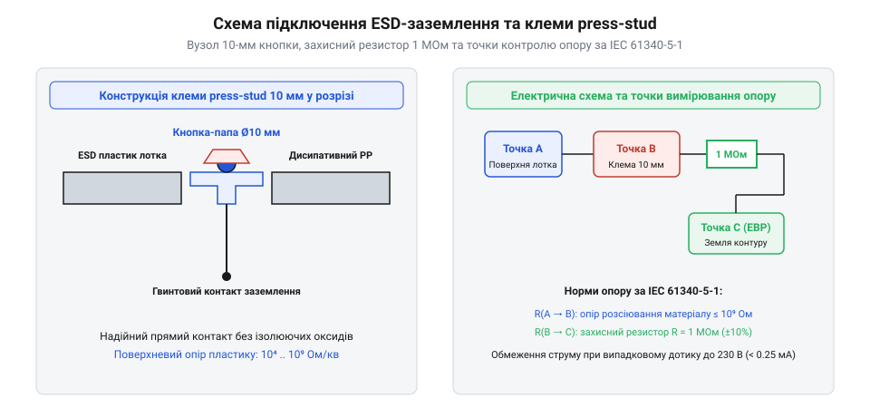

# Довідник геометричних растрів, посадкових профілів та заземлювальних інтерфейсів органайзерів

## Модульні сітки та стандарти касет

Організація робочого простору інженера та зберігання дрібних електронних компонентів, кріпильних елементів і плат неминуче стикається з проблемою безладу, коли деталі розсипані по випадкових коробках, а пошук потрібної позиції забирає дорогоцінний час. Щоб уникнути цього хаосу, елементи зберігання об'єднують у суворі геометричні системи, які дозволяють встановлювати шухляди, касети й лотки в будь-якій комбінації без зазорів чи перекосів. Базою для такого сумісного компонування слугують стандартизовані габарити, адаптовані під промислові стелажі й мобільні кейси.

*Стандартизовані геометричні растри 400×300 мм, Raaco та Gridfinity з допусками посадочних пазів.*

Основним будівельним блоком для багатьох складських і транспортних рішень є євроконтейнер із базовим габаритом основи 400×300 мм. Ця площа дозволяє розміщувати внутрішні лотки кратних розмірів, наприклад, 100×100 мм або 200×100 мм, що повністю виключає вільний простір і запобігає переміщенню коробок під час вібрацій чи транспортування. Для дрібних радіодеталей широке поширення здобули промислові касетні системи Raaco, де вертикальні стійки мають фіксовані кроки полиць, а пластикові висувні шухляди діляться за допомогою поздовжніх і поперечних перегородок на дрібні комірки. Така стандартизація дає змогу гнучко змінювати внутрішню геометрію під конкретні потреби лабораторного чи виробничого столу.

Сучасним відкритим стандартом модульного зберігання є система @@en|gridfinity system@@, розроблена для повної кастомізації робочого місця за допомогою тривимірного друку. Вона базується на дискретному кроці сітки 42 мм, що забезпечує ідеальну сумісність усіх лотків, тримачів та органайзерів. Усі контейнери Gridfinity мають знизу спеціальні фаски та магнітні кишені, які дозволяють надійно фіксувати їх на базових плитах або на дні висувних шухляд. Завдяки цьому підходу інженер може створювати власні касети під [набори гвинтів М3](root:cat-hw-parts/m3-screw-kits) чи специфічні електронні модулі, зберігаючи єдиний геометричний простір. Висота комірок і глибина посадочних гнізд розраховуються так, щоб пальці легко діставали найменші деталі, наприклад [набір кріплення М2.5](root:cat-hw-parts/m25-fastener-kit) або окремі [стійки М2/М3](root:cat-hw-parts/standoffs), не чіпляючи сусідні комірки. Поняття @@en|modular grid standard@@ охоплює всю сукупність цих розмірних ланцюгів, гарантуючи, що деталі з різних екосистем фізично сумісні між собою. Для закріплення важких елементів конструкції чи збирання касет на стінах часто застосовуються додаткові [болти М5/М6 і шайби М3/М4](root:cat-hw-parts/bolts-and-washers), які витримують значні механічні зусилля. Якщо ж у конструкції передбачені знімні кришки або герметичні пенали для захисту від вологи, у них інтегрують [вентиляційні захисні клапани та мембрани ePTFE](root:cat-hw-parts/eptfe-protective-vents), що вирівнюють тиск без втрати герметичності.

## Профілі кріплення, пази та напрямні

Коли модульні касети та органайзери змонтовані, виникає потреба надійно закріпити їх на вертикальних поверхнях, усередині шаф або на пересувних візках так, щоб вони не зсувалися від поштовхів, але легко висувалися для доступу до вмісту. Невідповідність посадочних місць чи занадто великі допуски пазів призводять до заклинювання шухляд, появи неприємних люфтів та швидкого зносу пластикових направляючих.

Для настінного розміщення чи монтажу на вертикальні стійки виробничих верстатів використовують панелі типу @@en|louvered panel@@. Вони мають штамповані відігнуті пелюстки, на які навішуються окремі пластикові бункери або ряди касет. Геометрія зачепів розрахована так, щоб вага контейнера разом із детальми надійно притискала його до поверхні, унеможливлюючи випадкове скидання. Для встановлення компактних корпусів електронних приладів або невеликих блок-органайзерів на стандартні металеві стійки використовують пружинні засувки на рейку DIN EN 60715, які замикаються одним рухом і тримаються завдяки бічним фіксаторам. У важких висувних шафах, де навантаження на одну секцію може сягати кількох десятків кілограмів, застосовують роликові або телескопічні напрямні шухляд. Розрахунок граничного навантаження таких напрямних виконується з урахуванням плеча сили при повному висуванні:

F_max = M_allow / L_ext
          = 150 Н·м / 0.4 м   [розрахунок допустимого експлуатаційного навантаження конструкції за граничним моментом перекидання]
          = 375 Н             [результівне граничне статичне зусилля на пару напрямних висувної шухляди]

де `F_{max}` — максимальне вертикальне зусилля на кінці висувної полиці, `M_{allow}` — допустимий згинальний момент конструкції шафи, а `L_{ext}` — повний виліт шухляди у відкритому положенні. Щоб перегородки всередині шухляд трималися щільно і не випадали від вібрації, пази в стінках виконуються з мінусовим допуском на товщину листового матеріалу, а параметр @@en|drawer slide clearance@@ визначає бічний зазор між рухомою та нерухомою частинами напрямної, який зазвичай становить від 0.2 до 0.5 мм для забезпечення плавного ходу без заклинювання. У разі потреби жорсткої фіксації знімних перегородок або склеювання пластикових корпусів на виробництві використовують [клей ціаноакрилатний](root:cat-hw-parts/cyanoacrylate-glue), який забезпечує миттєве схоплювання стиків, а для рознімних з'єднань корпусів часто залучають [неодимові магніти](root:cat-hw-parts/neodymium-magnets), що створюють надійне зусилля притягання без механічних защіпок.

## Електричний інтерфейс заземлення ESD

Під час роботи з чутливими електронними компонентами, мікросхемами та напівпровідниками звичайне пластикове або металеве сховище може стати джерелом катастрофічного пошкодження через накопичення статичної електрики. Навіть незначний розряд при торканні до висновків деталі здатний пробити напівпровідниковий перехід, якщо сам органайзер і робоче місце не об'єднані в єдиний контур вирівнювання потенціалів.

*Контур заземлення за стандартом IEC 61340-5-1 з кнопковою клемою 10 мм і струмообмежувальним резистором 1 МОм.*

Для запобігання цьому всі елементи конструкції антистатичних органайзерів виконуються з токопровідних або дисипативних полімерів і обов'язково підключаються до загальної системи заземлення захищеної зони. Фізичним інтерфейсом такого підключення слугує стандартизована кнопкова клема діаметром 10 мм типу @@en|press-stud connector@@, яка монтується безпосередньо в корпус полиці або стійки та забезпечує швидке приєднання або від'єднання заземлювального кабелю з пружинним фіксатором. Згідно з вимогами промислового стандарту @@en|electrostatic protected area@@, кожен такий ланцюг повинен містити вбудований струмообмежувальний резистор номіналом 1 МОм, який захищає оператора від ураження електричним струмом у разі випадкового контакту розетки чи металевого корпусу з мережевою напругою 220 В. Перевірка справності цього ланцюга здійснюється вимірюванням перехідного опору між будь-якою точкою полиці органайзера та шиною заземлення:

R_total = R_contact + R_resistor + R_cable
            = 0.1 МОм + 1.0 МОм + 0.05 МОм   [розрахункова сума електричних опорів усіх елементів ланцюга захисного заземлення]
            = 1.15 МОм                       [підсумковий результівний перехідний опір у допустимих межах стандарту IEC 61340-5-1]

де `R_{contact}` — опір посадочного місця кнопкової клеми, `R_{resistor}` — номінал вбудованого захисного резистора, а `R_{cable}` — опір самого гнучкого провідника. Отримане значення має лежати в діапазоні від 1.0·10⁶ до 1.0·10⁹ Ом, що гарантує достатнє стікання статичного заряду без утворення іскор і небезпечних струмів витоку.