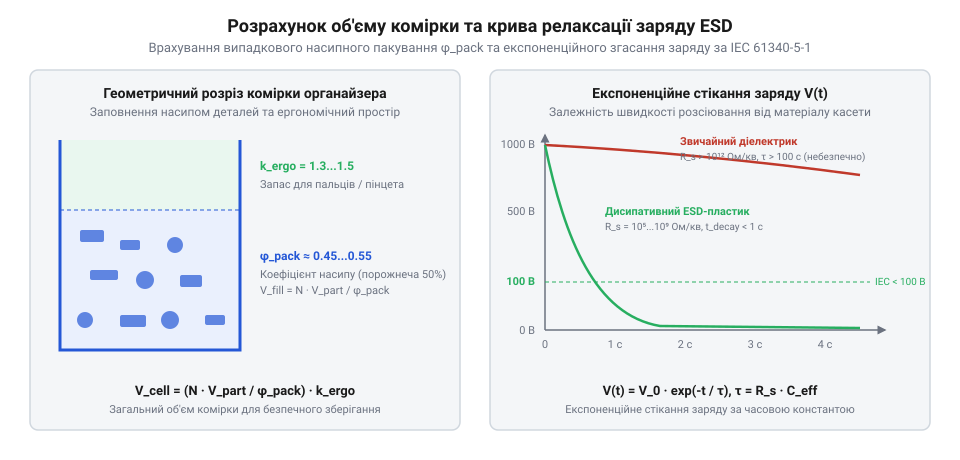

# Геометричний розрахунок об'єму комірок, щільності пакування та часових параметрів стекання ESD-заряду

## Об'єм комірок та насипне пакування

Проектування систем зберігання дрібних радіоелектронних компонентів та крепежу починається з визначення геометричного об'єму окремої шухляди чи комірки. Коли інженер намагається розрахувати місткість контейнера для тисяч гвинтів, шайб або резисторів, виникає спокуса просто розділити внутрішній об'єм комірки на геометрічний об'єм однієї деталі. На практиці такий наївний підхід неминуче призводить до серйозної похибки: комірка переповнюється задовго до досягнення розрахункової кількості, а деталі заклинюють у кутах. Причина полягає в тому, що розсип твердих тіл у просторі ніколи не заповнює весь доступний об'єм суцільно — між окремими елементами неминуче залишаються повітряні порожнини та зазори, форма й об'єм яких залежать від характеру взаємного розташування деталей. Для кількісного опису цього явища використовується коефіцієнт випадкового насипного пакування (packing fraction), який показує відношення чистого об'єму матеріалу деталей до загального об'єму, зайнятого цим насипом у контейнері.


*Геометричний розрахунок заповнення комірки з урахуванням випадкового насипного пакування деталей та динаміка згасання заряду.*

Для хаотично насипаних дрібних деталей складної форми, таких як корпуси резисторів, циліндричні виводи або кріпильні елементи, на кшталт високоміцних шестигранних гвинтів у наборах Набори гвинтів М3 (root:cat-hw-parts/m3-screw-kits) чи спеціалізованих нікельованих деталей із Набір кріплення М2.5 (root:cat-hw-parts/m25-fastener-kit), значення коефіцієнта випадкового пакування коливається в діапазоні від 0.45 до 0.55. Це означає, що від сорока п'яти до п'яти десяти відсотків геометричного об'єму комірки фактично припадає на порожнечу. Якщо ж у шухляді зберігаються довгі металеві Стійки М2/М3 (root:cat-hw-parts/standoffs) або різноманітні Болти М5/М6 і шайби М3/М4 (root:cat-hw-parts/bolts-and-washers), ефект неструктурованого переплетення стрижнів ще сильніше знижує ефективну щільність заповнення.

Окрім фізичного об'єму самих деталей, реальний органайзер вимагає введення додаткового запасу на вільне виймання компонентів пальцями або інструментом. Якщо заповнити комірку під саму верхню крайку, користувач втратить можливість занурити туди пальці чи пінцет, щоб захопити потрібну кількість елементів. Тому інженерна формула розрахунку необхідного об'єму комірки повинна враховувати ергономічний коефіцієнт запасу, який гарантує наявність над вільним насипом достатнього простору для маніпуляцій. Розрахунок мінімального об'єму комірки для заданої кількості деталей здійснюється за такою математичною моделлю:

```
V_cell = (N · V_part / phi_pack) · k_ergo
= (N · V_part / 0.50) · 1.4                   [підстановка типового коефіцієнта випадкової укладки та ергономічного запасу]
= 2.8 · N · V_part                            [результат спрощення розрахункового виразу об'єму комірки]
```

У цій формулі `V_cell` позначає повний внутрішній об'єм комірки органайзера, `N` — максимальну кількість деталей, яку необхідно зберігати в одному відділенні, `V_part` — геометричний об'єм однієї окремої деталі разом із її власними габаритними межами, `phi_pack` — безрозмірний коефіцієнт випадкового насипного пакування (random close packing), а `k_ergo` — ергономічний коефіцієнт запасу на вільне виймання (ergonomic clearance factor), який для зручних лабораторних органайзерів зазвичай лежить у межах від \(1.3\) до \(1.5\). Завдяки такій математичній моделі конструктор уникає ризику переповнення та забезпечує безперешкодний доступ до вмісту. У деяких випадках ущільнення дрібних елементів супроводжується застосуванням герметизуючих або фіксуючих матеріалів, наприклад, коли поряд зберігаються Клей ціаноакрилатний (root:cat-hw-parts/cyanoacrylate-glue) для дрібного ремонту корпусу або захисні елементи на кшталт Вентиляційні захисні клапани та мембрани ePTFE (root:cat-hw-parts/eptfe-protective-vents), що вимагають акуратного розділення простору. Для утримання магнітних компонентів або створення фіксованих баз у конструкції касет також часто залучають Неодимові магніти (root:cat-hw-parts/neodymium-magnets).

## Матричне компонування під ряди E12/E24

Коли об'єм окремої комірки визначено, постає задача організації їх сукупності у вигляді єдиного матричного блоку на робочому столі або в стійці лабораторного обладнання. Сучасна лабораторія електроніки оперує величезною номенклатурою пасивних радіокомпонентів — резисторів і конденсаторів, номінали яких стандартизовані міжнародними рядами E12 та E24. Ряд E12 містить дванадцять логарифмічно рівномірних номіналів на кожну декаду (множник), тоді як ряд E24 розширює цей набір до двадцяти чотирьох номіналів, забезпечуючи більш високу точність підбору номінальних значень без необхідності використання проміжних елементів. Проектування органайзера для повного набору номіналів від одиниць ом до мегаомів вимагає розміщення сотень комірок, що неминуче ставить питання про мінімізацію займаної площі стільниці та оптимізацію ергономіки доступу.

Для створення компактної касети з фіксованою кількістю рядків і стовпчиків застосовується матричне компонування площини зберігання. Нехай загальна кількість необхідних комірок для охоплення заданої кількості декад номінального ряду дорівнює `N_total`. Цю сукупність необхідно розбити на двовимірну матрицю розмірністю `N_x` на `N_y`, де `N_x` — кількість комірок у рядку (по горизонталі), а `N_y` — кількість комірок у стовпчику (по вертикалі). Вибір геометричних пропорцій матриці підпорядкований критерію мінімізації часу пошуку компонента та зручності досяжності крайніх точок робочої зони оператора. Ергономічні дослідження показують, що оптимальне співвідношення сторін матриці органайзера наближається до золотого перетину або співвідношення 4:3, що дозволяє охоплювати поглядом усю номенклатуру рядів E12/E24 без зайвих рухів корпусом.

Математична модель розрахунку габаритних розмірів матриці та товщини розділювальних стінок враховує не лише внутрішній об'єм комірок, а й механічну міцність конструкції. Товщина стінок між сусідніми комірками `t_wall` не може бути довільно малою, оскільки ливарні матеріали та пластики повинні витримувати багаторазові механічні навантаження при вийманні деталей і не деформуватися під тиском сусідніх рядів. Розрахунок загальної ширини матриці `W_total` та висоти `H_total` виконується за системою рівнянь:

```
W_total = N_x · w_cell + (N_x + 1) · t_wall
= N_x · (w_cell + t_wall) + t_wall        [винесення спільного множника розміру комірки та стінки]

H_total = N_y · h_cell + (N_y + 1) · t_wall
= N_y · (h_cell + t_wall) + t_wall        [розрахунок загальної висоти матричного касетного блока]
```

У наведених виразах `w_cell` та `h_cell` визначають внутрішню ширину та висоту окремої комірки, виходячи з розрахованого об'єму та умов зручного захвату, а `t_wall` задає конструктивну товщину міжкоміркової перегородки. Оптимізація модульної площі (modular footprint optimization) дозволяє об'єднувати окремі блоки в єдині стійкі батареї, де стандартизація розмірів сітки забезпечує взаємозамінність шухляд і простоту масштабування лабораторного простору під специфічні виробничі потреби.

## Час стікання електростатичного заряду ESD

Зберігання електронних компонентів, напівпровідникових кристалів, мікросхем та чутливих сенсорів у пластикових органайзерах неминуче стикається з фундаментальною фізичною проблемою накопичення електростатичного заряду. Під час висування шухляди, тертя деталей об стінки комірки або перекладання пакунків виникає трибоелектричний ефект, здатний генерувати потенціали у десятки тисяч вольт. Якщо матеріал органайзера є класичним діелектриком (наприклад, звичайний полістирол або акрил із поверхневим опором понад \(10^{12}\) Ом/квадрат), набраний заряд утримується на поверхні годинами, оскільки стікання електронів неможливе через надзвичайно високий опір. Торкання такої незахищеної комірки або виймання компонента призводить до миттєвого електростатичного розряду (ESD), який здатний безповоротно пробити тонкі ізоляційні шари польових транзисторів або мікросхем CMOS.

Для запобігання подібним відмовам корпуси сучасних професійних органайзерів виготовляються зі спеціальних розсіювальних пластиків (dissipative polymers), модифікованих вуглецевими нанотрубками, графітовими чи антистатичними домішками. Основною характеристикою такого матеріалу є поверхневий опір `R_s`, значення якого згідно з міжнародним стандартом IEC 61340-5-1 повинно лежати в чітко визначеному діапазоні від \(10^{5}\) до \(10^{11}\) Ом/квадрат (ohms per square). Цей діапазон є компромісним: з одного боку, опір достатньо низький, щоб забезпечити контрольоване стікання небезпечного заряду на заземлений каркас стійки, з іншого боку — достатньо високий, щоб уникнути виникнення імпульсних струмів коротке замикання, які могли б пошкодити чутливі ланцюги при прямому контакті.

Динаміка нейтралізації електростатичного заряду підпорядковується закону експоненційного згасання напруги у часі. Якщо в початковий момент часу \(t = 0\) на поверхні комірки зафіксовано потенціал `V_0`, то в будь-який наступний момент часу `t` напруга `V(t)` зменшується згідно з часовою константою релаксації `tau`. Розрахунок процесу згасання заряду описується такою математичною моделлю:

```
V(t) = V_0 · exp(-t / tau)
= V_0 · exp(-t / (R_s · C_eff))          [підстановка часової константи tau через поверхневий опір та ефективну ємність]
= V_0 · e^(-t / (R_s · C_eff))            [кінцевий розрахунковий експоненційний закон релаксації заряду за IEC 61340-5-1]
```

У цій формулі `V(t)` — напруга електростатичного поля в момент часу `t`, `V_0` — початковий піковий потенціал зарядженої поверхні, `tau` — час релаксації заряду (charge decay time), який визначається добутком поверхневого опору матеріалу `R_s` на ефективну електричну ємність системи `C_eff` відносно заземленої поверхні. Стандарт IEC 61340-5-1 вимагає, щоб час спадання напруги від початкового рівня до безпечного порогу (зазвичай менше \(10\%\) від `V_0`) становив не більше двох секунд для будь-яких елементів робочого середовища. Верифікація цього параметра дозволяє гарантувати абсолютну електростатичну безпеку електронних компонентів під час їх тривалого зберігання та сортування в інженерних органайзерах.