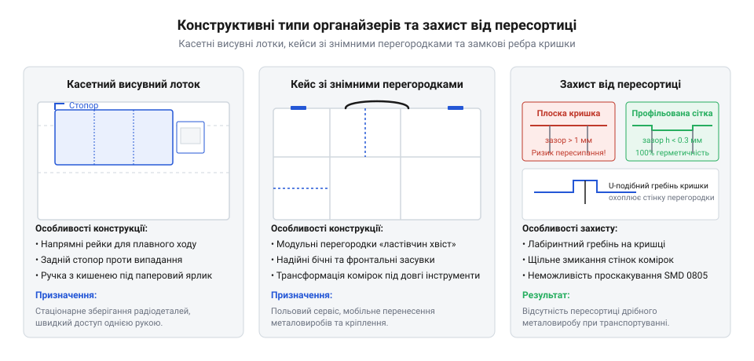
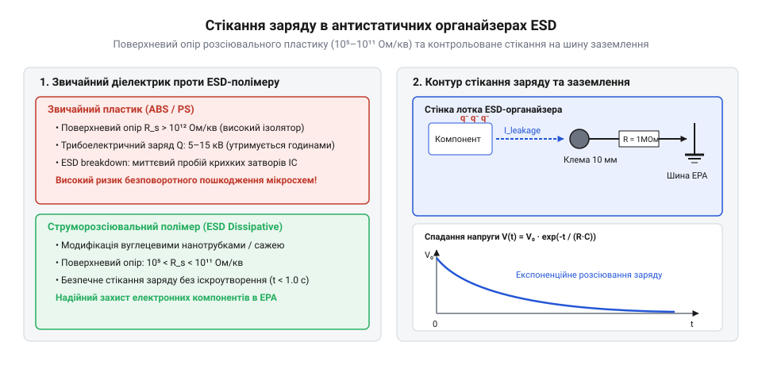
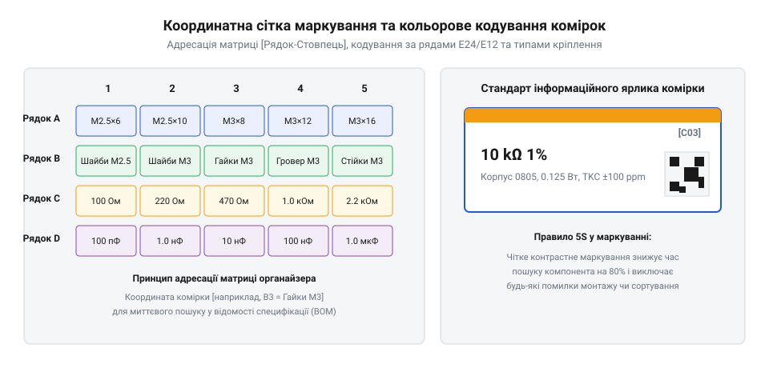

# Органайзер для дрібних деталей

<preknowlist>
- [Набори гвинтів М3 (шестигранник, потайні DIN7991)](root:cat-hw-parts/m3-screw-kits) — стандартні габарити дрібного металевого кріплення для оцінки необхідних розмірів комірок органайзера
- [Стійки М2/М3 (латунь, нейлон)](root:cat-hw-parts/standoffs) — різновиди й специфіку зберігання тендітних латунних та нейлонових дистанційних елементів
- [Болти М5/М6 і шайби М3/М4](root:cat-hw-parts/bolts-and-washers) — відмінності габаритів і насипної маси середнього кріплення для вибору міцності лотків
</preknowlist>

## Наслідки несистематизованого зберігання дрібних деталей

Робота на збиральній дільниці, у сервісному центрі або в радіоелектронній лабораторії неминуче супроводжується щоденним оперуванням сотнями найменувань дрібного металевого кріплення, фасонних дистанційних елементів та мікроелектронних компонентів. Коли ці деталі зберігаються у випадковій тарі — змішаних картонних коробках, відкритих технологічних лотках чи поліетиленових пакетах без внутрішньої сегментації, — найпершою прямою загрозою стає швидке механічне пошкодження точних поверхонь та різьбових профілів. Під час струшування контейнерів, транспортування чи постійного перемивання деталей вручну тверді загартовані сталеві гвинти зазнають постійного фрикційного тертя об м'які латунні або нейлонові [стійки М2/М3](root:cat-hw-parts/standoffs). Гострі вершини зовнішньої різьби сталі зрізають та деформують мікрони витків латуні, а ударні контактні навантаження утворюють заудири на потайних голівках та збивають захисне гальванічне покриття. У результаті деталь втрачає геометричну точність і корозійну стійкість ще до її монтажу у виріб, що призводить до заклинювання під час загвинчування та виникнення браку готової продукції.

Другим наслідком хаотичного зберігання є швидка пересортиця деталей, які є візуально схожими за габаритами, але відрізняються кроком різьби чи довжиною нарізного штифта. Наприклад, металеве нікельоване [набір кріплення М2.5](root:cat-hw-parts/m25-fastener-kit) має зовнішній діаметр різьби 2.5 мм і крок 0.45 мм, що візуально дуже важко відрізнити від суміжних стандартних елементів М3 з кроком 0.5 мм без використання мікрометра або штангенциркуля. Спроба монтажу неправильно вибраного гвинта в нарізний отвір друкованої плати чи алюмінієвого корпусу призводит до негайного зрізання витків або розклинювання різьбової втулки. Понад те, оператор витрачає від 30% до 50% робочого часу на візуальний пошук потрібного номіналу серед сотень подібних елементів, що критично знижує продуктивність збиральних робіт. Якщо ж поруч у тарі розміщені дрібні [болти М5/М6 і шайби М3/М4](root:cat-hw-parts/bolts-and-washers), великі важкі метиси під власною вагою продавлюють і деформують тонкостінні латунні гільзи та вигинають пласкі шайби.

Окрім механічних пошкоджень кріплення, хаотичне зберігання створює фатальні умови для електронних напівпровідникових компонентів та @@en|SMD@@-деталей (англ. @@en|SMD@@, @@en|Surface Mount Device@@ — пристрій поверхневого монтажу). Застосування випадкового діелектричного пластику — звичайних поліетиленових пакетів, оргалітових скриньок чи акрилових лотків — призводить до виникнення трибоелектричного ефекту (від грец. τριβή — тертя та ηλεκτρον — бурштин). Внаслідок постійного тертя деталей об стінки контейнера під час перенесення на поверхнях накопичується статичний заряд, потенціал якого сягає від 2000 В до 15 000 В. При вилученні компонента з тари відбувається миттєвий електростатичний розряд — @@en|ESD@@ (англ. @@en|ESD@@, @@en|Electrostatic Discharge@@, від грец. ηλεκτρον — бурштин та лат. staticus — нерухомий). Фізичний механізм розряду під час зберігання та оперування описують дві основні моделі: @@en|HBM@@ (англ. @@en|HBM@@, @@en|Human Body Model@@ — модель людського тіла) та @@en|CDM@@ (англ. @@en|CDM@@, @@en|Charged Device Model@@ — модель зарядженого пристрою). Модель @@en|HBM@@ відтворює розряд через торкання оператора, де еквівалентний опір людського тіла обмежує піковий струм, але збільшує тривалість імпульсу до сотень наносекунд. Натомість при зберіганні в діелектричному органайзері найнебезпечнішим є розряд за моделлю @@en|CDM@@: корпус компонента накопичує заряд від тертя об стінки комірки, а під час наближення металевого інструмента накопичена енергія миттєво стікає через один вивід за час менше 1 нс із піковим струмом до 10–30 А. Якщо високовольтні спалахи викликають миттєвий катастрофічний пробій, то низьковольтні імпульси @@en|ESD@@ потенціалом лише 100–300 В (які людина навіть не відчуває) утворюють @@en|латентний дефект@@ (від лат. @@la|latens@@ — прихований). Наносекундний сплеск струму локально перегріває напівпровідник і пробиває тонесенькі підзатворні діелектричні шари оксиду кремнію в інтегральних мікросхемах та польових транзисторах, формуючи точкові мікроскопічні дислокації та струмові канали витоку. Через цей прихований мікропробій деталь зберігає початкову працездатність і успішно проходить первинне тестування, проте під дією робочої температури й напруги дефект деградує, призводячи до раптової відмови пристрою вже під час експлуатації в кінцевого користувача. Для відвернення цих збитків органайзери мають виготовлятися з антистатичних матеріалів та інтегруватися в заземлені [системи заземлення робочого місця](root:cat-hw-instruments/cat-hw-esd-workstation-grounding-and-matting).

Еволюція систем зберігання дрібних деталей пройшла шлях від примітивних дерев'яних касет та касових скриньок середини XX століття до сучасних високотехнологічних рішень із токопровідних полімерів. Історично майстри зберігали кріплення в жестяних баночках та важких металевих лотках, що вимагало великої площі та не захищало деталі від корозії чи змішування при транспортуванні. Масове впровадження лиття термопластів під тиском дало змогу створювати легкі контейнери з хімічно стійкого поліпропілену та ударостійкого ABS-пластику із чіткою стандартизованою сіткою розмірів. Для електронної промисловості критичним кроком стала розробка антистатичних композитів із вуглецевими наноструктурами, що відводять статичний заряд. Паралельно розвивалася геометрія кришок: впровадження спеціальних протипересортичних протитискних пазів та еластичних ущільнювачів повністю усунуло проблему пересипання дрібного кріплення між сусідніми секціями під час вібрацій. Сучасний етап розвитку характеризується переходом до цифрових відкритих модульних екосистем та 3D-друку кастомних органайзерів безпосередньо під поточні завдання лабораторії.

Усі перелічені чинники — від зносу різьбових витків і часових втрат на сортування до трибоелектричного пробою напівпровідників та пересортиці при струшуванні — однозначно формулюють вимоги до професійного обладнання для зберігання. Потрібен конструктивний перехід від хаотичної тари до спеціалізованого @@en|organizer@@ (англ. @@en|organizer@@, від лат. @@la|organizo@@ — надавати стрункого вигляду, впорядковувати), який забезпечує жорстку геометричну ізоляцію кожного номіналу, захист від статичної електрики та фіксацію вмісту в комірках. Це підводить нас до аналізу конструктивних типів органайзерів та геометричного розрахунку їхніх комірок.

## Конструктивні типи та геометрія комірок

Конструктивне виконання органайзера визначається умовами експлуатації, необхідною мобільністю та ступенем диверсифікації асортименту деталей. На практиці сформувалися два основні класи конструкцій: стаціонарні касетні висувні блоки та переносні кейси з комірковою структурою.

Касетні висувні блоки (стаціонарні шафи-органайзери) розраховані на стаціонарне розміщення на робочому столі або стінній панелі. Основою конструкції є жорсткий несучий каркас із листової сталі або ударостійкого полімеру, у який за напрямними рейками встановлюються висувні лотки — @@de|Kassette@@ (нім. @@de|Kassette@@, від італ. @@it|cassetta@@ — скринька). Усередині лотків передбачено напрямні пази під знімні перегородки, що дозволяє регулювати внутрішню довжину та ширину комірок під поточні деталі. Для запобігання випадковому випаданню лотка під час повного висування конструкцію оснащують запобіжними виступами-стопорами. Для зберігання радіокомпонентів у стрічковій упаковці застосовують спеціалізовані [контейнери та стрічкові бокси для SMD](root:cat-hw-parts/cat-hw-smd-component-storage-strips-and-boxes), які інтегруються у висувні касети.

Переносні кейси з регульованими або знімними комірками призначені для виїзного монтажу та переміщення кріплення між робочими зонами. Конструкція складається з міцної нижньої чаші та прозорої захисної кришки із ударостійкого полікарбонату, що фіксується засувками-кліпсами (англ. @@en|latch@@ — фіксатор). Внутрішній простір формується або суцільною сіткою регульованих пазових перегородок, або набором окремих знімних лотків-вкладок різного типорозміру, що вставляються в посадкову матрицю нижнього корпусу.

Критичним вузлом переносного кейса є механізм запобігання пересортиці деталей при транспортуванні. У простих контейнерах між верхнім торцем внутрішніх перегородок і пласкою кришкою залишається зазор Δh > 0.5 мм. Під час вібрації або перевертання кейса дрібні пласкі шайби чи SMD-компоненти розміром 0603 прослизають крізь цей зазор, змішуючись у сусідніх комірках. У професійних органайзерах це розв'язується формуванням на внутрішній поверхні кришки спеціального протипересортичного профілю (протитискної сітки). При закриванні кейса виступаючі ребра кришки точно входять у контакт із верхнім торцем перегородок або перекривають їх у нахлест із технологічним зазором Δh < 0.1 мм.


*Конструктивні варіанти органайзерів: стаціонарний касетний блок, переносний кейс із притискним профілем кришки та герметизацією зазору комірок.*

Сучасним напрямом у геометрії органайзерів є перехід до відкритих модульних сітчастих екосистем. Вони базуються на стандартизованому кроці посадкової сітки — @@de|Raster@@ (нім. @@de|Raster@@, від лат. @@la|rastrum@@ — граблі, сітка). Найпоширенішою є відкрита система Gridfinity, у якій базова плита має сітку з кроком 42 мм із фасонними скошеними заглибленнями. Модульні комірки мають у нижній частині відповідний профіль із фасками та кутовими гніздами під [неодимові магніти](root:cat-hw-parts/neodymium-magnets), що фіксуються за допомогою [клей ціаноакрилатний](root:cat-hw-parts/cyanoacrylate-glue). Користувач може самостійно виготовляти комірки потрібної висоти й конфігурації на 3D-принтері, застосовуючи антистатичний струмопровідний пластик. Детальні геометрії растрів та механічні інтерфейси наведено у виданні [довідник геометричних растрів](root:cat-hw-parts/parts-organizer/api-parts-organizer-grid-and-mounting-spec.md), а практична розробка Gridfinity-органайзера описана у вставці про виготовлення [модульного органайзера Gridfinity](root:cat-hw-parts/parts-organizer/proj-3d-printed-gridfinity-esd-organizer.md). Додатково концепція Gridfinity як глобальної екосистеми розглядається через оглядову матеріальну [модульна система Gridfinity](root:cat-hw-parts/cat-hw-gridfinity-modular-ecosystem).

Геометрія внутрішнього об'єму комірки безпосередньо впливає на зручність вилучення деталей. У прямокутних комірках із прямими кутами між дном і бічними стінками дрібне кріплення (наприклад, потайні гвинти [набори гвинтів М3](root:cat-hw-parts/m3-screw-kits)) застрягає в кутках, і його важко підхопити пальцями або пінцетом. Для усунення цього бар'єра передню внутрішню стінку комірки виконують із радіусним схилом (радіусним жолобом). Радіус заокруглення дна R ≥ 15 мм дозволяє легко ковзати пальцем уздовж дна, вигрібаючи кріплення вгору до переднього торця комірки без заклинювання.

При розрахунку необхідних розмірів комірок органайзера слід ураховувати ефект хаотичного укладання (насипної щільності). Коли дрібне кріплення насипають у комірку bulk-способом, воно займає лише частину її геометричного об'єму через утворення міждетальних порожнеч. Коефіцієнт насипної щільності (коефіцієнт укладки) `η_pack` показує частку чистого об'єму металу чи пластику у сукупному насипному об'ємі. Числове значення цього коефіцієнта не є статичною константою, а суттєво залежить від геометричного аспектного співвідношення — англ. @@en|aspect ratio@@ (від лат. @@la|aspectus@@ — вигляд та @@la|ratio@@ — розрахунок, відношення), що визначається відношенням максимальної довжини деталі до її ефективного діаметра `AR = L / D`, а також від ступеня асиметрії її форми. Якщо ізометричні деталі з `AR ≈ 1` (гарантовано симетричні гайки або короткі гвинти з [набори гвинтів М3](root:cat-hw-parts/m3-screw-kits)) під дією гравітації легко повертаються і щільно заповнюють об'єм із `η_pack ≈ 0.55 ... 0.65`, то продовгасті деталі з `AR >> 1` (наприклад, довгомірні різьбові [стійки М2/М3](root:cat-hw-parts/standoffs) чи довгі [болти М5/М6](root:cat-hw-parts/bolts-and-washers)) демонструють принципово іншу поведінку. Під час хаотичного падіння у комірку видовжені або вигнуті асиметричні елементи орієнтуються під довільними кутами й вступають у взаємне заклинювання, утворюючи ефект арочного перекриття — @@en|bridging@@ (від англ. @@en|bridge@@ — міст). Тіла деталей спираються одне на одне в кількох точках і формують просторовий жорсткий решітчастий каркас із великими внутрішніми порожнечами, який перешкоджає самостійному ущільненню засипки. Через це із зростанням аспектного співвідношення `AR` коефіцієнт насипної щільності стрімко знижується до `η_pack ≈ 0.35 ... 0.45` (а для дуже тонких довгих шпильок — нижче `0.30`). Ігнорування геометричної асиметрії та застосування усередненого значення `η_pack = 0.60` під час розрахунку видовженого кріплення призводить до похибки об'єму до 40–50%: комірка виявляється переповненою, деталі виступають над бічними стінками та унеможливлюють герметичне закривання кришки органайзера.

Для стандартного неокресленого металевого кріплення (гвинти М3-М6, шайби, гайки) коефіцієнт насипної щільності становить η_pack ≈ 0.55 ... 0.65. Тобто 35–45% об'єму комірки складає повітряний простір між деталями.

Розрахунок необхідного робочого об'єму комірки V_cell для зберігання партії з N деталей, де кожна деталь має чистий об'єм V_part, виконується за формулою:

```
V_cell = (N × V_part) ÷ η_pack
= (N × V_part) ÷ 0.60         [припускаємо середній коефіцієнт насипу 0.60]
```

Для запобігання переповненню комірки, при якому деталі піднімаються вище рівня бічних стінок і перешкоджають щільному закриванню кришки, у розрахунок уводять технологічний коефіцієнт запасу за висотою k_safe = 1.25 (запас 25% об'єму):

```
V_total = V_cell × k_safe
= (N × V_part × 1.25) ÷ η_pack
```

**Приклад обчислення розміру комірки для гвинтів М3×10 DIN7991:**
**Умова:** Необхідно розмістити N = 200 шт. потайних гвинтів М3×10 мм із чистою вагою та об'ємом одного гвинта V_part = 0.08 см³. Коефіцієнт насипної щільності η_pack = 0.58.

```
V_cell = (200 × 0.08) ÷ 0.58
= 16.0 ÷ 0.58                 [обчислення об'єму суцільного металу та насипного об'єму]
= 27.59 см³                   [необхідний насипний об'єм деталей]

V_total = 27.59 × 1.25
= 34.49 см³                   [загальний необхідний об'єм комірки з урахуванням запасу 25%]
```

Висновок: Для розміщення 200 гвинтів М3×10 з урахуванням вигрібного схилу дна потрібна комірка з корисним геометричним об'ємом не менше 34.5 см³ (наприклад, комірка розміром 40 мм × 40 мм × 22 мм). Вичерпні інженерні формули та методика детального розрахунку наведені у виданні [геометричний розрахунок об'єму комірок](root:cat-hw-parts/parts-organizer/math-organizer-grid-packing-and-capacity-calculation.md).

## Матеріали корпусу та антистатичний захист

Взаємодія дрібного металевого кріплення та чутливих електронних компонентів із поверхнею органайзера супроводжується постійним механічним тертям та ударними навантаженнями. Якщо корпус виготовлено з крихкого або схильного до накопичення статичної електрики пластику, дрібні [набори гвинтів М3](root:cat-hw-parts/m3-screw-kits) швидко протирають стінки комірок, а падіння контейнера спричиняє тріщини та розсипання вмісту. Ще критичнішою є проблема для напівпровідникових компонентів: під час тертя виникає @@en|трибоелектричний заряд@@, здатний накопичувати потенціал у кілька тисяч volt та пробивати тонкі діелектричні затвори польових транзисторів. Тому вибір матеріалу корпусу органайзера визначає не лише його фізичну довговічність, а й рівень безпеки збережених компонентів.

Основою більшості промислових і побутових органайзерів є термопластичні полімери. Найпоширенішим матеріалом для виготовлення лотків і переносних кейсів є @@en|поліпропілен@@ (від грец. @@el|poly@@ — «багато» та @@en|propylen@@ — «пропілен»), який характеризується високою хімічною стійкістю до мастил, розчинників та високою в'язкістю руйнування. Поліпропіленові комірки витримують багаторазові вигини без утворення тріщин, що дозволяє формувати з них гнучкі з'єднувальні петлі та засувки. Для навантажених несучих каркасів та висувних модулів застосовують ударостійкий @@en|ABS-пластик@@ (від нім. @@de|Acrylnitril-Butadien-Styrol@@), який має високу жорсткість та стабільність розмірів під навантаженням, завдяки чому касетний органайзер не деформується під вагою металевого кріплення. Прозорі кришки кейсів виготовляють із @@en|полікарбонату@@ (від грец. @@el|poly@@ — «багато» та лат. @@la|carbo@@ — «вугілля»), який забезпечує оптичну прозорість для огляду вмісту без відкривання та високу опірність точковим ударам. Однак дифузійний захист від вологи вимагає спеціальних герметичних рішень, як-от [клапани ePTFE](root:cat-hw-parts/eptfe-protective-vents), які вирівнюють внутрішній тиск без проникнення пилу.

Стандартні диелектричні полімери є ізоляторами з високим поверхневим опором, через що накопичений електричний заряд залишається на них годинами. Для захисту чутливих напівпровідникових структур матеріал органайзера повинен володіти здатністю контрольовано розсіювати заряд. За величиною поверхневого опору `ρ_s` матеріали органайзерів поділяють на три класи:
1. Диелектричні ізолятори (`ρ_s > 10¹² Ом/квадрат`) — накопичують статичний заряд і створюють ризик трибоелектричного пробою. 2. @@en|дисипативні полімери@@ (від лат. @@la|dissipare@@ — «розсіювати», `10⁵ Ом/квадрат ≤ ρ_s ≤ 10¹¹ Ом/квадрат`) — забезпечують плавне стекання заряду без виникнення струмових піків. 3. @@en|струмопровідні композити@@ (`ρ_s < 10⁵ Ом/квадрат`) — миттєво відводят заряд на заземлений контур.

Щоб визначити дисипативні властивості полімерного корпусу органайзера, вимірюють опір між двома паралельними електродами довжиною `D` та відстанню між ними `d`. Поверхневий опір матеріалу `ρ_s` розраховують за співвідношенням геометричного коефіцієнта електродів та виміряного електричного опору `R`:

```
ρ_s = R · (D / d)      [геометричне нормування поверхневого опору]
```

Для квадратних вимірювальних електродів, де `D = d`, виразом `(D / d) = 1`, тому поверхневий опір `ρ_s` вимірюється в омах на квадрат (`Ом/квадрат`) і чисельно дорівнює виміряному опору `R`.

Час розрядки `t_d`, за який початковий потенціал статичного заряду `U_0` на поверхні органайзера зменшується до безпечного рівня `U_t`, визначається через електричний опір витоку `R_g` та еквівалентну ємність об'єкта `C`:

```
t_d = R_g · C · ln(U_0 / U_t)      [закон розрядки ємності через дисипативний опір]
```

З виразу видно, що зниження опору витоку `R_g` шляхом додавання вуглецевих волокон або струмопровідної сажі у полімер пропорційно скорочує час стекання заряду `t_d` від десятків секунд до кількох мілісекунд. Інженерна методика, що докладно описує [розрахунок об'єму комірок](root:cat-hw-parts/parts-organizer/math-organizer-grid-packing-and-capacity-calculation.md) та часові параметри стекання заряду, дозволяє точно розрахувати коефіцієнти укладки й часові характеристики ESD-захисту.

Для надання поліпропілену чи ABS-пластику антистатичних властивостей до їх складу на етапі екструзії ввозять струмопровідні домішки. Найпоширенішим наповнювачем є мікродисперсний вуглецевий сажовий концентрат (carbon black), який створює всередині полімерної матриці перколяційну сітку для проходження електронного струму. Такі органайзери мають характерний чорний колір і стабільні дисипативні властивості, які не залежать від відносної вологості повітря. Для забезпечення прозорості кришок використовують об'ємні антистатичні добавки на основі іонних рідин або поліефірних блокових кополімерів, які мігрують до поверхні та адсорбують тонкий шар вологи з повітря, знижуючи поверхневий опір до безпечних значень.


*Структура антистатичного дисипативного полімеру із перколяційною сіткою вуглецевих волокон та шлях відведення заряду на земляну шину.*

Для надійного захисту малогабаритних напівпровідникових модулів антистатичний органайзер інтегрують у загальну систему захисту майстерні. Корпус органайзера оснащують металевими заклепками або затискачами з кнопочним роз'ємом діаметром 10 мм, до якого підключають заземлювальний кабель із вбудованим захисним резистором номіналом 1 МОм. Це підключення інтегрують у шину, що з'єднує [заземлення робочого місця](root:cat-hw-instruments/cat-hw-esd-workstation-grounding-and-matting) та антистатичні настільні килимки. Для нетипових корпусних рішень розроблено методику, яка дозволяє виконати [3D-друк антистатичного органайзера](root:cat-hw-parts/parts-organizer/proj-3d-printed-gridfinity-esd-organizer.md) із застосуванням спеціалізованих філаментів ESD PETG та PLA, що містять вуглецеві нанотрубки. Фізичні геометричні розміри монтажних отворів і контактних клем описує [довідник геометричних растрів](root:cat-hw-parts/parts-organizer/api-parts-organizer-grid-and-mounting-spec.md) та заземлювальних інтерфейсів. Для зберігання особливо тендітних дистанційних елементів, таких як [латунні стійки М2](root:cat-hw-parts/standoffs), застосовують додаткові струмопровідні лотки з м'яким етиленвінілацетатним (EVA) ложементом.

## Маркування та логіка систематизації вмісту

Навіть найміцніший антистатичний органайзер втрачає свою ефективність, якщо всередині нього панує хаос. Хаотичне перемішування кріплення різних різьбових стандартів призводить до того, що інженер витрачає до 30% робочого часу на візуальний пошук потрібної деталі або, що гірше, випадково вкручує кріплення з неправильним кроком різьби, пошкоджуючи деталі. Особливо гостро ця проблема постає під час сортування дрібного [нікельованого кріплення М2.5](root:cat-hw-parts/m25-fastener-kit) та прилеглих розмірних груп, де візуальні відмінності між сусідніми довжинами гвинтів становлять частки міліметра. Систематизація вмісту органайзера на основі координатної матриці та логічного маркування створює чітку візуальну структуру, яка зводить ризик помилки до нуля.

Основою логічної систематизації є введення двовимірної координатної сітки комірок органайзера. Кожен висувний лоток або комірка переносного кейса отримує унікальний індекс, що складається з літери рядка та номера стовпця (наприклад, `A1`, `B4`). Для візуального прискорення пошуку координати поєднують із кольоровим кодуванням категорій вмісту. Наприклад, синій колір етикетки виділяє метричне кріплення, зелений — дистанційні елементи, червоний — напівпровідникові SMD-компоненти, а жовтий — пасивні радіодеталі. Друк етикеток виконують на зносостійких плівках методом термотрансферного друку, стійкого до стирання та впливу мастил. Інтеграція QR-кодів або двовимірних штрихкодів матриці дозволяє сканувати комірку за допомогою мобільного терміналу, пов'язуючи її стан із цифровізованою системою обліку, про що детально розповідають [системи маркування та обліку](root:cat-hw-instruments/cat-hw-component-labeling-and-inventory-systems) радіодеталей.


*Координатна матриця з кодуванням категорій вмісту кольором, текстовими індексами та штрихкодами для автоматизованого обліку.*

Розміщення деталей всередині органайзера підпорядковується правилам ергономічної ієрархії. Наближені до переднього краю комірки виділяють під номінали найвищої частоти використання. Для кріплення застосовують правило зростання розмірів від лівого верхнього кута до правого нижнього: у лівих комірках розміщують гвинти М2 і М2.5, у центральних — [набори гвинтів М3](root:cat-hw-parts/m3-screw-kits), а в крайніх правих — масивні [болти М5 і М6](root:cat-hw-parts/bolts-and-washers). Для SMD-компонентів сортування виконують за стандартними рядами номіналів (Е12, Е24) зі збільшенням опору чи ємності. При цьому наддрібні чіп-компоненти типорозмірів 0402 та 0603 розміщують у спеціальних боксах із пружинними прозорими кришками, які відчиняються в один клік, де застосовують спеціалізовані [стрічкові бокси SMD](root:cat-hw-parts/cat-hw-smd-component-storage-strips-and-boxes) для відрізків бластерних стрічок.

Індивідуальні органайзери є лише елементом загальної логістичної системи майстерні. Ефективне зональне сортування передбачає поділ усього запасу деталей на три рівні доступності:
1. Оперативна зона (золота зона охоплення руки) — настільні модульні блоки та настінні касети із найвживанішими номіналами. 2. Буферна зона (зона кроковой доступності) — стелажні касетні шафи для зберігання повного асортименту номіналів кріплення та радіодеталей. 3. Магістральна складська зона — глибокі контейнери для оптових упаковок і резервних запасів.

Для побудови гнучкої та налаштовної системи настільної зони застосовують стандартизовані відкриті системи. Найпопулярнішим рішенням є [модульні системи Gridfinity](root:cat-hw-parts/cat-hw-gridfinity-modular-ecosystem), які базуються на сітці з кроком 42 мм та дозволяють вільно комбінувати комірки різної висоти й ділити їх знімними перегородками. Фіксація модулів на підставці забезпечується за рахунок геометрії або через вбудовані [неодимові магніти](root:cat-hw-parts/neodymium-magnets), що запобігає зсуву лотків при вібраціях. Покрокову інструкцію про те, як розгорнути таку інфраструктуру у реальних умовах, покроково розкриває [проектування системи зберігання](root:cat-hw-parts/parts-organizer/proj-modular-workshop-organizer-system.md) для майстерні або виробничої дільниці.


*Трирівневе зонування робочого місця інженера-монтажника з розподілом компонентів за частотою використання та типами органайзерів.*

## Інтеграція органайзерів у робочий простір

Навіть ідеально впорядковані касетні бокси та марковані комірки втрачають сенс, якщо @@en|organizer@@ розміщено хаотично на робочому столі або на віддалених полицях. Коли інженер змушений щоразу вставати з місця, тягнутися через увесь верстак за лотком із [наборами гвинтів М3](root:cat-hw-parts/m3-screw-kits) або шукати потрібний номінал серед купи переносних кейсів, робочий ритм розривається, зростає втома й підвищується ризик випадково перекинути відкриті контейнери. Вирішення цієї проблеми полягає не в купівлі додаткових боксів, а в побудові узгодженої просторової системи, де кожен елемент зберігання прив’язаний до фізичних зон досяжності та жорстко зафіксований на відповідному носії.

Для звільнення горизонтальної площини столу органайзери виносять у вертикальну площину. Проте звичайний підвіс на саморізи не витримує тривалого експлуатаційного навантаження: масивний касетний блок, у якому складено важкі [болти М5 і М6](root:cat-hw-parts/bolts-and-washers), створює значний зсувний момент. Для надійної фіксації застосовують підвісні планки @@fr|French cleat@@ (від англ. *cleat* — клин або планка зі скошеним під кутом 45° краєм), де вагова сила касети притискає її до стінового кронштейна без ризику самовільного зсуву.

Обчислимо максимальний зсувний момент `M` на стінову планку при повній завантаженості касети масою `m`, де `g` — прискорення вільного падіння, а `L` — плече віддалення центра ваги від стіни:

```
M = F × L
  = (m × g) × L
  = (12.5 × 9.81) × 0.15     [підстановка маси, гравітаційної сталої та плеча]
  = 18.39                    [граничний зсувний момент у ньютон-метрах]
```

Такий розрахунок показує, що звичайна пластикова клямка під дією моменту в 18.39 Н·м з часом зазнає пластичної деформації, тоді як планка @@fr|French cleat@@ розподіляє навантаження вздовж усього профілю. Альтернативним варіантом для компактних модулів є металева @@de|DIN-рейка@@ (від нім. *Deutsches Institut für Normung* — німецький інститут стандартизації), яка дозволяє швидко переміщувати висувні блоки вздовж горизонталі та фіксувати їх засувками. Для кріплення напрямних на дерев'яні чи композитні щити використовують високоміцний [ціаноакрилатний клей](root:cat-hw-parts/cyanoacrylate-glue) разом із механічними анкерами.

Розміщення стінних і настільних носіїв підпорядковується правилам такої дисципліни, як @@en|ергономіка@@ (від грец. *ergon* — робота та *nomos* — закон), яка оптимізує рухи людини. Робочий простір розділяють на три радіальні зони відносно оператора, який сидить або стоїть у центрі робочого місця:
1. *Оперативна зона (первинна)* — дуга з радіусом 35–45 см від ліктя. Сюди вміщують найбільш запитуване дрібне кріплення, наприклад [латунні та нейлонові стійки](root:cat-hw-parts/standoffs) або часто вживані номінали [стрічкових боксів SMD](root:cat-hw-parts/cat-hw-smd-component-storage-strips-and-boxes). Всі лотки доступні рухом кисті без нахилу тулуба. 2. *Основна зона (вторинна)* — радіус 50–60 см (витягнута рука в межах видимості). Тут розміщують касетні блоки із середньою частотою звернення. 3. *Буферна зона (третинна)* — радіус понад 70 см або верхні й нижні яруси стелажів. Сюди відносять запасні контейнери та [нікельовані набори М2.5](root:cat-hw-parts/m25-fastener-kit), які виймають лише під час реорганізації чи поповнення запасів.

Крім того, застосовують правило «вертикальної важкості»: важкі металеві деталі завжди зберігають на нижніх ярусах (на рівні стільниці чи нижче), а легкі полімерні деталі та @@en|SMD@@-компоненти — на рівні очей. Це запобігає зміщенню центра ваги стелажної стійки вгору та виключає травмування при випадковому випадінні лотка.


*Схема поділу робочої зони на оперативну та буферну частини з деталізацією вузлів кріплення French cleat та DIN-рейки, що забезпечує мінімізацію траєкторій руху оператора.*

Щоб поєднати стаціонарне зберігання в майстерні з можливістю мобільної роботи (наприклад, виїзд на об'єкт або міжлабораторне переміщення), будують двоконтурну систему:
- *Стаціонарний контур*: стінна касетна матриця, де номенклатура прив'язана до [цифрового обліку кріплення](root:cat-hw-instruments/cat-hw-component-labeling-and-inventory-systems). - *Мобільний контур*: переносний кейс зі знімними лотками. При формуванні виїзного комплекту оператор переставляє потрібні модулі зі стаціонарної касети в кейс без пересипання деталей вручну. Для цього розміри комірок стандартизують, застосовуючи сітку [модульної системи Gridfinity](root:cat-hw-parts/cat-hw-gridfinity-modular-ecosystem).

Якщо в майстерні монтують чутливу мікроелектроніку, стаціонарні стелажі та настінні рейки обов'язково інтегрують у [систему заземлення майстерні](root:cat-hw-instruments/cat-hw-esd-workstation-grounding-and-matting). Для цього металеві підвіси з'єднують із загальною заземлювальною шиною через захисний резистор опором 1 МОм. Якщо органайзери транспортують у закритих контейнерах між приміщеннями з різною температурою, у корпуси кейсів вбудовують [захисні мембрани ePTFE](root:cat-hw-parts/eptfe-protective-vents), які вирівнюють тиск і блокують утворення конденсату.

При виборі геометричних параметрів підвісів та розрахунку навантаження на полиці користуються [довідником геометричних растрів](root:cat-hw-parts/parts-organizer/api-parts-organizer-grid-and-mounting-spec.md). Точний обчислювальний порядок розрахунку ємності лотків наведено в матеріалі про [обчислення ємності комірок](root:cat-hw-parts/parts-organizer/math-organizer-grid-packing-and-capacity-calculation.md). Для практичного втілення комплексної системи зберігання корисно опрацювати кроки з [розгортання модульної системи](root:cat-hw-parts/parts-organizer/proj-modular-workshop-organizer-system.md), а при самостійному виготовленні антистатичних лотків — інструкцію з [виготовлення ESD-органайзерів](root:cat-hw-parts/parts-organizer/proj-3d-printed-gridfinity-esd-organizer.md).

Для запобігання раптовому вичерпанню кріплення на робочому місці впроваджують принцип @@ja|kanban@@ (від япон. *kanban* — вивіска або картка). Останній лоток або нижня третина комірки позначається сигнальним кольором. Коли оператор досягає цього рівня, картка сигналізує про необхідність поповнення запасу з центрального буфера, що гарантує безперервність монтажного процесу без захаращення оперативної зони надлишковими деталями.