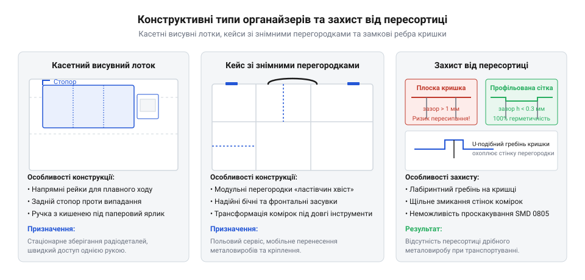

# Органайзер для дрібних деталей

<preknowlist>
- [Набори гвинтів М3 (шестигранник, потайні DIN7991)](root:cat-hw-parts/m3-screw-kits) — стандартні габарити дрібного металевого кріплення для оцінки розмірів комірок
- [Стійки М2/М3 (латунь, нейлон)](root:cat-hw-parts/standoffs) — специфіка зберігання тендітних латунних та нейлонових дистанційних елементів
- [Болти М5/М6 і шайби М3/М4](root:cat-hw-parts/bolts-and-washers) — відмінності габаритів і насипної маси важкого кріплення для розрахунку міцності лотків
</preknowlist>

## Наслідки несистематизованого зберігання деталей

Під час монтажу та ремонту радіоелектронної апаратури щодня доводиться оперувати десятками типів дрібного металевого кріплення, фасонних дистанційних елементів і напівпровідникових компонентів. Зберігання деталей у випадкових коробках або пакетах без жорсткої сегментації призводить до стирання поверхонь і деформації різьби. Тверді загартовані сталеві гвинти зрізають витки м'яких деталей, таких як латунні [стійки М2/М3](root:cat-hw-parts/standoffs), а важкі [болти М5/М6 і шайби М3/М4](root:cat-hw-parts/bolts-and-washers) продавлюють тонкі гільзи під власною вагою.

Іншою прямою загрозою є швидка пересортиця візуально схожих компонентів з різним кроком різьби, на пошук яких майстер втрачає до третини робочого часу. Ще небезпечнішим є хаотичне зберігання мікросхем у діелектричній тарі: тертя корпусів спричиняє трибоелектричний заряд до кількох тисяч вольт. При дотику виникає електростатичний розряд — @@en|ESD@@ (англ. @@en|ESD@@, @@en|Electrostatic Discharge@@), який пробиває ізоляційні затвори польових транзисторів і створює латентні дефекти, що призводять до раптової відмови приладу. Для запобігання цим втратам застосовують спеціалізований @@en|organizer@@ (англ. @@en|organizer@@, від лат. @@la|organizo@@ — упорядковувати), який ізолює кожен номінал у замкненому просторі.

## Конструктивні типи та геометрія комірок

За умовами експлуатації органайзери поділяють на стаціонарні касетні блоки та переносні кейси. Стаціонарні блоки містять висувні пластикові лотки з регульованими перегородками й стопорами від випадання. Переносні кейси захищають деталі під час транспортування завдяки прозорій кришці з полікарбонату та надійним замкам — @@en|latch@@ (англ. @@en|latch@@ — засувка, фіксатор).

*Конструктивні варіанти органайзерів: стаціонарний касетний блок, переносний кейс із притискним профілем кришки та герметизацією зазору комірок.*

Щоб дрібні шайби та гвинти не пересипалися між секціями при перевертанні кейса, внутрішня поверхня кришки має протипересортичні ребра, які щільно прилягають до торців перегородок із зазором менше 0.1 мм. Сучасні органайзери все частіше використовують модульний крок сітки — @@de|Raster@@ (нім. @@de|Raster@@, від лат. @@la|rastrum@@ — граблі, сітка), зокрема відкриту систему Gridfinity з модулем 42 мм, де базові чаші фіксуються за допомогою магнітних гнізд. У ці гнізда встановлюють [неодимові магніти](root:cat-hw-parts/neodymium-magnets), що фіксуються в комірках через [клей ціаноакрилатний](root:cat-hw-parts/cyanoacrylate-glue).

При розрахунку місткості комірок враховують ефект випадкового насипання: хаотично насипані [набори гвинтів М3](root:cat-hw-parts/m3-screw-kits) заповнюють лише частку об'єму через повітряні проміжки між деталями. Повний робочий об'єм комірки розраховують за коефіцієнтом насипної щільності та технологічним запасом:

    V_total = (N · V_part · 1.25) / eta_pack

де `N` — кількість деталей, `V_part` — об'єм однієї деталі, `eta_pack` у межах від 0.55 до 0.65 — коефіцієнт насипної щільності, а множник `1.25` забезпечує 25% запасу за висотою, унеможливлюючи заклинювання кришки. Для легкого виймання дрібниць дно комірки часто виконують із радіусним вигрібним жолобом.

## Антистатичний захист і принципи маркування

Матеріал корпусу органайзера визначає його довговічність і електростатичну безпеку. Стандартні ударостійкі лотки виготовляють із хімічно стійкого поліпропілену або пружного ABS-пластику. Проте для напівпровідників потрібні дисипативні полімери з поверхневим опором від `10⁵` до `10¹¹` Ом/квадрат, модифіковані вуглецевими наноструктурами. Такий матеріал забезпечує плавне стікання статичного заряду за час менше двох секунд без виникнення небезпечних іскрових розрядів.

Для інтеграції в захищену зону робочого місця корпус антистатичного органайзера оснащують металевою кнопковою клемою діаметром 10 мм, до якої приєднують заземлювальний кабель із вбудованим захисним резистором номіналом 1 МОм. Резистор контролює струм витоку й оберігає оператора при випадковому контакті з напругою мережі. За потреби захисту від надлишкової вологи та перепадів тиску у приладові кейси встановлюють [клапани ePTFE](root:cat-hw-parts/eptfe-protective-vents).

Для усунення плутанини впорядкування вмісту підпорядковують координатній сітці: кожен висувний модуль отримує літерно-цифровий індекс (наприклад, `A1`, `B3`) та кольорове кодування за типом деталей. Етикетки друкують на зносостійких плівках із нанесенням штрихкодів або QR-кодів. Це скорочує час комплектації виробів і повністю виключає помилки вибору номіналів кріплення чи радіоелементів під час збирання.