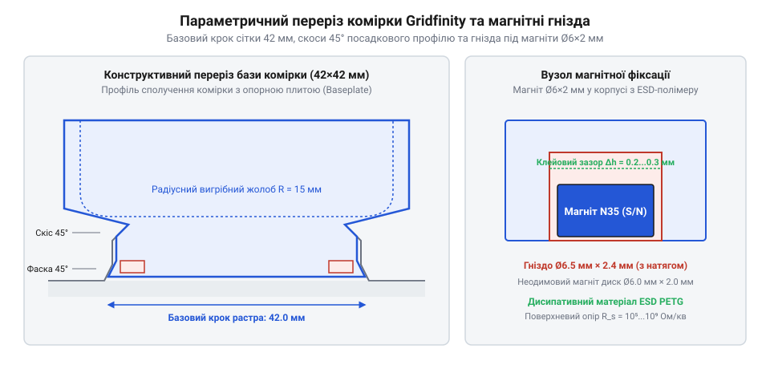

# 3D-друк та адаптація індивідуального модульного органайзера Gridfinity із заземленням ESD-зони

## Геометрія Gridfinity та моделювання комірок

Під час організації робочого місця інженера-електроніка класичні монолітні касетниці або випадкові пластикові коробки швидко виявляють свої конструктивні обмеження. Вони не дозволяють адаптувати внутрішній простір під плати нестандартного формату, специфічний монтажний інструмент чи чутливі SMD-компоненти. Відповіддю спільноти розробників стала відкрита параметрична система зберігання Gridfinity (від англ. *grid* — сітка та *infinity* — нескінченність, @@en|Gridfinity@@). Її ключова ідея полягає в модульній сітці з фіксованим просторовим кроком, що дозволяє вільно комбінувати лотки різного призначення на єдиній базовій платформі.

В основі системи лежить планарний растр із кроком `L_grid = 42.0 мм` по осях X та Y. Щоб модулі вільно встановлювалися в сусідні гнізда базової плити без заклинювання від теплового розширення або виробничих похибок 3D-друку, номінальний зовнішній габарит одиничного модуля виконують дещо меншим: `L_mod = 41.5 мм`. Ця різниця забезпечує гарантований бічний зазор `δ = 0.5 мм` між сусідніми лотками (по `0.25 мм` на кожну сторону). По вертикалі висота органайзера квантується стандартними дискретними одиницями `h_unit = 7.0 мм`, що відповідає висоті кроку `1U`. Повна висота комірки розраховується як добуток кількості одиниць `N` на `7.0 мм` плюс висота верхнього посадкового бортика для штабелювання (від нім. *Stapeln* — складати в стос, @@en|stacking@@).

*Конструктивна геометрія модуля Gridfinity: кути фасок основи, магнітні гнізда та закруглене дно для легкого виймання дрібниць.*

Нижня частина кожної одиничної комірки має характерний двоетапний конічний профіль. Верхній скіс під кутом 45° слугує напрямною для легкого центрування лотка при опусканні в базу, а нижня поличка з кутом нахилу 26° утворює жорстку опорну поверхню, яка запобігає перекосу під навантаженням. Верхній зріз лотка оснащується відповідним зворотним профілем (бортиком штабелювання), що дозволяє встановлювати менші лотки поверх більших у багатоповерхові модульні башти.

Під час параметричного моделювання комірок у CAD-середовищі особливу увагу приділяють ергономіці виймання дрібних деталей:
- Внутрішній фронтальний край лотка проектують із радіусним жолобником (радіус скруглення `R_scoop = 4.0–6.0 мм`). Це дозволяє пальцю легко підчіплювати крихітні резистори типорозміру 0603 чи шайби, ковзаючи по дузі вгору без утикання в прямий кут дна. - Товщину бічних стінок оптимізують під ширину ліній стандартного сопла: значення `t_wall = 1.2 мм` відповідає рівно трьом суцільним периметрам при діаметрі сопла 0.4 мм, що усуває порожнини, прискорює друк і надає стінці високої міцності. - У чотирьох кутах кожної базової ділянки 42×42 мм формують циліндричні посадочні гнізда діаметром `D_pocket = 6.5 мм` та глибиною `h_pocket = 2.4 мм` під дискові [неодимові магніти](root:cat-hw-parts/neodymium-magnets) типорозміру 6×2 мм. Ці отвори проектують із невеликим піднутренням або клейовим зазором, що фіксує модуль на базовій плиті з приємним зусиллям замикання.

## 3D-друк струморозсіювальними пластиками ESD

Звичайні полімери для 3D-друку, такі як стандартний PLA чи PETG, є високоефективними діелектриками з питомим поверхневим опором понад `10¹² Ом/кв`. Під час тертя пластикових лотків об інструмент або руки оператора внаслідок трибоелектричного ефекту накопичується електростатичний заряд потенціалом до 5000–10000 В. Для чутливих напівпровідникових структур польових транзисторів (MOSFET), радіочастотних трактів та мікроконтролерів прямий контакт із такою поверхнею призводить до незворотного пробою затворів (англ. *Electrostatic Discharge*, @@en|ESD@@).

Щоб зробити органайзер безпечним для робочих зон EPA (англ. *Electrostatic Protected Area*, @@en|EPA@@), модулі друкують струморозсіювальними (дисипативними) філаментами. Це термопластичні матриці (найчастіше модифікований PETG або PLA), наповнені провідними вуглецевими нанотрубками (англ. *carbon nanotubes*, @@en|carbon nanotubes@@) або структурованою електропровідною сажею (англ. *carbon black*). За стандартом IEC 61340-5-1 поверхневий опір антистатичного матеріалу для пакування та зберігання компонентів повинен знаходитися в строго регламентованому діапазоні:

    10⁵ ≤ R_surface ≤ 10⁹ Ом/кв

Цей коридор опору обрано з двох фізичних причин: матеріал не повинен бути ізолятором (бо заряд не стектиме), але не повинен бути й надто провідним металом (якщо `R < 10⁴ Ом`, заряд стече за частки наносекунди, що спричинить піковий струмовий імпульс і розплавить мікрокристал).

Результуючі електричні властивості надрукованої деталі критично залежать від параметрів технологічного процесу 3D-друку:
1. **Температура екструзії.** На відміну від чистого пластику, вуглецевий наповнювач збільшує вʼязкість розплаву. Друк ESD PETG виконують за підвищеної температури сопла `T_nozzle = 245–255 °C`. Це забезпечує ідеальне спікання сусідніх шарів, дозволяючи вуглецевим нанотрубкам переплітатися через межу шару й утворювати суцільну перколяційну провідну сітку. Зниження температури призводить до різкого стрибка міжшарового опору в сотні разів. 2. **Анізотропія провідності.** Через пошарове наплавлення провідність уздовж траєкторії друку (в площині XY) завжди вища, ніж по осі Z. Опір між сусідніми шарами може бути в 5–10 разів вищим. Щоб гарантувати стікання заряду з будь-якої точки лотка на дно, друк виконують із суцільним заповненням периметрів стінок або прямолінійним заповненням щільністю не менше 30%. 3. **Монтаж магнітів.** Неодимові магніти фіксують у гніздах після завершення друку. Спроби закладати магніти всередину тіла деталі під час паузи друку несуть ризик: нагрівальний стіл принтера, що працює при 70–80 °C, разом із гарячим екструдером може нагріти сплав NdFeB вище робочої температури (стандартні марки N35–N52 втрачають коерцитивну силу вже при 80 °C). Магніти 6×2 мм запресовують вручну в охолоджену деталь, застосовуючи швидкодіючий [ціаноакрилатний клей](root:cat-hw-parts/cyanoacrylate-glue) середньої вʼязкості.

## Заземлення блоку та верифікація опору

Навіть якщо кожен модуль Gridfinity виготовлено зі струморозсіювального пластику, він не захистить мікроелектроніку, якщо заряд не має шляху стікання в землю. Утворюваний масив лотків потребує створення єдиного провідного каркаса та підключення до центральної шини заземлення робочого місця.

Конструкція системи заземлення складається з таких ланок:
- **Міжмодульні провідні мости.** На дні комірок або базової сітки монтують самоклейну мідну фольгу або закладають латунний дріт діаметром 0.8–1.0 мм, що проходить через спеціальні пази в базі. Встановлені в гнізда нікельовані магніти також формують надійний низькоомний контакт між лотком і базовою решіткою. - **Вузол підключення до контуру EPA.** До опорної бази органайзера кріпиться пелюсткова клема заземлення (англ. *grounding point*, @@en|grounding terminal@@). Для її надійного механічного фіксування використовують різьбові [стійки М2/М3](root:cat-hw-parts/standoffs) або [набори гвинтів М3 з потайною головкою DIN7991](root:cat-hw-parts/m3-screw-kits), затиснуті через контактні зубчасті шайби [з асортименту болтів та шайб М3](root:cat-hw-parts/bolts-and-washers). - **Захисний резистор безпеки.** Згідно з нормативами електробезпеки та стандартом IEC 61340-5-1, провід заземлення органайзера ніколи не підключають до захисного нуля мережі безпосередньо. У розрив лінії заземлення обовʼязково інтегрують захисний резистор номіналом:

    R_safety = 1.0 МОм ± 10% (1 Вт)

Цей резистор виконує дві функції: він захищає оператора від смертельного ураження струмом у разі випадкового торкання фазної напруги рукою, що спирається на стіл, та обмежує швидкість релаксації заряду, запобігаючи виникненню мікроіскор.

Після складання вузла виконують обовʼязкову метрологічну верифікацію опору заземлення. Вимірювання звичайним побутовим мультиметром неможливе, оскільки його внутрішня батарея 9 В не здатна подолати контактні потенціали нанотрубок. Використовують спеціалізований тераомметр (вимірювач поверхневого опору) з випробувальною напругою 10 В для низьких опорів та 100 В для опорів вище 1 МОм.

Вимірювання проводять двома стандартними важкими електродами масою по 2.5 кг із провідною гумовою основою:
1. Вимірюють опір «точка-точка» (`R_p-p`) між найвіддаленішими кутами лотка. Значення повинно укладатися в діапазон `10⁶ – 10⁹ Ом`. 2. Вимірюють опір до точки заземлення (`R_g`) від довільної внутрішньої поверхні комірки до вихідної клеми. За наявності захисного резистора виміряне значення повинно складати `1.1 – 2.0 МОм`. 3. Контролюють час стікання заряду (англ. *charge decay time*): статичний заряд потенціалом 1000 В, наведений на модуль, повинен розсіюватися до рівня нижче 100 В за час `t_decay < 2.0 с`. Якщо показники відповідають цим нормам, модульний органайзер Gridfinity гарантує повну безпеку компонентів від деградації кристалів під час монтажних робіт.